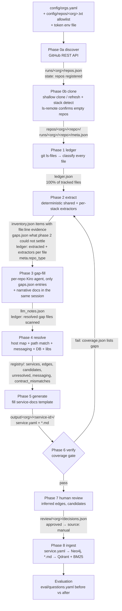
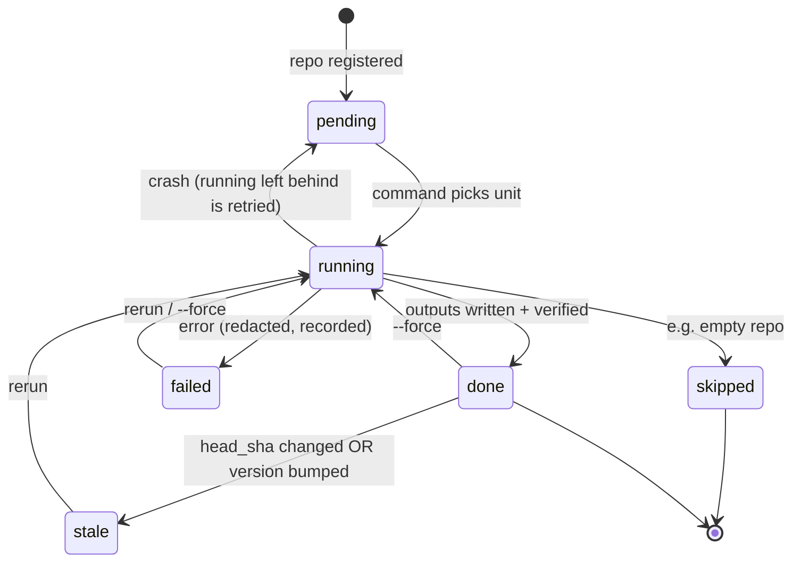

# repo_docs pipeline — phases 0–8 + evaluation

Goal: turn every repository of every configured GitHub org into a **standardized service doc set**
(`templates/service-docs/` → [`../../templates/service-docs/README.md`](../../templates/service-docs/README.md))
so SmartBrain's RAG + Neo4j graph can answer, with evidence:

- which service depends on which (and what depends on X)
- how data flows end-to-end (booking → payment → confirmation)
- what breaks if X goes down (inbound edges + `criticality`)
- which services touch table / topic / env var Y

**Completeness is the top priority.** No API, outbound call, dependency, event, data store or env var
may be missed. That is why the pipeline is built as a ledger of *every tracked file* that later phases
must consume and tick off, and why a coverage gate (phase 6) blocks publication.

Paths below are relative to `repo_docs/` (this subsystem root,
`/Users/Rithik.Kumar/code/SmartBrain/tvsm-ai-platform/smartbrain-v2/repo_docs`). Layout: see
[`../README.md`](../README.md#layout). Schemas: [`SCHEMAS.md`](SCHEMAS.md). Resume protocol:
[`../RUNBOOK.md`](../RUNBOOK.md).

| # | Phase | State key | Command | Status |
|---|---|---|---|---|
| 0 | Discover + Clone | `clone` (discovery is org-level) | `discover`, `clone` | implemented |
| 1 | File Ledger | `ledger` | `ledger` | implemented |
| 2 | Deterministic Extraction | `extract` | `extract` | implemented |
| 3 | Targeted gap-fill (per-repo Kiro agent, Option B) | `llm_scan` | `llm-scan` | planned |
| 4 | Cross-repo Resolution | `resolve` | `resolve` | implemented |
| 5 | Doc Generation | `generate` | `generate` | planned |
| 6 | Coverage Gate | `verify` | `verify` | planned |
| 7 | Human Review | `review` | (manual; `review` file) | planned |
| 8 | Ingestion into SmartBrain | `ingest` | `ingest` | planned |
| – | Evaluation (before/after bench) | – (org-level results files) | `eval` | planned |

All commands: `.venv/bin/python -m repo_docs <command> [--org ORG] [--repo NAME ...] [--force] [--workers N]`
run from `repo_docs/`. `--org` defaults to all `enabled` orgs in `config/orgs.yaml`. Cross-cutting:
`status [--json]` (effective statuses + next suggested command) and `selfcheck` (token-leak scan of
`repo_docs/` excluding `.venv`, plus every clone's `.git/config`; prints counts/paths only, exit 1 on any hit).
Exit codes: 0 ok, 1 some unit failed / allowlist name missing / token or API error, 2 usage error
(unknown org, `--repo` not registered) or planned command. Planned commands
print `"<cmd>: planned (Phase N) — see docs/PIPELINE.md"` to stderr, exit 2, and never touch state.

## Decisions

Agreed with the user; every phase must respect them.

| # | Decision | Consequence |
|---|---|---|
| D1 | **Default branch only.** | Phase 0 clones `default_branch` (`--depth 1`); other branches/tags are never read or documented. |
| D2 | **No APIM / gateway routing configs exist** (none available). | Phase 4 resolves targets from config/env values, k8s/helm service + ingress names and inbound-route path matching only; there is no gateway mapping input. |
| D3 | **Phase 3 is a targeted gap-fill (Option B)**, superseding the earlier "LLM reads every file" design. | A per-repo Kiro agent investigates only what phase 2 lists in `gaps.json` (grep/read across files), adds evidence-backed `source: inferred` items to `llm_notes.json` and, in the same session, writes the narrative half of the phase-5 docs. Repos with an empty gap list skip the investigation. Files phase 2 marked `extracted` are not revisited. |
| D4 | **Frontends are callers.** | Phase 2 extracts `frontend_api_call` items from portals/UIs; phase 4 turns them into `http` edges with `caller_type: frontend` and fills the callee's `inbound[].callers`. |
| D5 | **Service Bus is first-class.** | Publishers/consumers, entity names via config (key + per-env value), subscriptions, filters, message types, DLQ/retry are extracted and linked across repos. |
| D6 | **Request/response contracts are documented.** | Inbound params/request/responses and every referenced DTO become `schemas`; caller↔callee DTO diffs are reported by phase 4. |
| D7 | **Evidence or nothing.** | Every item (code, contract or LLM) cites `file:line:snippet` that is verified against the clone. |

## Phase flow



## Per-repo, per-phase state machine

Stored statuses: `pending | running | done | failed | skipped`. `stale` is **derived** on read
(never stored): a `done` phase becomes `stale` when the repo's current `head_sha` differs from the
phase's recorded `input_sha`, or when the phase's recorded `version` differs from the code's
current phase/extractor version (for `extract`: the composite of `PHASE_VERSION`, every applicable
`extractor_version` and the external-systems registry hash; also stale when `ledger.json` was regenerated
after the extract). Phase commands treat `stale`, `failed`, `pending` and leftover
`running` (crash) as "needs work".



Units: phases 0–3, 5–6 and 8 operate per **repo** (phase 3: one agent session per repo);
phase 4 operates per **org** (and globally for cross-org edges); phase 7 per **edge**; evaluation per run. Every unit checkpoints to `state/state.json` immediately when it
finishes, so killing a command at any moment loses at most the in-flight units.

---

## Phase 0 — Discover + Clone

**Status: implemented** (`PHASE_VERSION = "0.1.0"` in `repo_docs/phase0_discover_clone.py`).

### Purpose
Know exactly which repos exist, register the ones in scope, and keep an up-to-date shallow working copy
of each default branch, plus a first stack/subproject map that phase 2 uses to pick extractors.

### Inputs
- `config/orgs.yaml` (org name, token file + key, include/exclude, `allowlist`, `service_id_overrides`,
  `self_repos`, workers/retries).
- `config/repos/<org>.txt` allowlist (optional; when set, ONLY these repos are registered).
- Token from the org's `token_env_file` / `token_key` (loaded at runtime, never persisted).
- GitHub REST API `GET /orgs/{org}/repos?type=all&per_page=100&page=N`.

### Outputs
- `runs/<org>/repos.json` — full API snapshot of the org (all repos, each with `allowlisted`, `service_id`)
  → [SCHEMAS.md#runsorgreposjson](SCHEMAS.md#runsorgreposjson).
- `state/state.json` — `orgs.<org>` block (`discovered_at`, `api_repo_count`, `repo_count`,
  `allowlist_missing`) and one entry per registered repo (`service_id`, `default_branch`, `language`,
  `empty`, `self`, `head_sha`, `stacks`, `phases.clone`) → [SCHEMAS.md#statestatejson](SCHEMAS.md#statestatejson).
- `repos/<org>/<repo>/` — shallow clone (`--depth 1`, default branch). **gitignored.**
- `runs/<org>/<repo>/meta.json` — repo metadata + detected stacks/subprojects
  → [SCHEMAS.md#runsorgrepometajson](SCHEMAS.md#runsorgrepometajson).
- `logs/<org>/<command>-<UTCts>.log` (gitignored, token-redacted).

### Command
```bash
.venv/bin/python -m repo_docs discover --org TVS-CS
.venv/bin/python -m repo_docs clone    --org TVS-CS [--repo NAME ...] [--force] [--workers 5]
```

### What it does
1. **discover**: paginate the API (`per_page=100`, until a short page / no `Link: rel="next"`),
   normalise each repo (`name, full_name, default_branch, language, size_kb, archived, empty (size==0),
   pushed_at, html_url`), mark `self: true` for names in `self_repos`, write `repos.json`.
   Register in state only repos that pass `allowlist` ∩ `include` − `exclude` (and `include_archived`).
   Assign `service_id` per [SCHEMAS.md#service_id-rules](SCHEMAS.md#service_id-rules) (collisions get
   a hash suffix and `service_id_collision: true`, logged as WARNING). Repos with API `size == 0` are
   flagged `empty: true` and may be pre-recorded as `phases.clone = skipped (skip_reason "empty")`, but
   this is only a hint (GitHub computes `size` lazily) and is always re-checked by `clone`. Allowlisted
   names not found on GitHub (exact, case-sensitive) → ERROR per name, `allowlist_missing`, exit 1
   (found ones still registered).
2. **clone** (parallel, `workers` threads; each repo independent):
   - `git ls-remote --heads <url>` → SHA of `refs/heads/<default_branch>`; this runs for **every**
     non-`done` repo, including those flagged empty by the API. No refs at all → `skipped(empty)`;
     refs present on a repo flagged empty → flag cleared (`empty: false`, logged as WARNING) and the repo
     is cloned normally; default branch missing → failed.
   - If clone status is `done` at the current `PHASE_VERSION`, recorded `head_sha` == remote SHA, the clone
     dir HEAD matches and `meta.json` exists → outcome `unchanged` (no git fetch/clone).
   - Missing clone → `git clone --depth 1 --single-branch --branch <b>` into `repos/<org>/<repo>.partial/`
     then atomic rename to `repos/<org>/<repo>/` (a crash never leaves a half clone at the final path).
   - Existing clone → `git fetch --depth 1 origin <b>`, `git reset --hard FETCH_HEAD`, `git clean -fdx`
     (scoped to that clone dir only). If the refresh fails after retries, it falls back to a fresh clone.
   - Record `head_sha`; `assert_no_credentials` (no `extraheader` in `.git/config`, remote URL has no `@`);
     run stack detection over `git ls-files`; write `meta.json`; set `clone = done`
     (`output_sha = head_sha`, `version`, timestamps, `attempts`).
   - Retries: up to `max_retries` with exponential backoff (2, 4, 8, 16 s + jitter).
   - Per-repo outcome printed in the command's JSON summary:
     `cloned | refreshed | unchanged | skipped | failed`.

**Auth / secrets:** the token is given to git only through env-scoped config
(`GIT_CONFIG_COUNT=2`, `GIT_CONFIG_KEY_0=http.https://github.com/.extraheader`,
`GIT_CONFIG_VALUE_0=AUTHORIZATION: basic base64(x-access-token:<token>)`,
`GIT_CONFIG_KEY_1=credential.helper` / `GIT_CONFIG_VALUE_1=` (empty resets the helper list so ambient
keychain/GCM/store helpers never run), plus `GIT_TERMINAL_PROMPT=0`,
`GIT_ASKPASS=/usr/bin/false`). Remote URL stays `https://github.com/<org>/<repo>.git`. The token never
appears in argv, `.git/config`, state, runs, or logs; all git stderr and log records pass through `redact()`.

**Stack detection** (`repo_docs/stack_detect.py`, monorepo-aware; vendor/build dirs ignored):
`*.csproj|*.fsproj|*.vbproj` (else `*.sln`) → `dotnet`; `pom.xml|build.gradle(.kts)` → `java`,
+`AndroidManifest.xml` under it or `com.android` in gradle → `android`; `package.json` → `node`, plus from
deps `@angular/core`/`angular.json` → `angular`, `next` → `nextjs`, `react` → `react`,
`react-native` → `react-native`, `@nestjs/core` → `nest`, `express` → `express`, `vue`/`nuxt` → `vue`;
`pubspec.yaml` → `dart` (+`flutter`); `*.xcodeproj`/`*.xcworkspace`/`Podfile`/`Package.swift` → `ios`;
`requirements*.txt|pyproject.toml|setup.py|Pipfile` → `python`; `composer.json` → `php`.
Each hit records `subproject` (directory) and `evidence` files.

### Checkpoint / Resume
Per repo. Re-running `discover` refreshes metadata without resetting phase records. Re-running `clone`
skips repos `done` at the same remote SHA; `failed`, `pending` and crash-leftover `running` repos are
retried. A changed remote SHA triggers refresh, which makes every later phase `stale` for that repo.
`--force` re-fetches all non-skipped repos.

### Definition of Done
`discover`: `repos.json` count == API total; every allowlisted name registered; `allowlist_missing == []`.
`clone` per repo: clone dir HEAD == recorded `head_sha` == remote SHA; `meta.json` exists with `stacks`;
no credentials in `.git/config`. Org-level: every registered repo is `clone: done` or `skipped`.

### Failure Handling
Per-repo failures are recorded (`status: failed`, redacted `error`, `attempts`) and are **not fatal**;
the command finishes the rest and exits 1 if any failed. 401/403/404 from the API are not retried
(token/scope problem; see RUNBOOK troubleshooting). 429/5xx/network errors are retried honouring
`Retry-After` / `X-RateLimit-Reset`.

---

## Phase 1 — File Ledger

**Status: implemented** (`PHASE_VERSION = "0.1.0"` in `repo_docs/phase1_ledger.py`).

### Purpose
Create the authoritative list of **every tracked file** in the repo, classified, so that later phases
cannot silently miss anything: each file is either `pending` (phase 2 marks the files it fully parsed
`extracted` and lists the rest in `gaps.json`; phase 3 resolves those gap files and marks them
`scanned`) or explicitly
`skipped:<reason>`. Lifecycle: [SCHEMAS.md#file-status-lifecycle](SCHEMAS.md#file-status-lifecycle).

### Inputs
`repos/<org>/<repo>/` (clone `done`), `git ls-files -s -z`, `max_file_bytes` from config.

### Outputs
- `runs/<org>/<repo>/ledger.json` → [SCHEMAS.md#runsorgrepoledgerjson](SCHEMAS.md#runsorgrepoledgerjson)
- `meta.json` gains a `ledger` block (counts by class/status, `git_ls_files_count`, `ledger_count`,
  `self_check`, `secret_risk_files`).
- `state.json` `phases.ledger` (`input_sha = head_sha`, `counts`).

### Command
```bash
.venv/bin/python -m repo_docs ledger --org TVS-CS [--repo NAME ...] [--force] [--workers 5]
```

### What it does
For each `git ls-files` entry: stat size, read the first 8 KB, classify (first matching rule wins):

| Class | Status | Examples |
|---|---|---|
| `submodule` / `symlink` | `skipped:*` | gitlink mode 160000 / 120000 |
| `vendor` | `skipped:vendor` | `node_modules/`, `vendor/`, `Pods/`, `bower_components/`, NuGet `packages/<Id>.<ver>/`, `wwwroot/lib/` |
| `generated` | `skipped:generated` | `obj/`, `dist/`, `build/`, `target/`, `.next/`, `bin/Debug|Release/`, `*.g.cs`, `*.Designer.cs`, `*ModelSnapshot.cs`, `*_pb2.py` |
| `lockfile` | `skipped:lockfile` | `package-lock.json`, `yarn.lock`, `packages.lock.json`, `pubspec.lock`, … |
| `minified` | `skipped:minified` | `*.min.js`, `*.min.css`, `*.map` |
| `binary` | `skipped:binary` | binary extension or NUL byte in first 8 KB |
| `asset` | `skipped:asset` | `*.svg`, non-code files under `assets/ static/ public/ wwwroot/ images/ fonts/` |
| `large` | `skipped:large` | size > `max_file_bytes` (default 1 000 000) |
| `api_contract` | `pending` | `openapi*`, `swagger*`, `*.proto`, `*.graphql`, `*.wsdl`, `*.postman_collection.json`, `*.raml`, `asyncapi*`, `*.http` |
| `infra` | `pending` | `Dockerfile*`, `docker-compose*`, `*.tf`, `*.bicep`, `azure-pipelines*.yml`, `.github/workflows/*`, `Jenkinsfile`, helm/k8s dirs, any yaml with `apiVersion:`+`kind:`, `nginx*.conf` |
| `build_manifest` | `pending` | `*.csproj`, `*.sln`, `pom.xml`, `build.gradle*`, `package.json`, `pubspec.yaml`, `requirements*.txt`, `composer.json`, `angular.json`, `tsconfig*.json`, … |
| `test` | `pending` | `test/ tests/ __tests__/ spec/ src/test/`, `*.spec.*`, `*.test.*`, `*Tests.cs`, `*Test.java` |
| `docs` | `pending` | `*.md *.rst *.adoc *.txt`, README/CHANGELOG/LICENSE |
| `config` | `pending` | `appsettings*.json`, `web.config`, `*.properties`, `application*.yml`, `.env*`, `environment*.ts`, other json/yaml/xml |
| `source` | `pending` | by extension (cs, java, kt, ts, js, py, dart, swift, php, sql, html, cshtml, …) |
| `other` | `pending` | anything else (reported to phase 3 through `gaps.json` when no extractor settles it) |

Notes: EF `Migrations/*.Designer.cs` and `*ModelSnapshot.cs` are `generated` (the migration `.cs` files
themselves stay `source`, so schema facts are still covered). A top-level `packages/` dir is only vendor when
it is a NuGet restore folder (`packages/<Id>.<version>/`); monorepo `packages/*` stay in scope. `bin/` is
generated only as `bin/Debug|Release|x64|x86/` (node `bin/www` stays in scope).

`lines` is counted for non-skipped files. Tracked `.env`-style files are listed in
`meta.ledger.secret_risk_files` (paths only; values are never read into outputs).

Repos whose clone is `skipped` (empty) get `ledger: skipped` with the same `skip_reason`; if such a repo
later gains commits and is cloned, the next `ledger` run builds it.

The ledger also refuses to run (phase `failed`) if the clone dir HEAD differs from `state.head_sha`
(re-run `clone` first).

Per-repo outcome in the JSON summary: `done | fresh | skipped | no-clone | failed`.

### Checkpoint / Resume
Per repo. Skips repos whose ledger is `done` and fresh (`input_sha == head_sha`, same version) →
`fresh`; rebuilds `stale`, `failed`, `pending`, `running`. `--force` rebuilds all cloned repos
(`--repo NAME --force` for one).

### Definition of Done
**Self-check:** `len(ledger.files) == len(git ls-files)` **and** the path sets are identical →
`meta.ledger.self_check = "pass"`; otherwise the phase is `failed`. Sums of `by_class` and `by_status`
equal the total. Ledger written atomically.

### Failure Handling
A file that disappears between `ls-files` and `stat` is kept in the ledger as class `other`,
status `failed:missing` (counted, so the self-check still accounts for it; phase 6 treats it as a gap).
Any exception → repo `ledger: failed`; the error string `f"{type(e).__name__}: {e}"` is passed through
`secrets.redact(…, SecretFilter.secrets())` **before** it is stored in `state.json` and before it is
logged (same as phase 0). Other repos continue; exit 1 if any failed.

---

## Phase 2 — Deterministic Extraction

**Status: implemented** (`PHASE_VERSION = "0.1.2"` in `repo_docs/phase2_extract.py`, `GAPS_VERSION = "0.1.1"` in `repo_docs/gaps.py`; extractors in
`repo_docs/extractors/`, each with its own `extractor_version`). Contract, extractor ids and the
per-kind rules: [EXTRACTORS.md](EXTRACTORS.md). Item schema and template mapping:
[SCHEMAS.md#runsorgrepoinventoryjson](SCHEMAS.md#runsorgrepoinventoryjson).

### Purpose
Find, with exact `file:line` evidence and no LLM, everything `service.yaml` and `API_SPEC.md` need, as
inventory items that map 1:1 onto template fields:

| kind | template target |
|---|---|
| `inbound_http` | `inbound[]` — method, fully combined route (class + method, `~/` and absolute overrides, context-path/servlet path, Nest `setGlobalPrefix`, `[Route("api/[controller]")]` token replacement), params path/query/header/body with types, request DTO, responses with status codes, auth |
| `schema` | `schemas.<Name>` — fields name/type/required/validation, nested types by reference, enums with values, `defined_in` file:line, generics/wrappers resolved |
| `outbound_http` | `outbound[]` — client, method, path template, base URL source `literal \| config:<key> \| env:<VAR>`, request/response types (one wrapper level followed) |
| `frontend_api_call` | callers of other services' `inbound[]` (portals/UIs, D4) |
| `messaging` | `events.publishes[]` / `events.subscribes[]` — every field incl. entity name key + per-env resolved values, subscription, filter, message types, session/correlation ids, DLQ/retry (D5) |
| `data_access` | `data_stores[]` — store type, host/db name only, tables/collections, read/write, stored procedures, owned schema |
| `config_key` | `config[]` — every key read or defined; non-secret URL/host/path/entity/db-name values per env, secrets name-only |
| `scheduled_job` | `inbound[]` with `kind: scheduled` |
| `external_system` | `outbound[].target: external:<name>` via `registry/external_systems.yaml` |
| `dependency` / `artifact` | `tech_stack.key_libraries`, internal `library_dependency` edges |
| `infra` | `deployment`, phase-4 host → service index |
| `api_contract` | `API_SPEC.md` `openapi:` + contract-sourced `inbound`/`schemas` |
| `meta.repo_type` | `type` (`service \| frontend \| library \| test-suite \| db-migration \| function-app \| scheduler \| mobile \| unknown`) |

### Inputs
`meta.json` (`stacks[]` with subprojects), `ledger.json` (all non-skipped files), the clone at
`state.head_sha`, `registry/external_systems.yaml`, `config/orgs.yaml` (`internal_package_patterns`).

### Outputs
- `runs/<org>/<repo>/inventory.json` (deterministic, byte-identical for the same input).
- `runs/<org>/<repo>/gaps.json` → [SCHEMAS.md#runsorgrepogapsjson](SCHEMAS.md#runsorgrepogapsjson):
  the phase-3 work list (deterministic, sorted, built by `repo_docs/gaps.py` from the same in-memory
  results). Gap types: `unresolved_base_url`, `unresolved_entity`, `missing_payload`, `missing_schema`,
  `partial_parse`, `silent_client_file`, `untouched_source`, `untouched_file` (any other
  pending file: test, config, docs, …), `unknown_repo_type`; `summary.by_type` counts. Every `pending`
  ledger path is listed (no cap).
- `ledger.json`: for every file an applicable extractor opened, an `extractors[]` entry
  `{id, version, parse: full|partial, items, error?}`; status recomputed — a file is **`extracted`**
  when any extractor fully parsed it (a clean tree with every construct resolved, including a file with
  no construct of interest), otherwise it stays **`pending`** and appears in `gaps.json`
  (`partial_parse`, `untouched_source` or `untouched_file`). Phase 3 only revisits gap files.
- `meta.json` gains `repo_type` and `extract` blocks (`extract.gaps` = total gap count).
- `state.phases.extract`: `version` (composite), `extractor_versions`, `registry_hash`, `input_sha =
  head_sha`, `ledger_generated_at`, `counts`, `missing_extractors`, `gaps` (count per gap type).

### Command
`.venv/bin/python -m repo_docs extract --org TVS-CS [--repo NAME ...] [--force] [--workers 5]`

### What it does
1. Refuse (phase `failed`) unless `ledger: done` and fresh, and the clone HEAD equals `state.head_sha`.
2. For each `(stack, subproject)` in `meta.stacks` plus the shared extractors, run every applicable
   extractor in the fixed order (EXTRACTORS.md#extractor-ids) over the subproject's non-skipped files in
   ledger path order. Stacks whose extractor is a planned stub → `missing_extractors`.
3. Merge items by `id` (EXTRACTORS rule 6: code beats contract, runtime beats `tests_target`, other
   scalar conflicts keep both values), validate each (kind schema, ≥1 evidence, file ledgered +
   non-skipped, line in range, snippet is a substring of the redacted line, no classifier secret hit, no
   token form).
4. Classify `repo_type`, match external systems, sort.
5. Recompute ledger statuses, re-check that the ledger path set is unchanged, build `gaps.json`; write
   `inventory.json`, `gaps.json` and `ledger.json` atomically; merge `meta.json`; set `extract: done`.

Per-repo outcome in the JSON summary: `done | fresh | skipped | no-ledger | failed`.

### Versioning and staleness
`PHASE_VERSION` (orchestrator) and each `extractor_version` are bumped on any change to output.
`extract` becomes `stale` when the repo `head_sha` changes, when the composite version changes (an
applicable extractor, `PHASE_VERSION` or `gaps.GAPS_VERSION` bumped, or the external-systems registry
edited), when `ledger.json` was regenerated after the extract, or when `gaps.json` is missing. Re-running
a stale repo rewrites `inventory.json`, `gaps.json` and every ledger `extractors[]` entry from scratch (no merge with old output; phase-3 `llm` records are kept
and statuses recomputed), which together with deterministic extraction gives the same bytes for the
same input.

### Checkpoint / Resume
Per repo; inventory, gaps and ledger are each written atomically at the end of the repo, so a crash leaves
the previous complete output (or none) and the repo `running` → retried. `fresh` repos are skipped
unless `--force`.

### Definition of Done
Every detected `(stack, subproject)` ran its extractor (or is listed in `missing_extractors`); every item
passed validation; inventory, gaps, ledger and meta written; every `build_manifest` and `api_contract` file
that parsed without error is `extracted`; `selfcheck` finds no token.

### Failure Handling
A file that fails to parse → `inventory.errors[]` (level `file`) + ledger `extractors[].error`, file stays
`pending`, repo still `done`. An extractor exception or a validation failure → repo `extract: failed`
with a redacted error, previous outputs untouched, other repos continue; exit 1 if any failed.

---

## Phase 3 — Targeted gap-fill (Option B)

**Status: planned.** State key `llm_scan` / command `llm-scan` are kept from the earlier design.

### Purpose
Close what deterministic extraction left open, with evidence, without re-reading the whole repo: a
per-repo Kiro agent works through `gaps.json` only (wrappers deeper than the extractor's limit (one level; java.spring three hops), URLs/topic names
built at runtime, unknown payload types, missing request/response schemas, files using a client library
that yielded no item, parse failures, untouched source files, an `unknown` repo type). It investigates
each gap with grep/read across the clone, then, in the same session, writes the narrative facts the
template needs (business `purpose` of endpoints/consumers/modules, consumer `action`, `flow_step` hints,
`soft` criticality from fallbacks) as the narrative half of phase 5. It only **adds** `source: inferred`
items; it never edits or removes phase-2 items. Repos whose `gaps.json` has `summary.total == 0` skip the
investigation and go straight to the narrative docs.

### Inputs
- `runs/<org>/<repo>/gaps.json` (the work list), `inventory.json` (what is already known),
  `ledger.json` (`extractors[]` per file), `meta.json`, the clone.
- The template field list (read-only) and the item schemas of [SCHEMAS.md](SCHEMAS.md#item-kinds-and-attributes).

### Outputs
- `runs/<org>/<repo>/llm_notes.json` → [SCHEMAS.md#runsorgrepollm_notesjson-planned](SCHEMAS.md#runsorgrepollm_notesjson-planned):
  items with `source: "inferred"`, `extractor: {id: "kiro-agent", version: <prompt_version>}`, each
  citing `file:line:snippet`, plus `resolved_gaps[]` (gap key → item ids or a `not_applicable` reason).
  **Only evidence-backed items are accepted**: they are validated with the same
  `inventory_schema.validate_item` as phase 2 (line re-read, redacted, snippet must be a substring; no
  secret values); invalid items are rejected and listed under `rejected[]`.
- Ledger: gap files the agent resolved get an `llm` record (`content_sha1`) → status `scanned`
  (recomputed by phase 2 on the next extract while the content is unchanged).
- Narrative markdown for phase 5 (same session); deterministic `service.yaml` generation stays scripted.
- `state.phases.llm_scan` (`version` = prompt version, `counts` per gap type resolved / open).

### Command
`.venv/bin/python -m repo_docs llm-scan --org TVS-CS [--repo NAME ...] [--force]` (planned: prepares
the per-repo agent brief from `gaps.json` and validates/merges `llm_notes.json` afterwards).

### Checkpoint / Resume
Per repo. Stale on `head_sha` change, prompt-version change, or a newer `extract` (gaps may have
changed); a stale repo's `llm_notes.json` is re-validated against the new inventory, and only gaps not
yet resolved are handed to the agent again.

### Definition of Done
Every `gaps.json` entry is resolved (an accepted item or a recorded `not_applicable` reason); every
accepted item has verified evidence; every gap file is `scanned`; no secret values; `selfcheck` passes.

### Failure Handling
An agent session that ends early leaves `llm_notes.json` with the gaps resolved so far; the next run
continues with the open ones. Items failing validation are rejected, not merged. Open gaps fail the
coverage gate (phase 6, check 1) for that repo.

---

## Phase 4 — Cross-repo Resolution

**Status: implemented** (`repo_docs/phase4_resolve.py`, tests `tests/test_resolve.py`).

### Purpose
Turn per-repo facts into a service graph **without APIM/gateway configs** (D2): map every outbound and
frontend call, topic, table and library to a `service_id` or `external:<name>`; fill each service's
inbound `callers` and events `consumers`/`producers`; report what could not be matched.

### Inputs
All `inventory.json` + `llm_notes.json` of the org (and of other orgs for cross-org edges),
`meta.json` (`service_id`, `repo_type`), `registry/external_systems.yaml`, optional manual
`config/registry_overrides.yaml` (`host → service_id [+ path_prefix]`, alias names), phase-7 decisions.

### Resolution steps
**(a) Host mapping.** Build a host index per env: k8s/helm `Service` names (`<name>`,
`<name>.<ns>`, `<name>.<ns>.svc.cluster.local`) → the repo whose deployment/image/pipeline defines them;
ingress `hosts` + `paths` → backend service (longest path-prefix wins); compose service names; App
Service / Function App names from pipelines (`<app>.azurewebsites.net`); each service's own
`deployment` base URLs from config; manual overrides. Every outbound/frontend base URL value (per env,
from `base_url_values`) is reduced to host + path prefix and looked up. A host shared by many services
(gateway-like, no ingress detail) does not decide alone; it falls through to (b).

**(b) Path matching.** Normalize both sides: lowercase for comparison, collapse `//`, strip trailing `/`,
strip query string and fragment, every parameter form (`{id}`, `{id:int}`, `:id`, `${x}`, `[id]`,
`<id>`, `*`) → `{}`; inbound paths already include context-path / global prefix; outbound path = base
URL path prefix + call path. Match the call against **all** inbound routes of the org (method must match;
unknown method = wildcard): segment-wise equality with `{}` matching any segment; if the base path is
unknown, suffix match is allowed. Result: **unique** match → edge (`high` when the host also mapped to
that service or the full path matched exactly; `medium` for path-only or suffix matches); **multiple**
→ `registry/candidates.json` for review (phase 7), no edge; **none** → `registry/unresolved.json`
(third-party hosts → `registry/external_candidates.json`). Test-suite repos' calls become `tests` edges,
never runtime callers.

**(c) Messaging.** Key each entity by `(broker, namespace?, entity_type, resolved name)` using every
env's resolved value; topic publishers ↔ topic subscriptions, queue senders ↔ queue receivers. Namespace
known on both sides must agree; unknown on either side → match by name with `medium`. Write
`registry/messaging.json` with flags `no_subscribers` (published, nobody consumes), `no_publishers`
(consumed, nobody publishes), `message_type_unmatched` (consumer filter/types no producer emits).

**(d) Shared-DB coupling.** Identify data stores by `(store_type, host, database)` (host `_` when
unknown); when ≥2 services **write** the same table/collection emit `shared_db` edges between them
(readers listed); db-migration repos emit `owns_schema` to the tables they define, and the TVS-CPS
family's matching tables get `owned: false`, `owner_service: tvs-cps-db-migration`.

**(e) Library dependencies.** `dependency` items whose name equals another registered repo's `artifact`
(or matches `internal_package_patterns` and a library repo) → `library_dependency` edge with the used
version; version drift across consumers is reported.

**(f) Back-fill.** Every `http` edge adds the caller (services **and** frontends, D4) to the callee's
`inbound[].callers`; messaging links fill `events.publishes[].consumers` and
`events.subscribes[].producers`; config keys whose value maps to a service set `config[].points_to`.

**(g) Contract mismatch.** For each resolved `http` edge with known schemas on both sides, diff caller
request DTO ↔ callee request DTO and callee response ↔ caller expected response field by field (JSON
names after `@JsonProperty`/`[JsonPropertyName]`/naming policy): `missing_required` (error), `type_mismatch`,
`enum_mismatch` (warn), `extra`, `name_case` (info) → `registry/contract_mismatches.json`; shown in docs
and `status`, never blocking.

### Outputs
`registry/<org>/services.json`, `registry/edges.json` (`kind` ∈ `http | grpc | soap | event | shared_db |
owns_schema | library_dependency | tests`), `registry/candidates.json`, `registry/unresolved.json`,
`registry/messaging.json`, `registry/contract_mismatches.json`, `registry/external_candidates.json`
→ [SCHEMAS.md#registry-files-planned](SCHEMAS.md#registry-files-planned); `state.phases.resolve` per repo
(`input_sha` = hash of all inventories used).

### Command
`.venv/bin/python -m repo_docs resolve [--org TVS-CS]`

### Checkpoint / Resume
Org-level unit; deterministic and cheap, so it is simply re-run whenever any inventory changes
(any repo's `extract`/`llm_scan` newer than the registry → all repos' `resolve` stale).

### Definition of Done
Every outbound/frontend call, messaging item, data store and internal dependency is in exactly one of:
an edge, `candidates.json`, `unresolved.json` / `external_candidates.json`; inbound/outbound are symmetric
for internal edges; every edge carries evidence, `source` and `confidence`.

### Failure Handling
Ambiguity is never guessed away: multiple matches go to `candidates.json` and phase 7. Never silently drop
an item. One repo's malformed inventory → that repo `resolve: failed`, others still resolved.

---

## Phase 5 — Doc Generation

**Status: planned.**

### Purpose
Produce the standard doc set per service, exactly matching
`smartbrain-v2/templates/service-docs/` (fixed headings, front-matter, canonical IDs, no secrets).

### Inputs
`inventory.json`, `llm_notes.json`, `meta.json` (`repo_type` → `type`), `registry/*`, ledger
docs/api_contract files, the template files (read-only). Mapping:
[SCHEMAS.md#inventory--template-mapping](SCHEMAS.md#inventory--template-mapping).

### Outputs
`output/<org>/<service-id>/` = `service.yaml`, `OVERVIEW.md`, `API_SPEC.md`, `DATA_FLOWS.md`, `HLD.md`,
`HLC.md`, `LLD.md`. `service.yaml` is filled deterministically from inventory + registry
(`inbound`, `outbound` with `criticality`, `events`, `data_stores`, `config` names only, `flows` with
shared `flow_id`, every edge with `source: code|manual|inferred`) by a script. Markdown narrative
sections are written by the phase-3 agent in the same per-repo session (Option B); they must not
contradict `service.yaml` and must reference evidence.

### Command
`.venv/bin/python -m repo_docs generate --org TVS-CS [--repo NAME ...] [--force]`

### End-to-end flows (`flows`, runs between `resolve` and `generate`)
`.venv/bin/python -m repo_docs flows --org TVS-CS` (`repo_docs/flows.py`, deterministic, no LLM).
Walks the http/event edges of `registry/edges.json` (no self-loops, test edges, library/owns_schema/
shared_db edges, `script`/`tests_target` callers, test-suite/library services; `external:<name>` is a
terminal). One hop per `(from, to, kind)` aggregating all its edges. Entries: frontends, services with
scheduled jobs, services with no inbound edge from another service, every event publisher (flow starts
with its event hop), then any node still uncovered (cycle-only). All maximal simple paths, max 5 hops;
identical paths are merged. Writes `registry/flows.json` and fully regenerates every
`output/<org>/<service-id>/DATA_FLOWS.md` (keeps `last_reviewed` and any `##` section the generator
does not own; top 25 flows per service by confidence, then length). `generate` then fills
`service.yaml` `flows` from `flows.json` with the same selection (legacy per-topic flows only when
`flows.json` is absent). Order: `resolve → flows → aliases → generate → verify`.
### Aliases + summaries (`aliases`, runs before `generate`)
`.venv/bin/python -m repo_docs aliases --org TVS-CS` (`repo_docs/aliases.py`, deterministic, no LLM)
collects nicknames per service from repo name / service_id variants, README H1 + bold name, manifest
artifacts, caller-side base-URL config keys, client classes and hostnames from resolved http edges,
the dominant inbound base path, compose/pipeline names; merges `config/aliases.manual.yaml` on top and
writes `registry/aliases.yaml` (with an `ambiguous` alias → services map). `generate` reads it plus
`config/service_summaries.yaml` and fills `service.yaml` `aliases` (ranked, cap 15, service_id
excluded), `summary`, `domain`; it also refreshes OVERVIEW.md: front-matter `aliases: [...]` and the
`Summary:` / `Also known as:` lines directly under `## Purpose` (idempotent; headings untouched).

### Checkpoint / Resume
Per repo; written to `output/<org>/<service-id>.partial/` then renamed. Stale when inventory, registry
or template version changes.

### Definition of Done
All 7 files present, every `##` heading of the template present in order (or `N/A — <reason>`),
front-matter valid, `service.yaml` validates against the template's schema v1.

### Failure Handling
Per repo `failed` with reason; previous output kept until a new one is complete.

---

## Phase 6 — Coverage Gate

**Status: planned.**

### Purpose
Block publication unless the docs provably cover everything the code contains.

### Inputs
`ledger.json`, `inventory.json`, `registry/*`, `output/<org>/<service-id>/`.

### Outputs
`runs/<org>/<repo>/coverage.json` → [SCHEMAS.md#coverage-and-review-files-planned](SCHEMAS.md#coverage-and-review-files-planned)
(`pass|fail`, list of gaps); `state.phases.verify`.

### Command
`.venv/bin/python -m repo_docs verify --org TVS-CS [--repo NAME ...]`

### Checks (any failure → `fail`)
1. **Ledger:** every non-skipped file is `extracted` (settled by phase 2) or `scanned` (a phase-2 gap
   file the phase-3 agent resolved); nothing is left `pending` (`repo_docs/coverage.py` `ledger_gate`), and
   **any `failed:*` entry (including `failed:missing`) is a gate failure** — `failed:missing` passes the phase-1 count check but has no content behind it. Skipped files
   are fine (explicit reason), except submodules (check 2).
2. **Submodules:** every `skipped:submodule` gitlink is resolved via `.gitmodules` (URL → `<org>/<repo>`).
   It passes only if the target repo is registered in this pipeline (it is documented on its own; phase 4
   adds a `library_dependency` edge with `via: submodule:<path>`) or is listed in the org's
   `submodule_exempt` with a reason. Otherwise `gaps.submodules_unregistered` → `fail` (add the repo to an
   allowlist or exempt it). TVS-CS currently has 0 submodules.
3. Every inventory item (endpoint, schema, outbound, frontend call, event, data store, config key,
   scheduled job) appears in `service.yaml` / `API_SPEC.md`.
4. Inbound/outbound symmetry with the registry for internal edges.
5. No secret value anywhere in the output (token scan + classifier rules 2–4 + high-entropy scan).
6. Template conformance (headings, front-matter, canonical IDs).

### Checkpoint / Resume
Per repo, cheap; re-run after any upstream change.

### Definition of Done
`coverage.json.result == "pass"` for the repo.

### Failure Handling
`fail` sends the repo back to the phase that owns the gap (0/1 for `failed:missing` — re-clone with
`--force`, then re-ledger; 3 for `pending` gap files; 2/3 for missing items; 5 for doc gaps;
config/allowlist for unregistered submodules); `status` shows the gap counts.

---

## Phase 7 — Human Review

**Status: planned.**

### Purpose
A human confirms or rejects every `source: inferred` edge/item, every multi-match `candidates` entry,
every phase-3 `conflicts` entry and every `unresolved` target before it is treated as fact in the graph.

### Inputs
`registry/edges.json` (inferred), `registry/candidates.json`, `registry/unresolved.json`,
`llm_notes.json` conflicts, `output/` docs.

### Outputs
`review/<org>/pending_inferred.json` (queue) and `review/<org>/decisions.json`
(`{edge_id, decision: approve|reject|edit, reviewer, at, note}`); approved edges are re-emitted with
`source: manual`, rejected ones excluded on the next `resolve`/`generate`.

### Command
Planned `.venv/bin/python -m repo_docs review --org TVS-CS` (export queue / import decisions).

### Checkpoint / Resume
Per edge; decisions are durable and survive re-runs (keyed by a stable edge id
`sha1(from|to|kind|via)`).

### Definition of Done
Queue empty for the org; docs regenerated with decisions applied; coverage gate passes.

### Failure Handling
Undecided edges stay `inferred` (visible as such in the graph), never silently promoted.

---

## Phase 8 — Ingestion into SmartBrain

**Status: planned (plan only).** Naming aligned with `smartbrain-v2/ingestion/clean_ingest.py`,
`storage/graph/schema.py` and `docs/DATA_SOURCE_MAP.md` (all read-only for this subsystem).

### Purpose
Load the verified doc set into SmartBrain so graph answers come from code-backed edges instead of the
LLM-guessed `DEPENDS_ON` edges that `clean_ingest.py` phase 3 derives from steering docs today.

### Inputs
`output/<org>/<service-id>/` of repos with `verify: done` (coverage `pass`) and an empty phase-7 queue,
`registry/edges.json`, `registry/messaging.json`.

### Graph (Neo4j) — deterministic, from `service.yaml` only
Every node carries the schema-invariant properties `source_id`, `created_at`, `updated_at`
(`text_hash`/`deleted_at` are managed by the graph layer), like existing nodes.

| Node label | `source_id` | from |
|---|---|---|
| `Service` (existing label) | `service:<service_id>` | `service_id`, `name`, `aliases`, `type`, `domain`, `repo`, `tech_stack` |
| `Endpoint` | `endpoint:<service_id>:<METHOD>:<path>` | `inbound[]` (`kind`, `auth`, `request`, `responses`) |
| `Topic` | `topic:<broker>:<namespace or _>:<entity>` | `events.*[]` (`entity_type`, `broker`, `namespace`) |
| `Schema` | `schema:<service_id>:<Name>` | `schemas.<Name>` (`fields` as JSON string, `defined_in`) |
| `DataStore` | `datastore:<type>:<host or _>:<database or name>` | `data_stores[]` |
| `ExternalSystem` | `external:<name>` | `outbound[].target: external:*` |
| `ConfigKey` | `configkey:<service_id>:<name>` | `config[]` (names, `secret`, `provided_by` — never values) |

| Relationship | Pattern | Properties |
|---|---|---|
| `EXPOSES` | `(Service)-[:EXPOSES]->(Endpoint)` | `source` |
| `CALLS` | `(Service)-[:CALLS]->(Endpoint)` when the endpoint resolved, else `->(Service)` / `->(ExternalSystem)` | `method`, `path`, `criticality`, `caller_type`, `kind` |
| `PUBLISHES` | `(Service)-[:PUBLISHES]->(Topic)` | `message_types`, `name_from` |
| `SUBSCRIBES` | `(Service)-[:SUBSCRIBES]->(Topic)` | `subscription`, `filter`, `message_types`, `max_delivery`, `dead_letter` |
| `READS` / `WRITES` | `(Service)-[:READS\|WRITES]->(DataStore)` | `tables` |
| `DEPENDS_ON_LIBRARY` | `(Service)-[:DEPENDS_ON_LIBRARY]->(Service)` (library repo) | `version`, `via` |
| `DEPENDS_ON` (existing type, re-derived) | `(Service)-[:DEPENDS_ON]->(Service\|ExternalSystem)` | aggregate of `CALLS`/event/shared-DB links, `source: repo_docs` — keeps existing queries working |
| proposed additions | `(Endpoint)-[:ACCEPTS\|RETURNS]->(Schema)`, `(Topic)-[:CARRIES]->(Schema)`, `(Service)-[:USES_CONFIG]->(ConfigKey)`, `(Service)-[:OWNS_SCHEMA]->(DataStore)` | – |

All edges carry `source` (`code | manual | inferred`), `confidence` (`high | medium`) and `evidence`
(list of `"<repo>/<file>:<line>"` strings — Neo4j properties cannot hold maps). Writes are `MERGE` on
`source_id` / `(from, type, to, via)`, so re-ingest is idempotent.

**Replacing LLM-guessed edges:** for every service ingested from repo_docs, `DEPENDS_ON` edges between
covered services that were not written by repo_docs are soft-deleted and replaced by the re-derived ones;
services not yet covered keep their current edges.

### Text (Qdrant + BM25)
Each `.md` of the doc set is chunked on its fixed `##` headings (sub-split to the existing 200–500 token
chunks) through the existing chunker/`_ingest_chunks` path; metadata from front-matter: `service_id`
(as `repo_name`), `doc_type`, `last_reviewed`, `section_title`, `source_ref =
output/<org>/<service-id>/<file>#<heading>`, `parent_source_id = servicedoc:<service_id>:<doc_type>`.
Structural edges reuse `DOCUMENTED_IN` (Service → doc) and `HAS_CHUNK` (doc → chunk).

### Open items (need a user decision before implementation)
1. New labels/relationship types must be added to `storage/graph/schema.py` `EntityType` /
   `RelationshipType`, and the steering-based `DEPENDS_ON` extraction in `clean_ingest.py` should be
   skipped for covered services — both live **outside** `repo_docs/` (RUNBOOK rule 6), so they need
   explicit approval. Alternative: a self-contained loader in `repo_docs` that writes through the Neo4j
   driver with the same conventions.
2. Existing `Service` nodes are keyed `service:<repo name as in the steering folder>` (GitHub repo name),
   while the template keys by kebab `service_id`. Phase 8 must either migrate those nodes (move
   relationships, keep the old name in `aliases`) or switch `clean_ingest.py` to `service_id`.

### Command / state
`.venv/bin/python -m repo_docs ingest --org TVS-CS [--repo NAME ...] [--dry-run]`; state key `ingest`
per repo, `input_sha` = sha1 of the repo's output folder; stale when the docs change.

### Definition of Done
For each ingested repo: node/edge counts in Neo4j equal the counts derived from `service.yaml`; chunk
count in Qdrant/BM25 equals the chunker's output; no LLM-only `DEPENDS_ON` left between covered services.

---

## Evaluation — before/after question bench

**Status: planned.**

### Purpose
Prove the doc set improves answers. Extend the existing bench (`smartbrain-v2/steering-lite/bench/questions.yaml`,
referenced only, never modified) with `repo_docs/eval/questions.yaml`
([SCHEMAS.md#evalquestionsyaml-planned](SCHEMAS.md#evalquestionsyaml-planned)).

### Question categories added
`dependency` ("What does tvsm-auth call?", "Which services call payment-service?"), `frontend_callers`
("Which UIs call booking-crud-services?"), `data_flow` ("Trace a booking from the portal to the
database and Service Bus"), `blast_radius` ("If tvsm-otp-service is down, which endpoints and UIs fail —
hard vs soft?"), `messaging` ("Who publishes topic X, who consumes it, with which subscription/filter,
what happens on failure (DLQ)?"), `request_response` ("What fields does POST /api/bookings require, and
what does it return on 409?"), `config` ("Which config key points booking-crud-services at
payment-service?"), `shared_db` ("Which services write table X?"), `library` ("Who uses
TVS-CPS-BE-BASE-FRAMEWORK, and which version?"). Ground truth is derived from `registry/*` and
`service.yaml`; because that is the pipeline's own output, at least 10 questions must be hand-verified
against the code (`verified_by`).

### Scoring
For each question: entity recall/precision against `expected_entities`, keyword recall (as in the
existing bench), and whether the answer cites evidence (file:line or doc section). Run **before** (current
SmartBrain state) and **after** Phase 8 on the same questions and the same MCP/ask entrypoint, plus the
existing bench questions; report per-category deltas.

### Command / outputs
`.venv/bin/python -m repo_docs eval --label before|after` → `eval/results/<UTCts>-<label>.json`;
not part of per-repo state.
