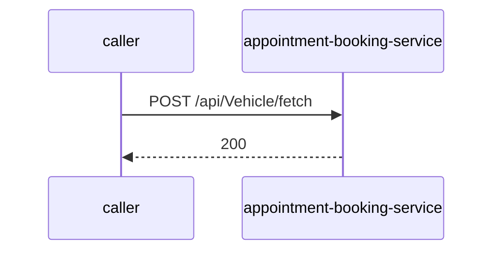

# appointment-booking-service — Low-Level Design

## Data Model
appointment-booking-service entities from `data_access` items (1).

Store access at `src/Appointment.Infrastructure/Extensions/ServiceCollectionExtensions.cs:19`: database Unknown; collections -.

### MDMS_APPOINTMENT_BOOKING
Entity `AppointmentBooking` defined in `src/Appointment.Domain/Entities/AppointmentAggregate/AppointmentBooking.cs:6`; table MDMS_APPOINTMENT_BOOKING; operation Unknown.
Columns: Unknown (no fields extracted).
Relationships: Unknown.

### MDMS_SERV_APP_FOLLOWUP_DET
Entity `AppointmentServFollowUpDet` defined in `src/Appointment.Domain/Entities/AppointmentAggregate/AppointmentServFollowUpDet.cs:4`; table MDMS_SERV_APP_FOLLOWUP_DET; operation Unknown.
Columns: Unknown (no fields extracted).
Relationships: Unknown.

### MDMS_BRANCH
Entity `Branch` defined in `src/Appointment.Domain/AggregatesModel/DealerAggregate/Branch.cs:13`; table MDMS_BRANCH; operation Unknown.

| Column | Type | Nullable | Notes |
|---|---|---|---|
| id | integer | Unknown | - |
| name | string | Unknown | - |
Relationships: Unknown.

### MDMS_CUSTOMER
Entity `Customer` defined in `src/Appointment.Domain/AggregatesModel/CustomerAggregate/Customer.cs:14`; table MDMS_CUSTOMER; operation Unknown.

| Column | Type | Nullable | Notes |
|---|---|---|---|
| id | integer | Unknown | - |
| name | string | Unknown | - |
| contact | Contact[] | Unknown | - |
Relationships: Unknown.

### MDMS_CUSTOMER_ADDRESS
Entity `CustomerAddress` defined in `src/Appointment.Domain/Entities/CustomerAggregate/CustomerAddress.cs:6`; table MDMS_CUSTOMER_ADDRESS; operation Unknown.
Columns: Unknown (no fields extracted).
Relationships: Unknown.

### MDMS_CUSTOMER_PHONE
Entity `CustomerContact` defined in `src/Appointment.Domain/Entities/CustomerAggregate/CustomerContact.cs:12`; table MDMS_CUSTOMER_PHONE; operation Unknown.
Columns: Unknown (no fields extracted).
Relationships: Unknown.

### MDMS_CUST_END_USER
Entity `CustomerEndUser` defined in `src/Appointment.Domain/Entities/CustomerAggregate/CustomerEndUser.cs:9`; table MDMS_CUST_END_USER; operation Unknown.
Columns: Unknown (no fields extracted).
Relationships: Unknown.

### MDMS_APPOINTMENT_BOOKING_REQUESTS
Entity `CustomerRequest` defined in `src/Appointment.Domain/Entities/AppointmentAggregate/CustomerRequest.cs:9`; table MDMS_APPOINTMENT_BOOKING_REQUESTS; operation Unknown.
Columns: Unknown (no fields extracted).
Relationships: Unknown.

### MDMS_CUSTOMER_VEHICLE
Entity `CustomerVehicle` defined in `src/Appointment.Domain/Entities/VehicleAggregate/CustomerVehicle.cs:10`; table MDMS_CUSTOMER_VEHICLE; operation Unknown.
Columns: Unknown (no fields extracted).
Relationships: Unknown.

### MDMS_DEALER
Entity `Dealer` defined in `src/Appointment.Domain/AggregatesModel/DealerAggregate/Dealer.cs:14`; table MDMS_DEALER; operation Unknown.

| Column | Type | Nullable | Notes |
|---|---|---|---|
| id | integer | Unknown | - |
| name | string | Unknown | - |
| countryCode | string | Unknown | - |
| branch | Branch | Unknown | - |
Relationships: Unknown.

### MDMS_DEALER_CUST_MAPPING
Entity `DealerCustomerMapping` defined in `src/Appointment.Domain/Entities/VehicleAggregate/DealerCustomerMapping.cs:4`; table MDMS_DEALER_CUST_MAPPING; operation Unknown.
Columns: Unknown (no fields extracted).
Relationships: Unknown.

### MDMS_EMPLOYEE
Entity `DealerEmployee` defined in `src/Appointment.Domain/Entities/DealerAggregate/DealerEmployee.cs:9`; table MDMS_EMPLOYEE; operation Unknown.
Columns: Unknown (no fields extracted).
Relationships: Unknown.

### MDMS_DEALER_VEHICLE_MAPPING
Entity `DealerVehicleMapping` defined in `src/Appointment.Domain/Entities/VehicleAggregate/DealerVehicleMapping.cs:4`; table MDMS_DEALER_VEHICLE_MAPPING; operation Unknown.
Columns: Unknown (no fields extracted).
Relationships: Unknown.

### MDMS_EMP_SUBGROUP
Entity `EmpSubGroup` defined in `src/Appointment.Domain/Entities/DealerAggregate/EmpSubGroup.cs:9`; table MDMS_EMP_SUBGROUP; operation Unknown.
Columns: Unknown (no fields extracted).
Relationships: Unknown.

### MDMS_JOBCARD_ID_TABLE
Entity `JobCardId` defined in `src/Appointment.Domain/Entities/AppointmentAggregate/JobCardId.cs:10`; table MDMS_JOBCARD_ID_TABLE; operation Unknown.
Columns: Unknown (no fields extracted).
Relationships: Unknown.

### MDMS_APPOINTMENT_BOOKING_SUB_REQUESTS
Entity `RequestSubType` defined in `src/Appointment.Domain/Entities/CustomerAggregate/RequestSubType.cs:6`; table MDMS_APPOINTMENT_BOOKING_SUB_REQUESTS; operation Unknown.
Columns: Unknown (no fields extracted).
Relationships: Unknown.

### MDMS_SERV_APPOINT
Entity `ServAppointment` defined in `src/Appointment.Domain/Entities/AppointmentAggregate/ServAppointment.cs:10`; table MDMS_SERV_APPOINT; operation Unknown.
Columns: Unknown (no fields extracted).
Relationships: Unknown.

### MDMS_SERV_APT_CAT
Entity `ServiceAppointmentCategory` defined in `src/Appointment.Domain/Entities/AppointmentAggregate/ServiceAppointmentCategory.cs:9`; table MDMS_SERV_APT_CAT; operation Unknown.
Columns: Unknown (no fields extracted).
Relationships: Unknown.

### MDMS_SERV_APPOINTMENT_REQUEST
Entity `ServiceAppointmentRequest` defined in `src/Appointment.Domain/Entities/CustomerAggregate/ServiceAppointmentRequest.cs:6`; table MDMS_SERV_APPOINTMENT_REQUEST; operation Unknown.
Columns: Unknown (no fields extracted).
Relationships: Unknown.

### MDMS_SERV_APPOINTMENT_SUB_REQUEST
Entity `ServiceAppointmentSubRequest` defined in `src/Appointment.Domain/Entities/CustomerAggregate/ServiceAppointmentSubRequest.cs:6`; table MDMS_SERV_APPOINTMENT_SUB_REQUEST; operation Unknown.
Columns: Unknown (no fields extracted).
Relationships: Unknown.

### MDMS_VEHICLE
Entity `Vehicle` defined in `src/Appointment.Domain/AggregatesModel/VehicleAggregate/Vehicle.cs:13`; table MDMS_VEHICLE; operation Unknown.

| Column | Type | Nullable | Notes |
|---|---|---|---|
| id | integer | Unknown | - |
| frameNo | string | Unknown | - |
| registrationNo | string | Unknown | - |
| countryCode | string | Unknown | - |
| vehicleType | VehicleType | Unknown | - |
| engineType | VehicleEngineType | Unknown | - |
| model | VehicleModel | Unknown | - |
Relationships: Unknown.

### MDMS_VEH_END_USER
Entity `VehicleEndUser` defined in `src/Appointment.Domain/Entities/VehicleAggregate/VehicleEndUser.cs:10`; table MDMS_VEH_END_USER; operation Unknown.
Columns: Unknown (no fields extracted).
Relationships: Unknown.

### MDMS_VEHICLE_MODEL
Entity `VehicleModel` defined in `src/Appointment.Domain/AggregatesModel/VehicleAggregate/VehicleModel.cs:13`; table MDMS_VEHICLE_MODEL; operation Unknown.

| Column | Type | Nullable | Notes |
|---|---|---|---|
| id | string | Unknown | - |
| description | string | Unknown | - |
| part | VehicleModelPart | Unknown | - |
Relationships: Unknown.

### MDMS_VEHICLE_MODEL_CLASSIFICATION_DIGI
Entity `VehicleModelClassificationDigi` defined in `src/Appointment.Domain/Entities/VehicleAggregate/VehicleModelClassificationDigi.cs:9`; table MDMS_VEHICLE_MODEL_CLASSIFICATION_DIGI; operation Unknown.
Columns: Unknown (no fields extracted).
Relationships: Unknown.

### MDMS_MODEL_PART
Entity `VehicleModelPart` defined in `src/Appointment.Domain/Entities/VehicleAggregate/VehicleModelPart.cs:5`; table MDMS_MODEL_PART; operation Unknown.

| Column | Type | Nullable | Notes |
|---|---|---|---|
| id | string | Unknown | - |
| description | string | Unknown | - |
Relationships: Unknown.

### MDMS_VEHICLE_TYPE_DIGI
Entity `VehicleTypeDigi` defined in `src/Appointment.Domain/Entities/VehicleAggregate/VehicleTypeDigi.cs:9`; table MDMS_VEHICLE_TYPE_DIGI; operation Unknown.
Columns: Unknown (no fields extracted).
Relationships: Unknown.

## State Machines
appointment-booking-service: N/A — no status/state enums found in code.

## Business Rules
appointment-booking-service validation rules on DTO fields (from schema `validation`):

| Schema.field | Rule | Defined in |
|---|---|---|
| `AppointmentDto.kilometer` | {'min': 1} | `src/Appointment.Application/Appointment/Dtos/AppointmentDto.cs:11` |
| `BranchDto.id` | {'min': 1} | `src/Appointment.Application/Appointment/Dtos/BranchDto.cs:7` |
| `CustomerAddressDto.Pincode` | {'pattern': '^\\d{6}$'} | `src/Appointment.Application/Appointment/Dtos/CustomerAddressDto.cs:6` |
| `CustomerContactDto.number` | {'pattern': '^\\d{10}$'} | `src/Appointment.Application/Appointment/Dtos/CustomerContactDto.cs:7` |
| `DealerDto.id` | {'min': 1} | `src/Appointment.Application/Appointment/Dtos/DealerDto.cs:6` |
| `EngineTypeDto.type` | {'pattern': '^(ICE\|EV)$'} | `src/Appointment.Application/Appointment/Dtos/EngineTypeDto.cs:5` |
| `VehicleTypeDto.type` | {'pattern': '^(2W\|3W)$'} | `src/Appointment.Application/Appointment/Dtos/VehicleTypeDto.cs:5` |

## Key Classes and Functions
appointment-booking-service key classes:

| Class / Function | File | Responsibility |
|---|---|---|
| `AppointmentController` | `src/Appointment.API/Controllers/AppointmentController.cs` | HTTP handlers |
| `VehicleController` | `src/Appointment.API/Controllers/VehicleController.cs` | HTTP handlers |

## Sequence Details
appointment-booking-service sequence for `POST /api/Vehicle/fetch` (handler `VehicleController.GetVehicleDetailsAsync`); downstream calls inside the handler are not traced from code, module-level targets shown as optional.

## Error Handling
appointment-booking-service error handling: no global exception handler found in code. Documented error statuses come from response annotations in API_SPEC.md.

## Configuration Details
appointment-booking-service behaviour-relevant config keys (names only; full list in OVERVIEW.md):
- N/A — no behaviour-switching keys identified

## Edge Cases
appointment-booking-service edge cases: N/A — not determinable from code without manual review.
