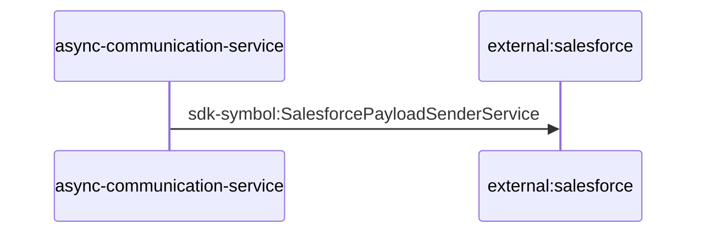

# async-communication-service — Data Flows

## Flow Index
async-communication-service takes part in 1 end-to-end flow(s) in registry/flows.json.

| flow_id | Name | Role of async-communication-service | Trigger |
|---|---|---|---|
| async-communication-service--external-salesforce | async-communication-service → external:salesforce (1 hop) | entry | scheduled job(s) in async-communication-service (job-to-call link not resolved): 30 15 * * *, 30 16 * * *; request to async-communication-service from outside the registry (no internal caller) |

## Flow: async-communication-service--external-salesforce
Summary: Starting at `async-communication-service` (scheduled job(s) in async-communication-service (job-to-call link not resolved): 30 15 * * *, 30 16 * * *; request to async-communication-service from outside the registry (no internal caller)), the flow ends at `external:salesforce`, using 1 sync HTTP hop(s) and 0 async event hop(s); async-communication-service role: entry; confidence high.

Steps:
| # | From | To | Via | Data (schema names) | Sync/Async | Confidence |
|---|---|---|---|---|---|---|
| 1 | async-communication-service | external:salesforce | sdk-symbol:SalesforcePayloadSenderService | Unknown | sync | high |

Data touched: async-communication-service: mssql

Failure points: hop 1 async-communication-service → external:salesforce: criticality hard

Evidence:
- hop 1 (async-communication-service → external:salesforce): `async-communication-service/src/communication/salesforce-sender.service.ts:7`
