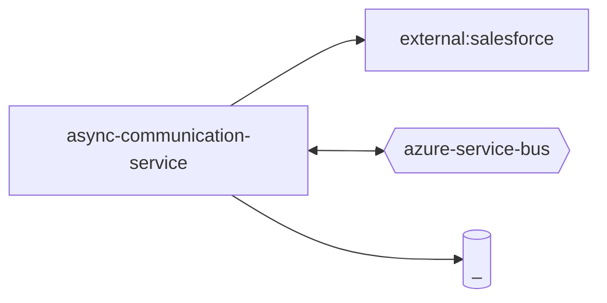

# async-communication-service — High-Level Design

## Context
async-communication-service is a `backend-api` in the TVS-CS org (domain: Unknown). Neighbours: callers Unknown; downstream `external:salesforce`.

## Architecture
async-communication-service components and connections (from service.yaml):

## Integration Points
async-communication-service registry edges (1):

| Direction | Peer | Kind | Via | Criticality | Source | Match |
|---|---|---|---|---|---|---|
| out | `external:salesforce` | http | sdk-symbol:SalesforcePayloadSenderService | hard | code | sdk-symbol |
| out | `external:salesforce` | http | - | hard | code | external |

## Data Ownership
async-communication-service data stores (service.yaml `data_stores`; ownership flag not determinable unless set):

| Store | Type | Access | Owned | Key entities |
|---|---|---|---|---|
| `_` | mssql | Unknown | Unknown | Booking, BookingCancellation, BookingRefund, BookingTopicLog, CityDetails, CommunicationEventBccList, Correspondence, DmsVehicleMaster, Location, Payment, Product, RefundTransactionLog, Vehicle, VehicleVariantColor |

## Key Design Decisions
async-communication-service: N/A — not determinable from code.

| Decision | Alternatives considered | Reason |
|---|---|---|
| Unknown | Unknown | Unknown |

## Non-Functional Requirements
async-communication-service NFR targets: N/A — not determinable from code.

## Security
async-communication-service security: endpoint auth values n/a. No auth middleware found in code. 1 secret config key(s), sourced via: {'None': 1} (names in OVERVIEW.md). PII handling: Unknown.

## Resilience and Failure Modes
async-communication-service hard dependencies: `external:salesforce`. No retry/circuit-breaker code found; failure behaviour Unknown.

## Deployment Topology
async-communication-service deployment artefacts (platform/regions: Unknown unless listed):

| Kind | Name | File | Environments | Image | Ports | Variable groups |
|---|---|---|---|---|---|---|
| azure-pipeline | azure_pipelines/ast-async-comm-uat-pipeline.yaml | `azure_pipelines/ast-async-comm-uat-pipeline.yaml:1` | - | - | - | Checkmarx_Common, UAT_Threshold |
| azure-pipeline | azure_pipelines/ast-image-scan-async-comm-pipeline.yaml | `azure_pipelines/ast-image-scan-async-comm-pipeline.yaml:1` | - | - | - | Checkmarx_Common, UAT_Threshold |
| azure-pipeline | azure_pipelines/cd-pipeline.yaml | `azure_pipelines/cd-pipeline.yaml:1` | dev, prod, uat | - | - | - |
| azure-pipeline | azure_pipelines/ci-pipeline.yaml | `azure_pipelines/ci-pipeline.yaml:1` | - | - | - | - |
| azure-pipeline | azure_pipelines/sonar.yaml | `azure_pipelines/sonar.yaml:1` | - | - | - | - |
| dockerfile | Dockerfile | `Dockerfile:2` | - | node:25.9.0-alpine | 8080 | - |

## Observability
async-communication-service observability libraries: `winston`, `winston-daily-rotate-file`. Related config keys: none. Dashboards/alerts: Unknown.
