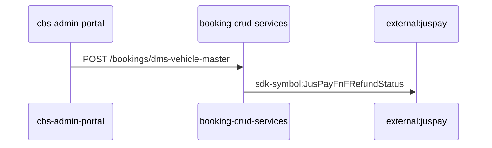
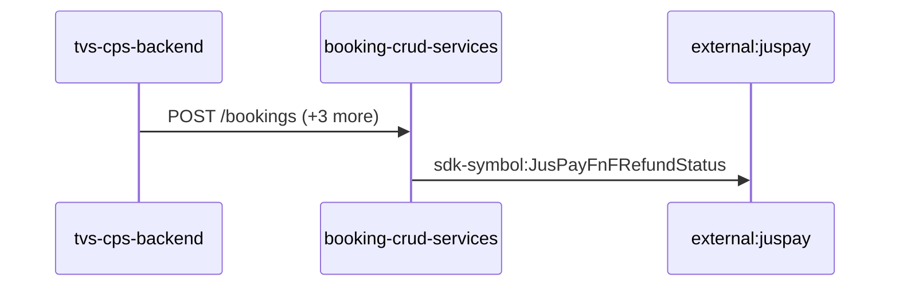
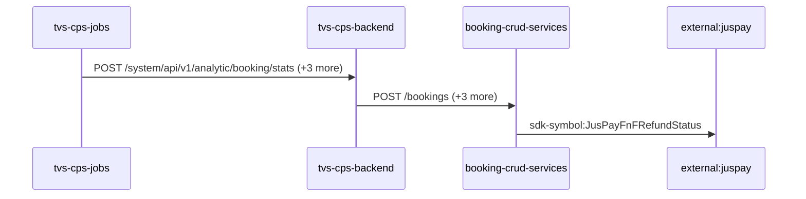
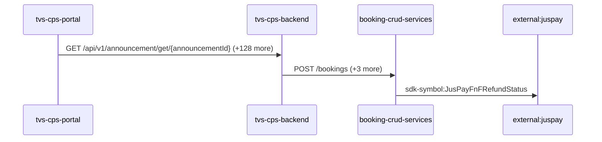
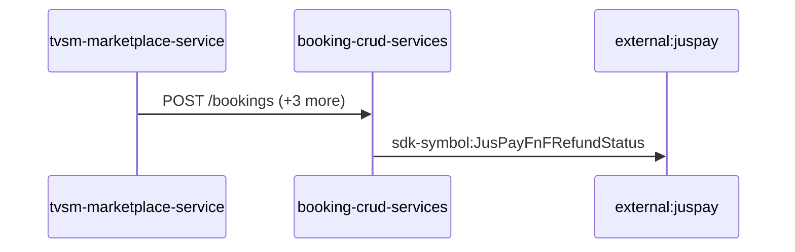

# booking-crud-services — Data Flows

## Flow Index
booking-crud-services takes part in 5 end-to-end flow(s) in registry/flows.json.

| flow_id | Name | Role of booking-crud-services | Trigger |
|---|---|---|---|
| cbs-admin-portal--external-juspay | cbs-admin-portal → external:juspay (2 hops) | participant | user action in cbs-admin-portal (frontend) |
| tvs-cps-backend--external-juspay | tvs-cps-backend → external:juspay (2 hops) | participant | scheduled job(s) in tvs-cps-backend (job-to-call link not resolved): JobScheduler.loadCatalogData, JobScheduler.retrieveMDPDealers, JobScheduler.retrieveMerchandiseStock (+2 more) |
| tvs-cps-jobs--external-juspay | tvs-cps-jobs → external:juspay (3 hops) | participant | scheduled job(s) in tvs-cps-jobs (job-to-call link not resolved): CronJobScheduler.allBookingsScheduler, CronJobScheduler.allEnquiriesScheduler, CronJobScheduler.availableStockScheduler (+27 more); request to tvs-cps-jobs from outside the registry (no internal caller) |
| tvs-cps-portal--external-juspay | tvs-cps-portal → external:juspay (3 hops) | participant | user action in tvs-cps-portal (frontend) |
| tvsm-marketplace-service--external-juspay | tvsm-marketplace-service → external:juspay (2 hops) | participant | scheduled job(s) in tvsm-marketplace-service (job-to-call link not resolved): AmazonPriceUpdateExecutorService.scheduledDrain, FlipkartPriceUpdateExecutorService.scheduledDrain, MarketplacePriceUpdateTaskService.cleanupDoneTasks (+2 more); request to tvsm-marketplace-service from outside the registry (no internal caller) |

## Flow: cbs-admin-portal--external-juspay
Summary: Starting at `cbs-admin-portal` (user action in cbs-admin-portal (frontend)), the flow passes through `booking-crud-services` and ends at `external:juspay`, using 2 sync HTTP hop(s) and 0 async event hop(s); booking-crud-services role: participant; confidence high.

Steps:
| # | From | To | Via | Data (schema names) | Sync/Async | Confidence |
|---|---|---|---|---|---|---|
| 1 | cbs-admin-portal | booking-crud-services | POST /bookings/dms-vehicle-master | DmsVehicleMasterDto, DmsVehicleMasterResponseDto | sync | high |
| 2 | booking-crud-services | external:juspay | sdk-symbol:JusPayFnFRefundStatus | Unknown | sync | high |

Data touched: booking-crud-services: mssql

Failure points: hop 1 cbs-admin-portal → booking-crud-services: criticality hard; hop 2 booking-crud-services → external:juspay: criticality hard

Evidence:
- hop 1 (cbs-admin-portal → booking-crud-services): `booking-crud-services/Booking Service.openapi.yaml:1433`, `cbs-admin-portal/src/services/dataService.js:76`
- hop 2 (booking-crud-services → external:juspay): `booking-crud-services/src/bookings/dto/booking-refund-status-update/booking-refund-status-request.dto.ts:19`, `booking-crud-services/src/bookings/services/booking-refund/jusPay-refund.service.ts:15`, `booking-crud-services/src/bookings/services/jusPay.service.ts:10`

## Flow: tvs-cps-backend--external-juspay
Summary: Starting at `tvs-cps-backend` (scheduled job(s) in tvs-cps-backend (job-to-call link not resolved): JobScheduler.loadCatalogData, JobScheduler.retrieveMDPDealers, JobScheduler.retrieveMerchandiseStock (+2 more)), the flow passes through `booking-crud-services` and ends at `external:juspay`, using 2 sync HTTP hop(s) and 0 async event hop(s); booking-crud-services role: participant; confidence medium.

Steps:
| # | From | To | Via | Data (schema names) | Sync/Async | Confidence |
|---|---|---|---|---|---|---|
| 1 | tvs-cps-backend | booking-crud-services | POST /bookings, POST /bookings/search, PUT /bookings (+1 more) | BookingResponseDto, BookingRetrievalRequestDto, BookingRetrievalResponseDto, CancelBookingRequestDto, CancellationResponseDto (+2 more) | sync | medium |
| 2 | booking-crud-services | external:juspay | sdk-symbol:JusPayFnFRefundStatus | Unknown | sync | high |

Data touched: tvs-cps-backend: postgres, postgres:nmazcpsdbsdev01-cmn-postgres-uks.postgres.database.azure.com:nmazcpsdbdev01-cps; booking-crud-services: mssql

Failure points: hop 1 tvs-cps-backend → booking-crud-services: criticality hard; hop 2 booking-crud-services → external:juspay: criticality hard

Evidence:
- hop 1 (tvs-cps-backend → booking-crud-services): `TVS-CPS-BACKEND/bff-service/src/main/java/com/tvsm/bff/client/BookingServiceClient.java:50`, `TVS-CPS-BACKEND/bff-service/src/main/java/com/tvsm/bff/client/BookingServiceClient.java:192`, `TVS-CPS-BACKEND/bff-service/src/main/java/com/tvsm/bff/client/BookingServiceClient.java:193` (+10 more)
- hop 2 (booking-crud-services → external:juspay): `booking-crud-services/src/bookings/dto/booking-refund-status-update/booking-refund-status-request.dto.ts:19`, `booking-crud-services/src/bookings/services/booking-refund/jusPay-refund.service.ts:15`, `booking-crud-services/src/bookings/services/jusPay.service.ts:10`

## Flow: tvs-cps-jobs--external-juspay
Summary: Starting at `tvs-cps-jobs` (scheduled job(s) in tvs-cps-jobs (job-to-call link not resolved): CronJobScheduler.allBookingsScheduler, CronJobScheduler.allEnquiriesScheduler, CronJobScheduler.availableStockScheduler (+27 more); request to tvs-cps-jobs from outside the registry (no internal caller)), the flow passes through `tvs-cps-backend`, `booking-crud-services` and ends at `external:juspay`, using 3 sync HTTP hop(s) and 0 async event hop(s); booking-crud-services role: participant; confidence medium.

Steps:
| # | From | To | Via | Data (schema names) | Sync/Async | Confidence |
|---|---|---|---|---|---|---|
| 1 | tvs-cps-jobs | tvs-cps-backend | POST /system/api/v1/analytic/booking/stats, POST /system/api/v1/analytics-dashboard/indicators/calculate, POST /system/api/v1/appointments/auto-close (+1 more) | APIResponse<map<string,object>>, AnalyticsDto, AnalyticsRequestDTO | sync | high |
| 2 | tvs-cps-backend | booking-crud-services | POST /bookings, POST /bookings/search, PUT /bookings (+1 more) | BookingResponseDto, BookingRetrievalRequestDto, BookingRetrievalResponseDto, CancelBookingRequestDto, CancellationResponseDto (+2 more) | sync | medium |
| 3 | booking-crud-services | external:juspay | sdk-symbol:JusPayFnFRefundStatus | Unknown | sync | high |

Data touched: tvs-cps-backend: postgres, postgres:nmazcpsdbsdev01-cmn-postgres-uks.postgres.database.azure.com:nmazcpsdbdev01-cps; booking-crud-services: mssql

Failure points: hop 1 tvs-cps-jobs → tvs-cps-backend: criticality hard; hop 2 tvs-cps-backend → booking-crud-services: criticality hard; hop 3 booking-crud-services → external:juspay: criticality hard

Evidence:
- hop 1 (tvs-cps-jobs → tvs-cps-backend): `TVS-CPS-BACKEND/bff-service/src/main/java/com/tvsm/bff/controller/AnalyticsController.java:23`, `TVS-CPS-JOBS/src/main/java/com/tvsm/jobs/service/AnalyticsService.java:32`, `TVS-CPS-JOBS/src/main/java/com/tvsm/jobs/service/RestCallService.java:50` (+4 more)
- hop 2 (tvs-cps-backend → booking-crud-services): `TVS-CPS-BACKEND/bff-service/src/main/java/com/tvsm/bff/client/BookingServiceClient.java:50`, `TVS-CPS-BACKEND/bff-service/src/main/java/com/tvsm/bff/client/BookingServiceClient.java:192`, `TVS-CPS-BACKEND/bff-service/src/main/java/com/tvsm/bff/client/BookingServiceClient.java:193` (+10 more)
- hop 3 (booking-crud-services → external:juspay): `booking-crud-services/src/bookings/dto/booking-refund-status-update/booking-refund-status-request.dto.ts:19`, `booking-crud-services/src/bookings/services/booking-refund/jusPay-refund.service.ts:15`, `booking-crud-services/src/bookings/services/jusPay.service.ts:10`

## Flow: tvs-cps-portal--external-juspay
Summary: Starting at `tvs-cps-portal` (user action in tvs-cps-portal (frontend)), the flow passes through `tvs-cps-backend`, `booking-crud-services` and ends at `external:juspay`, using 3 sync HTTP hop(s) and 0 async event hop(s); booking-crud-services role: participant; confidence medium.

Steps:
| # | From | To | Via | Data (schema names) | Sync/Async | Confidence |
|---|---|---|---|---|---|---|
| 1 | tvs-cps-portal | tvs-cps-backend | GET /api/v1/announcement/get/{announcementId}, GET /api/v1/announcement/user/banners, GET /api/v1/appointments/{appointmentId} (+126 more) | APIResponse<AnnouncementResponseDto>, APIResponse<AnnouncementResponseDto[]>, APIResponse<AppointmentCountResponseDTO>, APIResponse<AppointmentDashboardResponseDTO>, APIResponse<AppointmentDetailResponseDTO> (+105 more) | sync | medium |
| 2 | tvs-cps-backend | booking-crud-services | POST /bookings, POST /bookings/search, PUT /bookings (+1 more) | BookingResponseDto, BookingRetrievalRequestDto, BookingRetrievalResponseDto, CancelBookingRequestDto, CancellationResponseDto (+2 more) | sync | medium |
| 3 | booking-crud-services | external:juspay | sdk-symbol:JusPayFnFRefundStatus | Unknown | sync | high |

Data touched: tvs-cps-backend: postgres, postgres:nmazcpsdbsdev01-cmn-postgres-uks.postgres.database.azure.com:nmazcpsdbdev01-cps; booking-crud-services: mssql

Failure points: hop 1 tvs-cps-portal → tvs-cps-backend: criticality hard; hop 2 tvs-cps-backend → booking-crud-services: criticality hard; hop 3 booking-crud-services → external:juspay: criticality hard

Evidence:
- hop 1 (tvs-cps-portal → tvs-cps-backend): `TVS-CPS-BACKEND/announcement-service/src/main/java/com/tvsm/announcement/controller/AnnouncementController.java:31`, `TVS-CPS-PORTAL/channel-partner-system/src/services/notification.service.ts:140`, `TVS-CPS-PORTAL/channel-partner-system/src/services/notification.service.ts:144` (+194 more)
- hop 2 (tvs-cps-backend → booking-crud-services): `TVS-CPS-BACKEND/bff-service/src/main/java/com/tvsm/bff/client/BookingServiceClient.java:50`, `TVS-CPS-BACKEND/bff-service/src/main/java/com/tvsm/bff/client/BookingServiceClient.java:192`, `TVS-CPS-BACKEND/bff-service/src/main/java/com/tvsm/bff/client/BookingServiceClient.java:193` (+10 more)
- hop 3 (booking-crud-services → external:juspay): `booking-crud-services/src/bookings/dto/booking-refund-status-update/booking-refund-status-request.dto.ts:19`, `booking-crud-services/src/bookings/services/booking-refund/jusPay-refund.service.ts:15`, `booking-crud-services/src/bookings/services/jusPay.service.ts:10`

## Flow: tvsm-marketplace-service--external-juspay
Summary: Starting at `tvsm-marketplace-service` (scheduled job(s) in tvsm-marketplace-service (job-to-call link not resolved): AmazonPriceUpdateExecutorService.scheduledDrain, FlipkartPriceUpdateExecutorService.scheduledDrain, MarketplacePriceUpdateTaskService.cleanupDoneTasks (+2 more); request to tvsm-marketplace-service from outside the registry (no internal caller)), the flow passes through `booking-crud-services` and ends at `external:juspay`, using 2 sync HTTP hop(s) and 0 async event hop(s); booking-crud-services role: participant; confidence high.

Steps:
| # | From | To | Via | Data (schema names) | Sync/Async | Confidence |
|---|---|---|---|---|---|---|
| 1 | tvsm-marketplace-service | booking-crud-services | POST /bookings, POST /bookings/search, PUT /bookings (+1 more) | BookingResponseDto, BookingRetrievalRequestDto, BookingRetrievalResponseDto, CancelBookingRequestDto, CancellationResponseDto (+2 more) | sync | high |
| 2 | booking-crud-services | external:juspay | sdk-symbol:JusPayFnFRefundStatus | Unknown | sync | high |

Data touched: tvsm-marketplace-service: mysql, mysql:localhost:marketplace; booking-crud-services: mssql

Failure points: hop 1 tvsm-marketplace-service → booking-crud-services: criticality hard; hop 2 booking-crud-services → external:juspay: criticality hard

Evidence:
- hop 1 (tvsm-marketplace-service → booking-crud-services): `booking-crud-services/Booking Service.openapi.yaml:275`, `tvsm-marketplace-service/src/main/java/com/tvsmotor/marketplace/service/OkHttpService.java:85`, `tvsm-marketplace-service/src/main/java/com/tvsmotor/marketplace/service/booking_service/BookingApiCallerService.java:55` (+7 more)
- hop 2 (booking-crud-services → external:juspay): `booking-crud-services/src/bookings/dto/booking-refund-status-update/booking-refund-status-request.dto.ts:19`, `booking-crud-services/src/bookings/services/booking-refund/jusPay-refund.service.ts:15`, `booking-crud-services/src/bookings/services/jusPay.service.ts:10`
