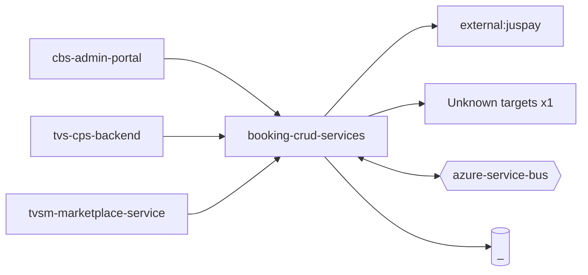

# booking-crud-services — High-Level Design

## Context
booking-crud-services is a `backend-api` in the TVS-CS org (domain: Unknown). Neighbours: callers `cbs-admin-portal`, `tvs-cps-backend`, `tvsm-marketplace-service`; downstream `external:juspay`.

## Architecture
booking-crud-services components and connections (from service.yaml):

## Integration Points
booking-crud-services registry edges (10):

| Direction | Peer | Kind | Via | Criticality | Source | Match |
|---|---|---|---|---|---|---|
| out | `external:juspay` | http | sdk-symbol:JusPayFnFRefundStatus | hard | code | sdk-symbol |
| in | `cbs-admin-portal` | http | POST /bookings/dms-vehicle-master | hard | code | path-unique |
| in | `tvs-cps-backend` | http | POST /bookings | hard | code | path-suffix |
| in | `tvs-cps-backend` | http | POST /bookings/search | hard | code | path-suffix |
| in | `tvs-cps-backend` | http | PUT /bookings | hard | code | path-suffix |
| in | `tvs-cps-backend` | http | PUT /bookings/cancel | hard | code | path-suffix |
| in | `tvsm-marketplace-service` | http | POST /bookings | hard | code | path-unique |
| in | `tvsm-marketplace-service` | http | POST /bookings/search | hard | code | path-unique |
| in | `tvsm-marketplace-service` | http | PUT /bookings | hard | code | path-unique |
| in | `tvsm-marketplace-service` | http | PUT /bookings/cancel | hard | code | path-unique |
| out | `external:juspay` | http | - | hard | code | external |

## Data Ownership
booking-crud-services data stores (service.yaml `data_stores`; ownership flag not determinable unless set):

| Store | Type | Access | Owned | Key entities |
|---|---|---|---|---|
| `_` | mssql | write | Unknown | AtpLog, Booking, BookingCancellation, BookingConfig, BookingFollowUp, BookingJournal, BookingRefund, BookingTopicLog, BookingTopicTestPushLog, DealerChangeLeadIdGenerationLog, DealerContact, DealerFlag, DealerLocation, DealerMaster, DmsLog … |

## Key Design Decisions
booking-crud-services: N/A — not determinable from code.

| Decision | Alternatives considered | Reason |
|---|---|---|
| Unknown | Unknown | Unknown |

## Non-Functional Requirements
booking-crud-services NFR targets: N/A — not determinable from code.

## Security
booking-crud-services security: endpoint auth values api-key. No auth middleware found in code. 1 secret config key(s), sourced via: {'None': 1} (names in OVERVIEW.md). PII handling: Unknown.

## Resilience and Failure Modes
booking-crud-services hard dependencies: `external:juspay`. Retry/circuit-breaker code: `src/app.module.ts:67` (retryAttempts), `src/bookings/services/catalog/catalog.service.ts:28` (retryAttempts), `src/bookings/services/catalog/catalog.service.spec.ts:280` (retryAttempts), `src/shared/constants/constants.ts:574` (retryAttempts).

## Deployment Topology
booking-crud-services deployment artefacts (platform/regions: Unknown unless listed):

| Kind | Name | File | Environments | Image | Ports | Variable groups |
|---|---|---|---|---|---|---|
| azure-pipeline | AST_Website_Corporate_booking_crud_services_DEV_Pipeline.yml | `AST_Website_Corporate_booking_crud_services_DEV_Pipeline.yml:2` | - | - | - | Checkmarx_Common, Tenable, UAT_Threshold |
| azure-pipeline | azure-pipelines/ast-booking-crud-prod-pipeline.yaml | `azure-pipelines/ast-booking-crud-prod-pipeline.yaml:1` | - | - | - | PROD_Threshold, Tenable |
| azure-pipeline | azure-pipelines/ast-booking-crud-uat-pipeline.yaml | `azure-pipelines/ast-booking-crud-uat-pipeline.yaml:1` | - | - | - | Checkmarx_Common, Tenable, UAT_Threshold |
| azure-pipeline | azure-pipelines/ast-image-scan-booking-crud-pipeline.yaml | `azure-pipelines/ast-image-scan-booking-crud-pipeline.yaml:1` | - | - | - | Checkmarx_Common, UAT_Threshold |
| azure-pipeline | azure-pipelines/cd-pipeline.yaml | `azure-pipelines/cd-pipeline.yaml:1` | dev, prod, uat | - | - | - |
| azure-pipeline | azure-pipelines/ci-pipeline.yaml | `azure-pipelines/ci-pipeline.yaml:1` | - | - | - | - |
| azure-pipeline | azure-pipelines/sonar.yaml | `azure-pipelines/sonar.yaml:1` | - | - | - | - |
| dockerfile | Dockerfile | `Dockerfile:3` | - | node:26.7.0-alpine3.24 | 8080 | - |

## Observability
booking-crud-services observability libraries: `@opentelemetry/api`, `@opentelemetry/api-logs`, `@opentelemetry/auto-instrumentations-node`, `@opentelemetry/exporter-logs-otlp-http`, `@opentelemetry/exporter-trace-otlp-http`, `@opentelemetry/instrumentation-nestjs-core`, `@opentelemetry/resources`, `@opentelemetry/sdk-logs`, `@opentelemetry/sdk-node`, `@opentelemetry/semantic-conventions`, `nest-winston`, `winston`, `winston-daily-rotate-file`. Related config keys: `OTEL_EXPORTER_OTLP_ENDPOINT`, `OTEL_LOG_LEVEL`, `OTEL_SERVICE_NAME`. Dashboards/alerts: Unknown.
