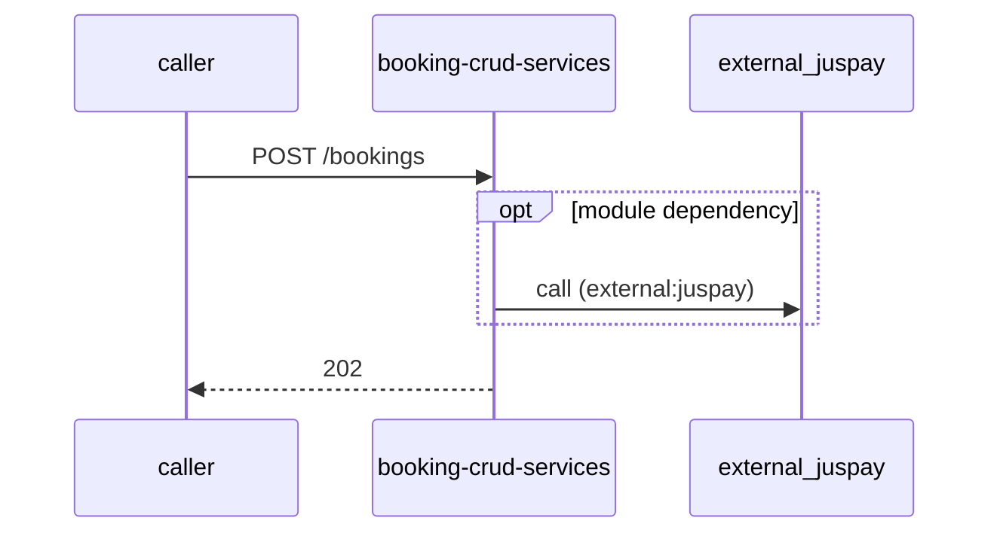

# booking-crud-services — Low-Level Design

## Data Model
booking-crud-services entities from `data_access` items (1).

Store access at `scripts/sql/create-retail-finance-detail-table.sql:58`: database Unknown; collections -.

### retail_finance_detail
Entity `retail_finance_detail` defined in `scripts/sql/create-retail-finance-detail-table.sql:58`; table retail_finance_detail; operation write.
Columns: Unknown (no fields extracted).
Relationships: Unknown.

### AtpLog
Entity `AtpLog` defined in `src/database/entities/atp-logs.entity.ts:10`; table Unknown; operation Unknown.
Columns: Unknown (no fields extracted).
Relationships: Unknown.

### BookingCancellation
Entity `BookingCancellation` defined in `src/database/entities/booking-cancellation.entity.ts:11`; table Unknown; operation Unknown.

| Column | Type | Nullable | Notes |
|---|---|---|---|
| cancellationSource | string | Unknown | - |
| cancellationReason | string | Unknown | - |
| cancellationSubReason | string | Unknown | - |
| cancellationFee | number | Unknown | - |
| cancellationFeeRemarks | string | Unknown | - |
| customerRemarks | string | Unknown | - |
| dateOfCancellation | datetime | Unknown | - |
| refundDetails | BookingCancellation_refundDetails | Unknown | - |
Relationships: Unknown.

### BookingConfig
Entity `BookingConfig` defined in `src/database/entities/booking-config.entity.ts:4`; table Unknown; operation Unknown.
Columns: Unknown (no fields extracted).
Relationships: Unknown.

### booking_followups
Entity `BookingFollowUp` defined in `src/database/entities/booking-followup.entity.ts:9`; table booking_followups; operation Unknown.
Columns: Unknown (no fields extracted).
Relationships: Unknown.

### BookingJournal
Entity `BookingJournal` defined in `src/database/entities/booking-journal.entity.ts:9`; table Unknown; operation Unknown.
Columns: Unknown (no fields extracted).
Relationships: Unknown.

### BookingRefund
Entity `BookingRefund` defined in `src/database/entities/booking-refund.entity.ts:7`; table Unknown; operation Unknown.
Columns: Unknown (no fields extracted).
Relationships: Unknown.

### BookingTopicLog
Entity `BookingTopicLog` defined in `src/database/entities/booking-topic-log.entity.ts:8`; table Unknown; operation Unknown.
Columns: Unknown (no fields extracted).
Relationships: Unknown.

### BookingTopicTestPushLogs
Entity `BookingTopicTestPushLog` defined in `src/database/entities/booking-topic-test-pushlog.entity.ts:4`; table BookingTopicTestPushLogs; operation Unknown.
Columns: Unknown (no fields extracted).
Relationships: Unknown.

### Booking
Entity `Booking` defined in `src/database/entities/booking.entity.ts:27`; table Unknown; operation Unknown.
Columns: Unknown (no fields extracted).
Relationships: Unknown.

### DealerChangeLeadIdGenerationLog
Entity `DealerChangeLeadIdGenerationLog` defined in `src/database/entities/dealer-change-leadId-generation-log.entity.ts:4`; table Unknown; operation Unknown.
Columns: Unknown (no fields extracted).
Relationships: Unknown.

### DealerContact
Entity `DealerContact` defined in `src/database/entities/dealer-contacts.entity.ts:11`; table Unknown; operation Unknown.
Columns: Unknown (no fields extracted).
Relationships: Unknown.

### DealerFlag
Entity `DealerFlag` defined in `src/database/entities/dealer-flags.entity.ts:12`; table Unknown; operation Unknown.
Columns: Unknown (no fields extracted).
Relationships: Unknown.

### DealerLocation
Entity `DealerLocation` defined in `src/database/entities/dealer-locations.entity.ts:11`; table Unknown; operation Unknown.
Columns: Unknown (no fields extracted).
Relationships: Unknown.

### DealerMaster
Entity `DealerMaster` defined in `src/database/entities/dealer-master.entity.ts:14`; table Unknown; operation Unknown.
Columns: Unknown (no fields extracted).
Relationships: Unknown.

### DmsLog
Entity `DmsLog` defined in `src/database/entities/dms-logs.entity.ts:10`; table Unknown; operation Unknown.
Columns: Unknown (no fields extracted).
Relationships: Unknown.

### DmsVehicleMaster
Entity `DmsVehicleMaster` defined in `src/database/entities/dms-vehicle-master.entity.ts:4`; table Unknown; operation Unknown.
Columns: Unknown (no fields extracted).
Relationships: Unknown.

### Location
Entity `Location` defined in `src/database/entities/location.entity.ts:8`; table Unknown; operation Unknown.
Columns: Unknown (no fields extracted).
Relationships: Unknown.

### MdpLog
Entity `MdpLog` defined in `src/database/entities/mdp-logs.entity.ts:10`; table Unknown; operation Unknown.
Columns: Unknown (no fields extracted).
Relationships: Unknown.

### Payment
Entity `Payment` defined in `src/database/entities/payment.entity.ts:8`; table Unknown; operation Unknown.
Columns: Unknown (no fields extracted).
Relationships: Unknown.

### Product
Entity `Product` defined in `src/database/entities/product.entity.ts:8`; table Unknown; operation Unknown.
Columns: Unknown (no fields extracted).
Relationships: Unknown.

### refund_transaction_logs
Entity `RefundTransactionLog` defined in `src/database/entities/refund-transaction-log.entity.ts:13`; table refund_transaction_logs; operation Unknown.
Columns: Unknown (no fields extracted).
Relationships: Unknown.

### RequestLog
Entity `RequestLog` defined in `src/database/entities/request-logs.entity.ts:6`; table Unknown; operation Unknown.
Columns: Unknown (no fields extracted).
Relationships: Unknown.

### RetailFinanceDetail
Entity `RetailFinanceDetail` defined in `src/database/entities/retail-finance-detail.entity.ts:15`; table Unknown; operation Unknown.
Columns: Unknown (no fields extracted).
Relationships: Unknown.

### SubOrders
Entity `SubOrders` defined in `src/database/entities/sub-orders.entity.ts:6`; table Unknown; operation Unknown.
Columns: Unknown (no fields extracted).
Relationships: Unknown.

### Vehicle
Entity `Vehicle` defined in `src/database/entities/vehicle.entity.ts:8`; table Unknown; operation Unknown.
Columns: Unknown (no fields extracted).
Relationships: Unknown.

## State Machines
booking-crud-services: N/A — no status/state enums found in code.

## Business Rules
booking-crud-services validation rules on DTO fields (from schema `validation`):

| Schema.field | Rule | Defined in |
|---|---|---|
| `ATPCommsData.UUID` | IsString(); IsNotEmpty() | `src/bookings/dto/atp-comms-payload.dto.ts:13` |
| `ATPCommsData.bookingId` | IsNumber() | `src/bookings/dto/atp-comms-payload.dto.ts:13` |
| `ATPCommsData.current_milestone` | IsString() | `src/bookings/dto/atp-comms-payload.dto.ts:13` |
| `ATPCommsData.initial_milestone` | IsString() | `src/bookings/dto/atp-comms-payload.dto.ts:13` |
| `ATPCommsData.delivery_date_min` | IsDateString() | `src/bookings/dto/atp-comms-payload.dto.ts:13` |
| `ATPCommsData.delivery_date_max` | IsDateString() | `src/bookings/dto/atp-comms-payload.dto.ts:13` |
| `ATPCommsData.extended_full_payment_date` | IsDateString() | `src/bookings/dto/atp-comms-payload.dto.ts:13` |
| `ATPCommsData.invoice_date_min` | IsDateString() | `src/bookings/dto/atp-comms-payload.dto.ts:13` |
| `ATPCommsData.invoice_date_max` | IsDateString() | `src/bookings/dto/atp-comms-payload.dto.ts:13` |
| `ATPCommsData.previous_delivery_date_min` | IsDateString() | `src/bookings/dto/atp-comms-payload.dto.ts:13` |
| `ATPCommsData.previous_delivery_date_max` | IsDateString() | `src/bookings/dto/atp-comms-payload.dto.ts:13` |
| `AllTimeOpenCountRetrievalRequestDto.dealerId` | IsNotEmpty(); IsString() | `src/bookings/dto/booking-retrieval/all-time-open-count-retrieval-request.dto.ts:4` |
| `AllTimeOpenCountRetrievalRequestDto.branchId` | IsString() | `src/bookings/dto/booking-retrieval/all-time-open-count-retrieval-request.dto.ts:4` |
| `AllTimeOpenCountRetrievalResponseDto.totalOpenBookings` | IsNumber() | `src/bookings/dto/booking-retrieval/all-time-open-count-retrieval-response.dto.ts:4` |
| `AllTimeOpenCountRetrievalResponseDto.openPartialPaymentBookings` | IsNumber() | `src/bookings/dto/booking-retrieval/all-time-open-count-retrieval-response.dto.ts:4` |
| `AllTimeOpenCountRetrievalResponseDto.openFullyPaidBookings` | IsNumber() | `src/bookings/dto/booking-retrieval/all-time-open-count-retrieval-response.dto.ts:4` |
| `AutoRefundStatus.bookingid` | IsNotEmpty(); IsString() | `src/bookings/dto/booking-refund-status-update/booking-refund-status-request.dto.ts:111` |
| `AutoRefundStatus.clientapptransactionid` | IsNotEmpty(); IsString() | `src/bookings/dto/booking-refund-status-update/booking-refund-status-request.dto.ts:111` |
| `AutoRefundStatus.orderamount` | IsNotEmpty(); IsNumber({ allowNaN: false }) | `src/bookings/dto/booking-refund-status-update/booking-refund-status-request.dto.ts:111` |
| `AutoRefundStatus.orderid` | IsNotEmpty(); IsString() | `src/bookings/dto/booking-refund-status-update/booking-refund-status-request.dto.ts:111` |
| `AutoRefundStatus.paymentinitiationcode` | IsNotEmpty(); IsString() | `src/bookings/dto/booking-refund-status-update/booking-refund-status-request.dto.ts:111` |
| `AutoRefundStatus.paymenttype` | IsNotEmpty(); IsString() | `src/bookings/dto/booking-refund-status-update/booking-refund-status-request.dto.ts:111` |
| `AutoRefundStatus.refundbankreferenceno` | IsString() | `src/bookings/dto/booking-refund-status-update/booking-refund-status-request.dto.ts:111` |
| `AutoRefundStatus.refundcompletiondate` | IsDateString() | `src/bookings/dto/booking-refund-status-update/booking-refund-status-request.dto.ts:111` |
| `AutoRefundStatus.refundreferenceno` | IsNotEmpty(); IsString() | `src/bookings/dto/booking-refund-status-update/booking-refund-status-request.dto.ts:111` |
| `AutoRefundStatus.refundstatus` | IsNotEmpty(); IsString() | `src/bookings/dto/booking-refund-status-update/booking-refund-status-request.dto.ts:111` |
| `AutoRefundStatus.status` | IsNotEmpty(); IsString() | `src/bookings/dto/booking-refund-status-update/booking-refund-status-request.dto.ts:111` |
| `AutoRefundStatus.statusmessage` | IsNotEmpty(); IsString() | `src/bookings/dto/booking-refund-status-update/booking-refund-status-request.dto.ts:111` |
| `AutoRefundStatus.transactiondate` | IsNotEmpty(); IsDateString() | `src/bookings/dto/booking-refund-status-update/booking-refund-status-request.dto.ts:111` |
| `AutoRefundStatus.transactionid` | IsNotEmpty(); IsString() | `src/bookings/dto/booking-refund-status-update/booking-refund-status-request.dto.ts:111` |
| `BookingCountDto.totalBookings` | IsNotEmpty(); IsNumber() | `src/bookings/dto/booking-retrieval/count.dto.ts:4` |
| `BookingCountDto.openBookings` | IsNotEmpty(); IsNumber() | `src/bookings/dto/booking-retrieval/count.dto.ts:4` |
| `BookingCountDto.invoicedBookings` | IsNotEmpty(); IsNumber() | `src/bookings/dto/booking-retrieval/count.dto.ts:4` |
| `BookingCountDto.cancelledBookings` | IsNotEmpty(); IsNumber() | `src/bookings/dto/booking-retrieval/count.dto.ts:4` |
| `BookingCountDto.deliveredBookings` | IsNotEmpty(); IsNumber() | `src/bookings/dto/booking-retrieval/count.dto.ts:4` |
| `BookingCountDto.partialPaymentBookings` | IsNotEmpty(); IsNumber() | `src/bookings/dto/booking-retrieval/count.dto.ts:4` |
| `BookingCountDto.fullPaymentBookings` | IsNotEmpty(); IsNumber() | `src/bookings/dto/booking-retrieval/count.dto.ts:4` |
| `BookingCountDto.allotedBookings` | IsNotEmpty(); IsNumber() | `src/bookings/dto/booking-retrieval/count.dto.ts:4` |
| `BookingCountDto.initiatedBookings` | IsNotEmpty(); IsNumber() | `src/bookings/dto/booking-retrieval/count.dto.ts:4` |
| `BookingCountDto.zeroPaymentBookings` | IsNumber() | `src/bookings/dto/booking-retrieval/count.dto.ts:4` |
| `BookingCountDto.expiredBookings` | IsNumber() | `src/bookings/dto/booking-retrieval/count.dto.ts:4` |
| `BookingCountRetrievalRequestDto.vehicleType` | IsString(); IsNotEmpty() | `src/bookings/dto/booking-retrieval/booking-count-retrieval-request.dto.ts:5` |
| `BookingCountRetrievalRequestDto.paymentType` | IsString() | `src/bookings/dto/booking-retrieval/booking-count-retrieval-request.dto.ts:5` |
| `BookingCountRetrievalRequestDto.brand` | IsString() | `src/bookings/dto/booking-retrieval/booking-count-retrieval-request.dto.ts:5` |
| `BookingCountRetrievalResponseDto.vehicleType` | IsNotEmpty(); IsString() | `src/bookings/dto/booking-retrieval/booking-count-retrienal-response.dto.ts:4` |
| `BookingCountRetrievalResponseDto.totalBookings` | IsNumber() | `src/bookings/dto/booking-retrieval/booking-count-retrienal-response.dto.ts:4` |
| `BookingCountRetrievalResponseDto.noOfDays` | IsNumber() | `src/bookings/dto/booking-retrieval/booking-count-retrienal-response.dto.ts:4` |
| `BookingCountRetrievalResponseDto.brand` | IsString() | `src/bookings/dto/booking-retrieval/booking-count-retrienal-response.dto.ts:4` |
| `BookingDto.assignedDealerSalesExecutiveId` | IsString() | `src/bookings/dto/booking.dto.ts:4` |
| `BookingDto.atpCommsPayload` | IsObject() | `src/bookings/dto/booking.dto.ts:4` |
| `BookingDto.bookingConfirmedDate` | IsDateString() | `src/bookings/dto/booking.dto.ts:4` |
| `BookingDto.bookingCreatedByDSEId` | IsString() | `src/bookings/dto/booking.dto.ts:4` |
| `BookingDto.bookingCreatedDate` | IsDateString() | `src/bookings/dto/booking.dto.ts:4` |
| `BookingDto.bookingNumber` | IsNumber() | `src/bookings/dto/booking.dto.ts:4` |
| `BookingDto.bookingSource` | IsString() | `src/bookings/dto/booking.dto.ts:4` |
| `BookingDto.bookingStatus` | IsString() | `src/bookings/dto/booking.dto.ts:4` |
| `BookingDto.bookingType` | IsString() | `src/bookings/dto/booking.dto.ts:4` |
| `BookingDto.btoStatusDetails` | IsObject() | `src/bookings/dto/booking.dto.ts:4` |
| `BookingDto.cancellationDetails` | IsObject() | `src/bookings/dto/booking.dto.ts:4` |
| `BookingDto.checkSum` | IsString() | `src/bookings/dto/booking.dto.ts:4` |
| `BookingDto.customer` | IsObject() | `src/bookings/dto/booking.dto.ts:4` |
| `BookingDto.dealer` | IsObject() | `src/bookings/dto/booking.dto.ts:4` |
| `BookingDto.dmsBookingNumber` | IsNumber() | `src/bookings/dto/booking.dto.ts:4` |
| `BookingDto.enquiryDetails` | IsObject() | `src/bookings/dto/booking.dto.ts:4` |
| `BookingDto.externalSourceBookingId` | IsString() | `src/bookings/dto/booking.dto.ts:4` |
| `BookingDto.externalSourceBookingNumber` | IsString() | `src/bookings/dto/booking.dto.ts:4` |
| `BookingDto.followUpDetails` | IsArray() | `src/bookings/dto/booking.dto.ts:4` |
| `BookingDto.gatepassDetails` | IsObject() | `src/bookings/dto/booking.dto.ts:4` |
| `BookingDto.homeDeliverySelected` | IsBoolean() | `src/bookings/dto/booking.dto.ts:4` |
| `BookingDto.hsrpDetails` | IsObject() | `src/bookings/dto/booking.dto.ts:4` |
| `BookingDto.invoiceDetails` | IsObject() | `src/bookings/dto/booking.dto.ts:4` |
| `BookingDto.isATPConfigured` | IsNotEmpty(); IsBoolean() | `src/bookings/dto/booking.dto.ts:4` |
| `BookingDto.location` | IsObject() | `src/bookings/dto/booking.dto.ts:4` |
| `BookingDto.oldBookingUUID` | IsString() | `src/bookings/dto/booking.dto.ts:4` |
| `BookingDto.oldLeadId` | IsString() | `src/bookings/dto/booking.dto.ts:4` |
| `BookingDto.payment` | IsObject() | `src/bookings/dto/booking.dto.ts:4` |
| `BookingDto.preBooked` | IsBoolean(); IsNotEmpty() | `src/bookings/dto/booking.dto.ts:4` |
| `BookingDto.previousATPStatus` | IsBoolean() | `src/bookings/dto/booking.dto.ts:4` |
| `BookingDto.productDetails` | IsObject() | `src/bookings/dto/booking.dto.ts:4` |
| `BookingDto.refundableAmount` | IsNumber() | `src/bookings/dto/booking.dto.ts:4` |
| … | 353 more | |

## Key Classes and Functions
booking-crud-services key classes:

| Class / Function | File | Responsibility |
|---|---|---|
| `BookingsController` | `Booking Service.openapi.yaml` | HTTP handlers |
| publish Unknown (name from `env:NORTON_BS_TOPIC_NAME`) | `src/bookings/services/norton-bs-sync/norton-bs-sync.service.ts:67` | azure-service-bus messaging |
| publish Unknown (`TOPIC_NAME`) | `src/cloud-conductor/services/publisher/topic-publisher.service.ts:43` | azure-service-bus messaging |
| subscribe Unknown (`ATP_TOPIC_NAME`) | `src/cloud-conductor/services/listener/base-topic-listener.service.ts:121` | azure-service-bus messaging |
| subscribe Unknown (`DEALER_TOPIC_NAME`) | `src/cloud-conductor/services/listener/base-topic-listener.service.ts:121` | azure-service-bus messaging |
| subscribe Unknown (`DMS_TOPIC_NAME`) | `src/cloud-conductor/services/listener/base-topic-listener.service.ts:121` | azure-service-bus messaging |
| subscribe Unknown (`TOPIC_NAME`) | `src/cloud-conductor/services/listener/base-topic-listener.service.ts:121` | azure-service-bus messaging |
| `@Catch(` | `src/shared/exceptions/global.exception.ts:9` | error handling |

## Sequence Details
booking-crud-services sequence for `POST /bookings` (handler `BookingsController.createBooking`); downstream calls inside the handler are not traced from code, module-level targets shown as optional.

## Error Handling
booking-crud-services error handling: `src/shared/exceptions/global.exception.ts:9` (@Catch(). Documented error statuses come from response annotations in API_SPEC.md. Retry evidence: `src/app.module.ts:67`, `src/bookings/services/catalog/catalog.service.ts:28`, `src/bookings/services/catalog/catalog.service.spec.ts:280`, `src/shared/constants/constants.ts:574`.

## Configuration Details
booking-crud-services behaviour-relevant config keys (names only; full list in OVERVIEW.md):
- `env:CCAURL`: base URL for outbound calls
- `NORTON_BS_TOPIC_NAME`: publish entity name
- `TOPIC_NAME`: publish entity name
- `ATP_TOPIC_NAME`: subscribe entity name
- `DEALER_TOPIC_NAME`: subscribe entity name
- `DMS_TOPIC_NAME`: subscribe entity name
- `TOPIC_NAME`: subscribe entity name

## Edge Cases
booking-crud-services edge cases: N/A — not determinable from code without manual review.
