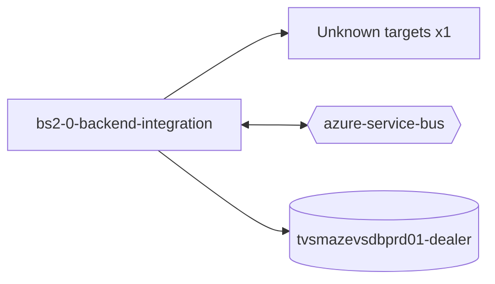

# bs2-0-backend-integration — High-Level Design

## Context
bs2-0-backend-integration is a `backend-api` in the TVS-CS org (domain: Unknown). Neighbours: callers Unknown; downstream none resolved.

## Architecture
bs2-0-backend-integration components and connections (from service.yaml):

## Integration Points
bs2-0-backend-integration registry edges (0):

| Direction | Peer | Kind | Via | Criticality | Source | Match |
|---|---|---|---|---|---|---|
| N/A | | | | | | no registry edges |

## Data Ownership
bs2-0-backend-integration data stores (service.yaml `data_stores`; ownership flag not determinable unless set):

| Store | Type | Access | Owned | Key entities |
|---|---|---|---|---|
| `tvsmazevsdbprd01-dealer` | mssql | Unknown | Unknown | AdAmdMapping, BookingClaim, BookingStatus, BookingTopicLog, BsviExportDocument, BsviInsuranceUploadLog, BsviInvoiceUploadLog, DocumentRejectLog, InvoiceUploadLog, PaymentDetail, SapapprovedLog, Tb1002SapDetail, Tb1002SapDetailsLog, Tb1002UserStatus, Tb1007PolicyDetail … |

## Key Design Decisions
bs2-0-backend-integration: N/A — not determinable from code.

| Decision | Alternatives considered | Reason |
|---|---|---|
| Unknown | Unknown | Unknown |

## Non-Functional Requirements
bs2-0-backend-integration NFR targets: N/A — not determinable from code.

## Security
bs2-0-backend-integration security: endpoint auth values None. Auth code: `Program.cs:28`. 3 secret config key(s), sourced via: {'app-settings': 3} (names in OVERVIEW.md). PII handling: Unknown.

## Resilience and Failure Modes
bs2-0-backend-integration hard dependencies: none resolved. No retry/circuit-breaker code found; failure behaviour Unknown.

## Deployment Topology
bs2-0-backend-integration deployment artefacts (platform/regions: Unknown unless listed):

| Kind | Name | File | Environments | Image | Ports | Variable groups |
|---|---|---|---|---|---|---|
| N/A | | | | | | no infra files |

## Observability
bs2-0-backend-integration observability libraries: none found. Related config keys: `Logging:LogLevel:Default`, `Logging:LogLevel:Microsoft.AspNetCore`. Dashboards/alerts: Unknown.
