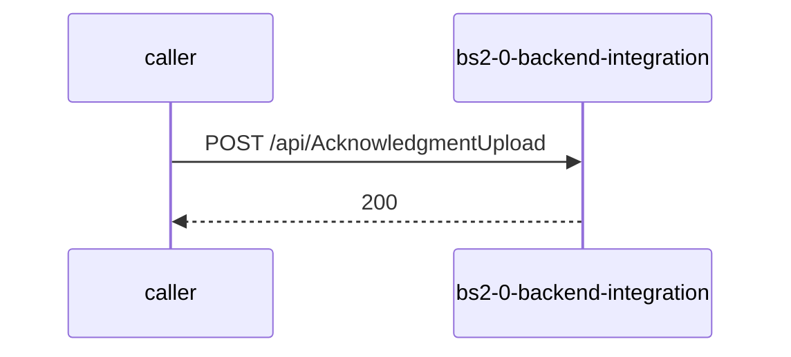

# bs2-0-backend-integration — Low-Level Design

## Data Model
bs2-0-backend-integration entities from `data_access` items (1).

Store access at `Controllers/SAPController.cs:247`: database tvsmazevsdbprd01-dealer; collections -.

### AD_AMD_Mapping
Entity `AdAmdMapping` defined in `Entities/AdAmdMapping.cs:9`; table AD_AMD_Mapping; operation Unknown.
Columns: Unknown (no fields extracted).
Relationships: Unknown.

### BookingClaim
Entity `BookingClaim` defined in `Entities/BookingClaim.cs:9`; table BookingClaim; operation Unknown.
Columns: Unknown (no fields extracted).
Relationships: Unknown.

### BookingStatus
Entity `BookingStatus` defined in `Entities/BookingStatus.cs:9`; table BookingStatus; operation Unknown.
Columns: Unknown (no fields extracted).
Relationships: Unknown.

### BookingTopicLog
Entity `BookingTopicLog` defined in `Entities/BookingTopicLog.cs:9`; table BookingTopicLog; operation Unknown.
Columns: Unknown (no fields extracted).
Relationships: Unknown.

### BsviExportDocument
Entity `BsviExportDocument` defined in `Entities/BsviExportDocument.cs:9`; table BsviExportDocument; operation Unknown.
Columns: Unknown (no fields extracted).
Relationships: Unknown.

### BSVI_InsuranceUploadLogs
Entity `BsviInsuranceUploadLog` defined in `Entities/BsviInsuranceUploadLog.cs:9`; table BSVI_InsuranceUploadLogs; operation Unknown.
Columns: Unknown (no fields extracted).
Relationships: Unknown.

### BSVI_InvoiceUploadLogs
Entity `BsviInvoiceUploadLog` defined in `Entities/BsviInvoiceUploadLog.cs:9`; table BSVI_InvoiceUploadLogs; operation Unknown.
Columns: Unknown (no fields extracted).
Relationships: Unknown.

### DocumentRejectLogs
Entity `DocumentRejectLog` defined in `Entities/DocumentRejectLog.cs:9`; table DocumentRejectLogs; operation Unknown.
Columns: Unknown (no fields extracted).
Relationships: Unknown.

### InvoiceUploadLogs
Entity `InvoiceUploadLog` defined in `Entities/InvoiceUploadLog.cs:9`; table InvoiceUploadLogs; operation Unknown.
Columns: Unknown (no fields extracted).
Relationships: Unknown.

### PaymentDetails
Entity `PaymentDetail` defined in `Entities/PaymentDetail.cs:9`; table PaymentDetails; operation Unknown.
Columns: Unknown (no fields extracted).
Relationships: Unknown.

### SAPApprovedLogs
Entity `SapapprovedLog` defined in `Entities/SapapprovedLog.cs:9`; table SAPApprovedLogs; operation Unknown.
Columns: Unknown (no fields extracted).
Relationships: Unknown.

### tb_1002_SAP_Details
Entity `Tb1002SapDetail` defined in `Entities/Tb1002SapDetail.cs:9`; table tb_1002_SAP_Details; operation Unknown.
Columns: Unknown (no fields extracted).
Relationships: Unknown.

### tb_1002_SAP_Details_Log
Entity `Tb1002SapDetailsLog` defined in `Entities/Tb1002SapDetailsLog.cs:9`; table tb_1002_SAP_Details_Log; operation Unknown.
Columns: Unknown (no fields extracted).
Relationships: Unknown.

### tb_1002_UserStatus
Entity `Tb1002UserStatus` defined in `Entities/Tb1002UserStatus.cs:9`; table tb_1002_UserStatus; operation Unknown.
Columns: Unknown (no fields extracted).
Relationships: Unknown.

### tb_1007_Policy_Details
Entity `Tb1007PolicyDetail` defined in `Entities/Tb1007PolicyDetail.cs:9`; table tb_1007_Policy_Details; operation Unknown.
Columns: Unknown (no fields extracted).
Relationships: Unknown.

### tb_1008_UserDetails
Entity `Tb1008UserDetail` defined in `Entities/Tb1008UserDetail.cs:9`; table tb_1008_UserDetails; operation Unknown.
Columns: Unknown (no fields extracted).
Relationships: Unknown.

### tb_1010_Settlement_Details
Entity `Tb1010SettlementDetail` defined in `Entities/Tb1010SettlementDetail.cs:9`; table tb_1010_Settlement_Details; operation Unknown.
Columns: Unknown (no fields extracted).
Relationships: Unknown.

### tb_1011_CCAvenue_Status_API_Details
Entity `Tb1011CcavenueStatusApiDetail` defined in `Entities/Tb1011CcavenueStatusApiDetail.cs:9`; table tb_1011_CCAvenue_Status_API_Details; operation Unknown.
Columns: Unknown (no fields extracted).
Relationships: Unknown.

### tb_1012_Settlement_Breakup
Entity `Tb1012SettlementBreakup` defined in `Entities/Tb1012SettlementBreakup.cs:9`; table tb_1012_Settlement_Breakup; operation Unknown.
Columns: Unknown (no fields extracted).
Relationships: Unknown.

### tb_105_UserStatus
Entity `Tb105UserStatus` defined in `Entities/Tb105UserStatus.cs:9`; table tb_105_UserStatus; operation Unknown.
Columns: Unknown (no fields extracted).
Relationships: Unknown.

### UserLoginLogs
Entity `UserLoginLog` defined in `Entities/UserLoginLog.cs:9`; table UserLoginLogs; operation Unknown.
Columns: Unknown (no fields extracted).
Relationships: Unknown.

### VehicleDetails
Entity `VehicleDetail` defined in `Entities/VehicleDetail.cs:9`; table VehicleDetails; operation Unknown.
Columns: Unknown (no fields extracted).
Relationships: Unknown.

## State Machines
bs2-0-backend-integration: N/A — no status/state enums found in code.

## Business Rules
bs2-0-backend-integration validation rules on DTO fields (from schema `validation`):
N/A — no declarative validation found; other rules not determinable without manual review.

## Key Classes and Functions
bs2-0-backend-integration key classes:

| Class / Function | File | Responsibility |
|---|---|---|
| `DealerDashboardController` | `Controllers/DealerDashboardController.cs` | HTTP handlers |
| `BookingsController` | `Controllers/BookingsController.cs` | HTTP handlers |
| `BookingExport` | `Controllers/BookingExport.cs` | HTTP handlers |
| `SAPController` | `Controllers/SAPController.cs` | HTTP handlers |
| `ExportQueue` | `QueueListeners/ExportQueue.cs:234` | scheduled job |
| publish Unknown (`unresolved`) | `QueueDispatcher/Dispatcher.cs:15` | azure-service-bus messaging |
| subscribe prod.booking | `TopicListener/BookingServiceTopicListener.cs:62` | azure-service-bus messaging |

## Sequence Details
bs2-0-backend-integration sequence for `POST /api/AcknowledgmentUpload` (handler `DealerDashboardController.AcknowledgmentUpload`); downstream calls inside the handler are not traced from code, module-level targets shown as optional.

## Error Handling
bs2-0-backend-integration error handling: no global exception handler found in code. Documented error statuses come from response annotations in API_SPEC.md.

## Configuration Details
bs2-0-backend-integration behaviour-relevant config keys (names only; full list in OVERVIEW.md):
- `ServiceBusSettings:TopicName`: subscribe entity name

## Edge Cases
bs2-0-backend-integration edge cases: N/A — not determinable from code without manual review.
