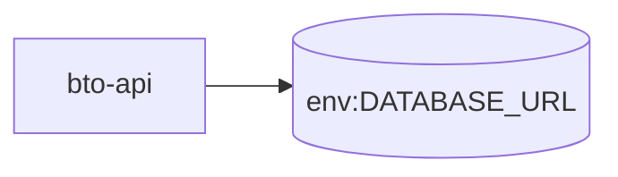

# bto-api — High-Level Design

## Context
bto-api is a `backend-api` in the TVS-CS org (domain: Unknown). Neighbours: callers Unknown; downstream none resolved.

## Architecture
bto-api components and connections (from service.yaml):

## Integration Points
bto-api registry edges (0):

| Direction | Peer | Kind | Via | Criticality | Source | Match |
|---|---|---|---|---|---|---|
| N/A | | | | | | no registry edges |

## Data Ownership
bto-api data stores (service.yaml `data_stores`; ownership flag not determinable unless set):

| Store | Type | Access | Owned | Key entities |
|---|---|---|---|---|
| `env:DATABASE_URL` | mssql | Unknown | Unknown | BTODashboardUser, BookingDetail, BookingStatus, Correspondence, SAPStatusUpdateLog, SMSPushDetail |

## Key Design Decisions
bto-api: N/A — not determinable from code.

| Decision | Alternatives considered | Reason |
|---|---|---|
| Unknown | Unknown | Unknown |

## Non-Functional Requirements
bto-api NFR targets: N/A — not determinable from code.

## Security
bto-api security: endpoint auth values None, guard:JwtGuard. Auth code: `src/auth/auth.module.ts:5`, `src/auth/guard/jwt.guard.ts:1`, `src/auth/strategy/jwt.strategy.ts:8`, `src/booking/booking.controller.ts:23`, `src/report/report.controller.ts:9`. 1 secret config key(s), sourced via: {'None': 1} (names in OVERVIEW.md). PII handling: Unknown.

## Resilience and Failure Modes
bto-api hard dependencies: none resolved. No retry/circuit-breaker code found; failure behaviour Unknown.

## Deployment Topology
bto-api deployment artefacts (platform/regions: Unknown unless listed):

| Kind | Name | File | Environments | Image | Ports | Variable groups |
|---|---|---|---|---|---|---|
| N/A | | | | | | no infra files |

## Observability
bto-api observability libraries: `nest-winston`, `winston`, `winston-daily-rotate-file`. Related config keys: none. Dashboards/alerts: Unknown.
