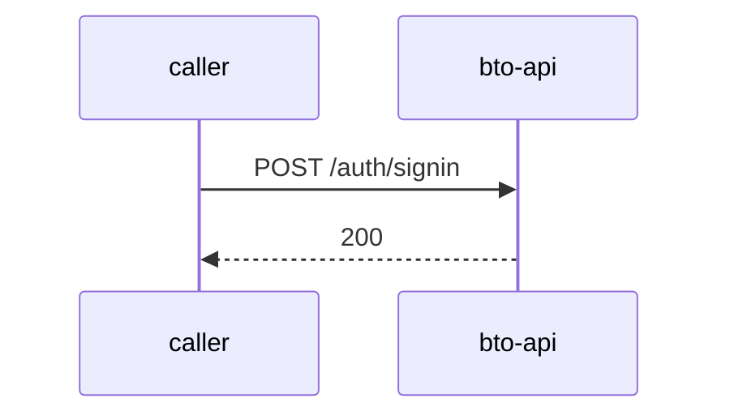

# bto-api — Low-Level Design

## Data Model
bto-api entities from `data_access` items (1).

Store access at `prisma/schema.prisma:6`: database Unknown; collections -.

### BTODashboardUsers
Entity `BTODashboardUser` defined in `prisma/schema.prisma:10`; table BTODashboardUsers; operation Unknown.
Columns: Unknown (no fields extracted).
Relationships: Unknown.

### BookingStatus
Entity `BookingStatus` defined in `prisma/schema.prisma:20`; table Unknown; operation Unknown.
Columns: Unknown (no fields extracted).
Relationships: Unknown.

### Correspondences
Entity `Correspondence` defined in `prisma/schema.prisma:115`; table Correspondences; operation Unknown.
Columns: Unknown (no fields extracted).
Relationships: Unknown.

### tb_1000_booking_details
Entity `BookingDetail` defined in `prisma/schema.prisma:132`; table tb_1000_booking_details; operation Unknown.
Columns: Unknown (no fields extracted).
Relationships: Unknown.

### tb_151_SMSPush_Details
Entity `SMSPushDetail` defined in `prisma/schema.prisma:246`; table tb_151_SMSPush_Details; operation Unknown.
Columns: Unknown (no fields extracted).
Relationships: Unknown.

### tb_1014_SAPOrderStatus_API_Log
Entity `SAPStatusUpdateLog` defined in `prisma/schema.prisma:262`; table tb_1014_SAPOrderStatus_API_Log; operation Unknown.
Columns: Unknown (no fields extracted).
Relationships: Unknown.

## State Machines
bto-api: N/A — no status/state enums found in code.

## Business Rules
bto-api validation rules on DTO fields (from schema `validation`):

| Schema.field | Rule | Defined in |
|---|---|---|
| `BookingInfoRequestDto.frameNumber` | IsString(); IsNotEmpty() | `src/booking/dto/bookingInfoRequest.dto.ts:3` |
| `BookingInfoRequestDto.orderNumber` | IsString(); IsNotEmpty() | `src/booking/dto/bookingInfoRequest.dto.ts:3` |
| `BookingResponseDto.Id` | IsNumber(); IsNotEmpty() | `src/booking/dto/bookingResponse.dto.ts:4` |
| `BookingResponseDto.TransactionID` | IsNotEmpty(); IsString() | `src/booking/dto/bookingResponse.dto.ts:4` |
| `BookingResponseDto.InternetEnquiryId` | IsString() | `src/booking/dto/bookingResponse.dto.ts:4` |
| `BookingResponseDto.CustomerName` | IsNotEmpty(); IsString() | `src/booking/dto/bookingResponse.dto.ts:4` |
| `BookingResponseDto.CustomerPhone` | IsNotEmpty(); IsString() | `src/booking/dto/bookingResponse.dto.ts:4` |
| `BookingResponseDto.CustomerEmail` | IsNotEmpty(); IsEmail() | `src/booking/dto/bookingResponse.dto.ts:4` |
| `BookingResponseDto.DealerCode` | IsNotEmpty(); IsString() | `src/booking/dto/bookingResponse.dto.ts:4` |
| `BookingResponseDto.CCAvenueRefNumber` | IsString() | `src/booking/dto/bookingResponse.dto.ts:4` |
| `BookingResponseDto.VehicleName` | IsNotEmpty(); IsString() | `src/booking/dto/bookingResponse.dto.ts:4` |
| `BookingResponseDto.VariantName` | IsNotEmpty(); IsString() | `src/booking/dto/bookingResponse.dto.ts:4` |
| `BookingResponseDto.Color` | IsNotEmpty(); IsString() | `src/booking/dto/bookingResponse.dto.ts:4` |
| `BookingResponseDto.FrameNumber` | IsString() | `src/booking/dto/bookingResponse.dto.ts:4` |
| `BookingResponseDto.BillToOrderNumber` | IsString() | `src/booking/dto/bookingResponse.dto.ts:4` |
| `BookingResponseDto.favoriteNumber` | IsString() | `src/booking/dto/bookingResponse.dto.ts:4` |
| `BookingResponseDto.CurrentStage` | IsNotEmpty(); IsString() | `src/booking/dto/bookingResponse.dto.ts:4` |
| `BookingResponseDto.BookingDate` | IsNotEmpty(); IsString() | `src/booking/dto/bookingResponse.dto.ts:4` |
| `BookingResponseDto.BookingRecievedDate` | IsNotEmpty(); IsDate() | `src/booking/dto/bookingResponse.dto.ts:4` |
| `BookingResponseDto.DMSPushedDate` | IsDate() | `src/booking/dto/bookingResponse.dto.ts:4` |
| `BookingResponseDto.OrderRecievedDate` | IsDate() | `src/booking/dto/bookingResponse.dto.ts:4` |
| `BookingResponseDto.IsCancelled` | IsBoolean() | `src/booking/dto/bookingResponse.dto.ts:4` |
| `BookingResponseDto.CancelledOn` | IsDate() | `src/booking/dto/bookingResponse.dto.ts:4` |
| `ReportDto.startDate` | IsString(); IsNotEmpty() | `src/report/dto/report.dto.ts:3` |
| `ReportDto.endDate` | IsString(); IsNotEmpty() | `src/report/dto/report.dto.ts:3` |
| `SignInDto.email` | IsEmail(); IsNotEmpty() | `src/auth/dto/signIn.dto.ts:3` |
| `SignInDto.password` | IsString(); IsNotEmpty() | `src/auth/dto/signIn.dto.ts:3` |
| `SignUpDto.email` | IsEmail(); IsNotEmpty() | `src/auth/dto/signUp.dto.ts:3` |
| `SignUpDto.password` | IsString(); IsNotEmpty() | `src/auth/dto/signUp.dto.ts:3` |
| `SignUpDto.role` | IsString(); IsNotEmpty() | `src/auth/dto/signUp.dto.ts:3` |
| `TokenDto.access_token` | IsString() | `src/auth/dto/token.dto.ts:3` |

## Key Classes and Functions
bto-api key classes:

| Class / Function | File | Responsibility |
|---|---|---|
| `BookingController` | `src/booking/booking.controller.ts` | HTTP handlers |
| `ReportController` | `src/report/report.controller.ts` | HTTP handlers |
| `AuthController` | `src/auth/auth.controller.ts` | HTTP handlers |

## Sequence Details
bto-api sequence for `POST /auth/signin` (handler `AuthController.signin`); downstream calls inside the handler are not traced from code, module-level targets shown as optional.

## Error Handling
bto-api error handling: no global exception handler found in code. Status mapping: Unknown.

## Configuration Details
bto-api behaviour-relevant config keys (names only; full list in OVERVIEW.md):
- N/A — no behaviour-switching keys identified

## Edge Cases
bto-api edge cases: N/A — not determinable from code without manual review.
