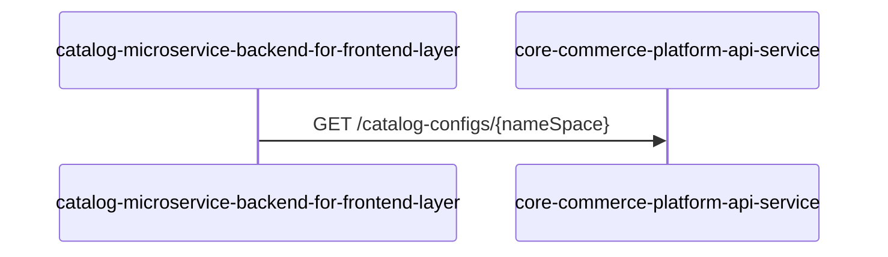

# catalog-microservice-backend-for-frontend-layer — Data Flows

## Flow Index
catalog-microservice-backend-for-frontend-layer takes part in 1 end-to-end flow(s) in registry/flows.json.

| flow_id | Name | Role of catalog-microservice-backend-for-frontend-layer | Trigger |
|---|---|---|---|
| catalog-microservice-backend-for-frontend-layer--core-commerce-platform-api-service | catalog-microservice-backend-for-frontend-layer → core-commerce-platform-api-service (1 hop) | entry | request to catalog-microservice-backend-for-frontend-layer from outside the registry (no internal caller) |

## Flow: catalog-microservice-backend-for-frontend-layer--core-commerce-platform-api-service
Summary: Starting at `catalog-microservice-backend-for-frontend-layer` (request to catalog-microservice-backend-for-frontend-layer from outside the registry (no internal caller)), the flow ends at `core-commerce-platform-api-service`, using 1 sync HTTP hop(s) and 0 async event hop(s); catalog-microservice-backend-for-frontend-layer role: entry; confidence medium.

Steps:
| # | From | To | Via | Data (schema names) | Sync/Async | Confidence |
|---|---|---|---|---|---|---|
| 1 | catalog-microservice-backend-for-frontend-layer | core-commerce-platform-api-service | GET /catalog-configs/{nameSpace} | Unknown | sync | medium |

Data touched: core-commerce-platform-api-service: mongo, redis

Failure points: hop 1 catalog-microservice-backend-for-frontend-layer → core-commerce-platform-api-service: criticality hard

Evidence:
- hop 1 (catalog-microservice-backend-for-frontend-layer → core-commerce-platform-api-service): `Catalog-Microservice-Backend-for-Frontend-Layer/src/rest/implementers/catalog-implementer.ts:31`, `Core-Commerce-Platform-API-Service/src/routes/api/catalog-configuration-routes.ts:8`
