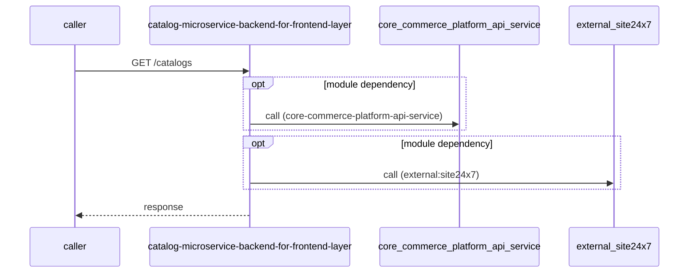

# catalog-microservice-backend-for-frontend-layer — Low-Level Design

## Data Model
catalog-microservice-backend-for-frontend-layer entities from `data_access` items (0).
N/A — no data access in this repo.

## State Machines
catalog-microservice-backend-for-frontend-layer: N/A — no status/state enums found in code.

## Business Rules
catalog-microservice-backend-for-frontend-layer validation rules on DTO fields (from schema `validation`):
N/A — no declarative validation found; other rules not determinable without manual review.

## Key Classes and Functions
catalog-microservice-backend-for-frontend-layer key classes:

| Class / Function | File | Responsibility |
|---|---|---|
| `catalogHandler` | `src/routes/api/catalog-route.ts` | HTTP handlers |
| `applicationHealthHandler` | `src/routes/api/application-health-route.ts` | HTTP handlers |

## Sequence Details
catalog-microservice-backend-for-frontend-layer sequence for `GET /catalogs` (handler `catalogHandler.getDefaultCatalog`); downstream calls inside the handler are not traced from code, module-level targets shown as optional.

## Error Handling
catalog-microservice-backend-for-frontend-layer error handling: no global exception handler found in code. Status mapping: Unknown.

## Configuration Details
catalog-microservice-backend-for-frontend-layer behaviour-relevant config keys (names only; full list in OVERVIEW.md):
- `CATALOG_MICRO_SERVICES_BASE_URL`: points to `core-commerce-platform-api-service`
- `env:CATALOG_MICRO_SERVICES_BASE_URL`: base URL for outbound calls
- `env:AZURE_OAUTH_TOKEN_BASE_URL`: base URL for outbound calls

## Edge Cases
catalog-microservice-backend-for-frontend-layer edge cases: N/A — not determinable from code without manual review.
