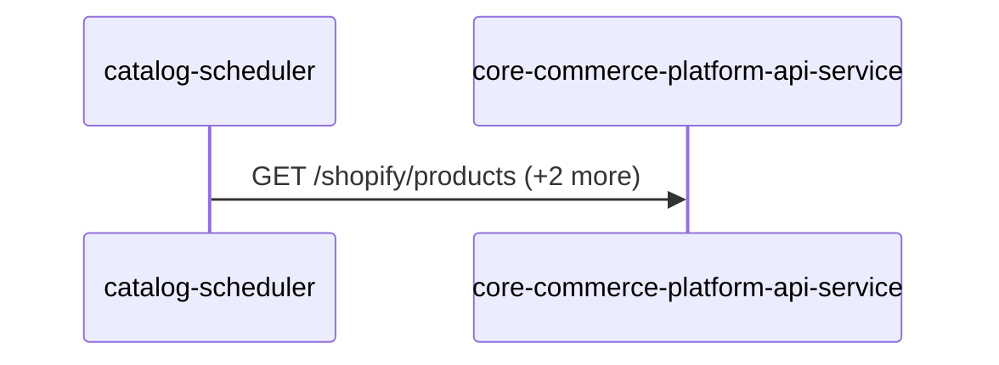
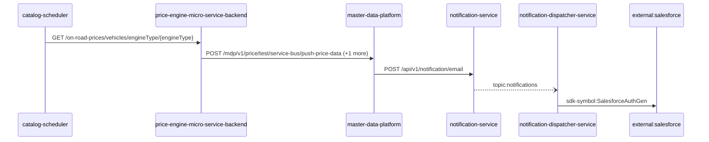
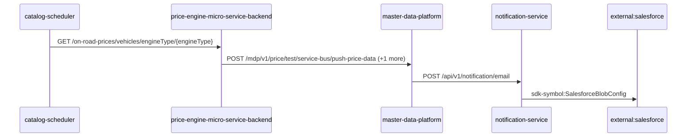
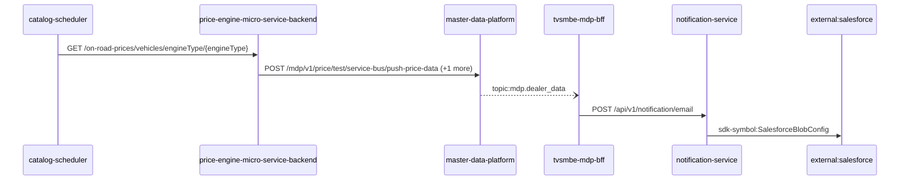
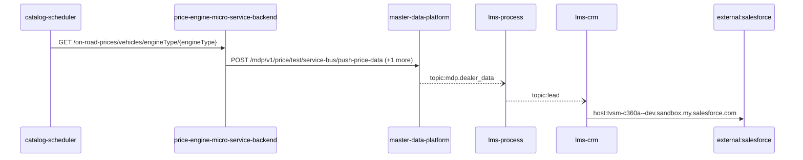
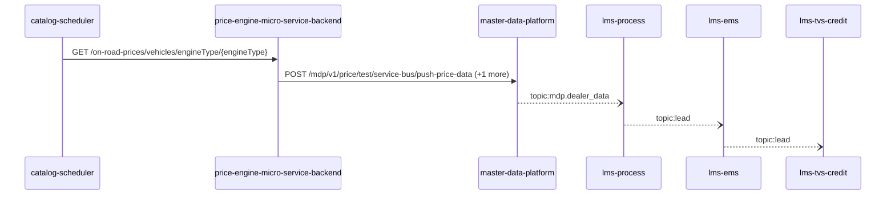
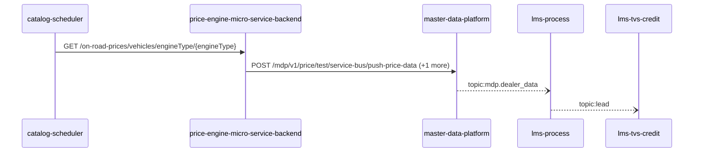
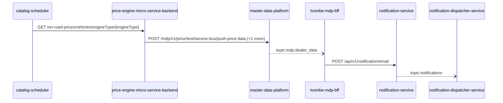

# catalog-scheduler — Data Flows

## Flow Index
catalog-scheduler takes part in 9 end-to-end flow(s) in registry/flows.json.

| flow_id | Name | Role of catalog-scheduler | Trigger |
|---|---|---|---|
| catalog-scheduler--core-commerce-platform-api-service | catalog-scheduler → core-commerce-platform-api-service (1 hop) | entry | scheduled job(s) in catalog-scheduler (job-to-call link not resolved): merchandise-accessories-ingestion-job, product-price-ingestion-job; request to catalog-scheduler from outside the registry (no internal caller) |
| catalog-scheduler--external-salesforce-7dacdd | catalog-scheduler → external:salesforce (5 hops) | entry | scheduled job(s) in catalog-scheduler (job-to-call link not resolved): merchandise-accessories-ingestion-job, product-price-ingestion-job; request to catalog-scheduler from outside the registry (no internal caller) |
| catalog-scheduler--external-salesforce-ee1cc0 | catalog-scheduler → external:salesforce (4 hops) | entry | scheduled job(s) in catalog-scheduler (job-to-call link not resolved): merchandise-accessories-ingestion-job, product-price-ingestion-job; request to catalog-scheduler from outside the registry (no internal caller) |
| catalog-scheduler--external-salesforce-fc87bd | catalog-scheduler → external:salesforce (5 hops) | entry | scheduled job(s) in catalog-scheduler (job-to-call link not resolved): merchandise-accessories-ingestion-job, product-price-ingestion-job; request to catalog-scheduler from outside the registry (no internal caller) |
| catalog-scheduler--external-salesforce-fdb9af | catalog-scheduler → external:salesforce (5 hops) | entry | scheduled job(s) in catalog-scheduler (job-to-call link not resolved): merchandise-accessories-ingestion-job, product-price-ingestion-job; request to catalog-scheduler from outside the registry (no internal caller) |
| catalog-scheduler--lms-crm | catalog-scheduler → lms-crm (5 hops) | entry | scheduled job(s) in catalog-scheduler (job-to-call link not resolved): merchandise-accessories-ingestion-job, product-price-ingestion-job; request to catalog-scheduler from outside the registry (no internal caller) |
| catalog-scheduler--lms-tvs-credit-bd6cbe | catalog-scheduler → lms-tvs-credit (5 hops) | entry | scheduled job(s) in catalog-scheduler (job-to-call link not resolved): merchandise-accessories-ingestion-job, product-price-ingestion-job; request to catalog-scheduler from outside the registry (no internal caller) |
| catalog-scheduler--lms-tvs-credit-db10c6 | catalog-scheduler → lms-tvs-credit (4 hops) | entry | scheduled job(s) in catalog-scheduler (job-to-call link not resolved): merchandise-accessories-ingestion-job, product-price-ingestion-job; request to catalog-scheduler from outside the registry (no internal caller) |
| catalog-scheduler--notification-dispatcher-service | catalog-scheduler → notification-dispatcher-service (5 hops) | entry | scheduled job(s) in catalog-scheduler (job-to-call link not resolved): merchandise-accessories-ingestion-job, product-price-ingestion-job; request to catalog-scheduler from outside the registry (no internal caller) |

## Flow: catalog-scheduler--core-commerce-platform-api-service
Summary: Starting at `catalog-scheduler` (scheduled job(s) in catalog-scheduler (job-to-call link not resolved): merchandise-accessories-ingestion-job, product-price-ingestion-job; request to catalog-scheduler from outside the registry (no internal caller)), the flow ends at `core-commerce-platform-api-service`, using 1 sync HTTP hop(s) and 0 async event hop(s); catalog-scheduler role: entry; confidence medium.

Steps:
| # | From | To | Via | Data (schema names) | Sync/Async | Confidence |
|---|---|---|---|---|---|---|
| 1 | catalog-scheduler | core-commerce-platform-api-service | GET /shopify/products, PUT /catalog-configs/{nameSpace}, PUT /catalogs/refresh/default-catalogs/{nameSpace} | Unknown | sync | medium |

Data touched: catalog-scheduler: mongo; core-commerce-platform-api-service: mongo, redis

Failure points: hop 1 catalog-scheduler → core-commerce-platform-api-service: criticality hard

Evidence:
- hop 1 (catalog-scheduler → core-commerce-platform-api-service): `Catalog-Scheduler/src/product-price-ingestion-job/data-sources/product-data-source/product-data-source-api.js:192`, `Core-Commerce-Platform-API-Service/src/routes/api/shopify-routes.ts:8`, `Catalog-Scheduler/src/product-price-ingestion-job/catalog-service/catalog-config-service.js:73` (+3 more)

## Flow: catalog-scheduler--external-salesforce-7dacdd
Summary: Starting at `catalog-scheduler` (scheduled job(s) in catalog-scheduler (job-to-call link not resolved): merchandise-accessories-ingestion-job, product-price-ingestion-job; request to catalog-scheduler from outside the registry (no internal caller)), the flow passes through `price-engine-micro-service-backend`, `master-data-platform`, `notification-service`, `notification-dispatcher-service` and ends at `external:salesforce`, using 4 sync HTTP hop(s) and 1 async event hop(s); catalog-scheduler role: entry; confidence medium.

Steps:
| # | From | To | Via | Data (schema names) | Sync/Async | Confidence |
|---|---|---|---|---|---|---|
| 1 | catalog-scheduler | price-engine-micro-service-backend | GET /on-road-prices/vehicles/engineType/{engineType} | Unknown | sync | medium |
| 2 | price-engine-micro-service-backend | master-data-platform | POST /mdp/v1/price/test/service-bus/push-price-data, POST /mdp/v1/product/test/service-bus/push-product-data | GeneralResponse | sync | high |
| 3 | master-data-platform | notification-service | POST /api/v1/notification/email | EmailNotification, NotificationResponse | sync | high |
| 4 | notification-service | notification-dispatcher-service | topic:notifications | Unknown | async | medium |
| 5 | notification-dispatcher-service | external:salesforce | sdk-symbol:SalesforceAuthGen | Unknown | sync | high |

Data touched: catalog-scheduler: mongo; price-engine-micro-service-backend: mongo, redis; master-data-platform: mysql:xxxx.mysql.database.azure.com:mdp_20230904, other, redis; notification-service: mongo; notification-dispatcher-service: mongo

Failure points: hop 1 catalog-scheduler → price-engine-micro-service-backend: criticality hard; hop 2 price-engine-micro-service-backend → master-data-platform: criticality hard; hop 3 master-data-platform → notification-service: criticality hard; hop 4 notification-service → notification-dispatcher-service: criticality async; hop 5 notification-dispatcher-service → external:salesforce: criticality hard

Evidence:
- hop 1 (catalog-scheduler → price-engine-micro-service-backend): `Catalog-Scheduler/src/product-price-ingestion-job/data-sources/price-engine-data-source/price-engine-data-source.js:21`, `Price-Engine-MicroService-Backend/src/routes/api/on-road-price-routes.ts:31`
- hop 2 (price-engine-micro-service-backend → master-data-platform): `Price-Engine-MicroService-Backend/sonar-exclusion-function/service-bus/service-bus.ts:23`, `master-data-platform/src/main/java/com/tvsmotor/mdp/price/controller/TestPriceServiceBusController.java:18`, `Price-Engine-MicroService-Backend/sonar-exclusion-function/service-bus/service-bus.ts:9` (+1 more)
- hop 3 (master-data-platform → notification-service): `master-data-platform/src/main/java/com/tvsmotor/mdp/service/OkHttpService.java:24`, `master-data-platform/src/main/java/com/tvsmotor/mdp/service/notification_service/NotificationSenderService.java:69`, `notification-service/src/main/java/com/tvsmotor/notification/controller/NotificationController.java:23`
- hop 4 (notification-service → notification-dispatcher-service): `notification-dispatcher-service/src/main/java/com/tvsmotor/notificationdispatcher/config/ServiceBusConfig.java:33`, `notification-dispatcher-service/src/main/java/com/tvsmotor/notificationdispatcher/config/ServiceBusConfig.java:34`, `notification-service/src/main/java/com/tvsmotor/notification/config/ServiceBusConfig.java:37` (+1 more)
- hop 5 (notification-dispatcher-service → external:salesforce): `notification-dispatcher-service/src/main/java/com/tvsmotor/notificationdispatcher/controller/SalesforceTokenController.java:18`, `notification-dispatcher-service/src/main/java/com/tvsmotor/notificationdispatcher/model/dto/salesforce/SalesforceData.java:5`, `notification-dispatcher-service/src/main/java/com/tvsmotor/notificationdispatcher/model/dto/salesforce/SalesforceTemplateKeys.java:8`

## Flow: catalog-scheduler--external-salesforce-ee1cc0
Summary: Starting at `catalog-scheduler` (scheduled job(s) in catalog-scheduler (job-to-call link not resolved): merchandise-accessories-ingestion-job, product-price-ingestion-job; request to catalog-scheduler from outside the registry (no internal caller)), the flow passes through `price-engine-micro-service-backend`, `master-data-platform`, `notification-service` and ends at `external:salesforce`, using 4 sync HTTP hop(s) and 0 async event hop(s); catalog-scheduler role: entry; confidence medium.

Steps:
| # | From | To | Via | Data (schema names) | Sync/Async | Confidence |
|---|---|---|---|---|---|---|
| 1 | catalog-scheduler | price-engine-micro-service-backend | GET /on-road-prices/vehicles/engineType/{engineType} | Unknown | sync | medium |
| 2 | price-engine-micro-service-backend | master-data-platform | POST /mdp/v1/price/test/service-bus/push-price-data, POST /mdp/v1/product/test/service-bus/push-product-data | GeneralResponse | sync | high |
| 3 | master-data-platform | notification-service | POST /api/v1/notification/email | EmailNotification, NotificationResponse | sync | high |
| 4 | notification-service | external:salesforce | sdk-symbol:SalesforceBlobConfig | Unknown | sync | high |

Data touched: catalog-scheduler: mongo; price-engine-micro-service-backend: mongo, redis; master-data-platform: mysql:xxxx.mysql.database.azure.com:mdp_20230904, other, redis; notification-service: mongo

Failure points: hop 1 catalog-scheduler → price-engine-micro-service-backend: criticality hard; hop 2 price-engine-micro-service-backend → master-data-platform: criticality hard; hop 3 master-data-platform → notification-service: criticality hard; hop 4 notification-service → external:salesforce: criticality hard

Evidence:
- hop 1 (catalog-scheduler → price-engine-micro-service-backend): `Catalog-Scheduler/src/product-price-ingestion-job/data-sources/price-engine-data-source/price-engine-data-source.js:21`, `Price-Engine-MicroService-Backend/src/routes/api/on-road-price-routes.ts:31`
- hop 2 (price-engine-micro-service-backend → master-data-platform): `Price-Engine-MicroService-Backend/sonar-exclusion-function/service-bus/service-bus.ts:23`, `master-data-platform/src/main/java/com/tvsmotor/mdp/price/controller/TestPriceServiceBusController.java:18`, `Price-Engine-MicroService-Backend/sonar-exclusion-function/service-bus/service-bus.ts:9` (+1 more)
- hop 3 (master-data-platform → notification-service): `master-data-platform/src/main/java/com/tvsmotor/mdp/service/OkHttpService.java:24`, `master-data-platform/src/main/java/com/tvsmotor/mdp/service/notification_service/NotificationSenderService.java:69`, `notification-service/src/main/java/com/tvsmotor/notification/controller/NotificationController.java:23`
- hop 4 (notification-service → external:salesforce): `notification-service/src/main/java/com/tvsmotor/notification/config/SalesforceBlobConfig.java:10`, `notification-service/src/main/java/com/tvsmotor/notification/cronjobs/SalesforceBlobStatusJob.java:17`, `notification-service/src/main/java/com/tvsmotor/notification/model/dto/salesforce/SalesforceData.java:8`

## Flow: catalog-scheduler--external-salesforce-fc87bd
Summary: Starting at `catalog-scheduler` (scheduled job(s) in catalog-scheduler (job-to-call link not resolved): merchandise-accessories-ingestion-job, product-price-ingestion-job; request to catalog-scheduler from outside the registry (no internal caller)), the flow passes through `price-engine-micro-service-backend`, `master-data-platform`, `tvsmbe-mdp-bff`, `notification-service` and ends at `external:salesforce`, using 4 sync HTTP hop(s) and 1 async event hop(s); catalog-scheduler role: entry; confidence medium.

Steps:
| # | From | To | Via | Data (schema names) | Sync/Async | Confidence |
|---|---|---|---|---|---|---|
| 1 | catalog-scheduler | price-engine-micro-service-backend | GET /on-road-prices/vehicles/engineType/{engineType} | Unknown | sync | medium |
| 2 | price-engine-micro-service-backend | master-data-platform | POST /mdp/v1/price/test/service-bus/push-price-data, POST /mdp/v1/product/test/service-bus/push-product-data | GeneralResponse | sync | high |
| 3 | master-data-platform | tvsmbe-mdp-bff | topic:mdp.dealer_data | DealerData | async | medium |
| 4 | tvsmbe-mdp-bff | notification-service | POST /api/v1/notification/email | EmailNotification, NotificationResponse | sync | high |
| 5 | notification-service | external:salesforce | sdk-symbol:SalesforceBlobConfig | Unknown | sync | high |

Data touched: catalog-scheduler: mongo; price-engine-micro-service-backend: mongo, redis; master-data-platform: mysql:xxxx.mysql.database.azure.com:mdp_20230904, other, redis; tvsmbe-mdp-bff: mysql, mysql:tvsmazcmndbsdev01-ci.mysql.database.azure.com:tvsmazebffsdbdev01; notification-service: mongo

Failure points: hop 1 catalog-scheduler → price-engine-micro-service-backend: criticality hard; hop 2 price-engine-micro-service-backend → master-data-platform: criticality hard; hop 3 master-data-platform → tvsmbe-mdp-bff: criticality async; hop 4 tvsmbe-mdp-bff → notification-service: criticality hard; hop 5 notification-service → external:salesforce: criticality hard

Evidence:
- hop 1 (catalog-scheduler → price-engine-micro-service-backend): `Catalog-Scheduler/src/product-price-ingestion-job/data-sources/price-engine-data-source/price-engine-data-source.js:21`, `Price-Engine-MicroService-Backend/src/routes/api/on-road-price-routes.ts:31`
- hop 2 (price-engine-micro-service-backend → master-data-platform): `Price-Engine-MicroService-Backend/sonar-exclusion-function/service-bus/service-bus.ts:23`, `master-data-platform/src/main/java/com/tvsmotor/mdp/price/controller/TestPriceServiceBusController.java:18`, `Price-Engine-MicroService-Backend/sonar-exclusion-function/service-bus/service-bus.ts:9` (+1 more)
- hop 3 (master-data-platform → tvsmbe-mdp-bff): `master-data-platform/src/main/java/com/tvsmotor/mdp/config/DealerMasterServiceBusConfig.java:26`, `master-data-platform/src/main/java/com/tvsmotor/mdp/config/DealerMasterServiceBusConfig.java:27`, `tvsmbe-mdp-bff/outbound/src/main/java/com/tvsmotor/mdp_bff/outbound/config/BffServiceBusConfig.java:24` (+1 more)
- hop 4 (tvsmbe-mdp-bff → notification-service): `notification-service/src/main/java/com/tvsmotor/notification/controller/NotificationController.java:23`, `tvsmbe-mdp-bff/outbound/src/main/java/com/tvsmotor/mdp_bff/outbound/service/NotificationSenderService.java:46`, `tvsmbe-mdp-bff/outbound/src/main/java/com/tvsmotor/mdp_bff/outbound/service/OkHttpService.java:88`
- hop 5 (notification-service → external:salesforce): `notification-service/src/main/java/com/tvsmotor/notification/config/SalesforceBlobConfig.java:10`, `notification-service/src/main/java/com/tvsmotor/notification/cronjobs/SalesforceBlobStatusJob.java:17`, `notification-service/src/main/java/com/tvsmotor/notification/model/dto/salesforce/SalesforceData.java:8`

## Flow: catalog-scheduler--external-salesforce-fdb9af
Summary: Starting at `catalog-scheduler` (scheduled job(s) in catalog-scheduler (job-to-call link not resolved): merchandise-accessories-ingestion-job, product-price-ingestion-job; request to catalog-scheduler from outside the registry (no internal caller)), the flow passes through `price-engine-micro-service-backend`, `master-data-platform`, `lms-process`, `lms-crm` and ends at `external:salesforce`, using 3 sync HTTP hop(s) and 2 async event hop(s); catalog-scheduler role: entry; confidence medium.

Steps:
| # | From | To | Via | Data (schema names) | Sync/Async | Confidence |
|---|---|---|---|---|---|---|
| 1 | catalog-scheduler | price-engine-micro-service-backend | GET /on-road-prices/vehicles/engineType/{engineType} | Unknown | sync | medium |
| 2 | price-engine-micro-service-backend | master-data-platform | POST /mdp/v1/price/test/service-bus/push-price-data, POST /mdp/v1/product/test/service-bus/push-product-data | GeneralResponse | sync | high |
| 3 | master-data-platform | lms-process | topic:mdp.dealer_data | DealerData | async | medium |
| 4 | lms-process | lms-crm | topic:lead | Unknown | async | medium |
| 5 | lms-crm | external:salesforce | host:tvsm-c360a--dev.sandbox.my.salesforce.com | Unknown | sync | high |

Data touched: catalog-scheduler: mongo; price-engine-micro-service-backend: mongo, redis; master-data-platform: mysql:xxxx.mysql.database.azure.com:mdp_20230904, other, redis; lms-process: mssql; lms-crm: mssql

Failure points: hop 1 catalog-scheduler → price-engine-micro-service-backend: criticality hard; hop 2 price-engine-micro-service-backend → master-data-platform: criticality hard; hop 3 master-data-platform → lms-process: criticality async; hop 4 lms-process → lms-crm: criticality async; hop 5 lms-crm → external:salesforce: criticality hard

Evidence:
- hop 1 (catalog-scheduler → price-engine-micro-service-backend): `Catalog-Scheduler/src/product-price-ingestion-job/data-sources/price-engine-data-source/price-engine-data-source.js:21`, `Price-Engine-MicroService-Backend/src/routes/api/on-road-price-routes.ts:31`
- hop 2 (price-engine-micro-service-backend → master-data-platform): `Price-Engine-MicroService-Backend/sonar-exclusion-function/service-bus/service-bus.ts:23`, `master-data-platform/src/main/java/com/tvsmotor/mdp/price/controller/TestPriceServiceBusController.java:18`, `Price-Engine-MicroService-Backend/sonar-exclusion-function/service-bus/service-bus.ts:9` (+1 more)
- hop 3 (master-data-platform → lms-process): `lms_process/processLeadService/Const/Constants.cs:7`, `lms_process/processLeadService/ListenerService/MdpConsumer.cs:42`, `master-data-platform/src/main/java/com/tvsmotor/mdp/config/DealerMasterServiceBusConfig.java:26` (+1 more)
- hop 4 (lms-process → lms-crm): `lms_crm/ListenerService/CrmListenerService.cs:44`, `lms_crm/Utils/Constants.cs:16`, `lms_process/processLeadService/Const/Constants.cs:6` (+1 more)
- hop 5 (lms-crm → external:salesforce): `lms_crm/appsettings.Development.json:16`, `lms_crm/appsettings.Production.json:17`, `lms_crm/appsettings.Uat.json:17`

## Flow: catalog-scheduler--lms-crm
Summary: Starting at `catalog-scheduler` (scheduled job(s) in catalog-scheduler (job-to-call link not resolved): merchandise-accessories-ingestion-job, product-price-ingestion-job; request to catalog-scheduler from outside the registry (no internal caller)), the flow passes through `price-engine-micro-service-backend`, `master-data-platform`, `lms-process`, `lms-ems` and ends at `lms-crm`, using 2 sync HTTP hop(s) and 3 async event hop(s); catalog-scheduler role: entry; confidence medium; truncated at the depth cap.

Steps:
| # | From | To | Via | Data (schema names) | Sync/Async | Confidence |
|---|---|---|---|---|---|---|
| 1 | catalog-scheduler | price-engine-micro-service-backend | GET /on-road-prices/vehicles/engineType/{engineType} | Unknown | sync | medium |
| 2 | price-engine-micro-service-backend | master-data-platform | POST /mdp/v1/price/test/service-bus/push-price-data, POST /mdp/v1/product/test/service-bus/push-product-data | GeneralResponse | sync | high |
| 3 | master-data-platform | lms-process | topic:mdp.dealer_data | DealerData | async | medium |
| 4 | lms-process | lms-ems | topic:lead | Unknown | async | medium |
| 5 | lms-ems | lms-crm | topic:lead | Unknown | async | medium |

Data touched: catalog-scheduler: mongo; price-engine-micro-service-backend: mongo, redis; master-data-platform: mysql:xxxx.mysql.database.azure.com:mdp_20230904, other, redis; lms-process: mssql; lms-ems: mssql; lms-crm: mssql

Failure points: hop 1 catalog-scheduler → price-engine-micro-service-backend: criticality hard; hop 2 price-engine-micro-service-backend → master-data-platform: criticality hard; hop 3 master-data-platform → lms-process: criticality async; hop 4 lms-process → lms-ems: criticality async; hop 5 lms-ems → lms-crm: criticality async

Evidence:
- hop 1 (catalog-scheduler → price-engine-micro-service-backend): `Catalog-Scheduler/src/product-price-ingestion-job/data-sources/price-engine-data-source/price-engine-data-source.js:21`, `Price-Engine-MicroService-Backend/src/routes/api/on-road-price-routes.ts:31`
- hop 2 (price-engine-micro-service-backend → master-data-platform): `Price-Engine-MicroService-Backend/sonar-exclusion-function/service-bus/service-bus.ts:23`, `master-data-platform/src/main/java/com/tvsmotor/mdp/price/controller/TestPriceServiceBusController.java:18`, `Price-Engine-MicroService-Backend/sonar-exclusion-function/service-bus/service-bus.ts:9` (+1 more)
- hop 3 (master-data-platform → lms-process): `lms_process/processLeadService/Const/Constants.cs:7`, `lms_process/processLeadService/ListenerService/MdpConsumer.cs:42`, `master-data-platform/src/main/java/com/tvsmotor/mdp/config/DealerMasterServiceBusConfig.java:26` (+1 more)
- hop 4 (lms-process → lms-ems): `lms_ems/emsService/Const/Constants.cs:14`, `lms_ems/emsService/ListenerService/EmsListenerService.cs:43`, `lms_process/processLeadService/Const/Constants.cs:6` (+1 more)
- hop 5 (lms-ems → lms-crm): `lms_crm/ListenerService/CrmListenerService.cs:44`, `lms_crm/Utils/Constants.cs:16`, `lms_ems/emsService/Const/Constants.cs:13` (+1 more)

## Flow: catalog-scheduler--lms-tvs-credit-bd6cbe
Summary: Starting at `catalog-scheduler` (scheduled job(s) in catalog-scheduler (job-to-call link not resolved): merchandise-accessories-ingestion-job, product-price-ingestion-job; request to catalog-scheduler from outside the registry (no internal caller)), the flow passes through `price-engine-micro-service-backend`, `master-data-platform`, `lms-process`, `lms-ems` and ends at `lms-tvs-credit`, using 2 sync HTTP hop(s) and 3 async event hop(s); catalog-scheduler role: entry; confidence medium.

Steps:
| # | From | To | Via | Data (schema names) | Sync/Async | Confidence |
|---|---|---|---|---|---|---|
| 1 | catalog-scheduler | price-engine-micro-service-backend | GET /on-road-prices/vehicles/engineType/{engineType} | Unknown | sync | medium |
| 2 | price-engine-micro-service-backend | master-data-platform | POST /mdp/v1/price/test/service-bus/push-price-data, POST /mdp/v1/product/test/service-bus/push-product-data | GeneralResponse | sync | high |
| 3 | master-data-platform | lms-process | topic:mdp.dealer_data | DealerData | async | medium |
| 4 | lms-process | lms-ems | topic:lead | Unknown | async | medium |
| 5 | lms-ems | lms-tvs-credit | topic:lead | Unknown | async | medium |

Data touched: catalog-scheduler: mongo; price-engine-micro-service-backend: mongo, redis; master-data-platform: mysql:xxxx.mysql.database.azure.com:mdp_20230904, other, redis; lms-process: mssql; lms-ems: mssql; lms-tvs-credit: mssql

Failure points: hop 1 catalog-scheduler → price-engine-micro-service-backend: criticality hard; hop 2 price-engine-micro-service-backend → master-data-platform: criticality hard; hop 3 master-data-platform → lms-process: criticality async; hop 4 lms-process → lms-ems: criticality async; hop 5 lms-ems → lms-tvs-credit: criticality async

Evidence:
- hop 1 (catalog-scheduler → price-engine-micro-service-backend): `Catalog-Scheduler/src/product-price-ingestion-job/data-sources/price-engine-data-source/price-engine-data-source.js:21`, `Price-Engine-MicroService-Backend/src/routes/api/on-road-price-routes.ts:31`
- hop 2 (price-engine-micro-service-backend → master-data-platform): `Price-Engine-MicroService-Backend/sonar-exclusion-function/service-bus/service-bus.ts:23`, `master-data-platform/src/main/java/com/tvsmotor/mdp/price/controller/TestPriceServiceBusController.java:18`, `Price-Engine-MicroService-Backend/sonar-exclusion-function/service-bus/service-bus.ts:9` (+1 more)
- hop 3 (master-data-platform → lms-process): `lms_process/processLeadService/Const/Constants.cs:7`, `lms_process/processLeadService/ListenerService/MdpConsumer.cs:42`, `master-data-platform/src/main/java/com/tvsmotor/mdp/config/DealerMasterServiceBusConfig.java:26` (+1 more)
- hop 4 (lms-process → lms-ems): `lms_ems/emsService/Const/Constants.cs:14`, `lms_ems/emsService/ListenerService/EmsListenerService.cs:43`, `lms_process/processLeadService/Const/Constants.cs:6` (+1 more)
- hop 5 (lms-ems → lms-tvs-credit): `lms_ems/emsService/Const/Constants.cs:13`, `lms_ems/emsService/Services/EmsService.cs:191`, `lms_tvs_credit/lms_tvs_credit/ListenerService/TvscreditListenerService.cs:46` (+1 more)

## Flow: catalog-scheduler--lms-tvs-credit-db10c6
Summary: Starting at `catalog-scheduler` (scheduled job(s) in catalog-scheduler (job-to-call link not resolved): merchandise-accessories-ingestion-job, product-price-ingestion-job; request to catalog-scheduler from outside the registry (no internal caller)), the flow passes through `price-engine-micro-service-backend`, `master-data-platform`, `lms-process` and ends at `lms-tvs-credit`, using 2 sync HTTP hop(s) and 2 async event hop(s); catalog-scheduler role: entry; confidence medium.

Steps:
| # | From | To | Via | Data (schema names) | Sync/Async | Confidence |
|---|---|---|---|---|---|---|
| 1 | catalog-scheduler | price-engine-micro-service-backend | GET /on-road-prices/vehicles/engineType/{engineType} | Unknown | sync | medium |
| 2 | price-engine-micro-service-backend | master-data-platform | POST /mdp/v1/price/test/service-bus/push-price-data, POST /mdp/v1/product/test/service-bus/push-product-data | GeneralResponse | sync | high |
| 3 | master-data-platform | lms-process | topic:mdp.dealer_data | DealerData | async | medium |
| 4 | lms-process | lms-tvs-credit | topic:lead | Unknown | async | medium |

Data touched: catalog-scheduler: mongo; price-engine-micro-service-backend: mongo, redis; master-data-platform: mysql:xxxx.mysql.database.azure.com:mdp_20230904, other, redis; lms-process: mssql; lms-tvs-credit: mssql

Failure points: hop 1 catalog-scheduler → price-engine-micro-service-backend: criticality hard; hop 2 price-engine-micro-service-backend → master-data-platform: criticality hard; hop 3 master-data-platform → lms-process: criticality async; hop 4 lms-process → lms-tvs-credit: criticality async

Evidence:
- hop 1 (catalog-scheduler → price-engine-micro-service-backend): `Catalog-Scheduler/src/product-price-ingestion-job/data-sources/price-engine-data-source/price-engine-data-source.js:21`, `Price-Engine-MicroService-Backend/src/routes/api/on-road-price-routes.ts:31`
- hop 2 (price-engine-micro-service-backend → master-data-platform): `Price-Engine-MicroService-Backend/sonar-exclusion-function/service-bus/service-bus.ts:23`, `master-data-platform/src/main/java/com/tvsmotor/mdp/price/controller/TestPriceServiceBusController.java:18`, `Price-Engine-MicroService-Backend/sonar-exclusion-function/service-bus/service-bus.ts:9` (+1 more)
- hop 3 (master-data-platform → lms-process): `lms_process/processLeadService/Const/Constants.cs:7`, `lms_process/processLeadService/ListenerService/MdpConsumer.cs:42`, `master-data-platform/src/main/java/com/tvsmotor/mdp/config/DealerMasterServiceBusConfig.java:26` (+1 more)
- hop 4 (lms-process → lms-tvs-credit): `lms_process/processLeadService/Const/Constants.cs:6`, `lms_process/processLeadService/Services/TwoWheelerService.cs:97`, `lms_tvs_credit/lms_tvs_credit/ListenerService/TvscreditListenerService.cs:46` (+1 more)

## Flow: catalog-scheduler--notification-dispatcher-service
Summary: Starting at `catalog-scheduler` (scheduled job(s) in catalog-scheduler (job-to-call link not resolved): merchandise-accessories-ingestion-job, product-price-ingestion-job; request to catalog-scheduler from outside the registry (no internal caller)), the flow passes through `price-engine-micro-service-backend`, `master-data-platform`, `tvsmbe-mdp-bff`, `notification-service` and ends at `notification-dispatcher-service`, using 3 sync HTTP hop(s) and 2 async event hop(s); catalog-scheduler role: entry; confidence medium; truncated at the depth cap.

Steps:
| # | From | To | Via | Data (schema names) | Sync/Async | Confidence |
|---|---|---|---|---|---|---|
| 1 | catalog-scheduler | price-engine-micro-service-backend | GET /on-road-prices/vehicles/engineType/{engineType} | Unknown | sync | medium |
| 2 | price-engine-micro-service-backend | master-data-platform | POST /mdp/v1/price/test/service-bus/push-price-data, POST /mdp/v1/product/test/service-bus/push-product-data | GeneralResponse | sync | high |
| 3 | master-data-platform | tvsmbe-mdp-bff | topic:mdp.dealer_data | DealerData | async | medium |
| 4 | tvsmbe-mdp-bff | notification-service | POST /api/v1/notification/email | EmailNotification, NotificationResponse | sync | high |
| 5 | notification-service | notification-dispatcher-service | topic:notifications | Unknown | async | medium |

Data touched: catalog-scheduler: mongo; price-engine-micro-service-backend: mongo, redis; master-data-platform: mysql:xxxx.mysql.database.azure.com:mdp_20230904, other, redis; tvsmbe-mdp-bff: mysql, mysql:tvsmazcmndbsdev01-ci.mysql.database.azure.com:tvsmazebffsdbdev01; notification-service: mongo; notification-dispatcher-service: mongo

Failure points: hop 1 catalog-scheduler → price-engine-micro-service-backend: criticality hard; hop 2 price-engine-micro-service-backend → master-data-platform: criticality hard; hop 3 master-data-platform → tvsmbe-mdp-bff: criticality async; hop 4 tvsmbe-mdp-bff → notification-service: criticality hard; hop 5 notification-service → notification-dispatcher-service: criticality async

Evidence:
- hop 1 (catalog-scheduler → price-engine-micro-service-backend): `Catalog-Scheduler/src/product-price-ingestion-job/data-sources/price-engine-data-source/price-engine-data-source.js:21`, `Price-Engine-MicroService-Backend/src/routes/api/on-road-price-routes.ts:31`
- hop 2 (price-engine-micro-service-backend → master-data-platform): `Price-Engine-MicroService-Backend/sonar-exclusion-function/service-bus/service-bus.ts:23`, `master-data-platform/src/main/java/com/tvsmotor/mdp/price/controller/TestPriceServiceBusController.java:18`, `Price-Engine-MicroService-Backend/sonar-exclusion-function/service-bus/service-bus.ts:9` (+1 more)
- hop 3 (master-data-platform → tvsmbe-mdp-bff): `master-data-platform/src/main/java/com/tvsmotor/mdp/config/DealerMasterServiceBusConfig.java:26`, `master-data-platform/src/main/java/com/tvsmotor/mdp/config/DealerMasterServiceBusConfig.java:27`, `tvsmbe-mdp-bff/outbound/src/main/java/com/tvsmotor/mdp_bff/outbound/config/BffServiceBusConfig.java:24` (+1 more)
- hop 4 (tvsmbe-mdp-bff → notification-service): `notification-service/src/main/java/com/tvsmotor/notification/controller/NotificationController.java:23`, `tvsmbe-mdp-bff/outbound/src/main/java/com/tvsmotor/mdp_bff/outbound/service/NotificationSenderService.java:46`, `tvsmbe-mdp-bff/outbound/src/main/java/com/tvsmotor/mdp_bff/outbound/service/OkHttpService.java:88`
- hop 5 (notification-service → notification-dispatcher-service): `notification-dispatcher-service/src/main/java/com/tvsmotor/notificationdispatcher/config/ServiceBusConfig.java:33`, `notification-dispatcher-service/src/main/java/com/tvsmotor/notificationdispatcher/config/ServiceBusConfig.java:34`, `notification-service/src/main/java/com/tvsmotor/notification/config/ServiceBusConfig.java:37` (+1 more)
