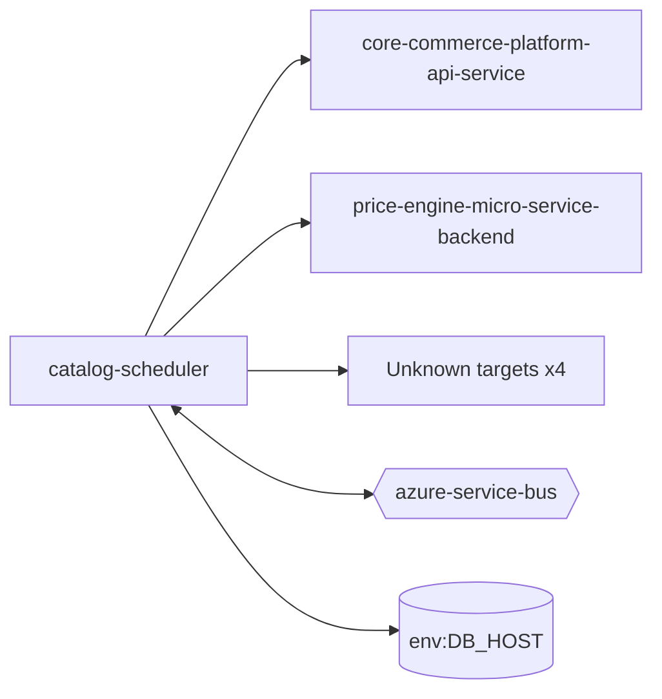

# catalog-scheduler — High-Level Design

## Context
catalog-scheduler is a `function` in the TVS-CS org (domain: Unknown). Neighbours: callers Unknown; downstream `core-commerce-platform-api-service`, `price-engine-micro-service-backend`.

## Architecture
catalog-scheduler components and connections (from service.yaml):

## Integration Points
catalog-scheduler registry edges (4):

| Direction | Peer | Kind | Via | Criticality | Source | Match |
|---|---|---|---|---|---|---|
| out | `core-commerce-platform-api-service` | http | GET /shopify/products | hard | code | path-unique |
| out | `core-commerce-platform-api-service` | http | PUT /catalog-configs/{nameSpace} | hard | code | path-unique |
| out | `core-commerce-platform-api-service` | http | PUT /catalogs/refresh/default-catalogs/{nameSpace} | hard | code | path-unique |
| out | `price-engine-micro-service-backend` | http | GET /on-road-prices/vehicles/engineType/{engineType} | hard | code | path-unique |

## Data Ownership
catalog-scheduler data stores (service.yaml `data_stores`; ownership flag not determinable unless set):

| Store | Type | Access | Owned | Key entities |
|---|---|---|---|---|
| `env:DB_HOST` | mongo | Unknown | Unknown | Unknown |

## Key Design Decisions
catalog-scheduler: N/A — not determinable from code.

| Decision | Alternatives considered | Reason |
|---|---|---|
| Unknown | Unknown | Unknown |

## Non-Functional Requirements
catalog-scheduler NFR targets: N/A — not determinable from code. Tuning-related config keys: `functionTimeout`.

## Security
catalog-scheduler security: endpoint auth values n/a. No auth middleware found in code. 2 secret config key(s), sourced via: {'None': 2} (names in OVERVIEW.md). PII handling: Unknown.

## Resilience and Failure Modes
catalog-scheduler hard dependencies: `core-commerce-platform-api-service`, `price-engine-micro-service-backend`. No retry/circuit-breaker code found; failure behaviour Unknown.

## Deployment Topology
catalog-scheduler deployment artefacts (platform/regions: Unknown unless listed):

| Kind | Name | File | Environments | Image | Ports | Variable groups |
|---|---|---|---|---|---|---|
| azure-pipeline | AST_CCP_Catalog_Service_Catalog_Scheduler_Release_Pipeline.yml | `AST_CCP_Catalog_Service_Catalog_Scheduler_Release_Pipeline.yml:1` | - | - | - | Checkmarx_Common, PROD_Threshold |
| azure-pipeline | AST_CCP_Catalog_Service_Catalog_Scheduler_UAT_Pipeline.yml | `AST_CCP_Catalog_Service_Catalog_Scheduler_UAT_Pipeline.yml:1` | - | - | - | Checkmarx_Common, UAT_Threshold |
| azure-pipeline | cd-dev-pipeline.yaml | `cd-dev-pipeline.yaml:1` | - | - | - | - |
| azure-pipeline | cd-prod-pipeline.yaml | `cd-prod-pipeline.yaml:1` | - | - | - | - |
| azure-pipeline | cd-uat-pipeline.yaml | `cd-uat-pipeline.yaml:1` | - | - | - | - |
| azure-pipeline | ci-dev-pipeline.yaml | `ci-dev-pipeline.yaml:1` | - | - | - | - |
| azure-pipeline | ci-prod-pipeline.yaml | `ci-prod-pipeline.yaml:1` | - | - | - | - |
| azure-pipeline | ci-uat-pipeline.yaml | `ci-uat-pipeline.yaml:1` | - | - | - | - |

## Observability
catalog-scheduler observability libraries: none found. Related config keys: `logging:applicationInsights:samplingSettings:excludedTypes`, `logging:applicationInsights:samplingSettings:isEnabled`. Dashboards/alerts: Unknown.
