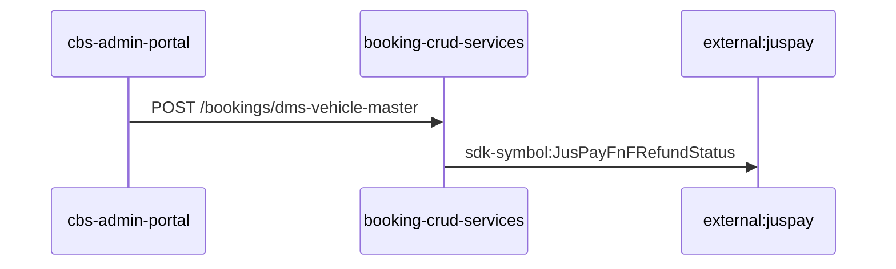
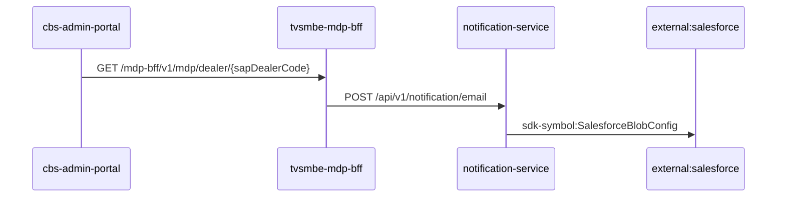
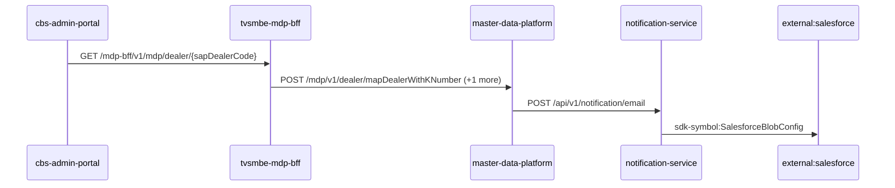
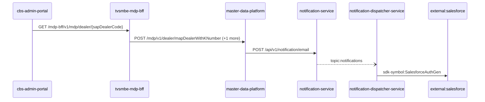
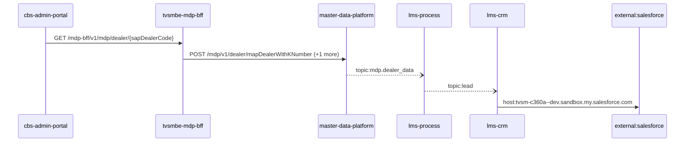
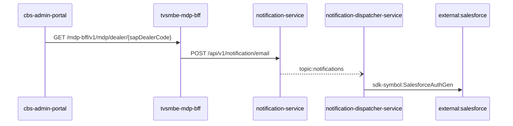
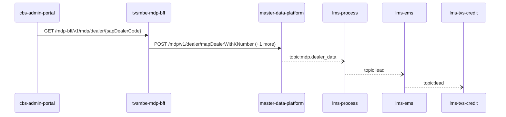
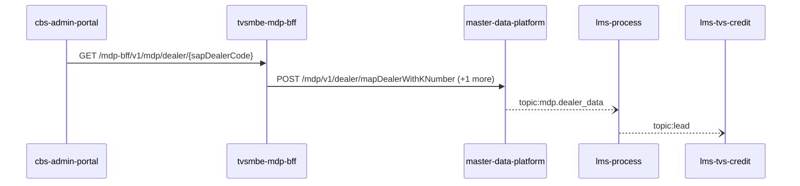
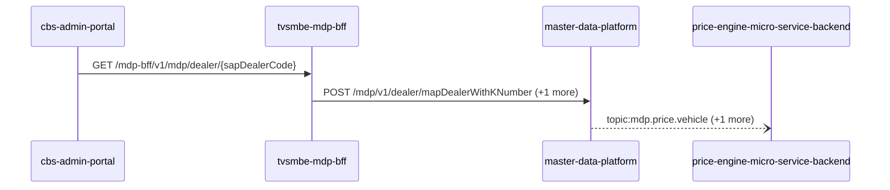
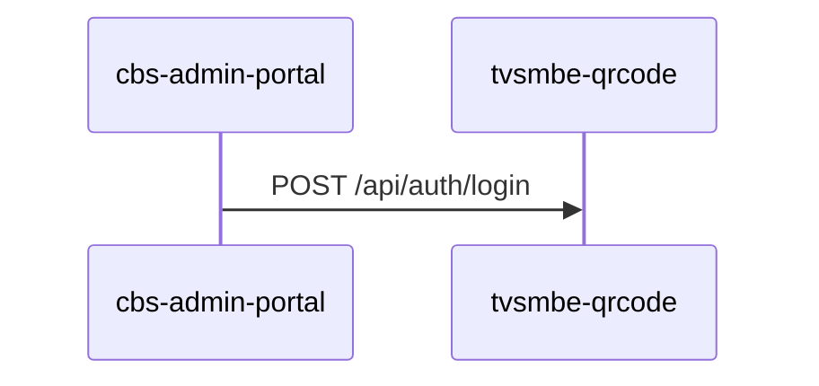

# cbs-admin-portal — Data Flows

## Flow Index
cbs-admin-portal takes part in 11 end-to-end flow(s) in registry/flows.json.

| flow_id | Name | Role of cbs-admin-portal | Trigger |
|---|---|---|---|
| cbs-admin-portal--external-juspay | cbs-admin-portal → external:juspay (2 hops) | entry | user action in cbs-admin-portal (frontend) |
| cbs-admin-portal--external-salesforce-09bb9c | cbs-admin-portal → external:salesforce (3 hops) | entry | user action in cbs-admin-portal (frontend) |
| cbs-admin-portal--external-salesforce-25d3af | cbs-admin-portal → external:salesforce (4 hops) | entry | user action in cbs-admin-portal (frontend) |
| cbs-admin-portal--external-salesforce-50c8e5 | cbs-admin-portal → external:salesforce (5 hops) | entry | user action in cbs-admin-portal (frontend) |
| cbs-admin-portal--external-salesforce-af678f | cbs-admin-portal → external:salesforce (5 hops) | entry | user action in cbs-admin-portal (frontend) |
| cbs-admin-portal--external-salesforce-c202d0 | cbs-admin-portal → external:salesforce (4 hops) | entry | user action in cbs-admin-portal (frontend) |
| cbs-admin-portal--lms-crm | cbs-admin-portal → lms-crm (5 hops) | entry | user action in cbs-admin-portal (frontend) |
| cbs-admin-portal--lms-tvs-credit-09d25e | cbs-admin-portal → lms-tvs-credit (5 hops) | entry | user action in cbs-admin-portal (frontend) |
| cbs-admin-portal--lms-tvs-credit-1ac22b | cbs-admin-portal → lms-tvs-credit (4 hops) | entry | user action in cbs-admin-portal (frontend) |
| cbs-admin-portal--price-engine-micro-service-backend | cbs-admin-portal → price-engine-micro-service-backend (3 hops) | entry | user action in cbs-admin-portal (frontend) |
| cbs-admin-portal--tvsmbe-qrcode | cbs-admin-portal → tvsmbe-qrcode (1 hop) | entry | user action in cbs-admin-portal (frontend) |

## Flow: cbs-admin-portal--external-juspay
Summary: Starting at `cbs-admin-portal` (user action in cbs-admin-portal (frontend)), the flow passes through `booking-crud-services` and ends at `external:juspay`, using 2 sync HTTP hop(s) and 0 async event hop(s); cbs-admin-portal role: entry; confidence high.

Steps:
| # | From | To | Via | Data (schema names) | Sync/Async | Confidence |
|---|---|---|---|---|---|---|
| 1 | cbs-admin-portal | booking-crud-services | POST /bookings/dms-vehicle-master | DmsVehicleMasterDto, DmsVehicleMasterResponseDto | sync | high |
| 2 | booking-crud-services | external:juspay | sdk-symbol:JusPayFnFRefundStatus | Unknown | sync | high |

Data touched: booking-crud-services: mssql

Failure points: hop 1 cbs-admin-portal → booking-crud-services: criticality hard; hop 2 booking-crud-services → external:juspay: criticality hard

Evidence:
- hop 1 (cbs-admin-portal → booking-crud-services): `booking-crud-services/Booking Service.openapi.yaml:1433`, `cbs-admin-portal/src/services/dataService.js:76`
- hop 2 (booking-crud-services → external:juspay): `booking-crud-services/src/bookings/dto/booking-refund-status-update/booking-refund-status-request.dto.ts:19`, `booking-crud-services/src/bookings/services/booking-refund/jusPay-refund.service.ts:15`, `booking-crud-services/src/bookings/services/jusPay.service.ts:10`

## Flow: cbs-admin-portal--external-salesforce-09bb9c
Summary: Starting at `cbs-admin-portal` (user action in cbs-admin-portal (frontend)), the flow passes through `tvsmbe-mdp-bff`, `notification-service` and ends at `external:salesforce`, using 3 sync HTTP hop(s) and 0 async event hop(s); cbs-admin-portal role: entry; confidence medium.

Steps:
| # | From | To | Via | Data (schema names) | Sync/Async | Confidence |
|---|---|---|---|---|---|---|
| 1 | cbs-admin-portal | tvsmbe-mdp-bff | GET /mdp-bff/v1/mdp/dealer/{sapDealerCode} | GeneralResponse | sync | medium |
| 2 | tvsmbe-mdp-bff | notification-service | POST /api/v1/notification/email | EmailNotification, NotificationResponse | sync | high |
| 3 | notification-service | external:salesforce | sdk-symbol:SalesforceBlobConfig | Unknown | sync | high |

Data touched: tvsmbe-mdp-bff: mysql, mysql:tvsmazcmndbsdev01-ci.mysql.database.azure.com:tvsmazebffsdbdev01; notification-service: mongo

Failure points: hop 1 cbs-admin-portal → tvsmbe-mdp-bff: criticality hard; hop 2 tvsmbe-mdp-bff → notification-service: criticality hard; hop 3 notification-service → external:salesforce: criticality hard

Evidence:
- hop 1 (cbs-admin-portal → tvsmbe-mdp-bff): `cbs-admin-portal/src/services/dataService.js:225`, `tvsmbe-mdp-bff/inbound/src/main/java/com/tvsmotor/bff/controller/MdpController.java:14`
- hop 2 (tvsmbe-mdp-bff → notification-service): `notification-service/src/main/java/com/tvsmotor/notification/controller/NotificationController.java:23`, `tvsmbe-mdp-bff/outbound/src/main/java/com/tvsmotor/mdp_bff/outbound/service/NotificationSenderService.java:46`, `tvsmbe-mdp-bff/outbound/src/main/java/com/tvsmotor/mdp_bff/outbound/service/OkHttpService.java:88`
- hop 3 (notification-service → external:salesforce): `notification-service/src/main/java/com/tvsmotor/notification/config/SalesforceBlobConfig.java:10`, `notification-service/src/main/java/com/tvsmotor/notification/cronjobs/SalesforceBlobStatusJob.java:17`, `notification-service/src/main/java/com/tvsmotor/notification/model/dto/salesforce/SalesforceData.java:8`

## Flow: cbs-admin-portal--external-salesforce-25d3af
Summary: Starting at `cbs-admin-portal` (user action in cbs-admin-portal (frontend)), the flow passes through `tvsmbe-mdp-bff`, `master-data-platform`, `notification-service` and ends at `external:salesforce`, using 4 sync HTTP hop(s) and 0 async event hop(s); cbs-admin-portal role: entry; confidence medium.

Steps:
| # | From | To | Via | Data (schema names) | Sync/Async | Confidence |
|---|---|---|---|---|---|---|
| 1 | cbs-admin-portal | tvsmbe-mdp-bff | GET /mdp-bff/v1/mdp/dealer/{sapDealerCode} | GeneralResponse | sync | medium |
| 2 | tvsmbe-mdp-bff | master-data-platform | POST /mdp/v1/dealer/mapDealerWithKNumber, POST /mdp/v1/dealers/basedOnFilters | DealerTypeStatusFlagsFilterRequest, GeneralResponse, MapDealerWithKNumberRequest | sync | high |
| 3 | master-data-platform | notification-service | POST /api/v1/notification/email | EmailNotification, NotificationResponse | sync | high |
| 4 | notification-service | external:salesforce | sdk-symbol:SalesforceBlobConfig | Unknown | sync | high |

Data touched: tvsmbe-mdp-bff: mysql, mysql:tvsmazcmndbsdev01-ci.mysql.database.azure.com:tvsmazebffsdbdev01; master-data-platform: mysql:xxxx.mysql.database.azure.com:mdp_20230904, other, redis; notification-service: mongo

Failure points: hop 1 cbs-admin-portal → tvsmbe-mdp-bff: criticality hard; hop 2 tvsmbe-mdp-bff → master-data-platform: criticality hard; hop 3 master-data-platform → notification-service: criticality hard; hop 4 notification-service → external:salesforce: criticality hard

Evidence:
- hop 1 (cbs-admin-portal → tvsmbe-mdp-bff): `cbs-admin-portal/src/services/dataService.js:225`, `tvsmbe-mdp-bff/inbound/src/main/java/com/tvsmotor/bff/controller/MdpController.java:14`
- hop 2 (tvsmbe-mdp-bff → master-data-platform): `master-data-platform/src/main/java/com/tvsmotor/mdp/controller/DealerKnowlarityDataController.java:16`, `tvsmbe-mdp-bff/outbound/src/main/java/com/tvsmotor/mdp_bff/outbound/service/MdpDealerOperationsService.java:54`, `tvsmbe-mdp-bff/outbound/src/main/java/com/tvsmotor/mdp_bff/outbound/service/OkHttpService.java:88` (+3 more)
- hop 3 (master-data-platform → notification-service): `master-data-platform/src/main/java/com/tvsmotor/mdp/service/OkHttpService.java:24`, `master-data-platform/src/main/java/com/tvsmotor/mdp/service/notification_service/NotificationSenderService.java:69`, `notification-service/src/main/java/com/tvsmotor/notification/controller/NotificationController.java:23`
- hop 4 (notification-service → external:salesforce): `notification-service/src/main/java/com/tvsmotor/notification/config/SalesforceBlobConfig.java:10`, `notification-service/src/main/java/com/tvsmotor/notification/cronjobs/SalesforceBlobStatusJob.java:17`, `notification-service/src/main/java/com/tvsmotor/notification/model/dto/salesforce/SalesforceData.java:8`

## Flow: cbs-admin-portal--external-salesforce-50c8e5
Summary: Starting at `cbs-admin-portal` (user action in cbs-admin-portal (frontend)), the flow passes through `tvsmbe-mdp-bff`, `master-data-platform`, `notification-service`, `notification-dispatcher-service` and ends at `external:salesforce`, using 4 sync HTTP hop(s) and 1 async event hop(s); cbs-admin-portal role: entry; confidence medium.

Steps:
| # | From | To | Via | Data (schema names) | Sync/Async | Confidence |
|---|---|---|---|---|---|---|
| 1 | cbs-admin-portal | tvsmbe-mdp-bff | GET /mdp-bff/v1/mdp/dealer/{sapDealerCode} | GeneralResponse | sync | medium |
| 2 | tvsmbe-mdp-bff | master-data-platform | POST /mdp/v1/dealer/mapDealerWithKNumber, POST /mdp/v1/dealers/basedOnFilters | DealerTypeStatusFlagsFilterRequest, GeneralResponse, MapDealerWithKNumberRequest | sync | high |
| 3 | master-data-platform | notification-service | POST /api/v1/notification/email | EmailNotification, NotificationResponse | sync | high |
| 4 | notification-service | notification-dispatcher-service | topic:notifications | Unknown | async | medium |
| 5 | notification-dispatcher-service | external:salesforce | sdk-symbol:SalesforceAuthGen | Unknown | sync | high |

Data touched: tvsmbe-mdp-bff: mysql, mysql:tvsmazcmndbsdev01-ci.mysql.database.azure.com:tvsmazebffsdbdev01; master-data-platform: mysql:xxxx.mysql.database.azure.com:mdp_20230904, other, redis; notification-service: mongo; notification-dispatcher-service: mongo

Failure points: hop 1 cbs-admin-portal → tvsmbe-mdp-bff: criticality hard; hop 2 tvsmbe-mdp-bff → master-data-platform: criticality hard; hop 3 master-data-platform → notification-service: criticality hard; hop 4 notification-service → notification-dispatcher-service: criticality async; hop 5 notification-dispatcher-service → external:salesforce: criticality hard

Evidence:
- hop 1 (cbs-admin-portal → tvsmbe-mdp-bff): `cbs-admin-portal/src/services/dataService.js:225`, `tvsmbe-mdp-bff/inbound/src/main/java/com/tvsmotor/bff/controller/MdpController.java:14`
- hop 2 (tvsmbe-mdp-bff → master-data-platform): `master-data-platform/src/main/java/com/tvsmotor/mdp/controller/DealerKnowlarityDataController.java:16`, `tvsmbe-mdp-bff/outbound/src/main/java/com/tvsmotor/mdp_bff/outbound/service/MdpDealerOperationsService.java:54`, `tvsmbe-mdp-bff/outbound/src/main/java/com/tvsmotor/mdp_bff/outbound/service/OkHttpService.java:88` (+3 more)
- hop 3 (master-data-platform → notification-service): `master-data-platform/src/main/java/com/tvsmotor/mdp/service/OkHttpService.java:24`, `master-data-platform/src/main/java/com/tvsmotor/mdp/service/notification_service/NotificationSenderService.java:69`, `notification-service/src/main/java/com/tvsmotor/notification/controller/NotificationController.java:23`
- hop 4 (notification-service → notification-dispatcher-service): `notification-dispatcher-service/src/main/java/com/tvsmotor/notificationdispatcher/config/ServiceBusConfig.java:33`, `notification-dispatcher-service/src/main/java/com/tvsmotor/notificationdispatcher/config/ServiceBusConfig.java:34`, `notification-service/src/main/java/com/tvsmotor/notification/config/ServiceBusConfig.java:37` (+1 more)
- hop 5 (notification-dispatcher-service → external:salesforce): `notification-dispatcher-service/src/main/java/com/tvsmotor/notificationdispatcher/controller/SalesforceTokenController.java:18`, `notification-dispatcher-service/src/main/java/com/tvsmotor/notificationdispatcher/model/dto/salesforce/SalesforceData.java:5`, `notification-dispatcher-service/src/main/java/com/tvsmotor/notificationdispatcher/model/dto/salesforce/SalesforceTemplateKeys.java:8`

## Flow: cbs-admin-portal--external-salesforce-af678f
Summary: Starting at `cbs-admin-portal` (user action in cbs-admin-portal (frontend)), the flow passes through `tvsmbe-mdp-bff`, `master-data-platform`, `lms-process`, `lms-crm` and ends at `external:salesforce`, using 3 sync HTTP hop(s) and 2 async event hop(s); cbs-admin-portal role: entry; confidence medium.

Steps:
| # | From | To | Via | Data (schema names) | Sync/Async | Confidence |
|---|---|---|---|---|---|---|
| 1 | cbs-admin-portal | tvsmbe-mdp-bff | GET /mdp-bff/v1/mdp/dealer/{sapDealerCode} | GeneralResponse | sync | medium |
| 2 | tvsmbe-mdp-bff | master-data-platform | POST /mdp/v1/dealer/mapDealerWithKNumber, POST /mdp/v1/dealers/basedOnFilters | DealerTypeStatusFlagsFilterRequest, GeneralResponse, MapDealerWithKNumberRequest | sync | high |
| 3 | master-data-platform | lms-process | topic:mdp.dealer_data | DealerData | async | medium |
| 4 | lms-process | lms-crm | topic:lead | Unknown | async | medium |
| 5 | lms-crm | external:salesforce | host:tvsm-c360a--dev.sandbox.my.salesforce.com | Unknown | sync | high |

Data touched: tvsmbe-mdp-bff: mysql, mysql:tvsmazcmndbsdev01-ci.mysql.database.azure.com:tvsmazebffsdbdev01; master-data-platform: mysql:xxxx.mysql.database.azure.com:mdp_20230904, other, redis; lms-process: mssql; lms-crm: mssql

Failure points: hop 1 cbs-admin-portal → tvsmbe-mdp-bff: criticality hard; hop 2 tvsmbe-mdp-bff → master-data-platform: criticality hard; hop 3 master-data-platform → lms-process: criticality async; hop 4 lms-process → lms-crm: criticality async; hop 5 lms-crm → external:salesforce: criticality hard

Evidence:
- hop 1 (cbs-admin-portal → tvsmbe-mdp-bff): `cbs-admin-portal/src/services/dataService.js:225`, `tvsmbe-mdp-bff/inbound/src/main/java/com/tvsmotor/bff/controller/MdpController.java:14`
- hop 2 (tvsmbe-mdp-bff → master-data-platform): `master-data-platform/src/main/java/com/tvsmotor/mdp/controller/DealerKnowlarityDataController.java:16`, `tvsmbe-mdp-bff/outbound/src/main/java/com/tvsmotor/mdp_bff/outbound/service/MdpDealerOperationsService.java:54`, `tvsmbe-mdp-bff/outbound/src/main/java/com/tvsmotor/mdp_bff/outbound/service/OkHttpService.java:88` (+3 more)
- hop 3 (master-data-platform → lms-process): `lms_process/processLeadService/Const/Constants.cs:7`, `lms_process/processLeadService/ListenerService/MdpConsumer.cs:42`, `master-data-platform/src/main/java/com/tvsmotor/mdp/config/DealerMasterServiceBusConfig.java:26` (+1 more)
- hop 4 (lms-process → lms-crm): `lms_crm/ListenerService/CrmListenerService.cs:44`, `lms_crm/Utils/Constants.cs:16`, `lms_process/processLeadService/Const/Constants.cs:6` (+1 more)
- hop 5 (lms-crm → external:salesforce): `lms_crm/appsettings.Development.json:16`, `lms_crm/appsettings.Production.json:17`, `lms_crm/appsettings.Uat.json:17`

## Flow: cbs-admin-portal--external-salesforce-c202d0
Summary: Starting at `cbs-admin-portal` (user action in cbs-admin-portal (frontend)), the flow passes through `tvsmbe-mdp-bff`, `notification-service`, `notification-dispatcher-service` and ends at `external:salesforce`, using 3 sync HTTP hop(s) and 1 async event hop(s); cbs-admin-portal role: entry; confidence medium.

Steps:
| # | From | To | Via | Data (schema names) | Sync/Async | Confidence |
|---|---|---|---|---|---|---|
| 1 | cbs-admin-portal | tvsmbe-mdp-bff | GET /mdp-bff/v1/mdp/dealer/{sapDealerCode} | GeneralResponse | sync | medium |
| 2 | tvsmbe-mdp-bff | notification-service | POST /api/v1/notification/email | EmailNotification, NotificationResponse | sync | high |
| 3 | notification-service | notification-dispatcher-service | topic:notifications | Unknown | async | medium |
| 4 | notification-dispatcher-service | external:salesforce | sdk-symbol:SalesforceAuthGen | Unknown | sync | high |

Data touched: tvsmbe-mdp-bff: mysql, mysql:tvsmazcmndbsdev01-ci.mysql.database.azure.com:tvsmazebffsdbdev01; notification-service: mongo; notification-dispatcher-service: mongo

Failure points: hop 1 cbs-admin-portal → tvsmbe-mdp-bff: criticality hard; hop 2 tvsmbe-mdp-bff → notification-service: criticality hard; hop 3 notification-service → notification-dispatcher-service: criticality async; hop 4 notification-dispatcher-service → external:salesforce: criticality hard

Evidence:
- hop 1 (cbs-admin-portal → tvsmbe-mdp-bff): `cbs-admin-portal/src/services/dataService.js:225`, `tvsmbe-mdp-bff/inbound/src/main/java/com/tvsmotor/bff/controller/MdpController.java:14`
- hop 2 (tvsmbe-mdp-bff → notification-service): `notification-service/src/main/java/com/tvsmotor/notification/controller/NotificationController.java:23`, `tvsmbe-mdp-bff/outbound/src/main/java/com/tvsmotor/mdp_bff/outbound/service/NotificationSenderService.java:46`, `tvsmbe-mdp-bff/outbound/src/main/java/com/tvsmotor/mdp_bff/outbound/service/OkHttpService.java:88`
- hop 3 (notification-service → notification-dispatcher-service): `notification-dispatcher-service/src/main/java/com/tvsmotor/notificationdispatcher/config/ServiceBusConfig.java:33`, `notification-dispatcher-service/src/main/java/com/tvsmotor/notificationdispatcher/config/ServiceBusConfig.java:34`, `notification-service/src/main/java/com/tvsmotor/notification/config/ServiceBusConfig.java:37` (+1 more)
- hop 4 (notification-dispatcher-service → external:salesforce): `notification-dispatcher-service/src/main/java/com/tvsmotor/notificationdispatcher/controller/SalesforceTokenController.java:18`, `notification-dispatcher-service/src/main/java/com/tvsmotor/notificationdispatcher/model/dto/salesforce/SalesforceData.java:5`, `notification-dispatcher-service/src/main/java/com/tvsmotor/notificationdispatcher/model/dto/salesforce/SalesforceTemplateKeys.java:8`

## Flow: cbs-admin-portal--lms-crm
Summary: Starting at `cbs-admin-portal` (user action in cbs-admin-portal (frontend)), the flow passes through `tvsmbe-mdp-bff`, `master-data-platform`, `lms-process`, `lms-ems` and ends at `lms-crm`, using 2 sync HTTP hop(s) and 3 async event hop(s); cbs-admin-portal role: entry; confidence medium; truncated at the depth cap.

Steps:
| # | From | To | Via | Data (schema names) | Sync/Async | Confidence |
|---|---|---|---|---|---|---|
| 1 | cbs-admin-portal | tvsmbe-mdp-bff | GET /mdp-bff/v1/mdp/dealer/{sapDealerCode} | GeneralResponse | sync | medium |
| 2 | tvsmbe-mdp-bff | master-data-platform | POST /mdp/v1/dealer/mapDealerWithKNumber, POST /mdp/v1/dealers/basedOnFilters | DealerTypeStatusFlagsFilterRequest, GeneralResponse, MapDealerWithKNumberRequest | sync | high |
| 3 | master-data-platform | lms-process | topic:mdp.dealer_data | DealerData | async | medium |
| 4 | lms-process | lms-ems | topic:lead | Unknown | async | medium |
| 5 | lms-ems | lms-crm | topic:lead | Unknown | async | medium |

Data touched: tvsmbe-mdp-bff: mysql, mysql:tvsmazcmndbsdev01-ci.mysql.database.azure.com:tvsmazebffsdbdev01; master-data-platform: mysql:xxxx.mysql.database.azure.com:mdp_20230904, other, redis; lms-process: mssql; lms-ems: mssql; lms-crm: mssql

Failure points: hop 1 cbs-admin-portal → tvsmbe-mdp-bff: criticality hard; hop 2 tvsmbe-mdp-bff → master-data-platform: criticality hard; hop 3 master-data-platform → lms-process: criticality async; hop 4 lms-process → lms-ems: criticality async; hop 5 lms-ems → lms-crm: criticality async

Evidence:
- hop 1 (cbs-admin-portal → tvsmbe-mdp-bff): `cbs-admin-portal/src/services/dataService.js:225`, `tvsmbe-mdp-bff/inbound/src/main/java/com/tvsmotor/bff/controller/MdpController.java:14`
- hop 2 (tvsmbe-mdp-bff → master-data-platform): `master-data-platform/src/main/java/com/tvsmotor/mdp/controller/DealerKnowlarityDataController.java:16`, `tvsmbe-mdp-bff/outbound/src/main/java/com/tvsmotor/mdp_bff/outbound/service/MdpDealerOperationsService.java:54`, `tvsmbe-mdp-bff/outbound/src/main/java/com/tvsmotor/mdp_bff/outbound/service/OkHttpService.java:88` (+3 more)
- hop 3 (master-data-platform → lms-process): `lms_process/processLeadService/Const/Constants.cs:7`, `lms_process/processLeadService/ListenerService/MdpConsumer.cs:42`, `master-data-platform/src/main/java/com/tvsmotor/mdp/config/DealerMasterServiceBusConfig.java:26` (+1 more)
- hop 4 (lms-process → lms-ems): `lms_ems/emsService/Const/Constants.cs:14`, `lms_ems/emsService/ListenerService/EmsListenerService.cs:43`, `lms_process/processLeadService/Const/Constants.cs:6` (+1 more)
- hop 5 (lms-ems → lms-crm): `lms_crm/ListenerService/CrmListenerService.cs:44`, `lms_crm/Utils/Constants.cs:16`, `lms_ems/emsService/Const/Constants.cs:13` (+1 more)

## Flow: cbs-admin-portal--lms-tvs-credit-09d25e
Summary: Starting at `cbs-admin-portal` (user action in cbs-admin-portal (frontend)), the flow passes through `tvsmbe-mdp-bff`, `master-data-platform`, `lms-process`, `lms-ems` and ends at `lms-tvs-credit`, using 2 sync HTTP hop(s) and 3 async event hop(s); cbs-admin-portal role: entry; confidence medium.

Steps:
| # | From | To | Via | Data (schema names) | Sync/Async | Confidence |
|---|---|---|---|---|---|---|
| 1 | cbs-admin-portal | tvsmbe-mdp-bff | GET /mdp-bff/v1/mdp/dealer/{sapDealerCode} | GeneralResponse | sync | medium |
| 2 | tvsmbe-mdp-bff | master-data-platform | POST /mdp/v1/dealer/mapDealerWithKNumber, POST /mdp/v1/dealers/basedOnFilters | DealerTypeStatusFlagsFilterRequest, GeneralResponse, MapDealerWithKNumberRequest | sync | high |
| 3 | master-data-platform | lms-process | topic:mdp.dealer_data | DealerData | async | medium |
| 4 | lms-process | lms-ems | topic:lead | Unknown | async | medium |
| 5 | lms-ems | lms-tvs-credit | topic:lead | Unknown | async | medium |

Data touched: tvsmbe-mdp-bff: mysql, mysql:tvsmazcmndbsdev01-ci.mysql.database.azure.com:tvsmazebffsdbdev01; master-data-platform: mysql:xxxx.mysql.database.azure.com:mdp_20230904, other, redis; lms-process: mssql; lms-ems: mssql; lms-tvs-credit: mssql

Failure points: hop 1 cbs-admin-portal → tvsmbe-mdp-bff: criticality hard; hop 2 tvsmbe-mdp-bff → master-data-platform: criticality hard; hop 3 master-data-platform → lms-process: criticality async; hop 4 lms-process → lms-ems: criticality async; hop 5 lms-ems → lms-tvs-credit: criticality async

Evidence:
- hop 1 (cbs-admin-portal → tvsmbe-mdp-bff): `cbs-admin-portal/src/services/dataService.js:225`, `tvsmbe-mdp-bff/inbound/src/main/java/com/tvsmotor/bff/controller/MdpController.java:14`
- hop 2 (tvsmbe-mdp-bff → master-data-platform): `master-data-platform/src/main/java/com/tvsmotor/mdp/controller/DealerKnowlarityDataController.java:16`, `tvsmbe-mdp-bff/outbound/src/main/java/com/tvsmotor/mdp_bff/outbound/service/MdpDealerOperationsService.java:54`, `tvsmbe-mdp-bff/outbound/src/main/java/com/tvsmotor/mdp_bff/outbound/service/OkHttpService.java:88` (+3 more)
- hop 3 (master-data-platform → lms-process): `lms_process/processLeadService/Const/Constants.cs:7`, `lms_process/processLeadService/ListenerService/MdpConsumer.cs:42`, `master-data-platform/src/main/java/com/tvsmotor/mdp/config/DealerMasterServiceBusConfig.java:26` (+1 more)
- hop 4 (lms-process → lms-ems): `lms_ems/emsService/Const/Constants.cs:14`, `lms_ems/emsService/ListenerService/EmsListenerService.cs:43`, `lms_process/processLeadService/Const/Constants.cs:6` (+1 more)
- hop 5 (lms-ems → lms-tvs-credit): `lms_ems/emsService/Const/Constants.cs:13`, `lms_ems/emsService/Services/EmsService.cs:191`, `lms_tvs_credit/lms_tvs_credit/ListenerService/TvscreditListenerService.cs:46` (+1 more)

## Flow: cbs-admin-portal--lms-tvs-credit-1ac22b
Summary: Starting at `cbs-admin-portal` (user action in cbs-admin-portal (frontend)), the flow passes through `tvsmbe-mdp-bff`, `master-data-platform`, `lms-process` and ends at `lms-tvs-credit`, using 2 sync HTTP hop(s) and 2 async event hop(s); cbs-admin-portal role: entry; confidence medium.

Steps:
| # | From | To | Via | Data (schema names) | Sync/Async | Confidence |
|---|---|---|---|---|---|---|
| 1 | cbs-admin-portal | tvsmbe-mdp-bff | GET /mdp-bff/v1/mdp/dealer/{sapDealerCode} | GeneralResponse | sync | medium |
| 2 | tvsmbe-mdp-bff | master-data-platform | POST /mdp/v1/dealer/mapDealerWithKNumber, POST /mdp/v1/dealers/basedOnFilters | DealerTypeStatusFlagsFilterRequest, GeneralResponse, MapDealerWithKNumberRequest | sync | high |
| 3 | master-data-platform | lms-process | topic:mdp.dealer_data | DealerData | async | medium |
| 4 | lms-process | lms-tvs-credit | topic:lead | Unknown | async | medium |

Data touched: tvsmbe-mdp-bff: mysql, mysql:tvsmazcmndbsdev01-ci.mysql.database.azure.com:tvsmazebffsdbdev01; master-data-platform: mysql:xxxx.mysql.database.azure.com:mdp_20230904, other, redis; lms-process: mssql; lms-tvs-credit: mssql

Failure points: hop 1 cbs-admin-portal → tvsmbe-mdp-bff: criticality hard; hop 2 tvsmbe-mdp-bff → master-data-platform: criticality hard; hop 3 master-data-platform → lms-process: criticality async; hop 4 lms-process → lms-tvs-credit: criticality async

Evidence:
- hop 1 (cbs-admin-portal → tvsmbe-mdp-bff): `cbs-admin-portal/src/services/dataService.js:225`, `tvsmbe-mdp-bff/inbound/src/main/java/com/tvsmotor/bff/controller/MdpController.java:14`
- hop 2 (tvsmbe-mdp-bff → master-data-platform): `master-data-platform/src/main/java/com/tvsmotor/mdp/controller/DealerKnowlarityDataController.java:16`, `tvsmbe-mdp-bff/outbound/src/main/java/com/tvsmotor/mdp_bff/outbound/service/MdpDealerOperationsService.java:54`, `tvsmbe-mdp-bff/outbound/src/main/java/com/tvsmotor/mdp_bff/outbound/service/OkHttpService.java:88` (+3 more)
- hop 3 (master-data-platform → lms-process): `lms_process/processLeadService/Const/Constants.cs:7`, `lms_process/processLeadService/ListenerService/MdpConsumer.cs:42`, `master-data-platform/src/main/java/com/tvsmotor/mdp/config/DealerMasterServiceBusConfig.java:26` (+1 more)
- hop 4 (lms-process → lms-tvs-credit): `lms_process/processLeadService/Const/Constants.cs:6`, `lms_process/processLeadService/Services/TwoWheelerService.cs:97`, `lms_tvs_credit/lms_tvs_credit/ListenerService/TvscreditListenerService.cs:46` (+1 more)

## Flow: cbs-admin-portal--price-engine-micro-service-backend
Summary: Starting at `cbs-admin-portal` (user action in cbs-admin-portal (frontend)), the flow passes through `tvsmbe-mdp-bff`, `master-data-platform` and ends at `price-engine-micro-service-backend`, using 2 sync HTTP hop(s) and 1 async event hop(s); cbs-admin-portal role: entry; confidence medium.

Steps:
| # | From | To | Via | Data (schema names) | Sync/Async | Confidence |
|---|---|---|---|---|---|---|
| 1 | cbs-admin-portal | tvsmbe-mdp-bff | GET /mdp-bff/v1/mdp/dealer/{sapDealerCode} | GeneralResponse | sync | medium |
| 2 | tvsmbe-mdp-bff | master-data-platform | POST /mdp/v1/dealer/mapDealerWithKNumber, POST /mdp/v1/dealers/basedOnFilters | DealerTypeStatusFlagsFilterRequest, GeneralResponse, MapDealerWithKNumberRequest | sync | high |
| 3 | master-data-platform | price-engine-micro-service-backend | topic:mdp.price.vehicle, topic:mdp.product.vehicle | PriceVehicleData, ServiceBusOutgoingMessagePayloadBody | async | medium |

Data touched: tvsmbe-mdp-bff: mysql, mysql:tvsmazcmndbsdev01-ci.mysql.database.azure.com:tvsmazebffsdbdev01; master-data-platform: mysql:xxxx.mysql.database.azure.com:mdp_20230904, other, redis; price-engine-micro-service-backend: mongo, redis

Failure points: hop 1 cbs-admin-portal → tvsmbe-mdp-bff: criticality hard; hop 2 tvsmbe-mdp-bff → master-data-platform: criticality hard; hop 3 master-data-platform → price-engine-micro-service-backend: criticality async

Evidence:
- hop 1 (cbs-admin-portal → tvsmbe-mdp-bff): `cbs-admin-portal/src/services/dataService.js:225`, `tvsmbe-mdp-bff/inbound/src/main/java/com/tvsmotor/bff/controller/MdpController.java:14`
- hop 2 (tvsmbe-mdp-bff → master-data-platform): `master-data-platform/src/main/java/com/tvsmotor/mdp/controller/DealerKnowlarityDataController.java:16`, `tvsmbe-mdp-bff/outbound/src/main/java/com/tvsmotor/mdp_bff/outbound/service/MdpDealerOperationsService.java:54`, `tvsmbe-mdp-bff/outbound/src/main/java/com/tvsmotor/mdp_bff/outbound/service/OkHttpService.java:88` (+3 more)
- hop 3 (master-data-platform → price-engine-micro-service-backend): `Price-Engine-MicroService-Backend/sonar-exclusion-function/service-bus/implemeters/price-service-bus-implementer.ts:18`, `master-data-platform/src/main/java/com/tvsmotor/mdp/price/config/PriceVehicleServiceBusConfig.java:19`, `master-data-platform/src/main/java/com/tvsmotor/mdp/price/config/PriceVehicleServiceBusConfig.java:20` (+3 more)

## Flow: cbs-admin-portal--tvsmbe-qrcode
Summary: Starting at `cbs-admin-portal` (user action in cbs-admin-portal (frontend)), the flow ends at `tvsmbe-qrcode`, using 1 sync HTTP hop(s) and 0 async event hop(s); cbs-admin-portal role: entry; confidence medium.

Steps:
| # | From | To | Via | Data (schema names) | Sync/Async | Confidence |
|---|---|---|---|---|---|---|
| 1 | cbs-admin-portal | tvsmbe-qrcode | POST /api/auth/login | Unknown | sync | medium |

Data touched: tvsmbe-qrcode: mongo:tvs_qr

Failure points: hop 1 cbs-admin-portal → tvsmbe-qrcode: criticality hard

Evidence:
- hop 1 (cbs-admin-portal → tvsmbe-qrcode): `cbs-admin-portal/src/services/dataService.js:32`, `tvsmbe-qrcode/src/main/java/com/tvsmotor/qrcode/controller/AuthController.java:30`
