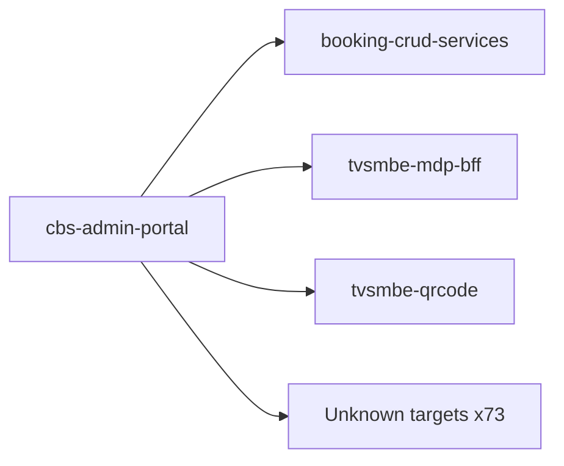

# cbs-admin-portal — High-Level Design

## Context
cbs-admin-portal is a `portal` in the TVS-CS org (domain: Unknown). Neighbours: callers Unknown; downstream `booking-crud-services`, `tvsmbe-mdp-bff`, `tvsmbe-qrcode`.

## Architecture
cbs-admin-portal components and connections (from service.yaml):

## Integration Points
cbs-admin-portal registry edges (3):

| Direction | Peer | Kind | Via | Criticality | Source | Match |
|---|---|---|---|---|---|---|
| out | `booking-crud-services` | http | POST /bookings/dms-vehicle-master | hard | code | path-unique |
| out | `tvsmbe-mdp-bff` | http | GET /mdp-bff/v1/mdp/dealer/{sapDealerCode} | hard | code | path-suffix |
| out | `tvsmbe-qrcode` | http | POST /api/auth/login | hard | code | path-suffix |

## Data Ownership
cbs-admin-portal data stores (service.yaml `data_stores`; ownership flag not determinable unless set):

| Store | Type | Access | Owned | Key entities |
|---|---|---|---|---|
| N/A | | | | no data stores extracted |

## Key Design Decisions
cbs-admin-portal: N/A — not determinable from code.

| Decision | Alternatives considered | Reason |
|---|---|---|
| Unknown | Unknown | Unknown |

## Non-Functional Requirements
cbs-admin-portal NFR targets: N/A — not determinable from code.

## Security
cbs-admin-portal security: endpoint auth values n/a. Auth code: `backend/src/main/java/com/tvs/leadsadmin/workflow/controller/WorkflowController.java:45`. 3 secret config key(s), sourced via: {'env-file': 3} (names in OVERVIEW.md). PII handling: Unknown.

## Resilience and Failure Modes
cbs-admin-portal hard dependencies: `booking-crud-services`, `tvsmbe-mdp-bff`, `tvsmbe-qrcode`. No retry/circuit-breaker code found; failure behaviour Unknown.

## Deployment Topology
cbs-admin-portal deployment artefacts (platform/regions: Unknown unless listed):

| Kind | Name | File | Environments | Image | Ports | Variable groups |
|---|---|---|---|---|---|---|
| N/A | | | | | | no infra files |

## Observability
cbs-admin-portal observability libraries: none found. Related config keys: none. Dashboards/alerts: Unknown.
