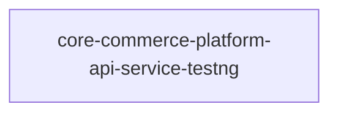

# core-commerce-platform-api-service-testng — High-Level Design

## Context
core-commerce-platform-api-service-testng is a `Unknown` in the TVS-CS org (domain: Unknown). Neighbours: callers Unknown; downstream none resolved.

## Architecture
core-commerce-platform-api-service-testng components and connections (from service.yaml):

## Integration Points
core-commerce-platform-api-service-testng registry edges (0):

| Direction | Peer | Kind | Via | Criticality | Source | Match |
|---|---|---|---|---|---|---|
| N/A | | | | | | no registry edges |

## Data Ownership
core-commerce-platform-api-service-testng data stores (service.yaml `data_stores`; ownership flag not determinable unless set):

| Store | Type | Access | Owned | Key entities |
|---|---|---|---|---|
| N/A | | | | no data stores extracted |

## Key Design Decisions
core-commerce-platform-api-service-testng: N/A — not determinable from code.

| Decision | Alternatives considered | Reason |
|---|---|---|
| Unknown | Unknown | Unknown |

## Non-Functional Requirements
core-commerce-platform-api-service-testng NFR targets: N/A — not determinable from code.

## Security
core-commerce-platform-api-service-testng security: endpoint auth values n/a. No auth middleware found in code. 0 secret config key(s), sourced via: n/a (names in OVERVIEW.md). PII handling: Unknown.

## Resilience and Failure Modes
core-commerce-platform-api-service-testng hard dependencies: none resolved. No retry/circuit-breaker code found; failure behaviour Unknown.

## Deployment Topology
core-commerce-platform-api-service-testng deployment artefacts (platform/regions: Unknown unless listed):

| Kind | Name | File | Environments | Image | Ports | Variable groups |
|---|---|---|---|---|---|---|
| N/A | | | | | | no infra files |

## Observability
core-commerce-platform-api-service-testng observability libraries: none found. Related config keys: none. Dashboards/alerts: Unknown.
