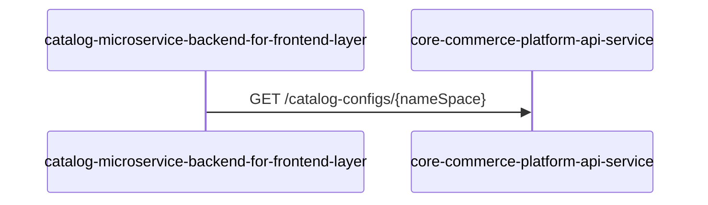
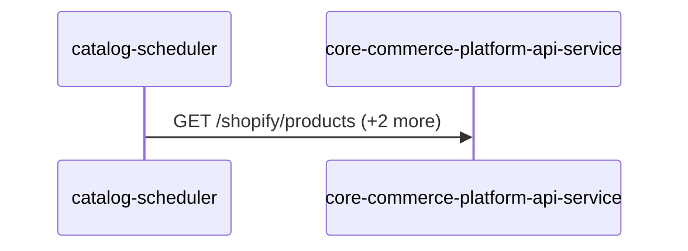

# core-commerce-platform-api-service — Data Flows

## Flow Index
core-commerce-platform-api-service takes part in 2 end-to-end flow(s) in registry/flows.json.

| flow_id | Name | Role of core-commerce-platform-api-service | Trigger |
|---|---|---|---|
| catalog-microservice-backend-for-frontend-layer--core-commerce-platform-api-service | catalog-microservice-backend-for-frontend-layer → core-commerce-platform-api-service (1 hop) | terminal | request to catalog-microservice-backend-for-frontend-layer from outside the registry (no internal caller) |
| catalog-scheduler--core-commerce-platform-api-service | catalog-scheduler → core-commerce-platform-api-service (1 hop) | terminal | scheduled job(s) in catalog-scheduler (job-to-call link not resolved): merchandise-accessories-ingestion-job, product-price-ingestion-job; request to catalog-scheduler from outside the registry (no internal caller) |

## Flow: catalog-microservice-backend-for-frontend-layer--core-commerce-platform-api-service
Summary: Starting at `catalog-microservice-backend-for-frontend-layer` (request to catalog-microservice-backend-for-frontend-layer from outside the registry (no internal caller)), the flow ends at `core-commerce-platform-api-service`, using 1 sync HTTP hop(s) and 0 async event hop(s); core-commerce-platform-api-service role: terminal; confidence medium.

Steps:
| # | From | To | Via | Data (schema names) | Sync/Async | Confidence |
|---|---|---|---|---|---|---|
| 1 | catalog-microservice-backend-for-frontend-layer | core-commerce-platform-api-service | GET /catalog-configs/{nameSpace} | Unknown | sync | medium |

Data touched: core-commerce-platform-api-service: mongo, redis

Failure points: hop 1 catalog-microservice-backend-for-frontend-layer → core-commerce-platform-api-service: criticality hard

Evidence:
- hop 1 (catalog-microservice-backend-for-frontend-layer → core-commerce-platform-api-service): `Catalog-Microservice-Backend-for-Frontend-Layer/src/rest/implementers/catalog-implementer.ts:31`, `Core-Commerce-Platform-API-Service/src/routes/api/catalog-configuration-routes.ts:8`

## Flow: catalog-scheduler--core-commerce-platform-api-service
Summary: Starting at `catalog-scheduler` (scheduled job(s) in catalog-scheduler (job-to-call link not resolved): merchandise-accessories-ingestion-job, product-price-ingestion-job; request to catalog-scheduler from outside the registry (no internal caller)), the flow ends at `core-commerce-platform-api-service`, using 1 sync HTTP hop(s) and 0 async event hop(s); core-commerce-platform-api-service role: terminal; confidence medium.

Steps:
| # | From | To | Via | Data (schema names) | Sync/Async | Confidence |
|---|---|---|---|---|---|---|
| 1 | catalog-scheduler | core-commerce-platform-api-service | GET /shopify/products, PUT /catalog-configs/{nameSpace}, PUT /catalogs/refresh/default-catalogs/{nameSpace} | Unknown | sync | medium |

Data touched: catalog-scheduler: mongo; core-commerce-platform-api-service: mongo, redis

Failure points: hop 1 catalog-scheduler → core-commerce-platform-api-service: criticality hard

Evidence:
- hop 1 (catalog-scheduler → core-commerce-platform-api-service): `Catalog-Scheduler/src/product-price-ingestion-job/data-sources/product-data-source/product-data-source-api.js:192`, `Core-Commerce-Platform-API-Service/src/routes/api/shopify-routes.ts:8`, `Catalog-Scheduler/src/product-price-ingestion-job/catalog-service/catalog-config-service.js:73` (+3 more)
