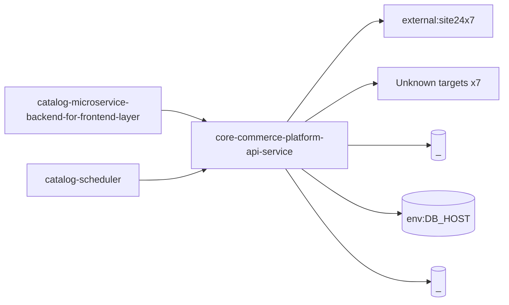

# core-commerce-platform-api-service — High-Level Design

## Context
core-commerce-platform-api-service is a `backend-api` in the TVS-CS org (domain: Unknown). Neighbours: callers `catalog-microservice-backend-for-frontend-layer`, `catalog-scheduler`; downstream `external:site24x7`.

## Architecture
core-commerce-platform-api-service components and connections (from service.yaml):

## Integration Points
core-commerce-platform-api-service registry edges (5):

| Direction | Peer | Kind | Via | Criticality | Source | Match |
|---|---|---|---|---|---|---|
| in | `catalog-microservice-backend-for-frontend-layer` | http | GET /catalog-configs/{nameSpace} | hard | code | path-unique |
| in | `catalog-scheduler` | http | GET /shopify/products | hard | code | path-unique |
| in | `catalog-scheduler` | http | PUT /catalog-configs/{nameSpace} | hard | code | path-unique |
| in | `catalog-scheduler` | http | PUT /catalogs/refresh/default-catalogs/{nameSpace} | hard | code | path-unique |
| out | `external:site24x7` | library_dependency | package:apminsight | hard | code | artifact |
| out | `external:site24x7` | http | - | Unknown | code | external |

## Data Ownership
core-commerce-platform-api-service data stores (service.yaml `data_stores`; ownership flag not determinable unless set):

| Store | Type | Access | Owned | Key entities |
|---|---|---|---|---|
| `_` | mongo | Unknown | Unknown | Unknown |
| `env:DB_HOST` | mongo | Unknown | Unknown | Unknown |
| `_` | redis | Unknown | Unknown | Unknown |

## Key Design Decisions
core-commerce-platform-api-service: N/A — not determinable from code.

| Decision | Alternatives considered | Reason |
|---|---|---|
| Unknown | Unknown | Unknown |

## Non-Functional Requirements
core-commerce-platform-api-service NFR targets: N/A — not determinable from code.

## Security
core-commerce-platform-api-service security: endpoint auth values None. No auth middleware found in code. 6 secret config key(s), sourced via: {'None': 6} (names in OVERVIEW.md). PII handling: Unknown.

## Resilience and Failure Modes
core-commerce-platform-api-service hard dependencies: none resolved. No retry/circuit-breaker code found; failure behaviour Unknown.

## Deployment Topology
core-commerce-platform-api-service deployment artefacts (platform/regions: Unknown unless listed):

| Kind | Name | File | Environments | Image | Ports | Variable groups |
|---|---|---|---|---|---|---|
| azure-pipeline | azure-pipelines.yml | `azure-pipelines.yml:6` | - | - | - | - |
| azure-pipeline | cd-pipeline.yaml | `cd-pipeline.yaml:1` | dev, prod, uat | - | - | - |
| azure-pipeline | ci-pipeline.yaml | `ci-pipeline.yaml:1` | - | - | - | - |
| dockerfile | Dockerfile | `Dockerfile:2` | - | node:20-alpine | 8080 | - |

## Observability
core-commerce-platform-api-service observability libraries: `winston`. Related config keys: none. Dashboards/alerts: Unknown.
