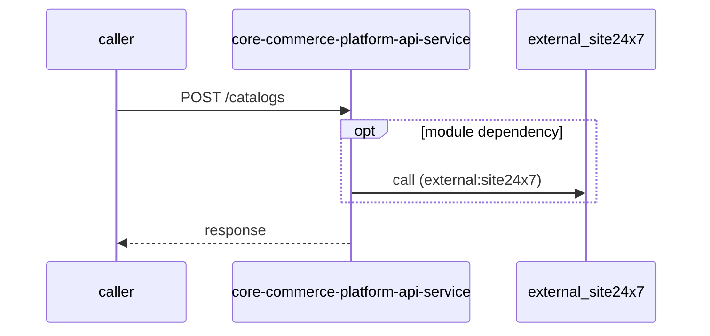

# core-commerce-platform-api-service — Low-Level Design

## Data Model
core-commerce-platform-api-service entities from `data_access` items (3).

Store access at `sonar-exclusion-function/scripts/data-migration-script.ts:35`: database Unknown; collections catalogConfigurations.

Store access at `src/db/mongodb/db.ts:18`: database Unknown; collections ApplicationHealth, Catalog, CatalogConfiguration, Category, EvPriceData, EvPriceMaster, IcePrice, IcePriceMaster, MerchandiseAndAccessoriesProductPriceMasterData, Products, Region, VehicleAccessoriesPricing, VehicleProductMaster.

Store access at `src/config/redis-config.ts:63`: database Unknown; collections -.

## State Machines
core-commerce-platform-api-service: N/A — no status/state enums found in code.

## Business Rules
core-commerce-platform-api-service validation rules on DTO fields (from schema `validation`):
N/A — no declarative validation found; other rules not determinable without manual review.

## Key Classes and Functions
core-commerce-platform-api-service key classes:

| Class / Function | File | Responsibility |
|---|---|---|
| `cacheHandler` | `src/routes/api/cache-routes.ts` | HTTP handlers |
| `catalogHandler` | `src/routes/api/catalog-routes.ts` | HTTP handlers |
| `catalogConfigurationHandler` | `src/routes/api/catalog-configuration-routes.ts` | HTTP handlers |
| `applicationHealthHandler` | `src/routes/api/application-heath-routes.ts` | HTTP handlers |
| `shopifyHandler` | `src/routes/api/shopify-routes.ts` | HTTP handlers |
| `vehicleAccessoriesPricingHandler` | `src/routes/api/vehicle-accessories-pricing-routes.ts` | HTTP handlers |

## Sequence Details
core-commerce-platform-api-service sequence for `POST /catalogs` (handler `catalogHandler.createCatalog`); downstream calls inside the handler are not traced from code, module-level targets shown as optional.

## Error Handling
core-commerce-platform-api-service error handling: no global exception handler found in code. Status mapping: Unknown.

## Configuration Details
core-commerce-platform-api-service behaviour-relevant config keys (names only; full list in OVERVIEW.md):
- `env:BUMBLEBEE_EV_API_URL`: base URL for outbound calls
- `env:BUMBLEBEE_ICE_API_URL`: base URL for outbound calls
- `env:SHOPIFY_API_URL`: base URL for outbound calls

## Edge Cases
core-commerce-platform-api-service edge cases: N/A — not determinable from code without manual review.
