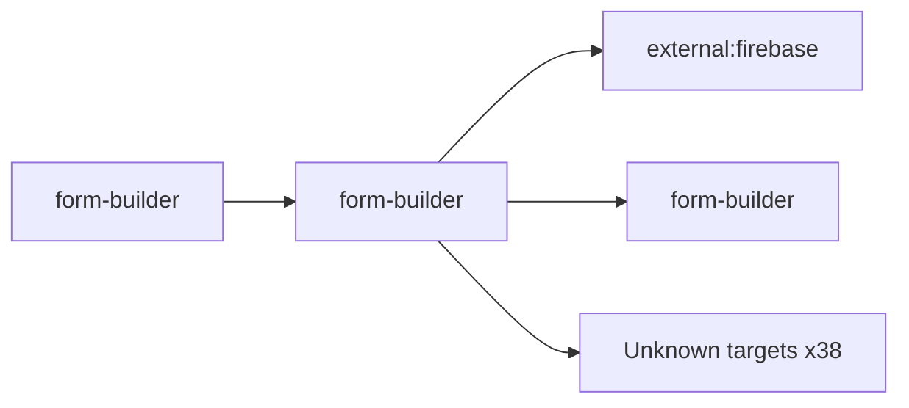

# form-builder — High-Level Design

## Context
form-builder is a `frontend-web` in the TVS-CS org (domain: Unknown). Neighbours: callers `form-builder`; downstream `external:firebase`, `form-builder`.

## Architecture
form-builder components and connections (from service.yaml):

## Integration Points
form-builder registry edges (3):

| Direction | Peer | Kind | Via | Criticality | Source | Match |
|---|---|---|---|---|---|---|
| self | `form-builder` | http | PATCH /api/admin/update-template | hard | code | path-unique |
| self | `form-builder` | http | POST /api/admin/create-template | hard | code | path-unique |
| out | `external:firebase` | library_dependency | package:firebase | hard | code | artifact |
| out | `external:firebase` | http | - | Unknown | code | external |

## Data Ownership
form-builder data stores (service.yaml `data_stores`; ownership flag not determinable unless set):

| Store | Type | Access | Owned | Key entities |
|---|---|---|---|---|
| N/A | | | | no data stores extracted |

## Key Design Decisions
form-builder: N/A — not determinable from code.

| Decision | Alternatives considered | Reason |
|---|---|---|
| Unknown | Unknown | Unknown |

## Non-Functional Requirements
form-builder NFR targets: N/A — not determinable from code.

## Security
form-builder security: endpoint auth values None. No auth middleware found in code. 3 secret config key(s), sourced via: {'None': 3} (names in OVERVIEW.md). PII handling: Unknown.

## Resilience and Failure Modes
form-builder hard dependencies: `form-builder`. No retry/circuit-breaker code found; failure behaviour Unknown.

## Deployment Topology
form-builder deployment artefacts (platform/regions: Unknown unless listed):

| Kind | Name | File | Environments | Image | Ports | Variable groups |
|---|---|---|---|---|---|---|
| azure-pipeline | cd-pipeline.yaml | `cd-pipeline.yaml:1` | dev, prod, uat | - | - | - |
| azure-pipeline | ci-pipeline.yaml | `ci-pipeline.yaml:1` | - | - | - | - |
| azure-pipeline | ci-sonar-pipeline-pr.yml | `ci-sonar-pipeline-pr.yml:1` | - | - | - | - |
| azure-pipeline | ci-sonar-pipeline.yml | `ci-sonar-pipeline.yml:1` | - | - | - | - |
| compose-service | app | `docker-compose.yml:4` | - | - | 3000:3000 | - |
| dockerfile | Dockerfile | `Dockerfile:2` | - | node:23.11.0-alpine3.20 | 3000 | - |

## Observability
form-builder observability libraries: none found. Related config keys: none. Dashboards/alerts: Unknown.
