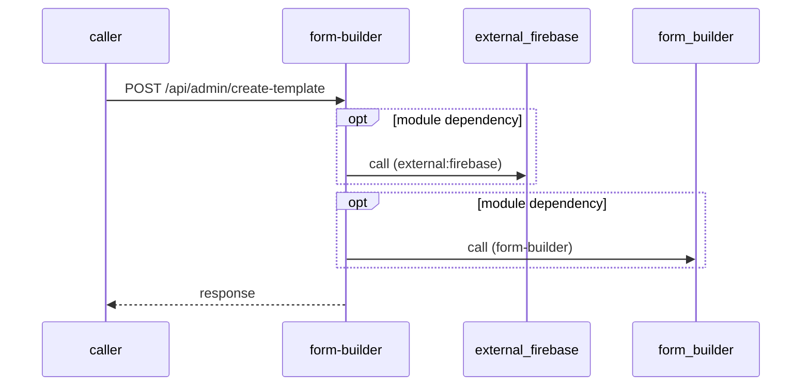

# form-builder — Low-Level Design

## Data Model
form-builder entities from `data_access` items (0).
N/A — no data access in this repo.

## State Machines
form-builder: N/A — no status/state enums found in code.

## Business Rules
form-builder validation rules on DTO fields (from schema `validation`):
N/A — no declarative validation found; other rules not determinable without manual review.

## Key Classes and Functions
form-builder key classes:

| Class / Function | File | Responsibility |
|---|---|---|
| `pages/api/admin/add-user` | `pages/api/admin/add-user.ts` | HTTP handlers |
| `pages/api/admin/delete-form/[id]` | `pages/api/admin/delete-form/[id].ts` | HTTP handlers |
| `pages/api/admin/delete-user/[id]` | `pages/api/admin/delete-user/[id].ts` | HTTP handlers |
| `pages/api/admin/edit-user/[id]` | `pages/api/admin/edit-user/[id].ts` | HTTP handlers |
| `pages/api/admin/get-client` | `pages/api/admin/get-client.ts` | HTTP handlers |
| `pages/api/admin/get-form-list` | `pages/api/admin/get-form-list.ts` | HTTP handlers |
| `pages/api/admin/get-form/[id]` | `pages/api/admin/get-form/[id].ts` | HTTP handlers |
| `pages/api/admin/get-user-list` | `pages/api/admin/get-user-list.ts` | HTTP handlers |
| `pages/api/admin/get-user/[id]` | `pages/api/admin/get-user/[id].ts` | HTTP handlers |
| `pages/api/admin/login-sso-user` | `pages/api/admin/login-sso-user.ts` | HTTP handlers |
| `pages/api/generate-pdf` | `pages/api/generate-pdf.ts` | HTTP handlers |
| `pages/api/get-env-config` | `pages/api/get-env-config.ts` | HTTP handlers |
| `pages/api/get-masterdata` | `pages/api/get-masterdata.ts` | HTTP handlers |
| `pages/api/get-submission-data` | `pages/api/get-submission-data.ts` | HTTP handlers |
| `pages/api/save-template-data` | `pages/api/save-template-data.ts` | HTTP handlers |
| `pages/api/submission-approval` | `pages/api/submission-approval.ts` | HTTP handlers |
| `pages/api/submission-update` | `pages/api/submission-update.ts` | HTTP handlers |
| `pages/api/templates` | `pages/api/templates.ts` | HTTP handlers |
| `pages/api/admin/update-template` | `pages/api/admin/update-template.ts` | HTTP handlers |
| `pages/api/admin/create-template` | `pages/api/admin/create-template.ts` | HTTP handlers |

## Sequence Details
form-builder sequence for `POST /api/admin/create-template` (handler `pages/api/admin/create-template.ts#POST`); downstream calls inside the handler are not traced from code, module-level targets shown as optional.

## Error Handling
form-builder error handling: no global exception handler found in code. Status mapping: Unknown.

## Configuration Details
form-builder behaviour-relevant config keys (names only; full list in OVERVIEW.md):
- `BASE_PATH`: points to `form-builder`
- `env:API_URL`: base URL for outbound calls
- `env:BASE_PATH`: base URL for outbound calls
- `env:NEXT_PUBLIC_API_URL`: base URL for outbound calls

## Edge Cases
form-builder edge cases: N/A — not determinable from code without manual review.
