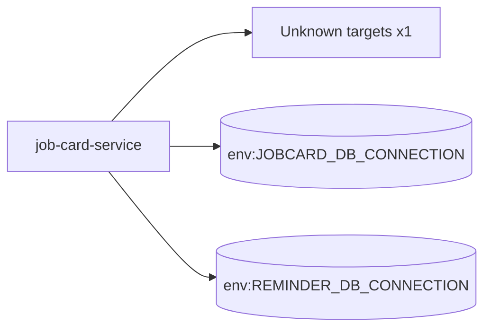

# job-card-service — High-Level Design

## Context
job-card-service is a `backend-api` in the TVS-CS org (domain: Unknown). Neighbours: callers Unknown; downstream none resolved.

## Architecture
job-card-service components and connections (from service.yaml):

## Integration Points
job-card-service registry edges (0):

| Direction | Peer | Kind | Via | Criticality | Source | Match |
|---|---|---|---|---|---|---|
| N/A | | | | | | no registry edges |

## Data Ownership
job-card-service data stores (service.yaml `data_stores`; ownership flag not determinable unless set):

| Store | Type | Access | Owned | Key entities |
|---|---|---|---|---|
| `env:JOBCARD_DB_CONNECTION` | mssql | Unknown | Unknown | Aggregate, Amc, AmcVehicle, AppointmentBooking, AtwModelLogic, AtwVehicle, Branch, CentralizedMobileImage, City, CityType, Complaint, ComplaintEstimation, ComplaintGroup, ComplaintGroupLink, ComplaintLaborPartsEstimation … |
| `env:REMINDER_DB_CONNECTION` | mssql | Unknown | Unknown | Branch, Dealer, Leads |

## Key Design Decisions
job-card-service: N/A — not determinable from code.

| Decision | Alternatives considered | Reason |
|---|---|---|
| Unknown | Unknown | Unknown |

## Non-Functional Requirements
job-card-service NFR targets: N/A — not determinable from code. Tuning-related config keys: `OTEL_BSP_EXPORT_TIMEOUT_SECONDS`, `OTEL_BSP_MAX_EXPORT_BATCH_SIZE`, `OTEL_EXPORTER_TIMEOUT_SECONDS`, `OpenTelemetry:OTEL_BSP_EXPORT_TIMEOUT_SECONDS`, `OpenTelemetry:OTEL_BSP_MAX_EXPORT_BATCH_SIZE`, `OpenTelemetry:OTEL_EXPORTER_TIMEOUT_SECONDS`.

## Security
job-card-service security: endpoint auth values None. No auth middleware found in code. 5 secret config key(s), sourced via: {'app-settings': 5} (names in OVERVIEW.md). PII handling: Unknown.

## Resilience and Failure Modes
job-card-service hard dependencies: none resolved. No retry/circuit-breaker code found; failure behaviour Unknown.

## Deployment Topology
job-card-service deployment artefacts (platform/regions: Unknown unless listed):

| Kind | Name | File | Environments | Image | Ports | Variable groups |
|---|---|---|---|---|---|---|
| azure-pipeline | azure_pipelines/ast-image-scan-job-card-service-pipeline.yaml | `azure_pipelines/ast-image-scan-job-card-service-pipeline.yaml:1` | - | - | - | Checkmarx_Common, UAT_Threshold |
| azure-pipeline | azure_pipelines/ast-job-card-prod-pipeline.yaml | `azure_pipelines/ast-job-card-prod-pipeline.yaml:1` | - | - | - | PROD_Threshold, Tenable |
| azure-pipeline | azure_pipelines/ast-job-card-uat-pipeline.yaml | `azure_pipelines/ast-job-card-uat-pipeline.yaml:1` | - | - | - | Checkmarx_Common, Tenable, UAT_Threshold |
| azure-pipeline | azure_pipelines/cd-pipeline.yaml | `azure_pipelines/cd-pipeline.yaml:1` | dev, prod, uat | - | - | - |
| azure-pipeline | azure_pipelines/ci-pipeline.yaml | `azure_pipelines/ci-pipeline.yaml:1` | - | - | - | - |
| azure-pipeline | azure_pipelines/sonar.yaml | `azure_pipelines/sonar.yaml:1` | - | - | - | - |
| azure-pipeline | sonar.yaml | `sonar.yaml:1` | - | - | - | - |
| dockerfile | Dockerfile | `Dockerfile:4` | - | mcr.microsoft.com/dotnet/aspnet:9.0, mcr.microsoft.com/dotnet/sdk:9.0 | 8080 | - |
| dockerfile | src/Jobcard.API/Dockerfile | `src/Jobcard.API/Dockerfile:2` | - | mcr.microsoft.com/dotnet/aspnet:9.0-bookworm, mcr.microsoft.com/dotnet/sdk:9.0-bookworm | 8080 | - |

## Observability
job-card-service observability libraries: `OpenTelemetry.Exporter.OpenTelemetryProtocol`, `OpenTelemetry.Extensions.Hosting`, `OpenTelemetry.Instrumentation.AspNetCore`, `OpenTelemetry.Instrumentation.Http`, `OpenTelemetry.Instrumentation.SqlClient`. Related config keys: `Logging:IncludeScopes`, `Logging:LogLevel:Default`, `Logging:LogLevel:Microsoft`, `Logging:LogLevel:System`, `OTEL_BSP_EXPORT_TIMEOUT_SECONDS`, `OTEL_BSP_MAX_EXPORT_BATCH_SIZE`, `OTEL_BSP_MAX_QUEUE_SIZE`, `OTEL_BSP_SCHEDULE_DELAY_SECONDS`, `OTEL_EXPORTER_ENABLED`, `OTEL_EXPORTER_OTLP_ENDPOINT`, `OTEL_EXPORTER_TIMEOUT_SECONDS`, `OTEL_SERVICE_NAME`, `OpenTelemetry:OTEL_BSP_EXPORT_TIMEOUT_SECONDS`, `OpenTelemetry:OTEL_BSP_MAX_EXPORT_BATCH_SIZE`, `OpenTelemetry:OTEL_BSP_MAX_QUEUE_SIZE`, `OpenTelemetry:OTEL_BSP_SCHEDULE_DELAY_SECONDS`, `OpenTelemetry:OTEL_EXPORTER_ENABLED`, `OpenTelemetry:OTEL_EXPORTER_OTLP_ENDPOINT`, `OpenTelemetry:OTEL_EXPORTER_TIMEOUT_SECONDS`, `OpenTelemetry:OTEL_SERVICE_NAME`. Dashboards/alerts: Unknown.
