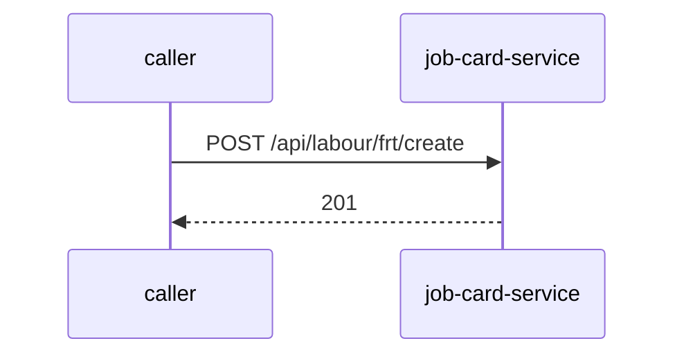

# job-card-service — Low-Level Design

## Data Model
job-card-service entities from `data_access` items (2).

Store access at `src/Jobcard.Infrastructure/Extensions/ServiceCollectionExtensions.cs:24`: database Unknown; collections -.

### MDMS_FRT_AGGREGATE
Entity `Aggregate` defined in `src/Jobcard.Domain/Entities/PartsAggregate/Aggregate.cs:6`; table MDMS_FRT_AGGREGATE; operation Unknown.
Columns: Unknown (no fields extracted).
Relationships: Unknown.

### MDMS_AMC
Entity `Amc` defined in `src/Jobcard.Domain/Entities/AmcAggregate/Amc.cs:9`; table MDMS_AMC; operation Unknown.
Columns: Unknown (no fields extracted).
Relationships: Unknown.

### MDMS_AMC_VEHICLE
Entity `AmcVehicle` defined in `src/Jobcard.Domain/Entities/AmcAggregate/AmcVehicle.cs:6`; table MDMS_AMC_VEHICLE; operation Unknown.
Columns: Unknown (no fields extracted).
Relationships: Unknown.

### MDMS_APPOINTMENT_BOOKING
Entity `AppointmentBooking` defined in `src/Jobcard.Domain/Entities/JobCardAggregate/AppointmentBooking.cs:4`; table MDMS_APPOINTMENT_BOOKING; operation Unknown.
Columns: Unknown (no fields extracted).
Relationships: Unknown.

### MDMS_ATW_MODEL_LOGIC
Entity `AtwModelLogic` defined in `src/Jobcard.Domain/Entities/LabourAggregate/AtwModelLogic.cs:4`; table MDMS_ATW_MODEL_LOGIC; operation Unknown.
Columns: Unknown (no fields extracted).
Relationships: Unknown.

### MDMS_ATW_VEHICLE
Entity `AtwVehicle` defined in `src/Jobcard.Domain/Entities/LabourAggregate/AtwVehicle.cs:6`; table MDMS_ATW_VEHICLE; operation Unknown.
Columns: Unknown (no fields extracted).
Relationships: Unknown.

### MDMS_BRANCH
Entity `Branch` defined in `src/Jobcard.API/Models/Branch.cs:26`; table MDMS_BRANCH; operation Unknown.
Columns: Unknown (no fields extracted).
Relationships: Unknown.

### MDMS_CENTRALIZED_MOBILE_IMAGE
Entity `CentralizedMobileImage` defined in `src/Jobcard.Domain/Entities/JobCardAggregate/CentralizedMobileImage.cs:4`; table MDMS_CENTRALIZED_MOBILE_IMAGE; operation Unknown.
Columns: Unknown (no fields extracted).
Relationships: Unknown.

### MDMS_CITY_DIGI
Entity `City` defined in `src/Jobcard.Domain/Entities/DealerAggregate/City.cs:7`; table MDMS_CITY_DIGI; operation Unknown.
Columns: Unknown (no fields extracted).
Relationships: Unknown.

### MDMS_CITY_TYPE_DIGI
Entity `CityType` defined in `src/Jobcard.Domain/Entities/DealerAggregate/CityType.cs:9`; table MDMS_CITY_TYPE_DIGI; operation Unknown.
Columns: Unknown (no fields extracted).
Relationships: Unknown.

### MDMS_COMPLAINT
Entity `Complaint` defined in `src/Jobcard.API/Models/Complaint.cs:26`; table MDMS_COMPLAINT; operation Unknown.
Columns: Unknown (no fields extracted).
Relationships: Unknown.

### MDMS_COMPLAINT_EST
Entity `ComplaintEstimation` defined in `src/Jobcard.Domain/Entities/JobCardAggregate/ComplaintEstimation.cs:4`; table MDMS_COMPLAINT_EST; operation Unknown.
Columns: Unknown (no fields extracted).
Relationships: Unknown.

### MDMS_COMPLAINT_GROUP
Entity `ComplaintGroup` defined in `src/Jobcard.Domain/Entities/JobCardAggregate/ComplaintGroup.cs:4`; table MDMS_COMPLAINT_GROUP; operation Unknown.
Columns: Unknown (no fields extracted).
Relationships: Unknown.

### MDMS_COMPLAINT_GRP_LINK
Entity `ComplaintGroupLink` defined in `src/Jobcard.Domain/Entities/JobCardAggregate/ComplaintGroupLink.cs:6`; table MDMS_COMPLAINT_GRP_LINK; operation Unknown.
Columns: Unknown (no fields extracted).
Relationships: Unknown.

### MDMS_COMPLAINT_LABOR_PARTS_EST
Entity `ComplaintLaborPartsEstimation` defined in `src/Jobcard.Domain/Entities/JobCardAggregate/ComplaintLaborPartsEstimation.cs:4`; table MDMS_COMPLAINT_LABOR_PARTS_EST; operation Unknown.
Columns: Unknown (no fields extracted).
Relationships: Unknown.

### MDMS_JOB_COMPLAINT_LABOR_PARTS
Entity `ComplaintLabourParts` defined in `src/Jobcard.Domain/Entities/JobCardAggregate/ComplaintLabourParts.cs:3`; table MDMS_JOB_COMPLAINT_LABOR_PARTS; operation Unknown.
Columns: Unknown (no fields extracted).
Relationships: Unknown.

### MDMS_COMPL_PROBING_ANSWERS
Entity `ComplaintProbingAnswers` defined in `src/Jobcard.Domain/Entities/JobCardAggregate/ComplaintProbingAnswers.cs:4`; table MDMS_COMPL_PROBING_ANSWERS; operation Unknown.
Columns: Unknown (no fields extracted).
Relationships: Unknown.

### MDMS_CUSTOMER
Entity `Customer` defined in `src/Jobcard.API/Models/Customer.cs:26`; table MDMS_CUSTOMER; operation Unknown.
Columns: Unknown (no fields extracted).
Relationships: Unknown.

### MDMS_CUSTOMER_ADDRESS
Entity `CustomerAddress` defined in `src/Jobcard.Domain/Entities/CustomerAggregate/CustomerAddress.cs:5`; table MDMS_CUSTOMER_ADDRESS; operation Unknown.
Columns: Unknown (no fields extracted).
Relationships: Unknown.

### MDMS_CUSTOMER_PHONE
Entity `CustomerContact` defined in `src/Jobcard.Domain/Entities/CustomerAggregate/CustomerContact.cs:6`; table MDMS_CUSTOMER_PHONE; operation Unknown.
Columns: Unknown (no fields extracted).
Relationships: Unknown.

### MDMS_DEALER
Entity `Dealer` defined in `src/Jobcard.API/Models/Dealer.cs:26`; table MDMS_DEALER; operation Unknown.
Columns: Unknown (no fields extracted).
Relationships: Unknown.

### MDMS_DEALER_VEHICLE_MAPPING
Entity `DealerVehicleMapping` defined in `src/Jobcard.Domain/Entities/VehicleAggregate/DealerVehicleMapping.cs:6`; table MDMS_DEALER_VEHICLE_MAPPING; operation Unknown.
Columns: Unknown (no fields extracted).
Relationships: Unknown.

### MDMS_DIGI_DEALER_SETTING
Entity `DigiDealerSetting` defined in `src/Jobcard.Domain/Entities/DealerAggregate/DigiDealerSetting.cs:9`; table MDMS_DIGI_DEALER_SETTING; operation Unknown.
Columns: Unknown (no fields extracted).
Relationships: Unknown.

### Employee
Entity `Employee` defined in `src/Jobcard.Domain/Entities/JobCardAggregate/Employee.cs:4`; table Employee; operation Unknown.
Columns: Unknown (no fields extracted).
Relationships: Unknown.

### MDMS_FRT_ACTION
Entity `FrtAction` defined in `src/Jobcard.Domain/Entities/MasterAggregate/FrtAction.cs:4`; table MDMS_FRT_ACTION; operation Unknown.
Columns: Unknown (no fields extracted).
Relationships: Unknown.

### FrtId
Entity `FrtId` defined in `src/Jobcard.Domain/Entities/LabourAggregate/FrtId.cs:4`; table FrtId; operation Unknown.
Columns: Unknown (no fields extracted).
Relationships: Unknown.

### MDMS_FRT_PMJ_PARTS
Entity `FrtPmjParts` defined in `src/Jobcard.Domain/Entities/PartsAggregate/FrtPmjParts.cs:5`; table MDMS_FRT_PMJ_PARTS; operation Unknown.
Columns: Unknown (no fields extracted).
Relationships: Unknown.

### MDMS_SPARE_PART_COUNTRY
Entity `FrtSparePartCountry` defined in `src/Jobcard.Domain/Entities/PartsAggregate/SparePartCountry.cs:4`; table MDMS_SPARE_PART_COUNTRY; operation Unknown.
Columns: Unknown (no fields extracted).
Relationships: Unknown.

### MDMS_UOM
Entity `FrtUom` defined in `src/Jobcard.Domain/Entities/PartsAggregate/Uom.cs:4`; table MDMS_UOM; operation Unknown.
Columns: Unknown (no fields extracted).
Relationships: Unknown.

### MDMS_FRT_VARIANCE
Entity `FrtVariance` defined in `src/Jobcard.Domain/Entities/VehicleAggregate/FrtVariance.cs:7`; table MDMS_FRT_VARIANCE; operation Unknown.
Columns: Unknown (no fields extracted).
Relationships: Unknown.

### MDMS_FRT_VEHICLE_MODEL_CLASSIFICATION_DIGI
Entity `FrtVehicleModelClassification` defined in `src/Jobcard.Domain/Entities/LabourAggregate/FrtVehicleModelClassification.cs:3`; table MDMS_FRT_VEHICLE_MODEL_CLASSIFICATION_DIGI; operation Unknown.
Columns: Unknown (no fields extracted).
Relationships: Unknown.

### MDMS_FRT_VEHICLE_TYPE_DIGI
Entity `FrtVehicleType` defined in `src/Jobcard.Domain/Entities/LabourAggregate/FrtVehicleType.cs:7`; table MDMS_FRT_VEHICLE_TYPE_DIGI; operation Unknown.
Columns: Unknown (no fields extracted).
Relationships: Unknown.

### MDMS_HSN_CODE_PER
Entity `Hsn` defined in `src/Jobcard.Domain/Entities/MasterAggregate/Hsn.cs:4`; table MDMS_HSN_CODE_PER; operation Unknown.
Columns: Unknown (no fields extracted).
Relationships: Unknown.

### MDMS_ISSUE_MODE
Entity `IssueMode` defined in `src/Jobcard.Domain/Entities/JobCardAggregate/IssueMode.cs:4`; table MDMS_ISSUE_MODE; operation Unknown.
Columns: Unknown (no fields extracted).
Relationships: Unknown.

### MDMS_JOB_CARD_AFTER_TRAIL
Entity `JobCardAfterTrial` defined in `src/Jobcard.Domain/Entities/JobCardAggregate/JobCardAfterTrial.cs:4`; table MDMS_JOB_CARD_AFTER_TRAIL; operation Unknown.
Columns: Unknown (no fields extracted).
Relationships: Unknown.

### MDMS_JOB_CARD_AMC
Entity `JobCardAmc` defined in `src/Jobcard.Domain/Entities/JobCardAggregate/JobCardAMC.cs:5`; table MDMS_JOB_CARD_AMC; operation Unknown.
Columns: Unknown (no fields extracted).
Relationships: Unknown.

### MDMS_JOB_CARD_BEFORE_DEL
Entity `JobCardBeforDelivery` defined in `src/Jobcard.Domain/Entities/JobCardAggregate/JobCardBeforDelivery.cs:4`; table MDMS_JOB_CARD_BEFORE_DEL; operation Unknown.
Columns: Unknown (no fields extracted).
Relationships: Unknown.

### MDMS_JOB_CARD_BEFORE_TRIAL
Entity `JobCardBeforTrial` defined in `src/Jobcard.Domain/Entities/JobCardAggregate/JobCardBeforTrial.cs:4`; table MDMS_JOB_CARD_BEFORE_TRIAL; operation Unknown.
Columns: Unknown (no fields extracted).
Relationships: Unknown.

### MDMS_JOB_CARD
Entity `JobCardBooking` defined in `src/Jobcard.Domain/Entities/JobCardAggregate/JobCardBooking.cs:6`; table MDMS_JOB_CARD; operation Unknown.
Columns: Unknown (no fields extracted).
Relationships: Unknown.

### MDMS_DIGI_JOB_CARD_DETAILS
Entity `JobCardDetails` defined in `src/Jobcard.Domain/Entities/JobCardAggregate/JobCardDetails.cs:4`; table MDMS_DIGI_JOB_CARD_DETAILS; operation Unknown.
Columns: Unknown (no fields extracted).
Relationships: Unknown.

### MDMS_JOB_CARD_EST
Entity `JobCardEstimation` defined in `src/Jobcard.Domain/Entities/JobCardAggregate/JobCardEstimation.cs:7`; table MDMS_JOB_CARD_EST; operation Unknown.
Columns: Unknown (no fields extracted).
Relationships: Unknown.

### MDMS_JOBCARD_ID_TABLE
Entity `JobCardId` defined in `src/Jobcard.Domain/Entities/JobCardAggregate/JobCardID.cs:4`; table MDMS_JOBCARD_ID_TABLE; operation Unknown.
Columns: Unknown (no fields extracted).
Relationships: Unknown.

### MDMS_JOB_CARD_INSURANCE
Entity `JobCardInsurance` defined in `src/Jobcard.Domain/Entities/JobCardAggregate/JobCardInsurance.cs:4`; table MDMS_JOB_CARD_INSURANCE; operation Unknown.
Columns: Unknown (no fields extracted).
Relationships: Unknown.

### MDMS_JOB_CARD_INS_DET
Entity `JobCardInsuranceDetails` defined in `src/Jobcard.Domain/Entities/JobCardAggregate/JobCardInsuranceDetails.cs:4`; table MDMS_JOB_CARD_INS_DET; operation Unknown.
Columns: Unknown (no fields extracted).
Relationships: Unknown.

### MDMS_JOB_CARD_INVOICE
Entity `JobCardInvoice` defined in `src/Jobcard.Domain/Entities/JobCardAggregate/JobCardInvoice.cs:4`; table MDMS_JOB_CARD_INVOICE; operation Unknown.
Columns: Unknown (no fields extracted).
Relationships: Unknown.

### MDMS_JOB_CARD_INV_LAB
Entity `JobCardInvoiceLabor` defined in `src/Jobcard.Domain/Entities/JobCardAggregate/JobCardInvoiceLabor.cs:6`; table MDMS_JOB_CARD_INV_LAB; operation Unknown.
Columns: Unknown (no fields extracted).
Relationships: Unknown.

### MDMS_JOB_CARD_INV_SPR
Entity `JobCardInvoiceSparePart` defined in `src/Jobcard.Domain/Entities/JobCardAggregate/JobCardInvoiceSparePart.cs:6`; table MDMS_JOB_CARD_INV_SPR; operation Unknown.
Columns: Unknown (no fields extracted).
Relationships: Unknown.

### MDMS_JOB_CARD_LABOUR
Entity `JobCardLabour` defined in `src/Jobcard.Domain/Entities/LabourAggregate/JobCardLabour.cs:6`; table MDMS_JOB_CARD_LABOUR; operation Unknown.
Columns: Unknown (no fields extracted).
Relationships: Unknown.

### MDMS_JOB_CARD_VAS
Entity `JobCardVas` defined in `src/Jobcard.Domain/Entities/JobCardAggregate/JobCardVas.cs:4`; table MDMS_JOB_CARD_VAS; operation Unknown.
Columns: Unknown (no fields extracted).
Relationships: Unknown.

### MDMS_JOB_COMPLAINT
Entity `JobComplaint` defined in `src/Jobcard.Domain/Entities/JobCardAggregate/JobComplaint.cs:8`; table MDMS_JOB_COMPLAINT; operation Unknown.
Columns: Unknown (no fields extracted).
Relationships: Unknown.

### MDMS_JOB_CARD_SPARES
Entity `JobSpares` defined in `src/Jobcard.Domain/Entities/JobCardAggregate/JobSpares.cs:6`; table MDMS_JOB_CARD_SPARES; operation Unknown.
Columns: Unknown (no fields extracted).
Relationships: Unknown.

### MDMS_JOB_TYPE_CATEGORY
Entity `JobTypeCategory` defined in `src/Jobcard.Domain/Entities/JobCardAggregate/JobTypeCategory.cs:9`; table MDMS_JOB_TYPE_CATEGORY; operation Unknown.
Columns: Unknown (no fields extracted).
Relationships: Unknown.

### MDMS_LABOUR_EST
Entity `LaborEstimate` defined in `src/Jobcard.Domain/Entities/LabourAggregate/LaborEstimate.cs:6`; table MDMS_LABOUR_EST; operation Unknown.
Columns: Unknown (no fields extracted).
Relationships: Unknown.

### MDMS_LABOUR
Entity `Labour` defined in `src/Jobcard.API/Models/Labour.cs:26`; table MDMS_LABOUR; operation Unknown.
Columns: Unknown (no fields extracted).
Relationships: Unknown.

### MDMS_LABOUR_CAT
Entity `LabourCategory` defined in `src/Jobcard.Domain/Entities/LabourAggregate/LabourCategory.cs:4`; table MDMS_LABOUR_CAT; operation Unknown.
Columns: Unknown (no fields extracted).
Relationships: Unknown.

### MDMS_LABOUR_ID_GENERATE
Entity `LabourIdGenerate` defined in `src/Jobcard.Domain/Entities/LabourAggregate/LabourIdGenerate.cs:9`; table MDMS_LABOUR_ID_GENERATE; operation Unknown.
Columns: Unknown (no fields extracted).
Relationships: Unknown.

### MDMS_LABOUR_MODEL_VARIANT
Entity `LabourModelVariant` defined in `src/Jobcard.Domain/Entities/LabourAggregate/LabourModelVariant.cs:6`; table MDMS_LABOUR_MODEL_VARIANT; operation Unknown.
Columns: Unknown (no fields extracted).
Relationships: Unknown.

### MDMS_LABOUR_TYPE
Entity `LabourType` defined in `src/Jobcard.Domain/Entities/LabourAggregate/LabourType.cs:4`; table MDMS_LABOUR_TYPE; operation Unknown.
Columns: Unknown (no fields extracted).
Relationships: Unknown.

### MDMS_FRT_MAN_HOUR_COST_DIGI
Entity `ManHourCost` defined in `src/Jobcard.Domain/Entities/VehicleAggregate/ManHourCost.cs:5`; table MDMS_FRT_MAN_HOUR_COST_DIGI; operation Unknown.
Columns: Unknown (no fields extracted).
Relationships: Unknown.

### MDMS_FRT_MAN_HOUR_VEH_TYPE_DIGI
Entity `ManHourVehType` defined in `src/Jobcard.Domain/Entities/VehicleAggregate/ManHourVehType.cs:4`; table MDMS_FRT_MAN_HOUR_VEH_TYPE_DIGI; operation Unknown.
Columns: Unknown (no fields extracted).
Relationships: Unknown.

### MDMS_MODEL_JOB_TYPE
Entity `ModelJobType` defined in `src/Jobcard.Domain/Entities/JobCardAggregate/ModelJobType.cs:12`; table MDMS_MODEL_JOB_TYPE; operation Unknown.
Columns: Unknown (no fields extracted).
Relationships: Unknown.

### MDMS_NON_FRT_PER_MAINT_COST_DIGI
Entity `NonFrtPerMaintCost` defined in `src/Jobcard.Domain/Entities/LabourAggregate/NonFrtPerMaintCost.cs:7`; table MDMS_NON_FRT_PER_MAINT_COST_DIGI; operation Unknown.
Columns: Unknown (no fields extracted).
Relationships: Unknown.

### MDMS_PSF_USER_ANSWER
Entity `PSF_SCORE` defined in `src/Jobcard.Domain/Entities/JobCardAggregate/PSF_SCORE.cs:3`; table MDMS_PSF_USER_ANSWER; operation Unknown.
Columns: Unknown (no fields extracted).
Relationships: Unknown.

### MDMS_FRT_PART
Entity `Part` defined in `src/Jobcard.API/Models/Part.cs:26`; table MDMS_FRT_PART; operation Unknown.
Columns: Unknown (no fields extracted).
Relationships: Unknown.

### MDMS_PAYER
Entity `Payer` defined in `src/Jobcard.Domain/Entities/JobCardAggregate/Payer.cs:4`; table MDMS_PAYER; operation Unknown.
Columns: Unknown (no fields extracted).
Relationships: Unknown.

### MDMS_PERFORMA_INVOICE
Entity `ProformaInvoice` defined in `src/Jobcard.Domain/Entities/ProformaAggregate/ProformaInvoice.cs:4`; table MDMS_PERFORMA_INVOICE; operation Unknown.
Columns: Unknown (no fields extracted).
Relationships: Unknown.

### MDMS_PERFORMA_INV_LAB
Entity `ProformaInvoiceLabor` defined in `src/Jobcard.Domain/Entities/ProformaAggregate/ProformaInvoiceLabor.cs:7`; table MDMS_PERFORMA_INV_LAB; operation Unknown.
Columns: Unknown (no fields extracted).
Relationships: Unknown.

### ProformaInvoiceSparePart
Entity `ProformaInvoiceSparePart` defined in `src/Jobcard.Domain/Entities/ProformaAggregate/ProformaInvoiceSparePart.cs:5`; table ProformaInvoiceSparePart; operation Unknown.
Columns: Unknown (no fields extracted).
Relationships: Unknown.

### MDMS_PSF
Entity `Psf` defined in `src/Jobcard.Domain/Entities/JobCardAggregate/Psf.cs:5`; table MDMS_PSF; operation Unknown.
Columns: Unknown (no fields extracted).
Relationships: Unknown.

### MDMS_PART_MFR_LOC_RACK_BIN
Entity `RackBIN` defined in `src/Jobcard.Domain/Entities/PartsAggregate/RackBIN.cs:4`; table MDMS_PART_MFR_LOC_RACK_BIN; operation Unknown.
Columns: Unknown (no fields extracted).
Relationships: Unknown.

### MDMS_SERVICE_PRICE
Entity `ServicePrice` defined in `src/Jobcard.Domain/Entities/LabourAggregate/ServicePrice.cs:4`; table MDMS_SERVICE_PRICE; operation Unknown.
Columns: Unknown (no fields extracted).
Relationships: Unknown.

### MDMS_SPARE_PART
Entity `SparePart` defined in `src/Jobcard.Domain/Entities/PartsAggregate/SparePart.cs:4`; table MDMS_SPARE_PART; operation Unknown.
Columns: Unknown (no fields extracted).
Relationships: Unknown.

### MDMS_SPARE_EST
Entity `SparePartEstimate` defined in `src/Jobcard.Domain/Entities/PartsAggregate/SparePartEstimate.cs:3`; table MDMS_SPARE_EST; operation Unknown.
Columns: Unknown (no fields extracted).
Relationships: Unknown.

### MDMS_STATUS
Entity `Status` defined in `src/Jobcard.Domain/Entities/JobCardAggregate/Status.cs:4`; table MDMS_STATUS; operation Unknown.
Columns: Unknown (no fields extracted).
Relationships: Unknown.

### MDMS_FRT_VEHICLE_MODEL_VARIANCE_DIGI
Entity `VehModelVariance` defined in `src/Jobcard.Domain/Entities/PartsAggregate/VehModelVariance.cs:6`; table MDMS_FRT_VEHICLE_MODEL_VARIANCE_DIGI; operation Unknown.
Columns: Unknown (no fields extracted).
Relationships: Unknown.

### MDMS_VEHICLE
Entity `Vehicle` defined in `src/Jobcard.Domain/Entities/VehicleAggregate/Vehicle.cs:9`; table MDMS_VEHICLE; operation Unknown.
Columns: Unknown (no fields extracted).
Relationships: Unknown.

### MDMS_VEHICLE_INVOICE
Entity `VehicleInvoice` defined in `src/Jobcard.Domain/Entities/VehicleAggregate/VehicleInvoice.cs:12`; table MDMS_VEHICLE_INVOICE; operation Unknown.
Columns: Unknown (no fields extracted).
Relationships: Unknown.

### MDMS_INVOICE_PART
Entity `VehicleInvoicePart` defined in `src/Jobcard.Domain/Entities/VehicleAggregate/VehicleInvoicePart.cs:11`; table MDMS_INVOICE_PART; operation Unknown.
Columns: Unknown (no fields extracted).
Relationships: Unknown.

### MDMS_VEHICLE_MODEL
Entity `VehicleModel` defined in `src/Jobcard.Domain/Entities/VehicleAggregate/VehicleModel.cs:7`; table MDMS_VEHICLE_MODEL; operation Unknown.
Columns: Unknown (no fields extracted).
Relationships: Unknown.

Store access at `src/Jobcard.Infrastructure/Extensions/ServiceCollectionExtensions.cs:23`: database Unknown; collections -.

### MDMS_BRANCH
Entity `Branch` defined in `src/Jobcard.API/Models/Branch.cs:26`; table MDMS_BRANCH; operation Unknown.
Columns: Unknown (no fields extracted).
Relationships: Unknown.

### MDMS_DEALER
Entity `Dealer` defined in `src/Jobcard.API/Models/Dealer.cs:26`; table MDMS_DEALER; operation Unknown.
Columns: Unknown (no fields extracted).
Relationships: Unknown.

### FRAME_LEVEL_SMRV2_LEADS
Entity `Leads` defined in `src/Jobcard.Domain/Entities/LeadsAggregate/Leads.cs:4`; table FRAME_LEVEL_SMRV2_LEADS; operation Unknown.
Columns: Unknown (no fields extracted).
Relationships: Unknown.

## State Machines
job-card-service: N/A — no status/state enums found in code.

## Business Rules
job-card-service validation rules on DTO fields (from schema `validation`):
N/A — no declarative validation found; other rules not determinable without manual review.

## Key Classes and Functions
job-card-service key classes:

| Class / Function | File | Responsibility |
|---|---|---|
| `JobcardController` | `src/Jobcard.API/Controllers/JobcardController.cs` | HTTP handlers |
| `LabourController` | `src/Jobcard.API/Controllers/LabourController.cs` | HTTP handlers |
| `AutoLaborController` | `src/Jobcard.API/Controllers/AutoLaborController.cs` | HTTP handlers |
| `AmcController` | `src/Jobcard.API/Controllers/AmcController.cs` | HTTP handlers |
| `PartsController` | `src/Jobcard.API/Controllers/PartsController.cs` | HTTP handlers |
| `UseExceptionHandler` | `src/Jobcard.API/Program.cs:386` | error handling |

## Sequence Details
job-card-service sequence for `POST /api/labour/frt/create` (handler `LabourController.CreateLabour`); downstream calls inside the handler are not traced from code, module-level targets shown as optional.

## Error Handling
job-card-service error handling: `src/Jobcard.API/Program.cs:386` (UseExceptionHandler). Documented error statuses come from response annotations in API_SPEC.md.

## Configuration Details
job-card-service behaviour-relevant config keys (names only; full list in OVERVIEW.md):
- `env:OTEL_EXPORTER_OTLP_ENDPOINT`: base URL for outbound calls

## Edge Cases
job-card-service edge cases: N/A — not determinable from code without manual review.
