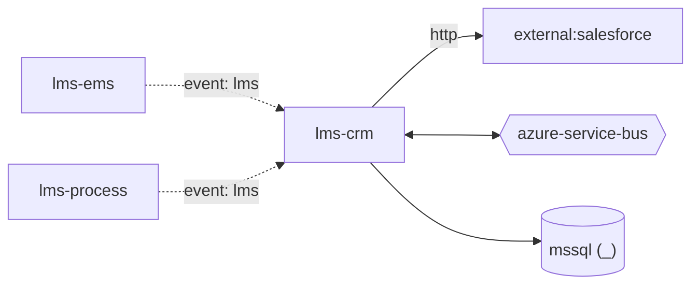

# lms-crm — High-Level Design

## Context
lms-crm is a `backend-api` in the TVS-CS Lead Management System (domain: lead-management). It is one of five LMS repos: `lms` (acquisition API) and the listener workers `lms-process`, `lms-ems`, `lms-crm`, `lms-tvs-credit`, connected through Service Bus topic `lead`.

## Architecture
lms-crm components and connections (from service.yaml / registry edges):

## Integration Points
lms-crm registry edges (3):

| Direction | Peer | Kind | Via | Criticality | Source | Match |
|---|---|---|---|---|---|---|
| out | `external:salesforce` | http | host:tvsm-c360a--dev.sandbox.my.salesforce.com | hard | code | host |
| in | `lms-ems` | event | azure-service-bus:topic:lead | async | inferred | entity |
| in | `lms-process` | event | azure-service-bus:topic:lead | async | inferred | entity |

## Data Ownership
lms-crm data stores (service.yaml `data_stores`). All LMS repos map the same LMS SQL schema (tables such as `leads`, `lead_push_logs`, `dealer_mediation_controls`, `lead_flow_configuration`); ownership is not declared in code.

| Store | Type | Owned | Key entities |
|---|---|---|---|
| `_` | mssql | Unknown | BrandMaster, DealerMediationControl, DialerToken, Lead, LeadFlowConfiguration, LeadPushLog, ModelIdPartIdMaster |

## Key Design Decisions
lms-crm design decisions evidenced in code:

| Decision | Alternatives considered | Evidence |
|---|---|---|
| CRM fan-out selected per lead source from `lead_flow_configuration` | Unknown | `Services/CrmService.cs:51` |

## Non-Functional Requirements
lms-crm NFR targets: N/A — not determinable from code.

## Security
lms-crm security: lms-crm exposes only `GET /` with no auth attribute. Outbound CCP and dialer calls obtain tokens from `CCP_TOKEN_URL` / `DIALER_TOKEN_URL` (names only, `Utils/AppSettingsService.cs:29-32`); tokens cached in `dialer_token`. Secrets (connection strings, client secrets, API keys) are read from configuration keys listed by name in OVERVIEW.md; values are not reproduced. PII handling: leads carry customer contact data (see request schemas); masking/encryption Unknown.

## Resilience and Failure Modes
lms-crm: The handler completes the Service Bus message *before* business processing (`AutoCompleteMessages = false` then an explicit `CompleteMessageAsync` at `ListenerService/CrmListenerService.cs:66`), so a failure in processing does not redeliver or dead-letter the message; the error handler only logs (CrmListenerService.cs `ProcessErrorAsync`). `MaxConcurrentCalls = 1` serialises processing. No retry policy, circuit breaker or DLQ handling found in code.

## Deployment Topology
lms-crm deployment artefacts (platform/regions: Unknown):

| Kind | File | Environments | Base images | Ports |
|---|---|---|---|---|
| none | no Dockerfile/pipeline found | - | - | - |

## Observability
lms-crm observability: `ILogger` logging only; no OpenTelemetry/App Insights configuration found. Dashboards/alerts: Unknown.
