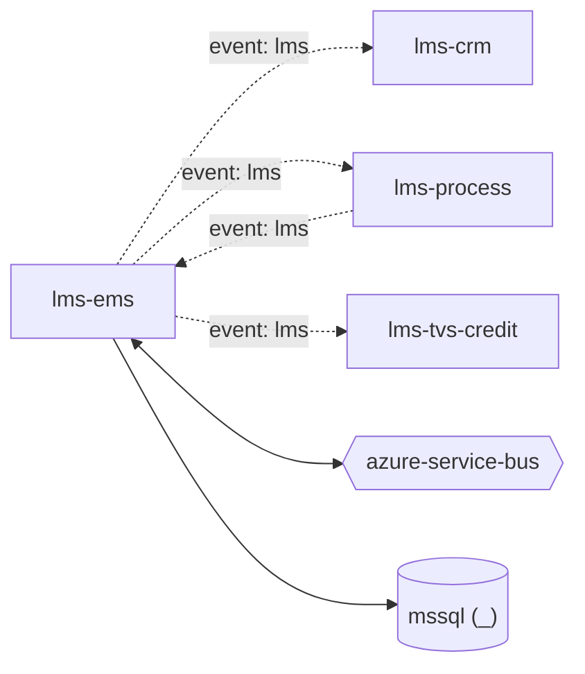

# lms-ems — High-Level Design

## Context
lms-ems is a `backend-api` in the TVS-CS Lead Management System (domain: lead-management). It is one of five LMS repos: `lms` (acquisition API) and the listener workers `lms-process`, `lms-ems`, `lms-crm`, `lms-tvs-credit`, connected through Service Bus topic `lead`.

## Architecture
lms-ems components and connections (from service.yaml / registry edges):

## Integration Points
lms-ems registry edges (5):

| Direction | Peer | Kind | Via | Criticality | Source | Match |
|---|---|---|---|---|---|---|
| out | `lms-crm` | event | azure-service-bus:topic:lead | async | inferred | entity |
| self | `lms-ems` | event | azure-service-bus:topic:lead | async | inferred | entity |
| out | `lms-process` | event | azure-service-bus:topic:lead | async | inferred | entity |
| out | `lms-tvs-credit` | event | azure-service-bus:topic:lead | async | inferred | entity |
| in | `lms-process` | event | azure-service-bus:topic:lead | async | inferred | entity |

## Data Ownership
lms-ems data stores (service.yaml `data_stores`). All LMS repos map the same LMS SQL schema (tables such as `leads`, `lead_push_logs`, `dealer_mediation_controls`, `lead_flow_configuration`); ownership is not declared in code.

| Store | Type | Owned | Key entities |
|---|---|---|---|
| `_` | mssql | Unknown | BrandMaster, DealerMediationControl, Lead, LeadFlowConfiguration, LeadPushLog |

## Key Design Decisions
lms-ems design decisions evidenced in code:

| Decision | Alternatives considered | Evidence |
|---|---|---|
| Retries and fallbacks are modelled as new messages on the same topic (scheduled messages) instead of in-process retries | Unknown | `emsService/Services/DispatchService.cs:22-56` |

## Non-Functional Requirements
lms-ems NFR targets: N/A — not determinable from code.

## Security
lms-ems security: lms-ems exposes only `GET /` with no auth attribute. Outbound EMS calls send an API key from config key `API_KEY_VALUE` (name only, `emsService/Const/AppSettingsService.cs:25`). Secrets (connection strings, client secrets, API keys) are read from configuration keys listed by name in OVERVIEW.md; values are not reproduced. PII handling: leads carry customer contact data (see request schemas); masking/encryption Unknown.

## Resilience and Failure Modes
lms-ems: The handler completes the Service Bus message *before* business processing (`AutoCompleteMessages = false` then an explicit `CompleteMessageAsync` at `emsService/ListenerService/EmsListenerService.cs:66`), so a failure in processing does not redeliver or dead-letter the message; the error handler only logs (EmsListenerService.cs `ProcessErrorAsync`). `MaxConcurrentCalls = 1` serialises processing. No retry policy, circuit breaker or DLQ handling found in code.

## Deployment Topology
lms-ems deployment artefacts (platform/regions: Unknown):

| Kind | File | Environments | Base images | Ports |
|---|---|---|---|---|
| azure-pipeline | `azure-pipelines/Norton-LS-CRM-CI.yaml` | - | - | - |

## Observability
lms-ems observability: `ILogger` logging only; no OpenTelemetry/App Insights configuration found. Dashboards/alerts: Unknown.
