# lms-process — Data Flows

## Flow Index
lms-process takes part in 87 end-to-end flow(s) in registry/flows.json; showing the top 25 by confidence, then length.

| flow_id | Name | Role of lms-process | Trigger |
|---|---|---|---|
| catalog-scheduler--external-salesforce-fdb9af | catalog-scheduler → external:salesforce (5 hops) | participant | scheduled job(s) in catalog-scheduler (job-to-call link not resolved): merchandise-accessories-ingestion-job, product-price-ingestion-job; request to catalog-scheduler from outside the registry (no internal caller) |
| catalog-scheduler--lms-crm | catalog-scheduler → lms-crm (5 hops) | participant | scheduled job(s) in catalog-scheduler (job-to-call link not resolved): merchandise-accessories-ingestion-job, product-price-ingestion-job; request to catalog-scheduler from outside the registry (no internal caller) |
| catalog-scheduler--lms-tvs-credit-bd6cbe | catalog-scheduler → lms-tvs-credit (5 hops) | participant | scheduled job(s) in catalog-scheduler (job-to-call link not resolved): merchandise-accessories-ingestion-job, product-price-ingestion-job; request to catalog-scheduler from outside the registry (no internal caller) |
| cbs-admin-portal--external-salesforce-af678f | cbs-admin-portal → external:salesforce (5 hops) | participant | user action in cbs-admin-portal (frontend) |
| cbs-admin-portal--lms-crm | cbs-admin-portal → lms-crm (5 hops) | participant | user action in cbs-admin-portal (frontend) |
| cbs-admin-portal--lms-tvs-credit-09d25e | cbs-admin-portal → lms-tvs-credit (5 hops) | participant | user action in cbs-admin-portal (frontend) |
| location-frontend--external-salesforce-2e55b0 | location-frontend → external:salesforce (5 hops) | participant | user action in location-frontend (frontend) |
| location-frontend--external-salesforce-308649 | location-frontend → external:salesforce (5 hops) | participant | user action in location-frontend (frontend) |
| location-frontend--lms-crm-01d477 | location-frontend → lms-crm (5 hops) | participant | user action in location-frontend (frontend) |
| location-frontend--lms-crm-0d4513 | location-frontend → lms-crm (5 hops) | participant | user action in location-frontend (frontend) |
| location-frontend--lms-crm-919670 | location-frontend → lms-crm (5 hops) | participant | user action in location-frontend (frontend) |
| location-frontend--lms-crm-9de356 | location-frontend → lms-crm (5 hops) | participant | user action in location-frontend (frontend) |
| location-frontend--lms-ems | location-frontend → lms-ems (5 hops) | participant | user action in location-frontend (frontend) |
| location-frontend--lms-tvs-credit-0668f5 | location-frontend → lms-tvs-credit (5 hops) | participant | user action in location-frontend (frontend) |
| location-frontend--lms-tvs-credit-3059e3 | location-frontend → lms-tvs-credit (5 hops) | participant | user action in location-frontend (frontend) |
| location-frontend--lms-tvs-credit-309d01 | location-frontend → lms-tvs-credit (5 hops) | participant | user action in location-frontend (frontend) |
| location-frontend--lms-tvs-credit-8e8dc7 | location-frontend → lms-tvs-credit (5 hops) | participant | user action in location-frontend (frontend) |
| tvs-cps-backend--external-salesforce-4e791f | tvs-cps-backend → external:salesforce (5 hops) | participant | scheduled job(s) in tvs-cps-backend (job-to-call link not resolved): JobScheduler.loadCatalogData, JobScheduler.retrieveMDPDealers, JobScheduler.retrieveMerchandiseStock (+2 more) |
| tvs-cps-backend--external-salesforce-5bee04 | tvs-cps-backend → external:salesforce (5 hops) | participant | scheduled job(s) in tvs-cps-backend (job-to-call link not resolved): JobScheduler.loadCatalogData, JobScheduler.retrieveMDPDealers, JobScheduler.retrieveMerchandiseStock (+2 more) |
| tvs-cps-jobs--external-salesforce-cd1252 | tvs-cps-jobs → external:salesforce (5 hops) | participant | scheduled job(s) in tvs-cps-jobs (job-to-call link not resolved): CronJobScheduler.allBookingsScheduler, CronJobScheduler.allEnquiriesScheduler, CronJobScheduler.availableStockScheduler (+27 more); request to tvs-cps-jobs from outside the registry (no internal caller) |
| tvs-cps-jobs--lms-crm-735e1f | tvs-cps-jobs → lms-crm (5 hops) | participant | scheduled job(s) in tvs-cps-jobs (job-to-call link not resolved): CronJobScheduler.allBookingsScheduler, CronJobScheduler.allEnquiriesScheduler, CronJobScheduler.availableStockScheduler (+27 more); request to tvs-cps-jobs from outside the registry (no internal caller) |
| tvs-cps-jobs--lms-crm-80b689 | tvs-cps-jobs → lms-crm (5 hops) | participant | scheduled job(s) in tvs-cps-jobs (job-to-call link not resolved): CronJobScheduler.allBookingsScheduler, CronJobScheduler.allEnquiriesScheduler, CronJobScheduler.availableStockScheduler (+27 more); request to tvs-cps-jobs from outside the registry (no internal caller) |
| tvs-cps-jobs--lms-tvs-credit-ce3ec7 | tvs-cps-jobs → lms-tvs-credit (5 hops) | participant | scheduled job(s) in tvs-cps-jobs (job-to-call link not resolved): CronJobScheduler.allBookingsScheduler, CronJobScheduler.allEnquiriesScheduler, CronJobScheduler.availableStockScheduler (+27 more); request to tvs-cps-jobs from outside the registry (no internal caller) |
| tvs-cps-jobs--lms-tvs-credit-e20095 | tvs-cps-jobs → lms-tvs-credit (5 hops) | participant | scheduled job(s) in tvs-cps-jobs (job-to-call link not resolved): CronJobScheduler.allBookingsScheduler, CronJobScheduler.allEnquiriesScheduler, CronJobScheduler.availableStockScheduler (+27 more); request to tvs-cps-jobs from outside the registry (no internal caller) |
| tvs-cps-portal--external-salesforce-59d84e | tvs-cps-portal → external:salesforce (5 hops) | participant | user action in tvs-cps-portal (frontend) |

## Flow: catalog-scheduler--external-salesforce-fdb9af
Summary: Starting at `catalog-scheduler` (scheduled job(s) in catalog-scheduler (job-to-call link not resolved): merchandise-accessories-ingestion-job, product-price-ingestion-job; request to catalog-scheduler from outside the registry (no internal caller)), the flow passes through `price-engine-micro-service-backend`, `master-data-platform`, `lms-process`, `lms-crm` and ends at `external:salesforce`, using 3 sync HTTP hop(s) and 2 async event hop(s); lms-process role: participant; confidence medium.

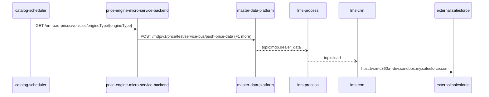

Steps:
| # | From | To | Via | Data (schema names) | Sync/Async | Confidence |
|---|---|---|---|---|---|---|
| 1 | catalog-scheduler | price-engine-micro-service-backend | GET /on-road-prices/vehicles/engineType/{engineType} | Unknown | sync | medium |
| 2 | price-engine-micro-service-backend | master-data-platform | POST /mdp/v1/price/test/service-bus/push-price-data, POST /mdp/v1/product/test/service-bus/push-product-data | GeneralResponse | sync | high |
| 3 | master-data-platform | lms-process | topic:mdp.dealer_data | DealerData | async | medium |
| 4 | lms-process | lms-crm | topic:lead | Unknown | async | medium |
| 5 | lms-crm | external:salesforce | host:tvsm-c360a--dev.sandbox.my.salesforce.com | Unknown | sync | high |

Data touched: catalog-scheduler: mongo; price-engine-micro-service-backend: mongo, redis; master-data-platform: mysql:xxxx.mysql.database.azure.com:mdp_20230904, other, redis; lms-process: mssql; lms-crm: mssql

Failure points: hop 1 catalog-scheduler → price-engine-micro-service-backend: criticality hard; hop 2 price-engine-micro-service-backend → master-data-platform: criticality hard; hop 3 master-data-platform → lms-process: criticality async; hop 4 lms-process → lms-crm: criticality async; hop 5 lms-crm → external:salesforce: criticality hard

Evidence:
- hop 1 (catalog-scheduler → price-engine-micro-service-backend): `Catalog-Scheduler/src/product-price-ingestion-job/data-sources/price-engine-data-source/price-engine-data-source.js:21`, `Price-Engine-MicroService-Backend/src/routes/api/on-road-price-routes.ts:31`
- hop 2 (price-engine-micro-service-backend → master-data-platform): `Price-Engine-MicroService-Backend/sonar-exclusion-function/service-bus/service-bus.ts:23`, `master-data-platform/src/main/java/com/tvsmotor/mdp/price/controller/TestPriceServiceBusController.java:18`, `Price-Engine-MicroService-Backend/sonar-exclusion-function/service-bus/service-bus.ts:9` (+1 more)
- hop 3 (master-data-platform → lms-process): `lms_process/processLeadService/Const/Constants.cs:7`, `lms_process/processLeadService/ListenerService/MdpConsumer.cs:42`, `master-data-platform/src/main/java/com/tvsmotor/mdp/config/DealerMasterServiceBusConfig.java:26` (+1 more)
- hop 4 (lms-process → lms-crm): `lms_crm/ListenerService/CrmListenerService.cs:44`, `lms_crm/Utils/Constants.cs:16`, `lms_process/processLeadService/Const/Constants.cs:6` (+1 more)
- hop 5 (lms-crm → external:salesforce): `lms_crm/appsettings.Development.json:16`, `lms_crm/appsettings.Production.json:17`, `lms_crm/appsettings.Uat.json:17`

## Flow: catalog-scheduler--lms-crm
Summary: Starting at `catalog-scheduler` (scheduled job(s) in catalog-scheduler (job-to-call link not resolved): merchandise-accessories-ingestion-job, product-price-ingestion-job; request to catalog-scheduler from outside the registry (no internal caller)), the flow passes through `price-engine-micro-service-backend`, `master-data-platform`, `lms-process`, `lms-ems` and ends at `lms-crm`, using 2 sync HTTP hop(s) and 3 async event hop(s); lms-process role: participant; confidence medium; truncated at the depth cap.


Steps:
| # | From | To | Via | Data (schema names) | Sync/Async | Confidence |
|---|---|---|---|---|---|---|
| 1 | catalog-scheduler | price-engine-micro-service-backend | GET /on-road-prices/vehicles/engineType/{engineType} | Unknown | sync | medium |
| 2 | price-engine-micro-service-backend | master-data-platform | POST /mdp/v1/price/test/service-bus/push-price-data, POST /mdp/v1/product/test/service-bus/push-product-data | GeneralResponse | sync | high |
| 3 | master-data-platform | lms-process | topic:mdp.dealer_data | DealerData | async | medium |
| 4 | lms-process | lms-ems | topic:lead | Unknown | async | medium |
| 5 | lms-ems | lms-crm | topic:lead | Unknown | async | medium |

Data touched: catalog-scheduler: mongo; price-engine-micro-service-backend: mongo, redis; master-data-platform: mysql:xxxx.mysql.database.azure.com:mdp_20230904, other, redis; lms-process: mssql; lms-ems: mssql; lms-crm: mssql

Failure points: hop 1 catalog-scheduler → price-engine-micro-service-backend: criticality hard; hop 2 price-engine-micro-service-backend → master-data-platform: criticality hard; hop 3 master-data-platform → lms-process: criticality async; hop 4 lms-process → lms-ems: criticality async; hop 5 lms-ems → lms-crm: criticality async

Evidence:
- hop 1 (catalog-scheduler → price-engine-micro-service-backend): `Catalog-Scheduler/src/product-price-ingestion-job/data-sources/price-engine-data-source/price-engine-data-source.js:21`, `Price-Engine-MicroService-Backend/src/routes/api/on-road-price-routes.ts:31`
- hop 2 (price-engine-micro-service-backend → master-data-platform): `Price-Engine-MicroService-Backend/sonar-exclusion-function/service-bus/service-bus.ts:23`, `master-data-platform/src/main/java/com/tvsmotor/mdp/price/controller/TestPriceServiceBusController.java:18`, `Price-Engine-MicroService-Backend/sonar-exclusion-function/service-bus/service-bus.ts:9` (+1 more)
- hop 3 (master-data-platform → lms-process): `lms_process/processLeadService/Const/Constants.cs:7`, `lms_process/processLeadService/ListenerService/MdpConsumer.cs:42`, `master-data-platform/src/main/java/com/tvsmotor/mdp/config/DealerMasterServiceBusConfig.java:26` (+1 more)
- hop 4 (lms-process → lms-ems): `lms_ems/emsService/Const/Constants.cs:14`, `lms_ems/emsService/ListenerService/EmsListenerService.cs:43`, `lms_process/processLeadService/Const/Constants.cs:6` (+1 more)
- hop 5 (lms-ems → lms-crm): `lms_crm/ListenerService/CrmListenerService.cs:44`, `lms_crm/Utils/Constants.cs:16`, `lms_ems/emsService/Const/Constants.cs:13` (+1 more)

## Flow: catalog-scheduler--lms-tvs-credit-bd6cbe
Summary: Starting at `catalog-scheduler` (scheduled job(s) in catalog-scheduler (job-to-call link not resolved): merchandise-accessories-ingestion-job, product-price-ingestion-job; request to catalog-scheduler from outside the registry (no internal caller)), the flow passes through `price-engine-micro-service-backend`, `master-data-platform`, `lms-process`, `lms-ems` and ends at `lms-tvs-credit`, using 2 sync HTTP hop(s) and 3 async event hop(s); lms-process role: participant; confidence medium.

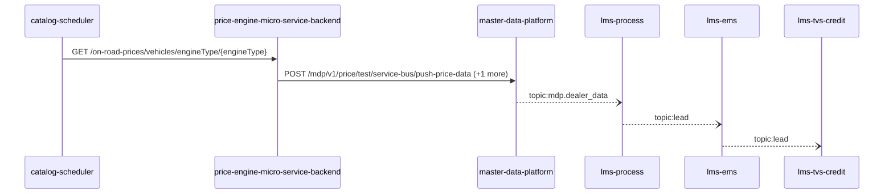

Steps:
| # | From | To | Via | Data (schema names) | Sync/Async | Confidence |
|---|---|---|---|---|---|---|
| 1 | catalog-scheduler | price-engine-micro-service-backend | GET /on-road-prices/vehicles/engineType/{engineType} | Unknown | sync | medium |
| 2 | price-engine-micro-service-backend | master-data-platform | POST /mdp/v1/price/test/service-bus/push-price-data, POST /mdp/v1/product/test/service-bus/push-product-data | GeneralResponse | sync | high |
| 3 | master-data-platform | lms-process | topic:mdp.dealer_data | DealerData | async | medium |
| 4 | lms-process | lms-ems | topic:lead | Unknown | async | medium |
| 5 | lms-ems | lms-tvs-credit | topic:lead | Unknown | async | medium |

Data touched: catalog-scheduler: mongo; price-engine-micro-service-backend: mongo, redis; master-data-platform: mysql:xxxx.mysql.database.azure.com:mdp_20230904, other, redis; lms-process: mssql; lms-ems: mssql; lms-tvs-credit: mssql

Failure points: hop 1 catalog-scheduler → price-engine-micro-service-backend: criticality hard; hop 2 price-engine-micro-service-backend → master-data-platform: criticality hard; hop 3 master-data-platform → lms-process: criticality async; hop 4 lms-process → lms-ems: criticality async; hop 5 lms-ems → lms-tvs-credit: criticality async

Evidence:
- hop 1 (catalog-scheduler → price-engine-micro-service-backend): `Catalog-Scheduler/src/product-price-ingestion-job/data-sources/price-engine-data-source/price-engine-data-source.js:21`, `Price-Engine-MicroService-Backend/src/routes/api/on-road-price-routes.ts:31`
- hop 2 (price-engine-micro-service-backend → master-data-platform): `Price-Engine-MicroService-Backend/sonar-exclusion-function/service-bus/service-bus.ts:23`, `master-data-platform/src/main/java/com/tvsmotor/mdp/price/controller/TestPriceServiceBusController.java:18`, `Price-Engine-MicroService-Backend/sonar-exclusion-function/service-bus/service-bus.ts:9` (+1 more)
- hop 3 (master-data-platform → lms-process): `lms_process/processLeadService/Const/Constants.cs:7`, `lms_process/processLeadService/ListenerService/MdpConsumer.cs:42`, `master-data-platform/src/main/java/com/tvsmotor/mdp/config/DealerMasterServiceBusConfig.java:26` (+1 more)
- hop 4 (lms-process → lms-ems): `lms_ems/emsService/Const/Constants.cs:14`, `lms_ems/emsService/ListenerService/EmsListenerService.cs:43`, `lms_process/processLeadService/Const/Constants.cs:6` (+1 more)
- hop 5 (lms-ems → lms-tvs-credit): `lms_ems/emsService/Const/Constants.cs:13`, `lms_ems/emsService/Services/EmsService.cs:191`, `lms_tvs_credit/lms_tvs_credit/ListenerService/TvscreditListenerService.cs:46` (+1 more)

## Flow: cbs-admin-portal--external-salesforce-af678f
Summary: Starting at `cbs-admin-portal` (user action in cbs-admin-portal (frontend)), the flow passes through `tvsmbe-mdp-bff`, `master-data-platform`, `lms-process`, `lms-crm` and ends at `external:salesforce`, using 3 sync HTTP hop(s) and 2 async event hop(s); lms-process role: participant; confidence medium.

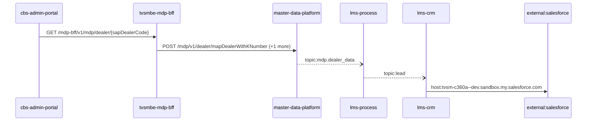

Steps:
| # | From | To | Via | Data (schema names) | Sync/Async | Confidence |
|---|---|---|---|---|---|---|
| 1 | cbs-admin-portal | tvsmbe-mdp-bff | GET /mdp-bff/v1/mdp/dealer/{sapDealerCode} | GeneralResponse | sync | medium |
| 2 | tvsmbe-mdp-bff | master-data-platform | POST /mdp/v1/dealer/mapDealerWithKNumber, POST /mdp/v1/dealers/basedOnFilters | DealerTypeStatusFlagsFilterRequest, GeneralResponse, MapDealerWithKNumberRequest | sync | high |
| 3 | master-data-platform | lms-process | topic:mdp.dealer_data | DealerData | async | medium |
| 4 | lms-process | lms-crm | topic:lead | Unknown | async | medium |
| 5 | lms-crm | external:salesforce | host:tvsm-c360a--dev.sandbox.my.salesforce.com | Unknown | sync | high |

Data touched: tvsmbe-mdp-bff: mysql, mysql:tvsmazcmndbsdev01-ci.mysql.database.azure.com:tvsmazebffsdbdev01; master-data-platform: mysql:xxxx.mysql.database.azure.com:mdp_20230904, other, redis; lms-process: mssql; lms-crm: mssql

Failure points: hop 1 cbs-admin-portal → tvsmbe-mdp-bff: criticality hard; hop 2 tvsmbe-mdp-bff → master-data-platform: criticality hard; hop 3 master-data-platform → lms-process: criticality async; hop 4 lms-process → lms-crm: criticality async; hop 5 lms-crm → external:salesforce: criticality hard

Evidence:
- hop 1 (cbs-admin-portal → tvsmbe-mdp-bff): `cbs-admin-portal/src/services/dataService.js:225`, `tvsmbe-mdp-bff/inbound/src/main/java/com/tvsmotor/bff/controller/MdpController.java:14`
- hop 2 (tvsmbe-mdp-bff → master-data-platform): `master-data-platform/src/main/java/com/tvsmotor/mdp/controller/DealerKnowlarityDataController.java:16`, `tvsmbe-mdp-bff/outbound/src/main/java/com/tvsmotor/mdp_bff/outbound/service/MdpDealerOperationsService.java:54`, `tvsmbe-mdp-bff/outbound/src/main/java/com/tvsmotor/mdp_bff/outbound/service/OkHttpService.java:88` (+3 more)
- hop 3 (master-data-platform → lms-process): `lms_process/processLeadService/Const/Constants.cs:7`, `lms_process/processLeadService/ListenerService/MdpConsumer.cs:42`, `master-data-platform/src/main/java/com/tvsmotor/mdp/config/DealerMasterServiceBusConfig.java:26` (+1 more)
- hop 4 (lms-process → lms-crm): `lms_crm/ListenerService/CrmListenerService.cs:44`, `lms_crm/Utils/Constants.cs:16`, `lms_process/processLeadService/Const/Constants.cs:6` (+1 more)
- hop 5 (lms-crm → external:salesforce): `lms_crm/appsettings.Development.json:16`, `lms_crm/appsettings.Production.json:17`, `lms_crm/appsettings.Uat.json:17`

## Flow: cbs-admin-portal--lms-crm
Summary: Starting at `cbs-admin-portal` (user action in cbs-admin-portal (frontend)), the flow passes through `tvsmbe-mdp-bff`, `master-data-platform`, `lms-process`, `lms-ems` and ends at `lms-crm`, using 2 sync HTTP hop(s) and 3 async event hop(s); lms-process role: participant; confidence medium; truncated at the depth cap.


Steps:
| # | From | To | Via | Data (schema names) | Sync/Async | Confidence |
|---|---|---|---|---|---|---|
| 1 | cbs-admin-portal | tvsmbe-mdp-bff | GET /mdp-bff/v1/mdp/dealer/{sapDealerCode} | GeneralResponse | sync | medium |
| 2 | tvsmbe-mdp-bff | master-data-platform | POST /mdp/v1/dealer/mapDealerWithKNumber, POST /mdp/v1/dealers/basedOnFilters | DealerTypeStatusFlagsFilterRequest, GeneralResponse, MapDealerWithKNumberRequest | sync | high |
| 3 | master-data-platform | lms-process | topic:mdp.dealer_data | DealerData | async | medium |
| 4 | lms-process | lms-ems | topic:lead | Unknown | async | medium |
| 5 | lms-ems | lms-crm | topic:lead | Unknown | async | medium |

Data touched: tvsmbe-mdp-bff: mysql, mysql:tvsmazcmndbsdev01-ci.mysql.database.azure.com:tvsmazebffsdbdev01; master-data-platform: mysql:xxxx.mysql.database.azure.com:mdp_20230904, other, redis; lms-process: mssql; lms-ems: mssql; lms-crm: mssql

Failure points: hop 1 cbs-admin-portal → tvsmbe-mdp-bff: criticality hard; hop 2 tvsmbe-mdp-bff → master-data-platform: criticality hard; hop 3 master-data-platform → lms-process: criticality async; hop 4 lms-process → lms-ems: criticality async; hop 5 lms-ems → lms-crm: criticality async

Evidence:
- hop 1 (cbs-admin-portal → tvsmbe-mdp-bff): `cbs-admin-portal/src/services/dataService.js:225`, `tvsmbe-mdp-bff/inbound/src/main/java/com/tvsmotor/bff/controller/MdpController.java:14`
- hop 2 (tvsmbe-mdp-bff → master-data-platform): `master-data-platform/src/main/java/com/tvsmotor/mdp/controller/DealerKnowlarityDataController.java:16`, `tvsmbe-mdp-bff/outbound/src/main/java/com/tvsmotor/mdp_bff/outbound/service/MdpDealerOperationsService.java:54`, `tvsmbe-mdp-bff/outbound/src/main/java/com/tvsmotor/mdp_bff/outbound/service/OkHttpService.java:88` (+3 more)
- hop 3 (master-data-platform → lms-process): `lms_process/processLeadService/Const/Constants.cs:7`, `lms_process/processLeadService/ListenerService/MdpConsumer.cs:42`, `master-data-platform/src/main/java/com/tvsmotor/mdp/config/DealerMasterServiceBusConfig.java:26` (+1 more)
- hop 4 (lms-process → lms-ems): `lms_ems/emsService/Const/Constants.cs:14`, `lms_ems/emsService/ListenerService/EmsListenerService.cs:43`, `lms_process/processLeadService/Const/Constants.cs:6` (+1 more)
- hop 5 (lms-ems → lms-crm): `lms_crm/ListenerService/CrmListenerService.cs:44`, `lms_crm/Utils/Constants.cs:16`, `lms_ems/emsService/Const/Constants.cs:13` (+1 more)

## Flow: cbs-admin-portal--lms-tvs-credit-09d25e
Summary: Starting at `cbs-admin-portal` (user action in cbs-admin-portal (frontend)), the flow passes through `tvsmbe-mdp-bff`, `master-data-platform`, `lms-process`, `lms-ems` and ends at `lms-tvs-credit`, using 2 sync HTTP hop(s) and 3 async event hop(s); lms-process role: participant; confidence medium.

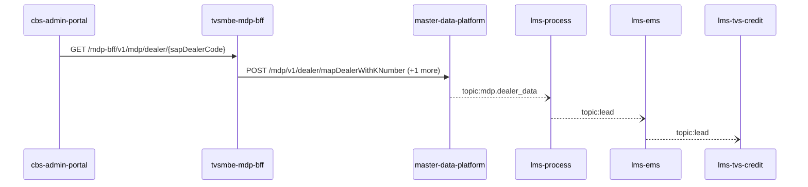

Steps:
| # | From | To | Via | Data (schema names) | Sync/Async | Confidence |
|---|---|---|---|---|---|---|
| 1 | cbs-admin-portal | tvsmbe-mdp-bff | GET /mdp-bff/v1/mdp/dealer/{sapDealerCode} | GeneralResponse | sync | medium |
| 2 | tvsmbe-mdp-bff | master-data-platform | POST /mdp/v1/dealer/mapDealerWithKNumber, POST /mdp/v1/dealers/basedOnFilters | DealerTypeStatusFlagsFilterRequest, GeneralResponse, MapDealerWithKNumberRequest | sync | high |
| 3 | master-data-platform | lms-process | topic:mdp.dealer_data | DealerData | async | medium |
| 4 | lms-process | lms-ems | topic:lead | Unknown | async | medium |
| 5 | lms-ems | lms-tvs-credit | topic:lead | Unknown | async | medium |

Data touched: tvsmbe-mdp-bff: mysql, mysql:tvsmazcmndbsdev01-ci.mysql.database.azure.com:tvsmazebffsdbdev01; master-data-platform: mysql:xxxx.mysql.database.azure.com:mdp_20230904, other, redis; lms-process: mssql; lms-ems: mssql; lms-tvs-credit: mssql

Failure points: hop 1 cbs-admin-portal → tvsmbe-mdp-bff: criticality hard; hop 2 tvsmbe-mdp-bff → master-data-platform: criticality hard; hop 3 master-data-platform → lms-process: criticality async; hop 4 lms-process → lms-ems: criticality async; hop 5 lms-ems → lms-tvs-credit: criticality async

Evidence:
- hop 1 (cbs-admin-portal → tvsmbe-mdp-bff): `cbs-admin-portal/src/services/dataService.js:225`, `tvsmbe-mdp-bff/inbound/src/main/java/com/tvsmotor/bff/controller/MdpController.java:14`
- hop 2 (tvsmbe-mdp-bff → master-data-platform): `master-data-platform/src/main/java/com/tvsmotor/mdp/controller/DealerKnowlarityDataController.java:16`, `tvsmbe-mdp-bff/outbound/src/main/java/com/tvsmotor/mdp_bff/outbound/service/MdpDealerOperationsService.java:54`, `tvsmbe-mdp-bff/outbound/src/main/java/com/tvsmotor/mdp_bff/outbound/service/OkHttpService.java:88` (+3 more)
- hop 3 (master-data-platform → lms-process): `lms_process/processLeadService/Const/Constants.cs:7`, `lms_process/processLeadService/ListenerService/MdpConsumer.cs:42`, `master-data-platform/src/main/java/com/tvsmotor/mdp/config/DealerMasterServiceBusConfig.java:26` (+1 more)
- hop 4 (lms-process → lms-ems): `lms_ems/emsService/Const/Constants.cs:14`, `lms_ems/emsService/ListenerService/EmsListenerService.cs:43`, `lms_process/processLeadService/Const/Constants.cs:6` (+1 more)
- hop 5 (lms-ems → lms-tvs-credit): `lms_ems/emsService/Const/Constants.cs:13`, `lms_ems/emsService/Services/EmsService.cs:191`, `lms_tvs_credit/lms_tvs_credit/ListenerService/TvscreditListenerService.cs:46` (+1 more)

## Flow: location-frontend--external-salesforce-2e55b0
Summary: Starting at `location-frontend` (user action in location-frontend (frontend)), the flow passes through `tvsmbe-location`, `master-data-platform`, `lms-process`, `lms-crm` and ends at `external:salesforce`, using 3 sync HTTP hop(s) and 2 async event hop(s); lms-process role: participant; confidence medium.

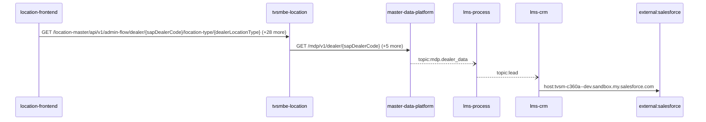

Steps:
| # | From | To | Via | Data (schema names) | Sync/Async | Confidence |
|---|---|---|---|---|---|---|
| 1 | location-frontend | tvsmbe-location | GET /location-master/api/v1/admin-flow/dealer/{sapDealerCode}/location-type/{dealerLocationType}, GET /location-master/api/v1/admin-flow/rejection-comments, GET /location-master/api/v1/admin-flow/summary (+26 more) | CreateDealerRequest, DealerListRequest, DealerResponse, DealerSearchFilterRequest, DealerSearchRequest (+8 more) | sync | high |
| 2 | tvsmbe-location | master-data-platform | GET /mdp/v1/dealer/{sapDealerCode}, GET /mdp/v1/dealer/{sapDealerCode}/branches, POST /mdp/v1/dealers/data (+3 more) | DealerStateWiseCountFilterRequest, DealerTypeStatusFlagsFilterRequest, GeneralResponse, ProximityRequest | sync | high |
| 3 | master-data-platform | lms-process | topic:mdp.dealer_data | DealerData | async | medium |
| 4 | lms-process | lms-crm | topic:lead | Unknown | async | medium |
| 5 | lms-crm | external:salesforce | host:tvsm-c360a--dev.sandbox.my.salesforce.com | Unknown | sync | high |

Data touched: tvsmbe-location: mongo, mysql; master-data-platform: mysql:xxxx.mysql.database.azure.com:mdp_20230904, other, redis; lms-process: mssql; lms-crm: mssql

Failure points: hop 1 location-frontend → tvsmbe-location: criticality hard; hop 2 tvsmbe-location → master-data-platform: criticality hard; hop 3 master-data-platform → lms-process: criticality async; hop 4 lms-process → lms-crm: criticality async; hop 5 lms-crm → external:salesforce: criticality hard

Evidence:
- hop 1 (location-frontend → tvsmbe-location): `location-frontend/src/services/DealerDetailsService.ts:38`, `tvsmbe-location/src/main/java/com/tvsmotor/location_master/controller/AdminFlowController.java:28`, `location-frontend/src/services/DealerDetailsService.ts:69` (+42 more)
- hop 2 (tvsmbe-location → master-data-platform): `master-data-platform/src/main/java/com/tvsmotor/mdp/controller/DealerController.java:20`, `tvsmbe-location/src/main/java/com/tvsmotor/location_master/service/MDPDealerService.java:68`, `tvsmbe-location/src/main/java/com/tvsmotor/location_master/utils/OkHttpUtil.java:35` (+7 more)
- hop 3 (master-data-platform → lms-process): `lms_process/processLeadService/Const/Constants.cs:7`, `lms_process/processLeadService/ListenerService/MdpConsumer.cs:42`, `master-data-platform/src/main/java/com/tvsmotor/mdp/config/DealerMasterServiceBusConfig.java:26` (+1 more)
- hop 4 (lms-process → lms-crm): `lms_crm/ListenerService/CrmListenerService.cs:44`, `lms_crm/Utils/Constants.cs:16`, `lms_process/processLeadService/Const/Constants.cs:6` (+1 more)
- hop 5 (lms-crm → external:salesforce): `lms_crm/appsettings.Development.json:16`, `lms_crm/appsettings.Production.json:17`, `lms_crm/appsettings.Uat.json:17`

## Flow: location-frontend--external-salesforce-308649
Summary: Starting at `location-frontend` (user action in location-frontend (frontend)), the flow passes through `tvsmbe-location`, `lms`, `lms-process`, `lms-crm` and ends at `external:salesforce`, using 3 sync HTTP hop(s) and 2 async event hop(s); lms-process role: participant; confidence medium.

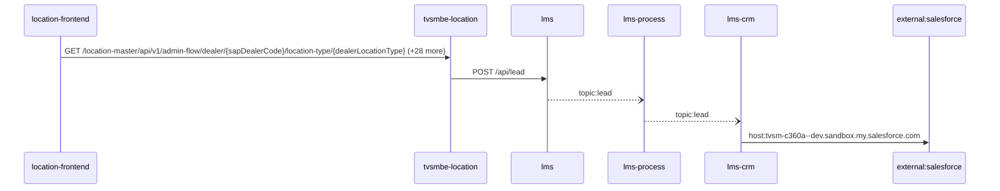

Steps:
| # | From | To | Via | Data (schema names) | Sync/Async | Confidence |
|---|---|---|---|---|---|---|
| 1 | location-frontend | tvsmbe-location | GET /location-master/api/v1/admin-flow/dealer/{sapDealerCode}/location-type/{dealerLocationType}, GET /location-master/api/v1/admin-flow/rejection-comments, GET /location-master/api/v1/admin-flow/summary (+26 more) | CreateDealerRequest, DealerListRequest, DealerResponse, DealerSearchFilterRequest, DealerSearchRequest (+8 more) | sync | high |
| 2 | tvsmbe-location | lms | POST /api/lead | LeadRequestModel | sync | medium |
| 3 | lms | lms-process | topic:lead | Unknown | async | medium |
| 4 | lms-process | lms-crm | topic:lead | Unknown | async | medium |
| 5 | lms-crm | external:salesforce | host:tvsm-c360a--dev.sandbox.my.salesforce.com | Unknown | sync | high |

Data touched: tvsmbe-location: mongo, mysql; lms: mssql, mssql:icubemobappsqlstg.database.windows.net:tazlmssqldbdev01; lms-process: mssql; lms-crm: mssql

Failure points: hop 1 location-frontend → tvsmbe-location: criticality hard; hop 2 tvsmbe-location → lms: criticality hard; hop 3 lms → lms-process: criticality async; hop 4 lms-process → lms-crm: criticality async; hop 5 lms-crm → external:salesforce: criticality hard

Evidence:
- hop 1 (location-frontend → tvsmbe-location): `location-frontend/src/services/DealerDetailsService.ts:38`, `tvsmbe-location/src/main/java/com/tvsmotor/location_master/controller/AdminFlowController.java:28`, `location-frontend/src/services/DealerDetailsService.ts:69` (+42 more)
- hop 2 (tvsmbe-location → lms): `lms/leadLogs/Controllers/LeadAcquisitionController.cs:61`, `tvsmbe-location/src/main/java/com/tvsmotor/location_master/service/LeadService.java:58`, `tvsmbe-location/src/main/java/com/tvsmotor/location_master/utils/OkHttpUtil.java:54`
- hop 3 (lms → lms-process): `lms/leadLogs/Services/LeadDispatchService.cs:21`, `lms_process/processLeadService/Const/Constants.cs:10`, `lms_process/processLeadService/ListenerService/QueueConsumer.cs:36`
- hop 4 (lms-process → lms-crm): `lms_crm/ListenerService/CrmListenerService.cs:44`, `lms_crm/Utils/Constants.cs:16`, `lms_process/processLeadService/Const/Constants.cs:6` (+1 more)
- hop 5 (lms-crm → external:salesforce): `lms_crm/appsettings.Development.json:16`, `lms_crm/appsettings.Production.json:17`, `lms_crm/appsettings.Uat.json:17`

## Flow: location-frontend--lms-crm-01d477
Summary: Starting at `location-frontend` (user action in location-frontend (frontend)), the flow passes through `tvsmbe-location`, `tvsm-auth`, `master-data-platform`, `lms-process` and ends at `lms-crm`, using 3 sync HTTP hop(s) and 2 async event hop(s); lms-process role: participant; confidence medium; truncated at the depth cap.

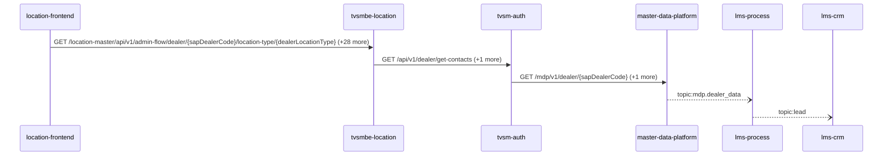

Steps:
| # | From | To | Via | Data (schema names) | Sync/Async | Confidence |
|---|---|---|---|---|---|---|
| 1 | location-frontend | tvsmbe-location | GET /location-master/api/v1/admin-flow/dealer/{sapDealerCode}/location-type/{dealerLocationType}, GET /location-master/api/v1/admin-flow/rejection-comments, GET /location-master/api/v1/admin-flow/summary (+26 more) | CreateDealerRequest, DealerListRequest, DealerResponse, DealerSearchFilterRequest, DealerSearchRequest (+8 more) | sync | high |
| 2 | tvsmbe-location | tvsm-auth | GET /api/v1/dealer/get-contacts, POST /auth/v1/app/token/validate | DealerContacts, TokenVerificationRequest, TokenVerificationResponse | sync | high |
| 3 | tvsm-auth | master-data-platform | GET /mdp/v1/dealer/{sapDealerCode}, GET /mdp/v1/dealer/{sapDealerCode}/branches | GeneralResponse | sync | medium |
| 4 | master-data-platform | lms-process | topic:mdp.dealer_data | DealerData | async | medium |
| 5 | lms-process | lms-crm | topic:lead | Unknown | async | medium |

Data touched: tvsmbe-location: mongo, mysql; tvsm-auth: mysql; master-data-platform: mysql:xxxx.mysql.database.azure.com:mdp_20230904, other, redis; lms-process: mssql; lms-crm: mssql

Failure points: hop 1 location-frontend → tvsmbe-location: criticality hard; hop 2 tvsmbe-location → tvsm-auth: criticality hard; hop 3 tvsm-auth → master-data-platform: criticality hard; hop 4 master-data-platform → lms-process: criticality async; hop 5 lms-process → lms-crm: criticality async

Evidence:
- hop 1 (location-frontend → tvsmbe-location): `location-frontend/src/services/DealerDetailsService.ts:38`, `tvsmbe-location/src/main/java/com/tvsmotor/location_master/controller/AdminFlowController.java:28`, `location-frontend/src/services/DealerDetailsService.ts:69` (+42 more)
- hop 2 (tvsmbe-location → tvsm-auth): `tvsm-auth/src/main/java/com/tvsmotor/tvsmauth/user/profile/api/DealerController.java:42`, `tvsmbe-location/src/main/java/com/tvsmotor/location_master/service/UMSService.java:49`, `tvsmbe-location/src/main/java/com/tvsmotor/location_master/utils/OkHttpUtil.java:35` (+3 more)
- hop 3 (tvsm-auth → master-data-platform): `master-data-platform/src/main/java/com/tvsmotor/mdp/controller/DealerController.java:20`, `tvsm-auth/src/main/java/com/tvsmotor/tvsmauth/user/gateway/MDPServiceClient.java:86`, `tvsm-auth/src/main/java/com/tvsmotor/tvsmauth/user/gateway/MDPServiceClient.java:110` (+2 more)
- hop 4 (master-data-platform → lms-process): `lms_process/processLeadService/Const/Constants.cs:7`, `lms_process/processLeadService/ListenerService/MdpConsumer.cs:42`, `master-data-platform/src/main/java/com/tvsmotor/mdp/config/DealerMasterServiceBusConfig.java:26` (+1 more)
- hop 5 (lms-process → lms-crm): `lms_crm/ListenerService/CrmListenerService.cs:44`, `lms_crm/Utils/Constants.cs:16`, `lms_process/processLeadService/Const/Constants.cs:6` (+1 more)

## Flow: location-frontend--lms-crm-0d4513
Summary: Starting at `location-frontend` (user action in location-frontend (frontend)), the flow passes through `tvsmbe-location`, `lms`, `lms-ems`, `lms-process` and ends at `lms-crm`, using 2 sync HTTP hop(s) and 3 async event hop(s); lms-process role: participant; confidence medium; truncated at the depth cap.


Steps:
| # | From | To | Via | Data (schema names) | Sync/Async | Confidence |
|---|---|---|---|---|---|---|
| 1 | location-frontend | tvsmbe-location | GET /location-master/api/v1/admin-flow/dealer/{sapDealerCode}/location-type/{dealerLocationType}, GET /location-master/api/v1/admin-flow/rejection-comments, GET /location-master/api/v1/admin-flow/summary (+26 more) | CreateDealerRequest, DealerListRequest, DealerResponse, DealerSearchFilterRequest, DealerSearchRequest (+8 more) | sync | high |
| 2 | tvsmbe-location | lms | POST /api/lead | LeadRequestModel | sync | medium |
| 3 | lms | lms-ems | topic:lead | Unknown | async | medium |
| 4 | lms-ems | lms-process | topic:lead | Unknown | async | medium |
| 5 | lms-process | lms-crm | topic:lead | Unknown | async | medium |

Data touched: tvsmbe-location: mongo, mysql; lms: mssql, mssql:icubemobappsqlstg.database.windows.net:tazlmssqldbdev01; lms-ems: mssql; lms-process: mssql; lms-crm: mssql

Failure points: hop 1 location-frontend → tvsmbe-location: criticality hard; hop 2 tvsmbe-location → lms: criticality hard; hop 3 lms → lms-ems: criticality async; hop 4 lms-ems → lms-process: criticality async; hop 5 lms-process → lms-crm: criticality async

Evidence:
- hop 1 (location-frontend → tvsmbe-location): `location-frontend/src/services/DealerDetailsService.ts:38`, `tvsmbe-location/src/main/java/com/tvsmotor/location_master/controller/AdminFlowController.java:28`, `location-frontend/src/services/DealerDetailsService.ts:69` (+42 more)
- hop 2 (tvsmbe-location → lms): `lms/leadLogs/Controllers/LeadAcquisitionController.cs:61`, `tvsmbe-location/src/main/java/com/tvsmotor/location_master/service/LeadService.java:58`, `tvsmbe-location/src/main/java/com/tvsmotor/location_master/utils/OkHttpUtil.java:54`
- hop 3 (lms → lms-ems): `lms/leadLogs/Services/LeadDispatchService.cs:21`, `lms_ems/emsService/Const/Constants.cs:14`, `lms_ems/emsService/ListenerService/EmsListenerService.cs:43`
- hop 4 (lms-ems → lms-process): `lms_ems/emsService/Const/Constants.cs:13`, `lms_ems/emsService/Services/EmsService.cs:191`, `lms_process/processLeadService/Const/Constants.cs:10` (+1 more)
- hop 5 (lms-process → lms-crm): `lms_crm/ListenerService/CrmListenerService.cs:44`, `lms_crm/Utils/Constants.cs:16`, `lms_process/processLeadService/Const/Constants.cs:6` (+1 more)

## Flow: location-frontend--lms-crm-919670
Summary: Starting at `location-frontend` (user action in location-frontend (frontend)), the flow passes through `tvsmbe-location`, `lms`, `lms-process`, `lms-ems` and ends at `lms-crm`, using 2 sync HTTP hop(s) and 3 async event hop(s); lms-process role: participant; confidence medium; truncated at the depth cap.

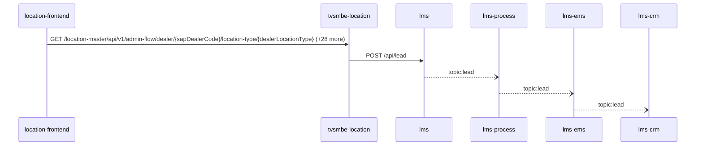

Steps:
| # | From | To | Via | Data (schema names) | Sync/Async | Confidence |
|---|---|---|---|---|---|---|
| 1 | location-frontend | tvsmbe-location | GET /location-master/api/v1/admin-flow/dealer/{sapDealerCode}/location-type/{dealerLocationType}, GET /location-master/api/v1/admin-flow/rejection-comments, GET /location-master/api/v1/admin-flow/summary (+26 more) | CreateDealerRequest, DealerListRequest, DealerResponse, DealerSearchFilterRequest, DealerSearchRequest (+8 more) | sync | high |
| 2 | tvsmbe-location | lms | POST /api/lead | LeadRequestModel | sync | medium |
| 3 | lms | lms-process | topic:lead | Unknown | async | medium |
| 4 | lms-process | lms-ems | topic:lead | Unknown | async | medium |
| 5 | lms-ems | lms-crm | topic:lead | Unknown | async | medium |

Data touched: tvsmbe-location: mongo, mysql; lms: mssql, mssql:icubemobappsqlstg.database.windows.net:tazlmssqldbdev01; lms-process: mssql; lms-ems: mssql; lms-crm: mssql

Failure points: hop 1 location-frontend → tvsmbe-location: criticality hard; hop 2 tvsmbe-location → lms: criticality hard; hop 3 lms → lms-process: criticality async; hop 4 lms-process → lms-ems: criticality async; hop 5 lms-ems → lms-crm: criticality async

Evidence:
- hop 1 (location-frontend → tvsmbe-location): `location-frontend/src/services/DealerDetailsService.ts:38`, `tvsmbe-location/src/main/java/com/tvsmotor/location_master/controller/AdminFlowController.java:28`, `location-frontend/src/services/DealerDetailsService.ts:69` (+42 more)
- hop 2 (tvsmbe-location → lms): `lms/leadLogs/Controllers/LeadAcquisitionController.cs:61`, `tvsmbe-location/src/main/java/com/tvsmotor/location_master/service/LeadService.java:58`, `tvsmbe-location/src/main/java/com/tvsmotor/location_master/utils/OkHttpUtil.java:54`
- hop 3 (lms → lms-process): `lms/leadLogs/Services/LeadDispatchService.cs:21`, `lms_process/processLeadService/Const/Constants.cs:10`, `lms_process/processLeadService/ListenerService/QueueConsumer.cs:36`
- hop 4 (lms-process → lms-ems): `lms_ems/emsService/Const/Constants.cs:14`, `lms_ems/emsService/ListenerService/EmsListenerService.cs:43`, `lms_process/processLeadService/Const/Constants.cs:6` (+1 more)
- hop 5 (lms-ems → lms-crm): `lms_crm/ListenerService/CrmListenerService.cs:44`, `lms_crm/Utils/Constants.cs:16`, `lms_ems/emsService/Const/Constants.cs:13` (+1 more)

## Flow: location-frontend--lms-crm-9de356
Summary: Starting at `location-frontend` (user action in location-frontend (frontend)), the flow passes through `tvsmbe-location`, `master-data-platform`, `lms-process`, `lms-ems` and ends at `lms-crm`, using 2 sync HTTP hop(s) and 3 async event hop(s); lms-process role: participant; confidence medium; truncated at the depth cap.

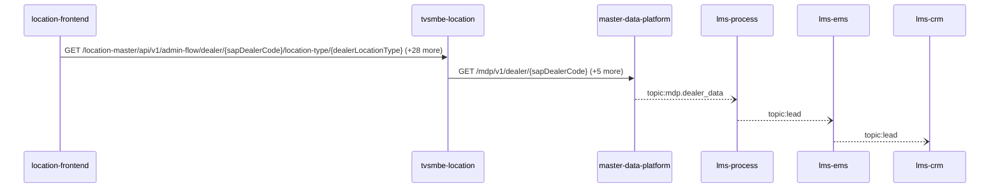

Steps:
| # | From | To | Via | Data (schema names) | Sync/Async | Confidence |
|---|---|---|---|---|---|---|
| 1 | location-frontend | tvsmbe-location | GET /location-master/api/v1/admin-flow/dealer/{sapDealerCode}/location-type/{dealerLocationType}, GET /location-master/api/v1/admin-flow/rejection-comments, GET /location-master/api/v1/admin-flow/summary (+26 more) | CreateDealerRequest, DealerListRequest, DealerResponse, DealerSearchFilterRequest, DealerSearchRequest (+8 more) | sync | high |
| 2 | tvsmbe-location | master-data-platform | GET /mdp/v1/dealer/{sapDealerCode}, GET /mdp/v1/dealer/{sapDealerCode}/branches, POST /mdp/v1/dealers/data (+3 more) | DealerStateWiseCountFilterRequest, DealerTypeStatusFlagsFilterRequest, GeneralResponse, ProximityRequest | sync | high |
| 3 | master-data-platform | lms-process | topic:mdp.dealer_data | DealerData | async | medium |
| 4 | lms-process | lms-ems | topic:lead | Unknown | async | medium |
| 5 | lms-ems | lms-crm | topic:lead | Unknown | async | medium |

Data touched: tvsmbe-location: mongo, mysql; master-data-platform: mysql:xxxx.mysql.database.azure.com:mdp_20230904, other, redis; lms-process: mssql; lms-ems: mssql; lms-crm: mssql

Failure points: hop 1 location-frontend → tvsmbe-location: criticality hard; hop 2 tvsmbe-location → master-data-platform: criticality hard; hop 3 master-data-platform → lms-process: criticality async; hop 4 lms-process → lms-ems: criticality async; hop 5 lms-ems → lms-crm: criticality async

Evidence:
- hop 1 (location-frontend → tvsmbe-location): `location-frontend/src/services/DealerDetailsService.ts:38`, `tvsmbe-location/src/main/java/com/tvsmotor/location_master/controller/AdminFlowController.java:28`, `location-frontend/src/services/DealerDetailsService.ts:69` (+42 more)
- hop 2 (tvsmbe-location → master-data-platform): `master-data-platform/src/main/java/com/tvsmotor/mdp/controller/DealerController.java:20`, `tvsmbe-location/src/main/java/com/tvsmotor/location_master/service/MDPDealerService.java:68`, `tvsmbe-location/src/main/java/com/tvsmotor/location_master/utils/OkHttpUtil.java:35` (+7 more)
- hop 3 (master-data-platform → lms-process): `lms_process/processLeadService/Const/Constants.cs:7`, `lms_process/processLeadService/ListenerService/MdpConsumer.cs:42`, `master-data-platform/src/main/java/com/tvsmotor/mdp/config/DealerMasterServiceBusConfig.java:26` (+1 more)
- hop 4 (lms-process → lms-ems): `lms_ems/emsService/Const/Constants.cs:14`, `lms_ems/emsService/ListenerService/EmsListenerService.cs:43`, `lms_process/processLeadService/Const/Constants.cs:6` (+1 more)
- hop 5 (lms-ems → lms-crm): `lms_crm/ListenerService/CrmListenerService.cs:44`, `lms_crm/Utils/Constants.cs:16`, `lms_ems/emsService/Const/Constants.cs:13` (+1 more)

## Flow: location-frontend--lms-ems
Summary: Starting at `location-frontend` (user action in location-frontend (frontend)), the flow passes through `tvsmbe-location`, `tvsm-auth`, `master-data-platform`, `lms-process` and ends at `lms-ems`, using 3 sync HTTP hop(s) and 2 async event hop(s); lms-process role: participant; confidence medium; truncated at the depth cap.


Steps:
| # | From | To | Via | Data (schema names) | Sync/Async | Confidence |
|---|---|---|---|---|---|---|
| 1 | location-frontend | tvsmbe-location | GET /location-master/api/v1/admin-flow/dealer/{sapDealerCode}/location-type/{dealerLocationType}, GET /location-master/api/v1/admin-flow/rejection-comments, GET /location-master/api/v1/admin-flow/summary (+26 more) | CreateDealerRequest, DealerListRequest, DealerResponse, DealerSearchFilterRequest, DealerSearchRequest (+8 more) | sync | high |
| 2 | tvsmbe-location | tvsm-auth | GET /api/v1/dealer/get-contacts, POST /auth/v1/app/token/validate | DealerContacts, TokenVerificationRequest, TokenVerificationResponse | sync | high |
| 3 | tvsm-auth | master-data-platform | GET /mdp/v1/dealer/{sapDealerCode}, GET /mdp/v1/dealer/{sapDealerCode}/branches | GeneralResponse | sync | medium |
| 4 | master-data-platform | lms-process | topic:mdp.dealer_data | DealerData | async | medium |
| 5 | lms-process | lms-ems | topic:lead | Unknown | async | medium |

Data touched: tvsmbe-location: mongo, mysql; tvsm-auth: mysql; master-data-platform: mysql:xxxx.mysql.database.azure.com:mdp_20230904, other, redis; lms-process: mssql; lms-ems: mssql

Failure points: hop 1 location-frontend → tvsmbe-location: criticality hard; hop 2 tvsmbe-location → tvsm-auth: criticality hard; hop 3 tvsm-auth → master-data-platform: criticality hard; hop 4 master-data-platform → lms-process: criticality async; hop 5 lms-process → lms-ems: criticality async

Evidence:
- hop 1 (location-frontend → tvsmbe-location): `location-frontend/src/services/DealerDetailsService.ts:38`, `tvsmbe-location/src/main/java/com/tvsmotor/location_master/controller/AdminFlowController.java:28`, `location-frontend/src/services/DealerDetailsService.ts:69` (+42 more)
- hop 2 (tvsmbe-location → tvsm-auth): `tvsm-auth/src/main/java/com/tvsmotor/tvsmauth/user/profile/api/DealerController.java:42`, `tvsmbe-location/src/main/java/com/tvsmotor/location_master/service/UMSService.java:49`, `tvsmbe-location/src/main/java/com/tvsmotor/location_master/utils/OkHttpUtil.java:35` (+3 more)
- hop 3 (tvsm-auth → master-data-platform): `master-data-platform/src/main/java/com/tvsmotor/mdp/controller/DealerController.java:20`, `tvsm-auth/src/main/java/com/tvsmotor/tvsmauth/user/gateway/MDPServiceClient.java:86`, `tvsm-auth/src/main/java/com/tvsmotor/tvsmauth/user/gateway/MDPServiceClient.java:110` (+2 more)
- hop 4 (master-data-platform → lms-process): `lms_process/processLeadService/Const/Constants.cs:7`, `lms_process/processLeadService/ListenerService/MdpConsumer.cs:42`, `master-data-platform/src/main/java/com/tvsmotor/mdp/config/DealerMasterServiceBusConfig.java:26` (+1 more)
- hop 5 (lms-process → lms-ems): `lms_ems/emsService/Const/Constants.cs:14`, `lms_ems/emsService/ListenerService/EmsListenerService.cs:43`, `lms_process/processLeadService/Const/Constants.cs:6` (+1 more)

## Flow: location-frontend--lms-tvs-credit-0668f5
Summary: Starting at `location-frontend` (user action in location-frontend (frontend)), the flow passes through `tvsmbe-location`, `master-data-platform`, `lms-process`, `lms-ems` and ends at `lms-tvs-credit`, using 2 sync HTTP hop(s) and 3 async event hop(s); lms-process role: participant; confidence medium.

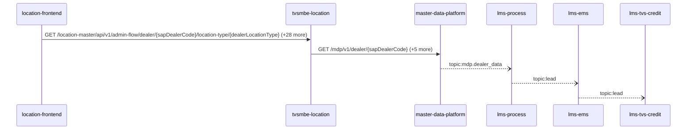

Steps:
| # | From | To | Via | Data (schema names) | Sync/Async | Confidence |
|---|---|---|---|---|---|---|
| 1 | location-frontend | tvsmbe-location | GET /location-master/api/v1/admin-flow/dealer/{sapDealerCode}/location-type/{dealerLocationType}, GET /location-master/api/v1/admin-flow/rejection-comments, GET /location-master/api/v1/admin-flow/summary (+26 more) | CreateDealerRequest, DealerListRequest, DealerResponse, DealerSearchFilterRequest, DealerSearchRequest (+8 more) | sync | high |
| 2 | tvsmbe-location | master-data-platform | GET /mdp/v1/dealer/{sapDealerCode}, GET /mdp/v1/dealer/{sapDealerCode}/branches, POST /mdp/v1/dealers/data (+3 more) | DealerStateWiseCountFilterRequest, DealerTypeStatusFlagsFilterRequest, GeneralResponse, ProximityRequest | sync | high |
| 3 | master-data-platform | lms-process | topic:mdp.dealer_data | DealerData | async | medium |
| 4 | lms-process | lms-ems | topic:lead | Unknown | async | medium |
| 5 | lms-ems | lms-tvs-credit | topic:lead | Unknown | async | medium |

Data touched: tvsmbe-location: mongo, mysql; master-data-platform: mysql:xxxx.mysql.database.azure.com:mdp_20230904, other, redis; lms-process: mssql; lms-ems: mssql; lms-tvs-credit: mssql

Failure points: hop 1 location-frontend → tvsmbe-location: criticality hard; hop 2 tvsmbe-location → master-data-platform: criticality hard; hop 3 master-data-platform → lms-process: criticality async; hop 4 lms-process → lms-ems: criticality async; hop 5 lms-ems → lms-tvs-credit: criticality async

Evidence:
- hop 1 (location-frontend → tvsmbe-location): `location-frontend/src/services/DealerDetailsService.ts:38`, `tvsmbe-location/src/main/java/com/tvsmotor/location_master/controller/AdminFlowController.java:28`, `location-frontend/src/services/DealerDetailsService.ts:69` (+42 more)
- hop 2 (tvsmbe-location → master-data-platform): `master-data-platform/src/main/java/com/tvsmotor/mdp/controller/DealerController.java:20`, `tvsmbe-location/src/main/java/com/tvsmotor/location_master/service/MDPDealerService.java:68`, `tvsmbe-location/src/main/java/com/tvsmotor/location_master/utils/OkHttpUtil.java:35` (+7 more)
- hop 3 (master-data-platform → lms-process): `lms_process/processLeadService/Const/Constants.cs:7`, `lms_process/processLeadService/ListenerService/MdpConsumer.cs:42`, `master-data-platform/src/main/java/com/tvsmotor/mdp/config/DealerMasterServiceBusConfig.java:26` (+1 more)
- hop 4 (lms-process → lms-ems): `lms_ems/emsService/Const/Constants.cs:14`, `lms_ems/emsService/ListenerService/EmsListenerService.cs:43`, `lms_process/processLeadService/Const/Constants.cs:6` (+1 more)
- hop 5 (lms-ems → lms-tvs-credit): `lms_ems/emsService/Const/Constants.cs:13`, `lms_ems/emsService/Services/EmsService.cs:191`, `lms_tvs_credit/lms_tvs_credit/ListenerService/TvscreditListenerService.cs:46` (+1 more)

## Flow: location-frontend--lms-tvs-credit-3059e3
Summary: Starting at `location-frontend` (user action in location-frontend (frontend)), the flow passes through `tvsmbe-location`, `lms`, `lms-process`, `lms-ems` and ends at `lms-tvs-credit`, using 2 sync HTTP hop(s) and 3 async event hop(s); lms-process role: participant; confidence medium.

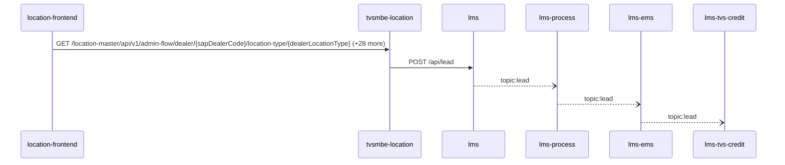

Steps:
| # | From | To | Via | Data (schema names) | Sync/Async | Confidence |
|---|---|---|---|---|---|---|
| 1 | location-frontend | tvsmbe-location | GET /location-master/api/v1/admin-flow/dealer/{sapDealerCode}/location-type/{dealerLocationType}, GET /location-master/api/v1/admin-flow/rejection-comments, GET /location-master/api/v1/admin-flow/summary (+26 more) | CreateDealerRequest, DealerListRequest, DealerResponse, DealerSearchFilterRequest, DealerSearchRequest (+8 more) | sync | high |
| 2 | tvsmbe-location | lms | POST /api/lead | LeadRequestModel | sync | medium |
| 3 | lms | lms-process | topic:lead | Unknown | async | medium |
| 4 | lms-process | lms-ems | topic:lead | Unknown | async | medium |
| 5 | lms-ems | lms-tvs-credit | topic:lead | Unknown | async | medium |

Data touched: tvsmbe-location: mongo, mysql; lms: mssql, mssql:icubemobappsqlstg.database.windows.net:tazlmssqldbdev01; lms-process: mssql; lms-ems: mssql; lms-tvs-credit: mssql

Failure points: hop 1 location-frontend → tvsmbe-location: criticality hard; hop 2 tvsmbe-location → lms: criticality hard; hop 3 lms → lms-process: criticality async; hop 4 lms-process → lms-ems: criticality async; hop 5 lms-ems → lms-tvs-credit: criticality async

Evidence:
- hop 1 (location-frontend → tvsmbe-location): `location-frontend/src/services/DealerDetailsService.ts:38`, `tvsmbe-location/src/main/java/com/tvsmotor/location_master/controller/AdminFlowController.java:28`, `location-frontend/src/services/DealerDetailsService.ts:69` (+42 more)
- hop 2 (tvsmbe-location → lms): `lms/leadLogs/Controllers/LeadAcquisitionController.cs:61`, `tvsmbe-location/src/main/java/com/tvsmotor/location_master/service/LeadService.java:58`, `tvsmbe-location/src/main/java/com/tvsmotor/location_master/utils/OkHttpUtil.java:54`
- hop 3 (lms → lms-process): `lms/leadLogs/Services/LeadDispatchService.cs:21`, `lms_process/processLeadService/Const/Constants.cs:10`, `lms_process/processLeadService/ListenerService/QueueConsumer.cs:36`
- hop 4 (lms-process → lms-ems): `lms_ems/emsService/Const/Constants.cs:14`, `lms_ems/emsService/ListenerService/EmsListenerService.cs:43`, `lms_process/processLeadService/Const/Constants.cs:6` (+1 more)
- hop 5 (lms-ems → lms-tvs-credit): `lms_ems/emsService/Const/Constants.cs:13`, `lms_ems/emsService/Services/EmsService.cs:191`, `lms_tvs_credit/lms_tvs_credit/ListenerService/TvscreditListenerService.cs:46` (+1 more)

## Flow: location-frontend--lms-tvs-credit-309d01
Summary: Starting at `location-frontend` (user action in location-frontend (frontend)), the flow passes through `tvsmbe-location`, `tvsm-auth`, `master-data-platform`, `lms-process` and ends at `lms-tvs-credit`, using 3 sync HTTP hop(s) and 2 async event hop(s); lms-process role: participant; confidence medium.

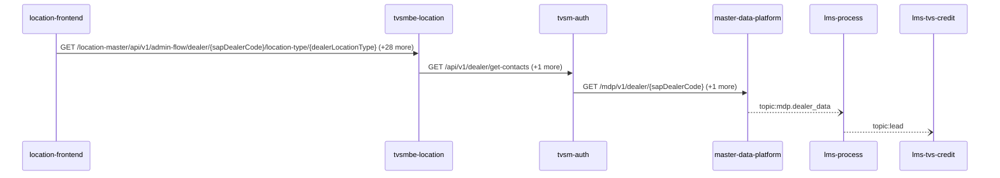

Steps:
| # | From | To | Via | Data (schema names) | Sync/Async | Confidence |
|---|---|---|---|---|---|---|
| 1 | location-frontend | tvsmbe-location | GET /location-master/api/v1/admin-flow/dealer/{sapDealerCode}/location-type/{dealerLocationType}, GET /location-master/api/v1/admin-flow/rejection-comments, GET /location-master/api/v1/admin-flow/summary (+26 more) | CreateDealerRequest, DealerListRequest, DealerResponse, DealerSearchFilterRequest, DealerSearchRequest (+8 more) | sync | high |
| 2 | tvsmbe-location | tvsm-auth | GET /api/v1/dealer/get-contacts, POST /auth/v1/app/token/validate | DealerContacts, TokenVerificationRequest, TokenVerificationResponse | sync | high |
| 3 | tvsm-auth | master-data-platform | GET /mdp/v1/dealer/{sapDealerCode}, GET /mdp/v1/dealer/{sapDealerCode}/branches | GeneralResponse | sync | medium |
| 4 | master-data-platform | lms-process | topic:mdp.dealer_data | DealerData | async | medium |
| 5 | lms-process | lms-tvs-credit | topic:lead | Unknown | async | medium |

Data touched: tvsmbe-location: mongo, mysql; tvsm-auth: mysql; master-data-platform: mysql:xxxx.mysql.database.azure.com:mdp_20230904, other, redis; lms-process: mssql; lms-tvs-credit: mssql

Failure points: hop 1 location-frontend → tvsmbe-location: criticality hard; hop 2 tvsmbe-location → tvsm-auth: criticality hard; hop 3 tvsm-auth → master-data-platform: criticality hard; hop 4 master-data-platform → lms-process: criticality async; hop 5 lms-process → lms-tvs-credit: criticality async

Evidence:
- hop 1 (location-frontend → tvsmbe-location): `location-frontend/src/services/DealerDetailsService.ts:38`, `tvsmbe-location/src/main/java/com/tvsmotor/location_master/controller/AdminFlowController.java:28`, `location-frontend/src/services/DealerDetailsService.ts:69` (+42 more)
- hop 2 (tvsmbe-location → tvsm-auth): `tvsm-auth/src/main/java/com/tvsmotor/tvsmauth/user/profile/api/DealerController.java:42`, `tvsmbe-location/src/main/java/com/tvsmotor/location_master/service/UMSService.java:49`, `tvsmbe-location/src/main/java/com/tvsmotor/location_master/utils/OkHttpUtil.java:35` (+3 more)
- hop 3 (tvsm-auth → master-data-platform): `master-data-platform/src/main/java/com/tvsmotor/mdp/controller/DealerController.java:20`, `tvsm-auth/src/main/java/com/tvsmotor/tvsmauth/user/gateway/MDPServiceClient.java:86`, `tvsm-auth/src/main/java/com/tvsmotor/tvsmauth/user/gateway/MDPServiceClient.java:110` (+2 more)
- hop 4 (master-data-platform → lms-process): `lms_process/processLeadService/Const/Constants.cs:7`, `lms_process/processLeadService/ListenerService/MdpConsumer.cs:42`, `master-data-platform/src/main/java/com/tvsmotor/mdp/config/DealerMasterServiceBusConfig.java:26` (+1 more)
- hop 5 (lms-process → lms-tvs-credit): `lms_process/processLeadService/Const/Constants.cs:6`, `lms_process/processLeadService/Services/TwoWheelerService.cs:97`, `lms_tvs_credit/lms_tvs_credit/ListenerService/TvscreditListenerService.cs:46` (+1 more)

## Flow: location-frontend--lms-tvs-credit-8e8dc7
Summary: Starting at `location-frontend` (user action in location-frontend (frontend)), the flow passes through `tvsmbe-location`, `lms`, `lms-ems`, `lms-process` and ends at `lms-tvs-credit`, using 2 sync HTTP hop(s) and 3 async event hop(s); lms-process role: participant; confidence medium.

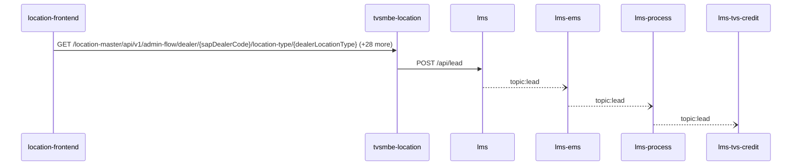

Steps:
| # | From | To | Via | Data (schema names) | Sync/Async | Confidence |
|---|---|---|---|---|---|---|
| 1 | location-frontend | tvsmbe-location | GET /location-master/api/v1/admin-flow/dealer/{sapDealerCode}/location-type/{dealerLocationType}, GET /location-master/api/v1/admin-flow/rejection-comments, GET /location-master/api/v1/admin-flow/summary (+26 more) | CreateDealerRequest, DealerListRequest, DealerResponse, DealerSearchFilterRequest, DealerSearchRequest (+8 more) | sync | high |
| 2 | tvsmbe-location | lms | POST /api/lead | LeadRequestModel | sync | medium |
| 3 | lms | lms-ems | topic:lead | Unknown | async | medium |
| 4 | lms-ems | lms-process | topic:lead | Unknown | async | medium |
| 5 | lms-process | lms-tvs-credit | topic:lead | Unknown | async | medium |

Data touched: tvsmbe-location: mongo, mysql; lms: mssql, mssql:icubemobappsqlstg.database.windows.net:tazlmssqldbdev01; lms-ems: mssql; lms-process: mssql; lms-tvs-credit: mssql

Failure points: hop 1 location-frontend → tvsmbe-location: criticality hard; hop 2 tvsmbe-location → lms: criticality hard; hop 3 lms → lms-ems: criticality async; hop 4 lms-ems → lms-process: criticality async; hop 5 lms-process → lms-tvs-credit: criticality async

Evidence:
- hop 1 (location-frontend → tvsmbe-location): `location-frontend/src/services/DealerDetailsService.ts:38`, `tvsmbe-location/src/main/java/com/tvsmotor/location_master/controller/AdminFlowController.java:28`, `location-frontend/src/services/DealerDetailsService.ts:69` (+42 more)
- hop 2 (tvsmbe-location → lms): `lms/leadLogs/Controllers/LeadAcquisitionController.cs:61`, `tvsmbe-location/src/main/java/com/tvsmotor/location_master/service/LeadService.java:58`, `tvsmbe-location/src/main/java/com/tvsmotor/location_master/utils/OkHttpUtil.java:54`
- hop 3 (lms → lms-ems): `lms/leadLogs/Services/LeadDispatchService.cs:21`, `lms_ems/emsService/Const/Constants.cs:14`, `lms_ems/emsService/ListenerService/EmsListenerService.cs:43`
- hop 4 (lms-ems → lms-process): `lms_ems/emsService/Const/Constants.cs:13`, `lms_ems/emsService/Services/EmsService.cs:191`, `lms_process/processLeadService/Const/Constants.cs:10` (+1 more)
- hop 5 (lms-process → lms-tvs-credit): `lms_process/processLeadService/Const/Constants.cs:6`, `lms_process/processLeadService/Services/TwoWheelerService.cs:97`, `lms_tvs_credit/lms_tvs_credit/ListenerService/TvscreditListenerService.cs:46` (+1 more)

## Flow: tvs-cps-backend--external-salesforce-4e791f
Summary: Starting at `tvs-cps-backend` (scheduled job(s) in tvs-cps-backend (job-to-call link not resolved): JobScheduler.loadCatalogData, JobScheduler.retrieveMDPDealers, JobScheduler.retrieveMerchandiseStock (+2 more)), the flow passes through `lms`, `lms-process`, `lms-ems`, `lms-crm` and ends at `external:salesforce`, using 2 sync HTTP hop(s) and 3 async event hop(s); lms-process role: participant; confidence medium.

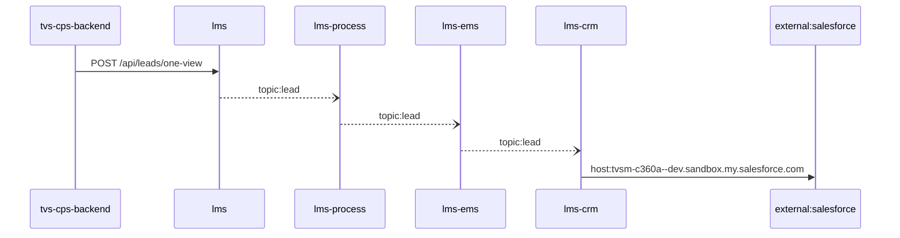

Steps:
| # | From | To | Via | Data (schema names) | Sync/Async | Confidence |
|---|---|---|---|---|---|---|
| 1 | tvs-cps-backend | lms | POST /api/leads/one-view | LeadOneViewRequest | sync | medium |
| 2 | lms | lms-process | topic:lead | Unknown | async | medium |
| 3 | lms-process | lms-ems | topic:lead | Unknown | async | medium |
| 4 | lms-ems | lms-crm | topic:lead | Unknown | async | medium |
| 5 | lms-crm | external:salesforce | host:tvsm-c360a--dev.sandbox.my.salesforce.com | Unknown | sync | high |

Data touched: tvs-cps-backend: postgres, postgres:nmazcpsdbsdev01-cmn-postgres-uks.postgres.database.azure.com:nmazcpsdbdev01-cps; lms: mssql, mssql:icubemobappsqlstg.database.windows.net:tazlmssqldbdev01; lms-process: mssql; lms-ems: mssql; lms-crm: mssql

Failure points: hop 1 tvs-cps-backend → lms: criticality hard; hop 2 lms → lms-process: criticality async; hop 3 lms-process → lms-ems: criticality async; hop 4 lms-ems → lms-crm: criticality async; hop 5 lms-crm → external:salesforce: criticality hard

Evidence:
- hop 1 (tvs-cps-backend → lms): `TVS-CPS-BACKEND/bff-service/src/main/java/com/tvsm/bff/client/ServiceReminderClient.java:209`, `lms/leadLogs/Controllers/LeadGetController.cs:90`
- hop 2 (lms → lms-process): `lms/leadLogs/Services/LeadDispatchService.cs:21`, `lms_process/processLeadService/Const/Constants.cs:10`, `lms_process/processLeadService/ListenerService/QueueConsumer.cs:36`
- hop 3 (lms-process → lms-ems): `lms_ems/emsService/Const/Constants.cs:14`, `lms_ems/emsService/ListenerService/EmsListenerService.cs:43`, `lms_process/processLeadService/Const/Constants.cs:6` (+1 more)
- hop 4 (lms-ems → lms-crm): `lms_crm/ListenerService/CrmListenerService.cs:44`, `lms_crm/Utils/Constants.cs:16`, `lms_ems/emsService/Const/Constants.cs:13` (+1 more)
- hop 5 (lms-crm → external:salesforce): `lms_crm/appsettings.Development.json:16`, `lms_crm/appsettings.Production.json:17`, `lms_crm/appsettings.Uat.json:17`

## Flow: tvs-cps-backend--external-salesforce-5bee04
Summary: Starting at `tvs-cps-backend` (scheduled job(s) in tvs-cps-backend (job-to-call link not resolved): JobScheduler.loadCatalogData, JobScheduler.retrieveMDPDealers, JobScheduler.retrieveMerchandiseStock (+2 more)), the flow passes through `lms`, `lms-ems`, `lms-process`, `lms-crm` and ends at `external:salesforce`, using 2 sync HTTP hop(s) and 3 async event hop(s); lms-process role: participant; confidence medium.


Steps:
| # | From | To | Via | Data (schema names) | Sync/Async | Confidence |
|---|---|---|---|---|---|---|
| 1 | tvs-cps-backend | lms | POST /api/leads/one-view | LeadOneViewRequest | sync | medium |
| 2 | lms | lms-ems | topic:lead | Unknown | async | medium |
| 3 | lms-ems | lms-process | topic:lead | Unknown | async | medium |
| 4 | lms-process | lms-crm | topic:lead | Unknown | async | medium |
| 5 | lms-crm | external:salesforce | host:tvsm-c360a--dev.sandbox.my.salesforce.com | Unknown | sync | high |

Data touched: tvs-cps-backend: postgres, postgres:nmazcpsdbsdev01-cmn-postgres-uks.postgres.database.azure.com:nmazcpsdbdev01-cps; lms: mssql, mssql:icubemobappsqlstg.database.windows.net:tazlmssqldbdev01; lms-ems: mssql; lms-process: mssql; lms-crm: mssql

Failure points: hop 1 tvs-cps-backend → lms: criticality hard; hop 2 lms → lms-ems: criticality async; hop 3 lms-ems → lms-process: criticality async; hop 4 lms-process → lms-crm: criticality async; hop 5 lms-crm → external:salesforce: criticality hard

Evidence:
- hop 1 (tvs-cps-backend → lms): `TVS-CPS-BACKEND/bff-service/src/main/java/com/tvsm/bff/client/ServiceReminderClient.java:209`, `lms/leadLogs/Controllers/LeadGetController.cs:90`
- hop 2 (lms → lms-ems): `lms/leadLogs/Services/LeadDispatchService.cs:21`, `lms_ems/emsService/Const/Constants.cs:14`, `lms_ems/emsService/ListenerService/EmsListenerService.cs:43`
- hop 3 (lms-ems → lms-process): `lms_ems/emsService/Const/Constants.cs:13`, `lms_ems/emsService/Services/EmsService.cs:191`, `lms_process/processLeadService/Const/Constants.cs:10` (+1 more)
- hop 4 (lms-process → lms-crm): `lms_crm/ListenerService/CrmListenerService.cs:44`, `lms_crm/Utils/Constants.cs:16`, `lms_process/processLeadService/Const/Constants.cs:6` (+1 more)
- hop 5 (lms-crm → external:salesforce): `lms_crm/appsettings.Development.json:16`, `lms_crm/appsettings.Production.json:17`, `lms_crm/appsettings.Uat.json:17`

## Flow: tvs-cps-jobs--external-salesforce-cd1252
Summary: Starting at `tvs-cps-jobs` (scheduled job(s) in tvs-cps-jobs (job-to-call link not resolved): CronJobScheduler.allBookingsScheduler, CronJobScheduler.allEnquiriesScheduler, CronJobScheduler.availableStockScheduler (+27 more); request to tvs-cps-jobs from outside the registry (no internal caller)), the flow passes through `tvs-cps-backend`, `lms`, `lms-process`, `lms-crm` and ends at `external:salesforce`, using 3 sync HTTP hop(s) and 2 async event hop(s); lms-process role: participant; confidence medium.

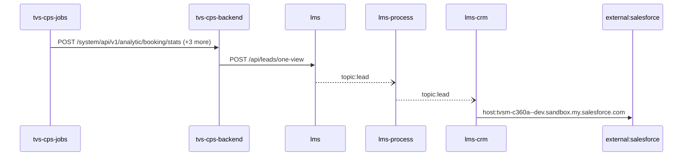

Steps:
| # | From | To | Via | Data (schema names) | Sync/Async | Confidence |
|---|---|---|---|---|---|---|
| 1 | tvs-cps-jobs | tvs-cps-backend | POST /system/api/v1/analytic/booking/stats, POST /system/api/v1/analytics-dashboard/indicators/calculate, POST /system/api/v1/appointments/auto-close (+1 more) | APIResponse<map<string,object>>, AnalyticsDto, AnalyticsRequestDTO | sync | high |
| 2 | tvs-cps-backend | lms | POST /api/leads/one-view | LeadOneViewRequest | sync | medium |
| 3 | lms | lms-process | topic:lead | Unknown | async | medium |
| 4 | lms-process | lms-crm | topic:lead | Unknown | async | medium |
| 5 | lms-crm | external:salesforce | host:tvsm-c360a--dev.sandbox.my.salesforce.com | Unknown | sync | high |

Data touched: tvs-cps-backend: postgres, postgres:nmazcpsdbsdev01-cmn-postgres-uks.postgres.database.azure.com:nmazcpsdbdev01-cps; lms: mssql, mssql:icubemobappsqlstg.database.windows.net:tazlmssqldbdev01; lms-process: mssql; lms-crm: mssql

Failure points: hop 1 tvs-cps-jobs → tvs-cps-backend: criticality hard; hop 2 tvs-cps-backend → lms: criticality hard; hop 3 lms → lms-process: criticality async; hop 4 lms-process → lms-crm: criticality async; hop 5 lms-crm → external:salesforce: criticality hard

Evidence:
- hop 1 (tvs-cps-jobs → tvs-cps-backend): `TVS-CPS-BACKEND/bff-service/src/main/java/com/tvsm/bff/controller/AnalyticsController.java:23`, `TVS-CPS-JOBS/src/main/java/com/tvsm/jobs/service/AnalyticsService.java:32`, `TVS-CPS-JOBS/src/main/java/com/tvsm/jobs/service/RestCallService.java:50` (+4 more)
- hop 2 (tvs-cps-backend → lms): `TVS-CPS-BACKEND/bff-service/src/main/java/com/tvsm/bff/client/ServiceReminderClient.java:209`, `lms/leadLogs/Controllers/LeadGetController.cs:90`
- hop 3 (lms → lms-process): `lms/leadLogs/Services/LeadDispatchService.cs:21`, `lms_process/processLeadService/Const/Constants.cs:10`, `lms_process/processLeadService/ListenerService/QueueConsumer.cs:36`
- hop 4 (lms-process → lms-crm): `lms_crm/ListenerService/CrmListenerService.cs:44`, `lms_crm/Utils/Constants.cs:16`, `lms_process/processLeadService/Const/Constants.cs:6` (+1 more)
- hop 5 (lms-crm → external:salesforce): `lms_crm/appsettings.Development.json:16`, `lms_crm/appsettings.Production.json:17`, `lms_crm/appsettings.Uat.json:17`

## Flow: tvs-cps-jobs--lms-crm-735e1f
Summary: Starting at `tvs-cps-jobs` (scheduled job(s) in tvs-cps-jobs (job-to-call link not resolved): CronJobScheduler.allBookingsScheduler, CronJobScheduler.allEnquiriesScheduler, CronJobScheduler.availableStockScheduler (+27 more); request to tvs-cps-jobs from outside the registry (no internal caller)), the flow passes through `tvs-cps-backend`, `lms`, `lms-process`, `lms-ems` and ends at `lms-crm`, using 2 sync HTTP hop(s) and 3 async event hop(s); lms-process role: participant; confidence medium; truncated at the depth cap.

```mermaid
sequenceDiagram
  participant tvs_cps_jobs as tvs-cps-jobs
  participant tvs_cps_backend as tvs-cps-backend
  participant lms as lms
  participant lms_process as lms-process
  participant lms_ems as lms-ems
  participant lms_crm as lms-crm
  tvs_cps_jobs->>tvs_cps_backend: POST /system/api/v1/analytic/booking/stats (+3 more)
  tvs_cps_backend->>lms: POST /api/leads/one-view
  lms--)lms_process: topic:lead
  lms_process--)lms_ems: topic:lead
  lms_ems--)lms_crm: topic:lead
```

Steps:
| # | From | To | Via | Data (schema names) | Sync/Async | Confidence |
|---|---|---|---|---|---|---|
| 1 | tvs-cps-jobs | tvs-cps-backend | POST /system/api/v1/analytic/booking/stats, POST /system/api/v1/analytics-dashboard/indicators/calculate, POST /system/api/v1/appointments/auto-close (+1 more) | APIResponse<map<string,object>>, AnalyticsDto, AnalyticsRequestDTO | sync | high |
| 2 | tvs-cps-backend | lms | POST /api/leads/one-view | LeadOneViewRequest | sync | medium |
| 3 | lms | lms-process | topic:lead | Unknown | async | medium |
| 4 | lms-process | lms-ems | topic:lead | Unknown | async | medium |
| 5 | lms-ems | lms-crm | topic:lead | Unknown | async | medium |

Data touched: tvs-cps-backend: postgres, postgres:nmazcpsdbsdev01-cmn-postgres-uks.postgres.database.azure.com:nmazcpsdbdev01-cps; lms: mssql, mssql:icubemobappsqlstg.database.windows.net:tazlmssqldbdev01; lms-process: mssql; lms-ems: mssql; lms-crm: mssql

Failure points: hop 1 tvs-cps-jobs → tvs-cps-backend: criticality hard; hop 2 tvs-cps-backend → lms: criticality hard; hop 3 lms → lms-process: criticality async; hop 4 lms-process → lms-ems: criticality async; hop 5 lms-ems → lms-crm: criticality async

Evidence:
- hop 1 (tvs-cps-jobs → tvs-cps-backend): `TVS-CPS-BACKEND/bff-service/src/main/java/com/tvsm/bff/controller/AnalyticsController.java:23`, `TVS-CPS-JOBS/src/main/java/com/tvsm/jobs/service/AnalyticsService.java:32`, `TVS-CPS-JOBS/src/main/java/com/tvsm/jobs/service/RestCallService.java:50` (+4 more)
- hop 2 (tvs-cps-backend → lms): `TVS-CPS-BACKEND/bff-service/src/main/java/com/tvsm/bff/client/ServiceReminderClient.java:209`, `lms/leadLogs/Controllers/LeadGetController.cs:90`
- hop 3 (lms → lms-process): `lms/leadLogs/Services/LeadDispatchService.cs:21`, `lms_process/processLeadService/Const/Constants.cs:10`, `lms_process/processLeadService/ListenerService/QueueConsumer.cs:36`
- hop 4 (lms-process → lms-ems): `lms_ems/emsService/Const/Constants.cs:14`, `lms_ems/emsService/ListenerService/EmsListenerService.cs:43`, `lms_process/processLeadService/Const/Constants.cs:6` (+1 more)
- hop 5 (lms-ems → lms-crm): `lms_crm/ListenerService/CrmListenerService.cs:44`, `lms_crm/Utils/Constants.cs:16`, `lms_ems/emsService/Const/Constants.cs:13` (+1 more)

## Flow: tvs-cps-jobs--lms-crm-80b689
Summary: Starting at `tvs-cps-jobs` (scheduled job(s) in tvs-cps-jobs (job-to-call link not resolved): CronJobScheduler.allBookingsScheduler, CronJobScheduler.allEnquiriesScheduler, CronJobScheduler.availableStockScheduler (+27 more); request to tvs-cps-jobs from outside the registry (no internal caller)), the flow passes through `tvs-cps-backend`, `lms`, `lms-ems`, `lms-process` and ends at `lms-crm`, using 2 sync HTTP hop(s) and 3 async event hop(s); lms-process role: participant; confidence medium; truncated at the depth cap.

```mermaid
sequenceDiagram
  participant tvs_cps_jobs as tvs-cps-jobs
  participant tvs_cps_backend as tvs-cps-backend
  participant lms as lms
  participant lms_ems as lms-ems
  participant lms_process as lms-process
  participant lms_crm as lms-crm
  tvs_cps_jobs->>tvs_cps_backend: POST /system/api/v1/analytic/booking/stats (+3 more)
  tvs_cps_backend->>lms: POST /api/leads/one-view
  lms--)lms_ems: topic:lead
  lms_ems--)lms_process: topic:lead
  lms_process--)lms_crm: topic:lead
```

Steps:
| # | From | To | Via | Data (schema names) | Sync/Async | Confidence |
|---|---|---|---|---|---|---|
| 1 | tvs-cps-jobs | tvs-cps-backend | POST /system/api/v1/analytic/booking/stats, POST /system/api/v1/analytics-dashboard/indicators/calculate, POST /system/api/v1/appointments/auto-close (+1 more) | APIResponse<map<string,object>>, AnalyticsDto, AnalyticsRequestDTO | sync | high |
| 2 | tvs-cps-backend | lms | POST /api/leads/one-view | LeadOneViewRequest | sync | medium |
| 3 | lms | lms-ems | topic:lead | Unknown | async | medium |
| 4 | lms-ems | lms-process | topic:lead | Unknown | async | medium |
| 5 | lms-process | lms-crm | topic:lead | Unknown | async | medium |

Data touched: tvs-cps-backend: postgres, postgres:nmazcpsdbsdev01-cmn-postgres-uks.postgres.database.azure.com:nmazcpsdbdev01-cps; lms: mssql, mssql:icubemobappsqlstg.database.windows.net:tazlmssqldbdev01; lms-ems: mssql; lms-process: mssql; lms-crm: mssql

Failure points: hop 1 tvs-cps-jobs → tvs-cps-backend: criticality hard; hop 2 tvs-cps-backend → lms: criticality hard; hop 3 lms → lms-ems: criticality async; hop 4 lms-ems → lms-process: criticality async; hop 5 lms-process → lms-crm: criticality async

Evidence:
- hop 1 (tvs-cps-jobs → tvs-cps-backend): `TVS-CPS-BACKEND/bff-service/src/main/java/com/tvsm/bff/controller/AnalyticsController.java:23`, `TVS-CPS-JOBS/src/main/java/com/tvsm/jobs/service/AnalyticsService.java:32`, `TVS-CPS-JOBS/src/main/java/com/tvsm/jobs/service/RestCallService.java:50` (+4 more)
- hop 2 (tvs-cps-backend → lms): `TVS-CPS-BACKEND/bff-service/src/main/java/com/tvsm/bff/client/ServiceReminderClient.java:209`, `lms/leadLogs/Controllers/LeadGetController.cs:90`
- hop 3 (lms → lms-ems): `lms/leadLogs/Services/LeadDispatchService.cs:21`, `lms_ems/emsService/Const/Constants.cs:14`, `lms_ems/emsService/ListenerService/EmsListenerService.cs:43`
- hop 4 (lms-ems → lms-process): `lms_ems/emsService/Const/Constants.cs:13`, `lms_ems/emsService/Services/EmsService.cs:191`, `lms_process/processLeadService/Const/Constants.cs:10` (+1 more)
- hop 5 (lms-process → lms-crm): `lms_crm/ListenerService/CrmListenerService.cs:44`, `lms_crm/Utils/Constants.cs:16`, `lms_process/processLeadService/Const/Constants.cs:6` (+1 more)

## Flow: tvs-cps-jobs--lms-tvs-credit-ce3ec7
Summary: Starting at `tvs-cps-jobs` (scheduled job(s) in tvs-cps-jobs (job-to-call link not resolved): CronJobScheduler.allBookingsScheduler, CronJobScheduler.allEnquiriesScheduler, CronJobScheduler.availableStockScheduler (+27 more); request to tvs-cps-jobs from outside the registry (no internal caller)), the flow passes through `tvs-cps-backend`, `lms`, `lms-ems`, `lms-process` and ends at `lms-tvs-credit`, using 2 sync HTTP hop(s) and 3 async event hop(s); lms-process role: participant; confidence medium.

```mermaid
sequenceDiagram
  participant tvs_cps_jobs as tvs-cps-jobs
  participant tvs_cps_backend as tvs-cps-backend
  participant lms as lms
  participant lms_ems as lms-ems
  participant lms_process as lms-process
  participant lms_tvs_credit as lms-tvs-credit
  tvs_cps_jobs->>tvs_cps_backend: POST /system/api/v1/analytic/booking/stats (+3 more)
  tvs_cps_backend->>lms: POST /api/leads/one-view
  lms--)lms_ems: topic:lead
  lms_ems--)lms_process: topic:lead
  lms_process--)lms_tvs_credit: topic:lead
```

Steps:
| # | From | To | Via | Data (schema names) | Sync/Async | Confidence |
|---|---|---|---|---|---|---|
| 1 | tvs-cps-jobs | tvs-cps-backend | POST /system/api/v1/analytic/booking/stats, POST /system/api/v1/analytics-dashboard/indicators/calculate, POST /system/api/v1/appointments/auto-close (+1 more) | APIResponse<map<string,object>>, AnalyticsDto, AnalyticsRequestDTO | sync | high |
| 2 | tvs-cps-backend | lms | POST /api/leads/one-view | LeadOneViewRequest | sync | medium |
| 3 | lms | lms-ems | topic:lead | Unknown | async | medium |
| 4 | lms-ems | lms-process | topic:lead | Unknown | async | medium |
| 5 | lms-process | lms-tvs-credit | topic:lead | Unknown | async | medium |

Data touched: tvs-cps-backend: postgres, postgres:nmazcpsdbsdev01-cmn-postgres-uks.postgres.database.azure.com:nmazcpsdbdev01-cps; lms: mssql, mssql:icubemobappsqlstg.database.windows.net:tazlmssqldbdev01; lms-ems: mssql; lms-process: mssql; lms-tvs-credit: mssql

Failure points: hop 1 tvs-cps-jobs → tvs-cps-backend: criticality hard; hop 2 tvs-cps-backend → lms: criticality hard; hop 3 lms → lms-ems: criticality async; hop 4 lms-ems → lms-process: criticality async; hop 5 lms-process → lms-tvs-credit: criticality async

Evidence:
- hop 1 (tvs-cps-jobs → tvs-cps-backend): `TVS-CPS-BACKEND/bff-service/src/main/java/com/tvsm/bff/controller/AnalyticsController.java:23`, `TVS-CPS-JOBS/src/main/java/com/tvsm/jobs/service/AnalyticsService.java:32`, `TVS-CPS-JOBS/src/main/java/com/tvsm/jobs/service/RestCallService.java:50` (+4 more)
- hop 2 (tvs-cps-backend → lms): `TVS-CPS-BACKEND/bff-service/src/main/java/com/tvsm/bff/client/ServiceReminderClient.java:209`, `lms/leadLogs/Controllers/LeadGetController.cs:90`
- hop 3 (lms → lms-ems): `lms/leadLogs/Services/LeadDispatchService.cs:21`, `lms_ems/emsService/Const/Constants.cs:14`, `lms_ems/emsService/ListenerService/EmsListenerService.cs:43`
- hop 4 (lms-ems → lms-process): `lms_ems/emsService/Const/Constants.cs:13`, `lms_ems/emsService/Services/EmsService.cs:191`, `lms_process/processLeadService/Const/Constants.cs:10` (+1 more)
- hop 5 (lms-process → lms-tvs-credit): `lms_process/processLeadService/Const/Constants.cs:6`, `lms_process/processLeadService/Services/TwoWheelerService.cs:97`, `lms_tvs_credit/lms_tvs_credit/ListenerService/TvscreditListenerService.cs:46` (+1 more)

## Flow: tvs-cps-jobs--lms-tvs-credit-e20095
Summary: Starting at `tvs-cps-jobs` (scheduled job(s) in tvs-cps-jobs (job-to-call link not resolved): CronJobScheduler.allBookingsScheduler, CronJobScheduler.allEnquiriesScheduler, CronJobScheduler.availableStockScheduler (+27 more); request to tvs-cps-jobs from outside the registry (no internal caller)), the flow passes through `tvs-cps-backend`, `lms`, `lms-process`, `lms-ems` and ends at `lms-tvs-credit`, using 2 sync HTTP hop(s) and 3 async event hop(s); lms-process role: participant; confidence medium.

```mermaid
sequenceDiagram
  participant tvs_cps_jobs as tvs-cps-jobs
  participant tvs_cps_backend as tvs-cps-backend
  participant lms as lms
  participant lms_process as lms-process
  participant lms_ems as lms-ems
  participant lms_tvs_credit as lms-tvs-credit
  tvs_cps_jobs->>tvs_cps_backend: POST /system/api/v1/analytic/booking/stats (+3 more)
  tvs_cps_backend->>lms: POST /api/leads/one-view
  lms--)lms_process: topic:lead
  lms_process--)lms_ems: topic:lead
  lms_ems--)lms_tvs_credit: topic:lead
```

Steps:
| # | From | To | Via | Data (schema names) | Sync/Async | Confidence |
|---|---|---|---|---|---|---|
| 1 | tvs-cps-jobs | tvs-cps-backend | POST /system/api/v1/analytic/booking/stats, POST /system/api/v1/analytics-dashboard/indicators/calculate, POST /system/api/v1/appointments/auto-close (+1 more) | APIResponse<map<string,object>>, AnalyticsDto, AnalyticsRequestDTO | sync | high |
| 2 | tvs-cps-backend | lms | POST /api/leads/one-view | LeadOneViewRequest | sync | medium |
| 3 | lms | lms-process | topic:lead | Unknown | async | medium |
| 4 | lms-process | lms-ems | topic:lead | Unknown | async | medium |
| 5 | lms-ems | lms-tvs-credit | topic:lead | Unknown | async | medium |

Data touched: tvs-cps-backend: postgres, postgres:nmazcpsdbsdev01-cmn-postgres-uks.postgres.database.azure.com:nmazcpsdbdev01-cps; lms: mssql, mssql:icubemobappsqlstg.database.windows.net:tazlmssqldbdev01; lms-process: mssql; lms-ems: mssql; lms-tvs-credit: mssql

Failure points: hop 1 tvs-cps-jobs → tvs-cps-backend: criticality hard; hop 2 tvs-cps-backend → lms: criticality hard; hop 3 lms → lms-process: criticality async; hop 4 lms-process → lms-ems: criticality async; hop 5 lms-ems → lms-tvs-credit: criticality async

Evidence:
- hop 1 (tvs-cps-jobs → tvs-cps-backend): `TVS-CPS-BACKEND/bff-service/src/main/java/com/tvsm/bff/controller/AnalyticsController.java:23`, `TVS-CPS-JOBS/src/main/java/com/tvsm/jobs/service/AnalyticsService.java:32`, `TVS-CPS-JOBS/src/main/java/com/tvsm/jobs/service/RestCallService.java:50` (+4 more)
- hop 2 (tvs-cps-backend → lms): `TVS-CPS-BACKEND/bff-service/src/main/java/com/tvsm/bff/client/ServiceReminderClient.java:209`, `lms/leadLogs/Controllers/LeadGetController.cs:90`
- hop 3 (lms → lms-process): `lms/leadLogs/Services/LeadDispatchService.cs:21`, `lms_process/processLeadService/Const/Constants.cs:10`, `lms_process/processLeadService/ListenerService/QueueConsumer.cs:36`
- hop 4 (lms-process → lms-ems): `lms_ems/emsService/Const/Constants.cs:14`, `lms_ems/emsService/ListenerService/EmsListenerService.cs:43`, `lms_process/processLeadService/Const/Constants.cs:6` (+1 more)
- hop 5 (lms-ems → lms-tvs-credit): `lms_ems/emsService/Const/Constants.cs:13`, `lms_ems/emsService/Services/EmsService.cs:191`, `lms_tvs_credit/lms_tvs_credit/ListenerService/TvscreditListenerService.cs:46` (+1 more)

## Flow: tvs-cps-portal--external-salesforce-59d84e
Summary: Starting at `tvs-cps-portal` (user action in tvs-cps-portal (frontend)), the flow passes through `tvs-cps-backend`, `lms`, `lms-process`, `lms-crm` and ends at `external:salesforce`, using 3 sync HTTP hop(s) and 2 async event hop(s); lms-process role: participant; confidence medium.

```mermaid
sequenceDiagram
  participant tvs_cps_portal as tvs-cps-portal
  participant tvs_cps_backend as tvs-cps-backend
  participant lms as lms
  participant lms_process as lms-process
  participant lms_crm as lms-crm
  participant external_salesforce as external:salesforce
  tvs_cps_portal->>tvs_cps_backend: GET /api/v1/announcement/get/{announcementId} (+128 more)
  tvs_cps_backend->>lms: POST /api/leads/one-view
  lms--)lms_process: topic:lead
  lms_process--)lms_crm: topic:lead
  lms_crm->>external_salesforce: host:tvsm-c360a--dev.sandbox.my.salesforce.com
```

Steps:
| # | From | To | Via | Data (schema names) | Sync/Async | Confidence |
|---|---|---|---|---|---|---|
| 1 | tvs-cps-portal | tvs-cps-backend | GET /api/v1/announcement/get/{announcementId}, GET /api/v1/announcement/user/banners, GET /api/v1/appointments/{appointmentId} (+126 more) | APIResponse<AnnouncementResponseDto>, APIResponse<AnnouncementResponseDto[]>, APIResponse<AppointmentCountResponseDTO>, APIResponse<AppointmentDashboardResponseDTO>, APIResponse<AppointmentDetailResponseDTO> (+105 more) | sync | medium |
| 2 | tvs-cps-backend | lms | POST /api/leads/one-view | LeadOneViewRequest | sync | medium |
| 3 | lms | lms-process | topic:lead | Unknown | async | medium |
| 4 | lms-process | lms-crm | topic:lead | Unknown | async | medium |
| 5 | lms-crm | external:salesforce | host:tvsm-c360a--dev.sandbox.my.salesforce.com | Unknown | sync | high |

Data touched: tvs-cps-backend: postgres, postgres:nmazcpsdbsdev01-cmn-postgres-uks.postgres.database.azure.com:nmazcpsdbdev01-cps; lms: mssql, mssql:icubemobappsqlstg.database.windows.net:tazlmssqldbdev01; lms-process: mssql; lms-crm: mssql

Failure points: hop 1 tvs-cps-portal → tvs-cps-backend: criticality hard; hop 2 tvs-cps-backend → lms: criticality hard; hop 3 lms → lms-process: criticality async; hop 4 lms-process → lms-crm: criticality async; hop 5 lms-crm → external:salesforce: criticality hard

Evidence:
- hop 1 (tvs-cps-portal → tvs-cps-backend): `TVS-CPS-BACKEND/announcement-service/src/main/java/com/tvsm/announcement/controller/AnnouncementController.java:31`, `TVS-CPS-PORTAL/channel-partner-system/src/services/notification.service.ts:140`, `TVS-CPS-PORTAL/channel-partner-system/src/services/notification.service.ts:144` (+194 more)
- hop 2 (tvs-cps-backend → lms): `TVS-CPS-BACKEND/bff-service/src/main/java/com/tvsm/bff/client/ServiceReminderClient.java:209`, `lms/leadLogs/Controllers/LeadGetController.cs:90`
- hop 3 (lms → lms-process): `lms/leadLogs/Services/LeadDispatchService.cs:21`, `lms_process/processLeadService/Const/Constants.cs:10`, `lms_process/processLeadService/ListenerService/QueueConsumer.cs:36`
- hop 4 (lms-process → lms-crm): `lms_crm/ListenerService/CrmListenerService.cs:44`, `lms_crm/Utils/Constants.cs:16`, `lms_process/processLeadService/Const/Constants.cs:6` (+1 more)
- hop 5 (lms-crm → external:salesforce): `lms_crm/appsettings.Development.json:16`, `lms_crm/appsettings.Production.json:17`, `lms_crm/appsettings.Uat.json:17`

## Request Flows
lms-process request/message flows traced in code (narrative; the registry flows above are generated). All LMS workers share topic `lead` (Azure Service Bus topic; `AppSettings:TOPIC_NAME`) and are selected by subscription (`EMS`, `CRM`, `FINANCE`, `PROCESS`) with the target carried in the `EventTarget` application property.

### lead processing (topic lms / PROCESS)
```mermaid
sequenceDiagram
  participant SB as Service Bus topic lms
  participant P as lms-process
  participant DB as LMS SQL (mssql)
  participant LL as external Latlong API (config)
  SB->>P: message (EventType LEAD_PROCESS ...)
  P->>DB: load lead-flow config / dealer data
  P->>LL: dealer allocation (lat/long)
  P->>DB: update lead / push log
  P->>SB: publish to lms with EventTarget FINANCE/CRM/EMS
```

| # | Step | Evidence |
|---|---|---|
| 1 | QueueConsumer receives from `TOPIC_NAME`/`PROCESS` | `processLeadService/ListenerService/QueueConsumer.cs:33-65` |
| 2 | Switch on `EventType` | `processLeadService/Services/LeadService.cs:37-56` |
| 3 | Destinations computed | `processLeadService/Services/TwoWheelerService.cs:60-89` |
| 4 | Dispatch to `TOPIC_NAME` | `processLeadService/Services/TwoWheelerService.cs:97, DispatchService.cs:23-39` |

### dealer sync (topic mdp.dealer_data / lms)
```mermaid
sequenceDiagram
  participant MDP as master-data-platform
  participant P as lms-process
  participant DB as LMS SQL (mssql)
  MDP->>P: dealer event (event = DEALER_CREATED/UPDATED/ONE_TIME_MIGRATION)
  P->>DB: upsert dealer_master / dealer_locations / dealer_contacts
  P->>DB: mdp_logs
```

| # | Step | Evidence |
|---|---|---|
| 1 | Session processor on `MDP_TOPIC_NAME`/`MDP_LMS_SUBSCRIPTION` | `processLeadService/ListenerService/MdpConsumer.cs:42` |
| 2 | Dispatch on `event` property | `processLeadService/MdpService/MdpDealerService.cs:31-45` |
