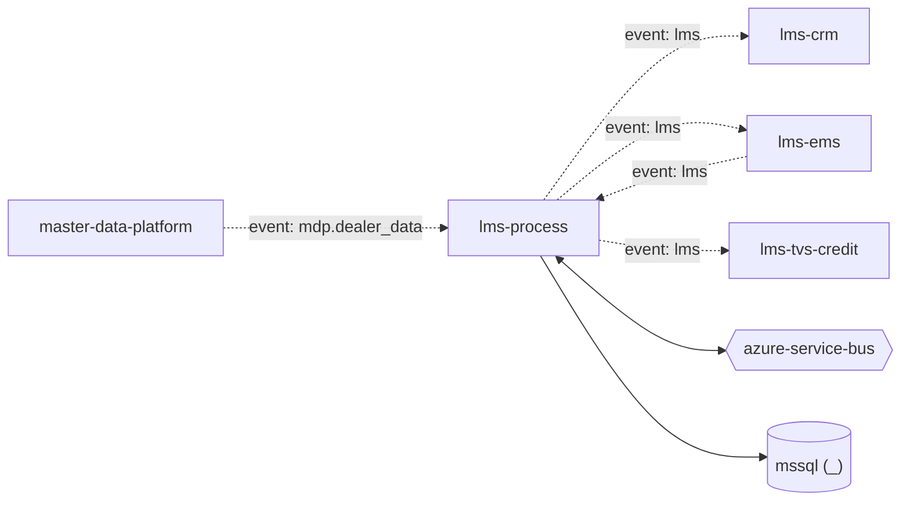

# lms-process — High-Level Design

## Context
lms-process is a `backend-api` in the TVS-CS Lead Management System (domain: lead-management). It is one of five LMS repos: `lms` (acquisition API) and the listener workers `lms-process`, `lms-ems`, `lms-crm`, `lms-tvs-credit`, connected through Service Bus topic `lead`.

## Architecture
lms-process components and connections (from service.yaml / registry edges):

## Integration Points
lms-process registry edges (6):

| Direction | Peer | Kind | Via | Criticality | Source | Match |
|---|---|---|---|---|---|---|
| out | `lms-crm` | event | azure-service-bus:topic:lead | async | inferred | entity |
| out | `lms-ems` | event | azure-service-bus:topic:lead | async | inferred | entity |
| self | `lms-process` | event | azure-service-bus:topic:lead | async | inferred | entity |
| out | `lms-tvs-credit` | event | azure-service-bus:topic:lead | async | inferred | entity |
| in | `lms-ems` | event | azure-service-bus:topic:lead | async | inferred | entity |
| in | `master-data-platform` | event | azure-service-bus:topic:mdp.dealer_data | async | inferred | entity |

## Data Ownership
lms-process data stores (service.yaml `data_stores`). All LMS repos map the same LMS SQL schema (tables such as `leads`, `lead_push_logs`, `dealer_mediation_controls`, `lead_flow_configuration`); ownership is not declared in code.

| Store | Type | Owned | Key entities |
|---|---|---|---|
| `_` | mssql | Unknown | BrandMaster, ClassifiedLead, DealerContact, DealerFlag, DealerLocation, DealerMaster, DealerMediationControl, LatlongPushLog, LceThreshold, Lead, LeadFlowConfiguration, LeadProcessLog, LeadPushLog, MdpLog, StatusCode, ThresholdMaster, UpdatedLead |

## Key Design Decisions
lms-process design decisions evidenced in code:

| Decision | Alternatives considered | Evidence |
|---|---|---|
| Single topic `lead` with per-consumer subscriptions; the target is carried in the `EventTarget` application property | Unknown | `processLeadService/Services/DispatchService.cs:23-38` |
| Session-enabled subscription for dealer events (`CreateSessionProcessor`, `MaxConcurrentSessions = 1`) | Unknown | `processLeadService/ListenerService/MdpConsumer.cs:35-42` |

## Non-Functional Requirements
lms-process NFR targets: N/A — not determinable from code.

## Security
lms-process security: lms-process exposes only `GET /` with no auth attribute; it is a background listener. Service Bus access uses connection-string config keys (names only; `MdpServiceBusConnectionString`, `processLeadService/Const/Constants.cs:8`). Secrets (connection strings, client secrets, API keys) are read from configuration keys listed by name in OVERVIEW.md; values are not reproduced. PII handling: leads carry customer contact data (see request schemas); masking/encryption Unknown.

## Resilience and Failure Modes
lms-process: The handler completes the Service Bus message *before* business processing (`AutoCompleteMessages = false` then an explicit `CompleteMessageAsync` at `processLeadService/ListenerService/QueueConsumer.cs:59 and MdpConsumer.cs:65`), so a failure in processing does not redeliver or dead-letter the message; the error handler only logs (QueueConsumer.cs / MdpConsumer.cs `ProcessErrorAsync`). `MaxConcurrentCalls = 1` serialises processing. No retry policy, circuit breaker or DLQ handling found in code.

## Deployment Topology
lms-process deployment artefacts (platform/regions: Unknown):

| Kind | File | Environments | Base images | Ports |
|---|---|---|---|---|
| azure-pipeline | `azure-pipelines/norton-lms_process-CI.yaml` | - | - | - |

## Observability
lms-process observability: `ILogger` logging only (`ProcessErrorAsync` logs source/entity path); no OpenTelemetry/App Insights configuration found. Dashboards/alerts: Unknown.
