# lms — Data Flows

## Flow Index
lms takes part in 70 end-to-end flow(s) in registry/flows.json; showing the top 25 by confidence, then length.

| flow_id | Name | Role of lms | Trigger |
|---|---|---|---|
| lms--external-salesforce-51394d | lms → external:salesforce (4 hops) | entry | lms publishes lead |
| location-frontend--external-salesforce-08fc2b | location-frontend → external:salesforce (5 hops) | participant | user action in location-frontend (frontend) |
| location-frontend--external-salesforce-308649 | location-frontend → external:salesforce (5 hops) | participant | user action in location-frontend (frontend) |
| location-frontend--lms-crm-0d4513 | location-frontend → lms-crm (5 hops) | participant | user action in location-frontend (frontend) |
| location-frontend--lms-crm-919670 | location-frontend → lms-crm (5 hops) | participant | user action in location-frontend (frontend) |
| location-frontend--lms-tvs-credit-3059e3 | location-frontend → lms-tvs-credit (5 hops) | participant | user action in location-frontend (frontend) |
| location-frontend--lms-tvs-credit-8e8dc7 | location-frontend → lms-tvs-credit (5 hops) | participant | user action in location-frontend (frontend) |
| tvs-cps-backend--external-salesforce-4e791f | tvs-cps-backend → external:salesforce (5 hops) | participant | scheduled job(s) in tvs-cps-backend (job-to-call link not resolved): JobScheduler.loadCatalogData, JobScheduler.retrieveMDPDealers, JobScheduler.retrieveMerchandiseStock (+2 more) |
| tvs-cps-backend--external-salesforce-5bee04 | tvs-cps-backend → external:salesforce (5 hops) | participant | scheduled job(s) in tvs-cps-backend (job-to-call link not resolved): JobScheduler.loadCatalogData, JobScheduler.retrieveMDPDealers, JobScheduler.retrieveMerchandiseStock (+2 more) |
| tvs-cps-jobs--external-salesforce-62e84d | tvs-cps-jobs → external:salesforce (5 hops) | participant | scheduled job(s) in tvs-cps-jobs (job-to-call link not resolved): CronJobScheduler.allBookingsScheduler, CronJobScheduler.allEnquiriesScheduler, CronJobScheduler.availableStockScheduler (+27 more); request to tvs-cps-jobs from outside the registry (no internal caller) |
| tvs-cps-jobs--external-salesforce-cd1252 | tvs-cps-jobs → external:salesforce (5 hops) | participant | scheduled job(s) in tvs-cps-jobs (job-to-call link not resolved): CronJobScheduler.allBookingsScheduler, CronJobScheduler.allEnquiriesScheduler, CronJobScheduler.availableStockScheduler (+27 more); request to tvs-cps-jobs from outside the registry (no internal caller) |
| tvs-cps-jobs--lms-crm-735e1f | tvs-cps-jobs → lms-crm (5 hops) | participant | scheduled job(s) in tvs-cps-jobs (job-to-call link not resolved): CronJobScheduler.allBookingsScheduler, CronJobScheduler.allEnquiriesScheduler, CronJobScheduler.availableStockScheduler (+27 more); request to tvs-cps-jobs from outside the registry (no internal caller) |
| tvs-cps-jobs--lms-crm-80b689 | tvs-cps-jobs → lms-crm (5 hops) | participant | scheduled job(s) in tvs-cps-jobs (job-to-call link not resolved): CronJobScheduler.allBookingsScheduler, CronJobScheduler.allEnquiriesScheduler, CronJobScheduler.availableStockScheduler (+27 more); request to tvs-cps-jobs from outside the registry (no internal caller) |
| tvs-cps-jobs--lms-tvs-credit-ce3ec7 | tvs-cps-jobs → lms-tvs-credit (5 hops) | participant | scheduled job(s) in tvs-cps-jobs (job-to-call link not resolved): CronJobScheduler.allBookingsScheduler, CronJobScheduler.allEnquiriesScheduler, CronJobScheduler.availableStockScheduler (+27 more); request to tvs-cps-jobs from outside the registry (no internal caller) |
| tvs-cps-jobs--lms-tvs-credit-e20095 | tvs-cps-jobs → lms-tvs-credit (5 hops) | participant | scheduled job(s) in tvs-cps-jobs (job-to-call link not resolved): CronJobScheduler.allBookingsScheduler, CronJobScheduler.allEnquiriesScheduler, CronJobScheduler.availableStockScheduler (+27 more); request to tvs-cps-jobs from outside the registry (no internal caller) |
| tvs-cps-portal--external-salesforce-59d84e | tvs-cps-portal → external:salesforce (5 hops) | participant | user action in tvs-cps-portal (frontend) |
| tvs-cps-portal--external-salesforce-af08bd | tvs-cps-portal → external:salesforce (5 hops) | participant | user action in tvs-cps-portal (frontend) |
| tvs-cps-portal--lms-crm-27db64 | tvs-cps-portal → lms-crm (5 hops) | participant | user action in tvs-cps-portal (frontend) |
| tvs-cps-portal--lms-crm-f79cdd | tvs-cps-portal → lms-crm (5 hops) | participant | user action in tvs-cps-portal (frontend) |
| tvs-cps-portal--lms-tvs-credit-dc3a7e | tvs-cps-portal → lms-tvs-credit (5 hops) | participant | user action in tvs-cps-portal (frontend) |
| tvs-cps-portal--lms-tvs-credit-deda48 | tvs-cps-portal → lms-tvs-credit (5 hops) | participant | user action in tvs-cps-portal (frontend) |
| tvsm-marketplace-service--external-salesforce-1dcb9e | tvsm-marketplace-service → external:salesforce (5 hops) | participant | scheduled job(s) in tvsm-marketplace-service (job-to-call link not resolved): AmazonPriceUpdateExecutorService.scheduledDrain, FlipkartPriceUpdateExecutorService.scheduledDrain, MarketplacePriceUpdateTaskService.cleanupDoneTasks (+2 more); request to tvsm-marketplace-service from outside the registry (no internal caller) |
| tvsm-marketplace-service--external-salesforce-c207f1 | tvsm-marketplace-service → external:salesforce (5 hops) | participant | scheduled job(s) in tvsm-marketplace-service (job-to-call link not resolved): AmazonPriceUpdateExecutorService.scheduledDrain, FlipkartPriceUpdateExecutorService.scheduledDrain, MarketplacePriceUpdateTaskService.cleanupDoneTasks (+2 more); request to tvsm-marketplace-service from outside the registry (no internal caller) |
| tvsmbe-location--external-salesforce-0a67ad | tvsmbe-location → external:salesforce (5 hops) | participant | scheduled job(s) in tvsmbe-location (job-to-call link not resolved): CronService.logMetricsPeriodically |
| tvsmbe-location--external-salesforce-5b3d0e | tvsmbe-location → external:salesforce (5 hops) | participant | scheduled job(s) in tvsmbe-location (job-to-call link not resolved): CronService.logMetricsPeriodically |

## Flow: lms--external-salesforce-51394d
Summary: Starting at `lms` (lms publishes lead), the flow passes through `lms-ems`, `lms-process`, `lms-crm` and ends at `external:salesforce`, using 1 sync HTTP hop(s) and 3 async event hop(s); lms role: entry; confidence medium.

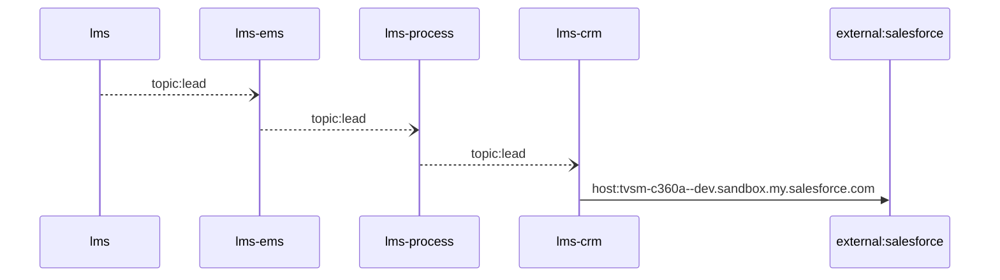

Steps:
| # | From | To | Via | Data (schema names) | Sync/Async | Confidence |
|---|---|---|---|---|---|---|
| 1 | lms | lms-ems | topic:lead | Unknown | async | medium |
| 2 | lms-ems | lms-process | topic:lead | Unknown | async | medium |
| 3 | lms-process | lms-crm | topic:lead | Unknown | async | medium |
| 4 | lms-crm | external:salesforce | host:tvsm-c360a--dev.sandbox.my.salesforce.com | Unknown | sync | high |

Data touched: lms: mssql, mssql:icubemobappsqlstg.database.windows.net:tazlmssqldbdev01; lms-ems: mssql; lms-process: mssql; lms-crm: mssql

Failure points: hop 1 lms → lms-ems: criticality async; hop 2 lms-ems → lms-process: criticality async; hop 3 lms-process → lms-crm: criticality async; hop 4 lms-crm → external:salesforce: criticality hard

Evidence:
- hop 1 (lms → lms-ems): `lms/leadLogs/Services/LeadDispatchService.cs:21`, `lms_ems/emsService/Const/Constants.cs:14`, `lms_ems/emsService/ListenerService/EmsListenerService.cs:43`
- hop 2 (lms-ems → lms-process): `lms_ems/emsService/Const/Constants.cs:13`, `lms_ems/emsService/Services/EmsService.cs:191`, `lms_process/processLeadService/Const/Constants.cs:10` (+1 more)
- hop 3 (lms-process → lms-crm): `lms_crm/ListenerService/CrmListenerService.cs:44`, `lms_crm/Utils/Constants.cs:16`, `lms_process/processLeadService/Const/Constants.cs:6` (+1 more)
- hop 4 (lms-crm → external:salesforce): `lms_crm/appsettings.Development.json:16`, `lms_crm/appsettings.Production.json:17`, `lms_crm/appsettings.Uat.json:17`

## Flow: location-frontend--external-salesforce-08fc2b
Summary: Starting at `location-frontend` (user action in location-frontend (frontend)), the flow passes through `tvsmbe-location`, `lms`, `lms-ems`, `lms-crm` and ends at `external:salesforce`, using 3 sync HTTP hop(s) and 2 async event hop(s); lms role: participant; confidence medium.


Steps:
| # | From | To | Via | Data (schema names) | Sync/Async | Confidence |
|---|---|---|---|---|---|---|
| 1 | location-frontend | tvsmbe-location | GET /location-master/api/v1/admin-flow/dealer/{sapDealerCode}/location-type/{dealerLocationType}, GET /location-master/api/v1/admin-flow/rejection-comments, GET /location-master/api/v1/admin-flow/summary (+26 more) | CreateDealerRequest, DealerListRequest, DealerResponse, DealerSearchFilterRequest, DealerSearchRequest (+8 more) | sync | high |
| 2 | tvsmbe-location | lms | POST /api/lead | LeadRequestModel | sync | medium |
| 3 | lms | lms-ems | topic:lead | Unknown | async | medium |
| 4 | lms-ems | lms-crm | topic:lead | Unknown | async | medium |
| 5 | lms-crm | external:salesforce | host:tvsm-c360a--dev.sandbox.my.salesforce.com | Unknown | sync | high |

Data touched: tvsmbe-location: mongo, mysql; lms: mssql, mssql:icubemobappsqlstg.database.windows.net:tazlmssqldbdev01; lms-ems: mssql; lms-crm: mssql

Failure points: hop 1 location-frontend → tvsmbe-location: criticality hard; hop 2 tvsmbe-location → lms: criticality hard; hop 3 lms → lms-ems: criticality async; hop 4 lms-ems → lms-crm: criticality async; hop 5 lms-crm → external:salesforce: criticality hard

Evidence:
- hop 1 (location-frontend → tvsmbe-location): `location-frontend/src/services/DealerDetailsService.ts:38`, `tvsmbe-location/src/main/java/com/tvsmotor/location_master/controller/AdminFlowController.java:28`, `location-frontend/src/services/DealerDetailsService.ts:69` (+42 more)
- hop 2 (tvsmbe-location → lms): `lms/leadLogs/Controllers/LeadAcquisitionController.cs:61`, `tvsmbe-location/src/main/java/com/tvsmotor/location_master/service/LeadService.java:58`, `tvsmbe-location/src/main/java/com/tvsmotor/location_master/utils/OkHttpUtil.java:54`
- hop 3 (lms → lms-ems): `lms/leadLogs/Services/LeadDispatchService.cs:21`, `lms_ems/emsService/Const/Constants.cs:14`, `lms_ems/emsService/ListenerService/EmsListenerService.cs:43`
- hop 4 (lms-ems → lms-crm): `lms_crm/ListenerService/CrmListenerService.cs:44`, `lms_crm/Utils/Constants.cs:16`, `lms_ems/emsService/Const/Constants.cs:13` (+1 more)
- hop 5 (lms-crm → external:salesforce): `lms_crm/appsettings.Development.json:16`, `lms_crm/appsettings.Production.json:17`, `lms_crm/appsettings.Uat.json:17`

## Flow: location-frontend--external-salesforce-308649
Summary: Starting at `location-frontend` (user action in location-frontend (frontend)), the flow passes through `tvsmbe-location`, `lms`, `lms-process`, `lms-crm` and ends at `external:salesforce`, using 3 sync HTTP hop(s) and 2 async event hop(s); lms role: participant; confidence medium.

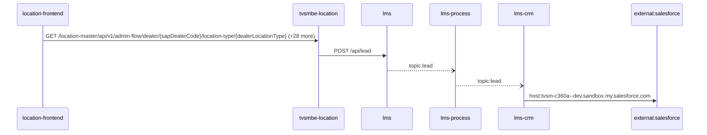

Steps:
| # | From | To | Via | Data (schema names) | Sync/Async | Confidence |
|---|---|---|---|---|---|---|
| 1 | location-frontend | tvsmbe-location | GET /location-master/api/v1/admin-flow/dealer/{sapDealerCode}/location-type/{dealerLocationType}, GET /location-master/api/v1/admin-flow/rejection-comments, GET /location-master/api/v1/admin-flow/summary (+26 more) | CreateDealerRequest, DealerListRequest, DealerResponse, DealerSearchFilterRequest, DealerSearchRequest (+8 more) | sync | high |
| 2 | tvsmbe-location | lms | POST /api/lead | LeadRequestModel | sync | medium |
| 3 | lms | lms-process | topic:lead | Unknown | async | medium |
| 4 | lms-process | lms-crm | topic:lead | Unknown | async | medium |
| 5 | lms-crm | external:salesforce | host:tvsm-c360a--dev.sandbox.my.salesforce.com | Unknown | sync | high |

Data touched: tvsmbe-location: mongo, mysql; lms: mssql, mssql:icubemobappsqlstg.database.windows.net:tazlmssqldbdev01; lms-process: mssql; lms-crm: mssql

Failure points: hop 1 location-frontend → tvsmbe-location: criticality hard; hop 2 tvsmbe-location → lms: criticality hard; hop 3 lms → lms-process: criticality async; hop 4 lms-process → lms-crm: criticality async; hop 5 lms-crm → external:salesforce: criticality hard

Evidence:
- hop 1 (location-frontend → tvsmbe-location): `location-frontend/src/services/DealerDetailsService.ts:38`, `tvsmbe-location/src/main/java/com/tvsmotor/location_master/controller/AdminFlowController.java:28`, `location-frontend/src/services/DealerDetailsService.ts:69` (+42 more)
- hop 2 (tvsmbe-location → lms): `lms/leadLogs/Controllers/LeadAcquisitionController.cs:61`, `tvsmbe-location/src/main/java/com/tvsmotor/location_master/service/LeadService.java:58`, `tvsmbe-location/src/main/java/com/tvsmotor/location_master/utils/OkHttpUtil.java:54`
- hop 3 (lms → lms-process): `lms/leadLogs/Services/LeadDispatchService.cs:21`, `lms_process/processLeadService/Const/Constants.cs:10`, `lms_process/processLeadService/ListenerService/QueueConsumer.cs:36`
- hop 4 (lms-process → lms-crm): `lms_crm/ListenerService/CrmListenerService.cs:44`, `lms_crm/Utils/Constants.cs:16`, `lms_process/processLeadService/Const/Constants.cs:6` (+1 more)
- hop 5 (lms-crm → external:salesforce): `lms_crm/appsettings.Development.json:16`, `lms_crm/appsettings.Production.json:17`, `lms_crm/appsettings.Uat.json:17`

## Flow: location-frontend--lms-crm-0d4513
Summary: Starting at `location-frontend` (user action in location-frontend (frontend)), the flow passes through `tvsmbe-location`, `lms`, `lms-ems`, `lms-process` and ends at `lms-crm`, using 2 sync HTTP hop(s) and 3 async event hop(s); lms role: participant; confidence medium; truncated at the depth cap.


Steps:
| # | From | To | Via | Data (schema names) | Sync/Async | Confidence |
|---|---|---|---|---|---|---|
| 1 | location-frontend | tvsmbe-location | GET /location-master/api/v1/admin-flow/dealer/{sapDealerCode}/location-type/{dealerLocationType}, GET /location-master/api/v1/admin-flow/rejection-comments, GET /location-master/api/v1/admin-flow/summary (+26 more) | CreateDealerRequest, DealerListRequest, DealerResponse, DealerSearchFilterRequest, DealerSearchRequest (+8 more) | sync | high |
| 2 | tvsmbe-location | lms | POST /api/lead | LeadRequestModel | sync | medium |
| 3 | lms | lms-ems | topic:lead | Unknown | async | medium |
| 4 | lms-ems | lms-process | topic:lead | Unknown | async | medium |
| 5 | lms-process | lms-crm | topic:lead | Unknown | async | medium |

Data touched: tvsmbe-location: mongo, mysql; lms: mssql, mssql:icubemobappsqlstg.database.windows.net:tazlmssqldbdev01; lms-ems: mssql; lms-process: mssql; lms-crm: mssql

Failure points: hop 1 location-frontend → tvsmbe-location: criticality hard; hop 2 tvsmbe-location → lms: criticality hard; hop 3 lms → lms-ems: criticality async; hop 4 lms-ems → lms-process: criticality async; hop 5 lms-process → lms-crm: criticality async

Evidence:
- hop 1 (location-frontend → tvsmbe-location): `location-frontend/src/services/DealerDetailsService.ts:38`, `tvsmbe-location/src/main/java/com/tvsmotor/location_master/controller/AdminFlowController.java:28`, `location-frontend/src/services/DealerDetailsService.ts:69` (+42 more)
- hop 2 (tvsmbe-location → lms): `lms/leadLogs/Controllers/LeadAcquisitionController.cs:61`, `tvsmbe-location/src/main/java/com/tvsmotor/location_master/service/LeadService.java:58`, `tvsmbe-location/src/main/java/com/tvsmotor/location_master/utils/OkHttpUtil.java:54`
- hop 3 (lms → lms-ems): `lms/leadLogs/Services/LeadDispatchService.cs:21`, `lms_ems/emsService/Const/Constants.cs:14`, `lms_ems/emsService/ListenerService/EmsListenerService.cs:43`
- hop 4 (lms-ems → lms-process): `lms_ems/emsService/Const/Constants.cs:13`, `lms_ems/emsService/Services/EmsService.cs:191`, `lms_process/processLeadService/Const/Constants.cs:10` (+1 more)
- hop 5 (lms-process → lms-crm): `lms_crm/ListenerService/CrmListenerService.cs:44`, `lms_crm/Utils/Constants.cs:16`, `lms_process/processLeadService/Const/Constants.cs:6` (+1 more)

## Flow: location-frontend--lms-crm-919670
Summary: Starting at `location-frontend` (user action in location-frontend (frontend)), the flow passes through `tvsmbe-location`, `lms`, `lms-process`, `lms-ems` and ends at `lms-crm`, using 2 sync HTTP hop(s) and 3 async event hop(s); lms role: participant; confidence medium; truncated at the depth cap.

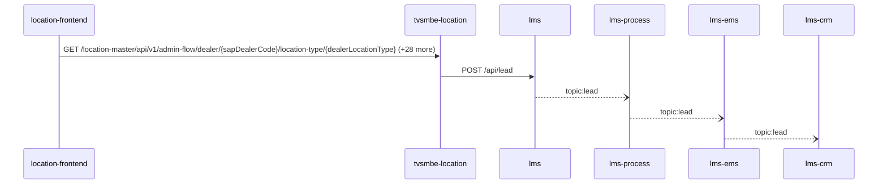

Steps:
| # | From | To | Via | Data (schema names) | Sync/Async | Confidence |
|---|---|---|---|---|---|---|
| 1 | location-frontend | tvsmbe-location | GET /location-master/api/v1/admin-flow/dealer/{sapDealerCode}/location-type/{dealerLocationType}, GET /location-master/api/v1/admin-flow/rejection-comments, GET /location-master/api/v1/admin-flow/summary (+26 more) | CreateDealerRequest, DealerListRequest, DealerResponse, DealerSearchFilterRequest, DealerSearchRequest (+8 more) | sync | high |
| 2 | tvsmbe-location | lms | POST /api/lead | LeadRequestModel | sync | medium |
| 3 | lms | lms-process | topic:lead | Unknown | async | medium |
| 4 | lms-process | lms-ems | topic:lead | Unknown | async | medium |
| 5 | lms-ems | lms-crm | topic:lead | Unknown | async | medium |

Data touched: tvsmbe-location: mongo, mysql; lms: mssql, mssql:icubemobappsqlstg.database.windows.net:tazlmssqldbdev01; lms-process: mssql; lms-ems: mssql; lms-crm: mssql

Failure points: hop 1 location-frontend → tvsmbe-location: criticality hard; hop 2 tvsmbe-location → lms: criticality hard; hop 3 lms → lms-process: criticality async; hop 4 lms-process → lms-ems: criticality async; hop 5 lms-ems → lms-crm: criticality async

Evidence:
- hop 1 (location-frontend → tvsmbe-location): `location-frontend/src/services/DealerDetailsService.ts:38`, `tvsmbe-location/src/main/java/com/tvsmotor/location_master/controller/AdminFlowController.java:28`, `location-frontend/src/services/DealerDetailsService.ts:69` (+42 more)
- hop 2 (tvsmbe-location → lms): `lms/leadLogs/Controllers/LeadAcquisitionController.cs:61`, `tvsmbe-location/src/main/java/com/tvsmotor/location_master/service/LeadService.java:58`, `tvsmbe-location/src/main/java/com/tvsmotor/location_master/utils/OkHttpUtil.java:54`
- hop 3 (lms → lms-process): `lms/leadLogs/Services/LeadDispatchService.cs:21`, `lms_process/processLeadService/Const/Constants.cs:10`, `lms_process/processLeadService/ListenerService/QueueConsumer.cs:36`
- hop 4 (lms-process → lms-ems): `lms_ems/emsService/Const/Constants.cs:14`, `lms_ems/emsService/ListenerService/EmsListenerService.cs:43`, `lms_process/processLeadService/Const/Constants.cs:6` (+1 more)
- hop 5 (lms-ems → lms-crm): `lms_crm/ListenerService/CrmListenerService.cs:44`, `lms_crm/Utils/Constants.cs:16`, `lms_ems/emsService/Const/Constants.cs:13` (+1 more)

## Flow: location-frontend--lms-tvs-credit-3059e3
Summary: Starting at `location-frontend` (user action in location-frontend (frontend)), the flow passes through `tvsmbe-location`, `lms`, `lms-process`, `lms-ems` and ends at `lms-tvs-credit`, using 2 sync HTTP hop(s) and 3 async event hop(s); lms role: participant; confidence medium.

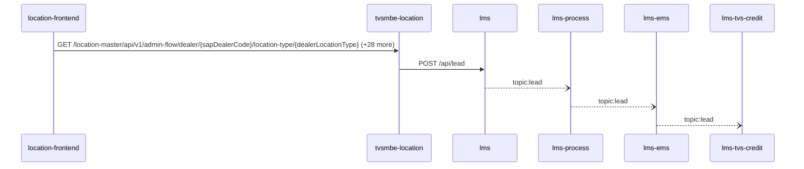

Steps:
| # | From | To | Via | Data (schema names) | Sync/Async | Confidence |
|---|---|---|---|---|---|---|
| 1 | location-frontend | tvsmbe-location | GET /location-master/api/v1/admin-flow/dealer/{sapDealerCode}/location-type/{dealerLocationType}, GET /location-master/api/v1/admin-flow/rejection-comments, GET /location-master/api/v1/admin-flow/summary (+26 more) | CreateDealerRequest, DealerListRequest, DealerResponse, DealerSearchFilterRequest, DealerSearchRequest (+8 more) | sync | high |
| 2 | tvsmbe-location | lms | POST /api/lead | LeadRequestModel | sync | medium |
| 3 | lms | lms-process | topic:lead | Unknown | async | medium |
| 4 | lms-process | lms-ems | topic:lead | Unknown | async | medium |
| 5 | lms-ems | lms-tvs-credit | topic:lead | Unknown | async | medium |

Data touched: tvsmbe-location: mongo, mysql; lms: mssql, mssql:icubemobappsqlstg.database.windows.net:tazlmssqldbdev01; lms-process: mssql; lms-ems: mssql; lms-tvs-credit: mssql

Failure points: hop 1 location-frontend → tvsmbe-location: criticality hard; hop 2 tvsmbe-location → lms: criticality hard; hop 3 lms → lms-process: criticality async; hop 4 lms-process → lms-ems: criticality async; hop 5 lms-ems → lms-tvs-credit: criticality async

Evidence:
- hop 1 (location-frontend → tvsmbe-location): `location-frontend/src/services/DealerDetailsService.ts:38`, `tvsmbe-location/src/main/java/com/tvsmotor/location_master/controller/AdminFlowController.java:28`, `location-frontend/src/services/DealerDetailsService.ts:69` (+42 more)
- hop 2 (tvsmbe-location → lms): `lms/leadLogs/Controllers/LeadAcquisitionController.cs:61`, `tvsmbe-location/src/main/java/com/tvsmotor/location_master/service/LeadService.java:58`, `tvsmbe-location/src/main/java/com/tvsmotor/location_master/utils/OkHttpUtil.java:54`
- hop 3 (lms → lms-process): `lms/leadLogs/Services/LeadDispatchService.cs:21`, `lms_process/processLeadService/Const/Constants.cs:10`, `lms_process/processLeadService/ListenerService/QueueConsumer.cs:36`
- hop 4 (lms-process → lms-ems): `lms_ems/emsService/Const/Constants.cs:14`, `lms_ems/emsService/ListenerService/EmsListenerService.cs:43`, `lms_process/processLeadService/Const/Constants.cs:6` (+1 more)
- hop 5 (lms-ems → lms-tvs-credit): `lms_ems/emsService/Const/Constants.cs:13`, `lms_ems/emsService/Services/EmsService.cs:191`, `lms_tvs_credit/lms_tvs_credit/ListenerService/TvscreditListenerService.cs:46` (+1 more)

## Flow: location-frontend--lms-tvs-credit-8e8dc7
Summary: Starting at `location-frontend` (user action in location-frontend (frontend)), the flow passes through `tvsmbe-location`, `lms`, `lms-ems`, `lms-process` and ends at `lms-tvs-credit`, using 2 sync HTTP hop(s) and 3 async event hop(s); lms role: participant; confidence medium.

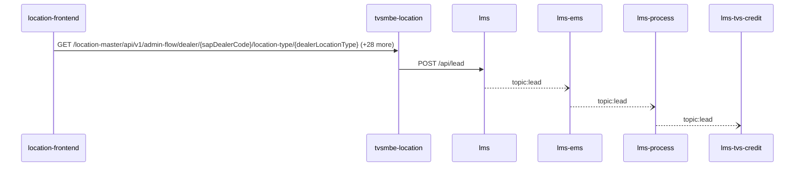

Steps:
| # | From | To | Via | Data (schema names) | Sync/Async | Confidence |
|---|---|---|---|---|---|---|
| 1 | location-frontend | tvsmbe-location | GET /location-master/api/v1/admin-flow/dealer/{sapDealerCode}/location-type/{dealerLocationType}, GET /location-master/api/v1/admin-flow/rejection-comments, GET /location-master/api/v1/admin-flow/summary (+26 more) | CreateDealerRequest, DealerListRequest, DealerResponse, DealerSearchFilterRequest, DealerSearchRequest (+8 more) | sync | high |
| 2 | tvsmbe-location | lms | POST /api/lead | LeadRequestModel | sync | medium |
| 3 | lms | lms-ems | topic:lead | Unknown | async | medium |
| 4 | lms-ems | lms-process | topic:lead | Unknown | async | medium |
| 5 | lms-process | lms-tvs-credit | topic:lead | Unknown | async | medium |

Data touched: tvsmbe-location: mongo, mysql; lms: mssql, mssql:icubemobappsqlstg.database.windows.net:tazlmssqldbdev01; lms-ems: mssql; lms-process: mssql; lms-tvs-credit: mssql

Failure points: hop 1 location-frontend → tvsmbe-location: criticality hard; hop 2 tvsmbe-location → lms: criticality hard; hop 3 lms → lms-ems: criticality async; hop 4 lms-ems → lms-process: criticality async; hop 5 lms-process → lms-tvs-credit: criticality async

Evidence:
- hop 1 (location-frontend → tvsmbe-location): `location-frontend/src/services/DealerDetailsService.ts:38`, `tvsmbe-location/src/main/java/com/tvsmotor/location_master/controller/AdminFlowController.java:28`, `location-frontend/src/services/DealerDetailsService.ts:69` (+42 more)
- hop 2 (tvsmbe-location → lms): `lms/leadLogs/Controllers/LeadAcquisitionController.cs:61`, `tvsmbe-location/src/main/java/com/tvsmotor/location_master/service/LeadService.java:58`, `tvsmbe-location/src/main/java/com/tvsmotor/location_master/utils/OkHttpUtil.java:54`
- hop 3 (lms → lms-ems): `lms/leadLogs/Services/LeadDispatchService.cs:21`, `lms_ems/emsService/Const/Constants.cs:14`, `lms_ems/emsService/ListenerService/EmsListenerService.cs:43`
- hop 4 (lms-ems → lms-process): `lms_ems/emsService/Const/Constants.cs:13`, `lms_ems/emsService/Services/EmsService.cs:191`, `lms_process/processLeadService/Const/Constants.cs:10` (+1 more)
- hop 5 (lms-process → lms-tvs-credit): `lms_process/processLeadService/Const/Constants.cs:6`, `lms_process/processLeadService/Services/TwoWheelerService.cs:97`, `lms_tvs_credit/lms_tvs_credit/ListenerService/TvscreditListenerService.cs:46` (+1 more)

## Flow: tvs-cps-backend--external-salesforce-4e791f
Summary: Starting at `tvs-cps-backend` (scheduled job(s) in tvs-cps-backend (job-to-call link not resolved): JobScheduler.loadCatalogData, JobScheduler.retrieveMDPDealers, JobScheduler.retrieveMerchandiseStock (+2 more)), the flow passes through `lms`, `lms-process`, `lms-ems`, `lms-crm` and ends at `external:salesforce`, using 2 sync HTTP hop(s) and 3 async event hop(s); lms role: participant; confidence medium.

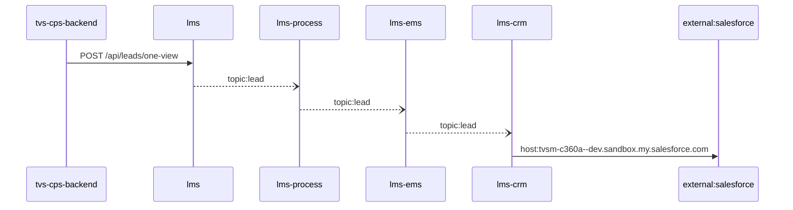

Steps:
| # | From | To | Via | Data (schema names) | Sync/Async | Confidence |
|---|---|---|---|---|---|---|
| 1 | tvs-cps-backend | lms | POST /api/leads/one-view | LeadOneViewRequest | sync | medium |
| 2 | lms | lms-process | topic:lead | Unknown | async | medium |
| 3 | lms-process | lms-ems | topic:lead | Unknown | async | medium |
| 4 | lms-ems | lms-crm | topic:lead | Unknown | async | medium |
| 5 | lms-crm | external:salesforce | host:tvsm-c360a--dev.sandbox.my.salesforce.com | Unknown | sync | high |

Data touched: tvs-cps-backend: postgres, postgres:nmazcpsdbsdev01-cmn-postgres-uks.postgres.database.azure.com:nmazcpsdbdev01-cps; lms: mssql, mssql:icubemobappsqlstg.database.windows.net:tazlmssqldbdev01; lms-process: mssql; lms-ems: mssql; lms-crm: mssql

Failure points: hop 1 tvs-cps-backend → lms: criticality hard; hop 2 lms → lms-process: criticality async; hop 3 lms-process → lms-ems: criticality async; hop 4 lms-ems → lms-crm: criticality async; hop 5 lms-crm → external:salesforce: criticality hard

Evidence:
- hop 1 (tvs-cps-backend → lms): `TVS-CPS-BACKEND/bff-service/src/main/java/com/tvsm/bff/client/ServiceReminderClient.java:209`, `lms/leadLogs/Controllers/LeadGetController.cs:90`
- hop 2 (lms → lms-process): `lms/leadLogs/Services/LeadDispatchService.cs:21`, `lms_process/processLeadService/Const/Constants.cs:10`, `lms_process/processLeadService/ListenerService/QueueConsumer.cs:36`
- hop 3 (lms-process → lms-ems): `lms_ems/emsService/Const/Constants.cs:14`, `lms_ems/emsService/ListenerService/EmsListenerService.cs:43`, `lms_process/processLeadService/Const/Constants.cs:6` (+1 more)
- hop 4 (lms-ems → lms-crm): `lms_crm/ListenerService/CrmListenerService.cs:44`, `lms_crm/Utils/Constants.cs:16`, `lms_ems/emsService/Const/Constants.cs:13` (+1 more)
- hop 5 (lms-crm → external:salesforce): `lms_crm/appsettings.Development.json:16`, `lms_crm/appsettings.Production.json:17`, `lms_crm/appsettings.Uat.json:17`

## Flow: tvs-cps-backend--external-salesforce-5bee04
Summary: Starting at `tvs-cps-backend` (scheduled job(s) in tvs-cps-backend (job-to-call link not resolved): JobScheduler.loadCatalogData, JobScheduler.retrieveMDPDealers, JobScheduler.retrieveMerchandiseStock (+2 more)), the flow passes through `lms`, `lms-ems`, `lms-process`, `lms-crm` and ends at `external:salesforce`, using 2 sync HTTP hop(s) and 3 async event hop(s); lms role: participant; confidence medium.


Steps:
| # | From | To | Via | Data (schema names) | Sync/Async | Confidence |
|---|---|---|---|---|---|---|
| 1 | tvs-cps-backend | lms | POST /api/leads/one-view | LeadOneViewRequest | sync | medium |
| 2 | lms | lms-ems | topic:lead | Unknown | async | medium |
| 3 | lms-ems | lms-process | topic:lead | Unknown | async | medium |
| 4 | lms-process | lms-crm | topic:lead | Unknown | async | medium |
| 5 | lms-crm | external:salesforce | host:tvsm-c360a--dev.sandbox.my.salesforce.com | Unknown | sync | high |

Data touched: tvs-cps-backend: postgres, postgres:nmazcpsdbsdev01-cmn-postgres-uks.postgres.database.azure.com:nmazcpsdbdev01-cps; lms: mssql, mssql:icubemobappsqlstg.database.windows.net:tazlmssqldbdev01; lms-ems: mssql; lms-process: mssql; lms-crm: mssql

Failure points: hop 1 tvs-cps-backend → lms: criticality hard; hop 2 lms → lms-ems: criticality async; hop 3 lms-ems → lms-process: criticality async; hop 4 lms-process → lms-crm: criticality async; hop 5 lms-crm → external:salesforce: criticality hard

Evidence:
- hop 1 (tvs-cps-backend → lms): `TVS-CPS-BACKEND/bff-service/src/main/java/com/tvsm/bff/client/ServiceReminderClient.java:209`, `lms/leadLogs/Controllers/LeadGetController.cs:90`
- hop 2 (lms → lms-ems): `lms/leadLogs/Services/LeadDispatchService.cs:21`, `lms_ems/emsService/Const/Constants.cs:14`, `lms_ems/emsService/ListenerService/EmsListenerService.cs:43`
- hop 3 (lms-ems → lms-process): `lms_ems/emsService/Const/Constants.cs:13`, `lms_ems/emsService/Services/EmsService.cs:191`, `lms_process/processLeadService/Const/Constants.cs:10` (+1 more)
- hop 4 (lms-process → lms-crm): `lms_crm/ListenerService/CrmListenerService.cs:44`, `lms_crm/Utils/Constants.cs:16`, `lms_process/processLeadService/Const/Constants.cs:6` (+1 more)
- hop 5 (lms-crm → external:salesforce): `lms_crm/appsettings.Development.json:16`, `lms_crm/appsettings.Production.json:17`, `lms_crm/appsettings.Uat.json:17`

## Flow: tvs-cps-jobs--external-salesforce-62e84d
Summary: Starting at `tvs-cps-jobs` (scheduled job(s) in tvs-cps-jobs (job-to-call link not resolved): CronJobScheduler.allBookingsScheduler, CronJobScheduler.allEnquiriesScheduler, CronJobScheduler.availableStockScheduler (+27 more); request to tvs-cps-jobs from outside the registry (no internal caller)), the flow passes through `tvs-cps-backend`, `lms`, `lms-ems`, `lms-crm` and ends at `external:salesforce`, using 3 sync HTTP hop(s) and 2 async event hop(s); lms role: participant; confidence medium.


Steps:
| # | From | To | Via | Data (schema names) | Sync/Async | Confidence |
|---|---|---|---|---|---|---|
| 1 | tvs-cps-jobs | tvs-cps-backend | POST /system/api/v1/analytic/booking/stats, POST /system/api/v1/analytics-dashboard/indicators/calculate, POST /system/api/v1/appointments/auto-close (+1 more) | APIResponse<map<string,object>>, AnalyticsDto, AnalyticsRequestDTO | sync | high |
| 2 | tvs-cps-backend | lms | POST /api/leads/one-view | LeadOneViewRequest | sync | medium |
| 3 | lms | lms-ems | topic:lead | Unknown | async | medium |
| 4 | lms-ems | lms-crm | topic:lead | Unknown | async | medium |
| 5 | lms-crm | external:salesforce | host:tvsm-c360a--dev.sandbox.my.salesforce.com | Unknown | sync | high |

Data touched: tvs-cps-backend: postgres, postgres:nmazcpsdbsdev01-cmn-postgres-uks.postgres.database.azure.com:nmazcpsdbdev01-cps; lms: mssql, mssql:icubemobappsqlstg.database.windows.net:tazlmssqldbdev01; lms-ems: mssql; lms-crm: mssql

Failure points: hop 1 tvs-cps-jobs → tvs-cps-backend: criticality hard; hop 2 tvs-cps-backend → lms: criticality hard; hop 3 lms → lms-ems: criticality async; hop 4 lms-ems → lms-crm: criticality async; hop 5 lms-crm → external:salesforce: criticality hard

Evidence:
- hop 1 (tvs-cps-jobs → tvs-cps-backend): `TVS-CPS-BACKEND/bff-service/src/main/java/com/tvsm/bff/controller/AnalyticsController.java:23`, `TVS-CPS-JOBS/src/main/java/com/tvsm/jobs/service/AnalyticsService.java:32`, `TVS-CPS-JOBS/src/main/java/com/tvsm/jobs/service/RestCallService.java:50` (+4 more)
- hop 2 (tvs-cps-backend → lms): `TVS-CPS-BACKEND/bff-service/src/main/java/com/tvsm/bff/client/ServiceReminderClient.java:209`, `lms/leadLogs/Controllers/LeadGetController.cs:90`
- hop 3 (lms → lms-ems): `lms/leadLogs/Services/LeadDispatchService.cs:21`, `lms_ems/emsService/Const/Constants.cs:14`, `lms_ems/emsService/ListenerService/EmsListenerService.cs:43`
- hop 4 (lms-ems → lms-crm): `lms_crm/ListenerService/CrmListenerService.cs:44`, `lms_crm/Utils/Constants.cs:16`, `lms_ems/emsService/Const/Constants.cs:13` (+1 more)
- hop 5 (lms-crm → external:salesforce): `lms_crm/appsettings.Development.json:16`, `lms_crm/appsettings.Production.json:17`, `lms_crm/appsettings.Uat.json:17`

## Flow: tvs-cps-jobs--external-salesforce-cd1252
Summary: Starting at `tvs-cps-jobs` (scheduled job(s) in tvs-cps-jobs (job-to-call link not resolved): CronJobScheduler.allBookingsScheduler, CronJobScheduler.allEnquiriesScheduler, CronJobScheduler.availableStockScheduler (+27 more); request to tvs-cps-jobs from outside the registry (no internal caller)), the flow passes through `tvs-cps-backend`, `lms`, `lms-process`, `lms-crm` and ends at `external:salesforce`, using 3 sync HTTP hop(s) and 2 async event hop(s); lms role: participant; confidence medium.

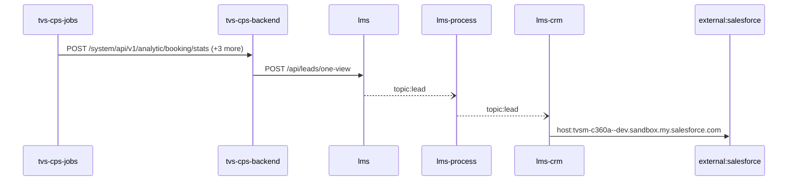

Steps:
| # | From | To | Via | Data (schema names) | Sync/Async | Confidence |
|---|---|---|---|---|---|---|
| 1 | tvs-cps-jobs | tvs-cps-backend | POST /system/api/v1/analytic/booking/stats, POST /system/api/v1/analytics-dashboard/indicators/calculate, POST /system/api/v1/appointments/auto-close (+1 more) | APIResponse<map<string,object>>, AnalyticsDto, AnalyticsRequestDTO | sync | high |
| 2 | tvs-cps-backend | lms | POST /api/leads/one-view | LeadOneViewRequest | sync | medium |
| 3 | lms | lms-process | topic:lead | Unknown | async | medium |
| 4 | lms-process | lms-crm | topic:lead | Unknown | async | medium |
| 5 | lms-crm | external:salesforce | host:tvsm-c360a--dev.sandbox.my.salesforce.com | Unknown | sync | high |

Data touched: tvs-cps-backend: postgres, postgres:nmazcpsdbsdev01-cmn-postgres-uks.postgres.database.azure.com:nmazcpsdbdev01-cps; lms: mssql, mssql:icubemobappsqlstg.database.windows.net:tazlmssqldbdev01; lms-process: mssql; lms-crm: mssql

Failure points: hop 1 tvs-cps-jobs → tvs-cps-backend: criticality hard; hop 2 tvs-cps-backend → lms: criticality hard; hop 3 lms → lms-process: criticality async; hop 4 lms-process → lms-crm: criticality async; hop 5 lms-crm → external:salesforce: criticality hard

Evidence:
- hop 1 (tvs-cps-jobs → tvs-cps-backend): `TVS-CPS-BACKEND/bff-service/src/main/java/com/tvsm/bff/controller/AnalyticsController.java:23`, `TVS-CPS-JOBS/src/main/java/com/tvsm/jobs/service/AnalyticsService.java:32`, `TVS-CPS-JOBS/src/main/java/com/tvsm/jobs/service/RestCallService.java:50` (+4 more)
- hop 2 (tvs-cps-backend → lms): `TVS-CPS-BACKEND/bff-service/src/main/java/com/tvsm/bff/client/ServiceReminderClient.java:209`, `lms/leadLogs/Controllers/LeadGetController.cs:90`
- hop 3 (lms → lms-process): `lms/leadLogs/Services/LeadDispatchService.cs:21`, `lms_process/processLeadService/Const/Constants.cs:10`, `lms_process/processLeadService/ListenerService/QueueConsumer.cs:36`
- hop 4 (lms-process → lms-crm): `lms_crm/ListenerService/CrmListenerService.cs:44`, `lms_crm/Utils/Constants.cs:16`, `lms_process/processLeadService/Const/Constants.cs:6` (+1 more)
- hop 5 (lms-crm → external:salesforce): `lms_crm/appsettings.Development.json:16`, `lms_crm/appsettings.Production.json:17`, `lms_crm/appsettings.Uat.json:17`

## Flow: tvs-cps-jobs--lms-crm-735e1f
Summary: Starting at `tvs-cps-jobs` (scheduled job(s) in tvs-cps-jobs (job-to-call link not resolved): CronJobScheduler.allBookingsScheduler, CronJobScheduler.allEnquiriesScheduler, CronJobScheduler.availableStockScheduler (+27 more); request to tvs-cps-jobs from outside the registry (no internal caller)), the flow passes through `tvs-cps-backend`, `lms`, `lms-process`, `lms-ems` and ends at `lms-crm`, using 2 sync HTTP hop(s) and 3 async event hop(s); lms role: participant; confidence medium; truncated at the depth cap.


Steps:
| # | From | To | Via | Data (schema names) | Sync/Async | Confidence |
|---|---|---|---|---|---|---|
| 1 | tvs-cps-jobs | tvs-cps-backend | POST /system/api/v1/analytic/booking/stats, POST /system/api/v1/analytics-dashboard/indicators/calculate, POST /system/api/v1/appointments/auto-close (+1 more) | APIResponse<map<string,object>>, AnalyticsDto, AnalyticsRequestDTO | sync | high |
| 2 | tvs-cps-backend | lms | POST /api/leads/one-view | LeadOneViewRequest | sync | medium |
| 3 | lms | lms-process | topic:lead | Unknown | async | medium |
| 4 | lms-process | lms-ems | topic:lead | Unknown | async | medium |
| 5 | lms-ems | lms-crm | topic:lead | Unknown | async | medium |

Data touched: tvs-cps-backend: postgres, postgres:nmazcpsdbsdev01-cmn-postgres-uks.postgres.database.azure.com:nmazcpsdbdev01-cps; lms: mssql, mssql:icubemobappsqlstg.database.windows.net:tazlmssqldbdev01; lms-process: mssql; lms-ems: mssql; lms-crm: mssql

Failure points: hop 1 tvs-cps-jobs → tvs-cps-backend: criticality hard; hop 2 tvs-cps-backend → lms: criticality hard; hop 3 lms → lms-process: criticality async; hop 4 lms-process → lms-ems: criticality async; hop 5 lms-ems → lms-crm: criticality async

Evidence:
- hop 1 (tvs-cps-jobs → tvs-cps-backend): `TVS-CPS-BACKEND/bff-service/src/main/java/com/tvsm/bff/controller/AnalyticsController.java:23`, `TVS-CPS-JOBS/src/main/java/com/tvsm/jobs/service/AnalyticsService.java:32`, `TVS-CPS-JOBS/src/main/java/com/tvsm/jobs/service/RestCallService.java:50` (+4 more)
- hop 2 (tvs-cps-backend → lms): `TVS-CPS-BACKEND/bff-service/src/main/java/com/tvsm/bff/client/ServiceReminderClient.java:209`, `lms/leadLogs/Controllers/LeadGetController.cs:90`
- hop 3 (lms → lms-process): `lms/leadLogs/Services/LeadDispatchService.cs:21`, `lms_process/processLeadService/Const/Constants.cs:10`, `lms_process/processLeadService/ListenerService/QueueConsumer.cs:36`
- hop 4 (lms-process → lms-ems): `lms_ems/emsService/Const/Constants.cs:14`, `lms_ems/emsService/ListenerService/EmsListenerService.cs:43`, `lms_process/processLeadService/Const/Constants.cs:6` (+1 more)
- hop 5 (lms-ems → lms-crm): `lms_crm/ListenerService/CrmListenerService.cs:44`, `lms_crm/Utils/Constants.cs:16`, `lms_ems/emsService/Const/Constants.cs:13` (+1 more)

## Flow: tvs-cps-jobs--lms-crm-80b689
Summary: Starting at `tvs-cps-jobs` (scheduled job(s) in tvs-cps-jobs (job-to-call link not resolved): CronJobScheduler.allBookingsScheduler, CronJobScheduler.allEnquiriesScheduler, CronJobScheduler.availableStockScheduler (+27 more); request to tvs-cps-jobs from outside the registry (no internal caller)), the flow passes through `tvs-cps-backend`, `lms`, `lms-ems`, `lms-process` and ends at `lms-crm`, using 2 sync HTTP hop(s) and 3 async event hop(s); lms role: participant; confidence medium; truncated at the depth cap.

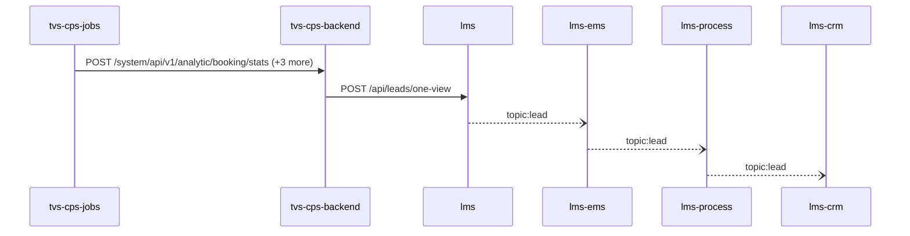

Steps:
| # | From | To | Via | Data (schema names) | Sync/Async | Confidence |
|---|---|---|---|---|---|---|
| 1 | tvs-cps-jobs | tvs-cps-backend | POST /system/api/v1/analytic/booking/stats, POST /system/api/v1/analytics-dashboard/indicators/calculate, POST /system/api/v1/appointments/auto-close (+1 more) | APIResponse<map<string,object>>, AnalyticsDto, AnalyticsRequestDTO | sync | high |
| 2 | tvs-cps-backend | lms | POST /api/leads/one-view | LeadOneViewRequest | sync | medium |
| 3 | lms | lms-ems | topic:lead | Unknown | async | medium |
| 4 | lms-ems | lms-process | topic:lead | Unknown | async | medium |
| 5 | lms-process | lms-crm | topic:lead | Unknown | async | medium |

Data touched: tvs-cps-backend: postgres, postgres:nmazcpsdbsdev01-cmn-postgres-uks.postgres.database.azure.com:nmazcpsdbdev01-cps; lms: mssql, mssql:icubemobappsqlstg.database.windows.net:tazlmssqldbdev01; lms-ems: mssql; lms-process: mssql; lms-crm: mssql

Failure points: hop 1 tvs-cps-jobs → tvs-cps-backend: criticality hard; hop 2 tvs-cps-backend → lms: criticality hard; hop 3 lms → lms-ems: criticality async; hop 4 lms-ems → lms-process: criticality async; hop 5 lms-process → lms-crm: criticality async

Evidence:
- hop 1 (tvs-cps-jobs → tvs-cps-backend): `TVS-CPS-BACKEND/bff-service/src/main/java/com/tvsm/bff/controller/AnalyticsController.java:23`, `TVS-CPS-JOBS/src/main/java/com/tvsm/jobs/service/AnalyticsService.java:32`, `TVS-CPS-JOBS/src/main/java/com/tvsm/jobs/service/RestCallService.java:50` (+4 more)
- hop 2 (tvs-cps-backend → lms): `TVS-CPS-BACKEND/bff-service/src/main/java/com/tvsm/bff/client/ServiceReminderClient.java:209`, `lms/leadLogs/Controllers/LeadGetController.cs:90`
- hop 3 (lms → lms-ems): `lms/leadLogs/Services/LeadDispatchService.cs:21`, `lms_ems/emsService/Const/Constants.cs:14`, `lms_ems/emsService/ListenerService/EmsListenerService.cs:43`
- hop 4 (lms-ems → lms-process): `lms_ems/emsService/Const/Constants.cs:13`, `lms_ems/emsService/Services/EmsService.cs:191`, `lms_process/processLeadService/Const/Constants.cs:10` (+1 more)
- hop 5 (lms-process → lms-crm): `lms_crm/ListenerService/CrmListenerService.cs:44`, `lms_crm/Utils/Constants.cs:16`, `lms_process/processLeadService/Const/Constants.cs:6` (+1 more)

## Flow: tvs-cps-jobs--lms-tvs-credit-ce3ec7
Summary: Starting at `tvs-cps-jobs` (scheduled job(s) in tvs-cps-jobs (job-to-call link not resolved): CronJobScheduler.allBookingsScheduler, CronJobScheduler.allEnquiriesScheduler, CronJobScheduler.availableStockScheduler (+27 more); request to tvs-cps-jobs from outside the registry (no internal caller)), the flow passes through `tvs-cps-backend`, `lms`, `lms-ems`, `lms-process` and ends at `lms-tvs-credit`, using 2 sync HTTP hop(s) and 3 async event hop(s); lms role: participant; confidence medium.


Steps:
| # | From | To | Via | Data (schema names) | Sync/Async | Confidence |
|---|---|---|---|---|---|---|
| 1 | tvs-cps-jobs | tvs-cps-backend | POST /system/api/v1/analytic/booking/stats, POST /system/api/v1/analytics-dashboard/indicators/calculate, POST /system/api/v1/appointments/auto-close (+1 more) | APIResponse<map<string,object>>, AnalyticsDto, AnalyticsRequestDTO | sync | high |
| 2 | tvs-cps-backend | lms | POST /api/leads/one-view | LeadOneViewRequest | sync | medium |
| 3 | lms | lms-ems | topic:lead | Unknown | async | medium |
| 4 | lms-ems | lms-process | topic:lead | Unknown | async | medium |
| 5 | lms-process | lms-tvs-credit | topic:lead | Unknown | async | medium |

Data touched: tvs-cps-backend: postgres, postgres:nmazcpsdbsdev01-cmn-postgres-uks.postgres.database.azure.com:nmazcpsdbdev01-cps; lms: mssql, mssql:icubemobappsqlstg.database.windows.net:tazlmssqldbdev01; lms-ems: mssql; lms-process: mssql; lms-tvs-credit: mssql

Failure points: hop 1 tvs-cps-jobs → tvs-cps-backend: criticality hard; hop 2 tvs-cps-backend → lms: criticality hard; hop 3 lms → lms-ems: criticality async; hop 4 lms-ems → lms-process: criticality async; hop 5 lms-process → lms-tvs-credit: criticality async

Evidence:
- hop 1 (tvs-cps-jobs → tvs-cps-backend): `TVS-CPS-BACKEND/bff-service/src/main/java/com/tvsm/bff/controller/AnalyticsController.java:23`, `TVS-CPS-JOBS/src/main/java/com/tvsm/jobs/service/AnalyticsService.java:32`, `TVS-CPS-JOBS/src/main/java/com/tvsm/jobs/service/RestCallService.java:50` (+4 more)
- hop 2 (tvs-cps-backend → lms): `TVS-CPS-BACKEND/bff-service/src/main/java/com/tvsm/bff/client/ServiceReminderClient.java:209`, `lms/leadLogs/Controllers/LeadGetController.cs:90`
- hop 3 (lms → lms-ems): `lms/leadLogs/Services/LeadDispatchService.cs:21`, `lms_ems/emsService/Const/Constants.cs:14`, `lms_ems/emsService/ListenerService/EmsListenerService.cs:43`
- hop 4 (lms-ems → lms-process): `lms_ems/emsService/Const/Constants.cs:13`, `lms_ems/emsService/Services/EmsService.cs:191`, `lms_process/processLeadService/Const/Constants.cs:10` (+1 more)
- hop 5 (lms-process → lms-tvs-credit): `lms_process/processLeadService/Const/Constants.cs:6`, `lms_process/processLeadService/Services/TwoWheelerService.cs:97`, `lms_tvs_credit/lms_tvs_credit/ListenerService/TvscreditListenerService.cs:46` (+1 more)

## Flow: tvs-cps-jobs--lms-tvs-credit-e20095
Summary: Starting at `tvs-cps-jobs` (scheduled job(s) in tvs-cps-jobs (job-to-call link not resolved): CronJobScheduler.allBookingsScheduler, CronJobScheduler.allEnquiriesScheduler, CronJobScheduler.availableStockScheduler (+27 more); request to tvs-cps-jobs from outside the registry (no internal caller)), the flow passes through `tvs-cps-backend`, `lms`, `lms-process`, `lms-ems` and ends at `lms-tvs-credit`, using 2 sync HTTP hop(s) and 3 async event hop(s); lms role: participant; confidence medium.

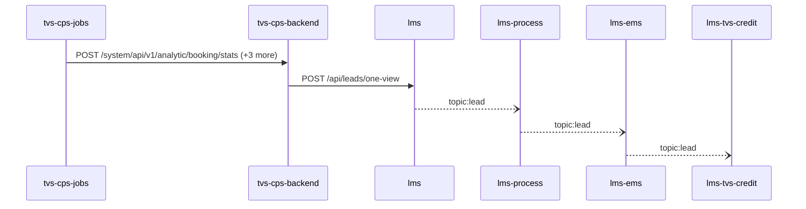

Steps:
| # | From | To | Via | Data (schema names) | Sync/Async | Confidence |
|---|---|---|---|---|---|---|
| 1 | tvs-cps-jobs | tvs-cps-backend | POST /system/api/v1/analytic/booking/stats, POST /system/api/v1/analytics-dashboard/indicators/calculate, POST /system/api/v1/appointments/auto-close (+1 more) | APIResponse<map<string,object>>, AnalyticsDto, AnalyticsRequestDTO | sync | high |
| 2 | tvs-cps-backend | lms | POST /api/leads/one-view | LeadOneViewRequest | sync | medium |
| 3 | lms | lms-process | topic:lead | Unknown | async | medium |
| 4 | lms-process | lms-ems | topic:lead | Unknown | async | medium |
| 5 | lms-ems | lms-tvs-credit | topic:lead | Unknown | async | medium |

Data touched: tvs-cps-backend: postgres, postgres:nmazcpsdbsdev01-cmn-postgres-uks.postgres.database.azure.com:nmazcpsdbdev01-cps; lms: mssql, mssql:icubemobappsqlstg.database.windows.net:tazlmssqldbdev01; lms-process: mssql; lms-ems: mssql; lms-tvs-credit: mssql

Failure points: hop 1 tvs-cps-jobs → tvs-cps-backend: criticality hard; hop 2 tvs-cps-backend → lms: criticality hard; hop 3 lms → lms-process: criticality async; hop 4 lms-process → lms-ems: criticality async; hop 5 lms-ems → lms-tvs-credit: criticality async

Evidence:
- hop 1 (tvs-cps-jobs → tvs-cps-backend): `TVS-CPS-BACKEND/bff-service/src/main/java/com/tvsm/bff/controller/AnalyticsController.java:23`, `TVS-CPS-JOBS/src/main/java/com/tvsm/jobs/service/AnalyticsService.java:32`, `TVS-CPS-JOBS/src/main/java/com/tvsm/jobs/service/RestCallService.java:50` (+4 more)
- hop 2 (tvs-cps-backend → lms): `TVS-CPS-BACKEND/bff-service/src/main/java/com/tvsm/bff/client/ServiceReminderClient.java:209`, `lms/leadLogs/Controllers/LeadGetController.cs:90`
- hop 3 (lms → lms-process): `lms/leadLogs/Services/LeadDispatchService.cs:21`, `lms_process/processLeadService/Const/Constants.cs:10`, `lms_process/processLeadService/ListenerService/QueueConsumer.cs:36`
- hop 4 (lms-process → lms-ems): `lms_ems/emsService/Const/Constants.cs:14`, `lms_ems/emsService/ListenerService/EmsListenerService.cs:43`, `lms_process/processLeadService/Const/Constants.cs:6` (+1 more)
- hop 5 (lms-ems → lms-tvs-credit): `lms_ems/emsService/Const/Constants.cs:13`, `lms_ems/emsService/Services/EmsService.cs:191`, `lms_tvs_credit/lms_tvs_credit/ListenerService/TvscreditListenerService.cs:46` (+1 more)

## Flow: tvs-cps-portal--external-salesforce-59d84e
Summary: Starting at `tvs-cps-portal` (user action in tvs-cps-portal (frontend)), the flow passes through `tvs-cps-backend`, `lms`, `lms-process`, `lms-crm` and ends at `external:salesforce`, using 3 sync HTTP hop(s) and 2 async event hop(s); lms role: participant; confidence medium.

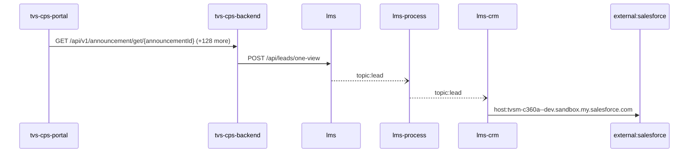

Steps:
| # | From | To | Via | Data (schema names) | Sync/Async | Confidence |
|---|---|---|---|---|---|---|
| 1 | tvs-cps-portal | tvs-cps-backend | GET /api/v1/announcement/get/{announcementId}, GET /api/v1/announcement/user/banners, GET /api/v1/appointments/{appointmentId} (+126 more) | APIResponse<AnnouncementResponseDto>, APIResponse<AnnouncementResponseDto[]>, APIResponse<AppointmentCountResponseDTO>, APIResponse<AppointmentDashboardResponseDTO>, APIResponse<AppointmentDetailResponseDTO> (+105 more) | sync | medium |
| 2 | tvs-cps-backend | lms | POST /api/leads/one-view | LeadOneViewRequest | sync | medium |
| 3 | lms | lms-process | topic:lead | Unknown | async | medium |
| 4 | lms-process | lms-crm | topic:lead | Unknown | async | medium |
| 5 | lms-crm | external:salesforce | host:tvsm-c360a--dev.sandbox.my.salesforce.com | Unknown | sync | high |

Data touched: tvs-cps-backend: postgres, postgres:nmazcpsdbsdev01-cmn-postgres-uks.postgres.database.azure.com:nmazcpsdbdev01-cps; lms: mssql, mssql:icubemobappsqlstg.database.windows.net:tazlmssqldbdev01; lms-process: mssql; lms-crm: mssql

Failure points: hop 1 tvs-cps-portal → tvs-cps-backend: criticality hard; hop 2 tvs-cps-backend → lms: criticality hard; hop 3 lms → lms-process: criticality async; hop 4 lms-process → lms-crm: criticality async; hop 5 lms-crm → external:salesforce: criticality hard

Evidence:
- hop 1 (tvs-cps-portal → tvs-cps-backend): `TVS-CPS-BACKEND/announcement-service/src/main/java/com/tvsm/announcement/controller/AnnouncementController.java:31`, `TVS-CPS-PORTAL/channel-partner-system/src/services/notification.service.ts:140`, `TVS-CPS-PORTAL/channel-partner-system/src/services/notification.service.ts:144` (+194 more)
- hop 2 (tvs-cps-backend → lms): `TVS-CPS-BACKEND/bff-service/src/main/java/com/tvsm/bff/client/ServiceReminderClient.java:209`, `lms/leadLogs/Controllers/LeadGetController.cs:90`
- hop 3 (lms → lms-process): `lms/leadLogs/Services/LeadDispatchService.cs:21`, `lms_process/processLeadService/Const/Constants.cs:10`, `lms_process/processLeadService/ListenerService/QueueConsumer.cs:36`
- hop 4 (lms-process → lms-crm): `lms_crm/ListenerService/CrmListenerService.cs:44`, `lms_crm/Utils/Constants.cs:16`, `lms_process/processLeadService/Const/Constants.cs:6` (+1 more)
- hop 5 (lms-crm → external:salesforce): `lms_crm/appsettings.Development.json:16`, `lms_crm/appsettings.Production.json:17`, `lms_crm/appsettings.Uat.json:17`

## Flow: tvs-cps-portal--external-salesforce-af08bd
Summary: Starting at `tvs-cps-portal` (user action in tvs-cps-portal (frontend)), the flow passes through `tvs-cps-backend`, `lms`, `lms-ems`, `lms-crm` and ends at `external:salesforce`, using 3 sync HTTP hop(s) and 2 async event hop(s); lms role: participant; confidence medium.


Steps:
| # | From | To | Via | Data (schema names) | Sync/Async | Confidence |
|---|---|---|---|---|---|---|
| 1 | tvs-cps-portal | tvs-cps-backend | GET /api/v1/announcement/get/{announcementId}, GET /api/v1/announcement/user/banners, GET /api/v1/appointments/{appointmentId} (+126 more) | APIResponse<AnnouncementResponseDto>, APIResponse<AnnouncementResponseDto[]>, APIResponse<AppointmentCountResponseDTO>, APIResponse<AppointmentDashboardResponseDTO>, APIResponse<AppointmentDetailResponseDTO> (+105 more) | sync | medium |
| 2 | tvs-cps-backend | lms | POST /api/leads/one-view | LeadOneViewRequest | sync | medium |
| 3 | lms | lms-ems | topic:lead | Unknown | async | medium |
| 4 | lms-ems | lms-crm | topic:lead | Unknown | async | medium |
| 5 | lms-crm | external:salesforce | host:tvsm-c360a--dev.sandbox.my.salesforce.com | Unknown | sync | high |

Data touched: tvs-cps-backend: postgres, postgres:nmazcpsdbsdev01-cmn-postgres-uks.postgres.database.azure.com:nmazcpsdbdev01-cps; lms: mssql, mssql:icubemobappsqlstg.database.windows.net:tazlmssqldbdev01; lms-ems: mssql; lms-crm: mssql

Failure points: hop 1 tvs-cps-portal → tvs-cps-backend: criticality hard; hop 2 tvs-cps-backend → lms: criticality hard; hop 3 lms → lms-ems: criticality async; hop 4 lms-ems → lms-crm: criticality async; hop 5 lms-crm → external:salesforce: criticality hard

Evidence:
- hop 1 (tvs-cps-portal → tvs-cps-backend): `TVS-CPS-BACKEND/announcement-service/src/main/java/com/tvsm/announcement/controller/AnnouncementController.java:31`, `TVS-CPS-PORTAL/channel-partner-system/src/services/notification.service.ts:140`, `TVS-CPS-PORTAL/channel-partner-system/src/services/notification.service.ts:144` (+194 more)
- hop 2 (tvs-cps-backend → lms): `TVS-CPS-BACKEND/bff-service/src/main/java/com/tvsm/bff/client/ServiceReminderClient.java:209`, `lms/leadLogs/Controllers/LeadGetController.cs:90`
- hop 3 (lms → lms-ems): `lms/leadLogs/Services/LeadDispatchService.cs:21`, `lms_ems/emsService/Const/Constants.cs:14`, `lms_ems/emsService/ListenerService/EmsListenerService.cs:43`
- hop 4 (lms-ems → lms-crm): `lms_crm/ListenerService/CrmListenerService.cs:44`, `lms_crm/Utils/Constants.cs:16`, `lms_ems/emsService/Const/Constants.cs:13` (+1 more)
- hop 5 (lms-crm → external:salesforce): `lms_crm/appsettings.Development.json:16`, `lms_crm/appsettings.Production.json:17`, `lms_crm/appsettings.Uat.json:17`

## Flow: tvs-cps-portal--lms-crm-27db64
Summary: Starting at `tvs-cps-portal` (user action in tvs-cps-portal (frontend)), the flow passes through `tvs-cps-backend`, `lms`, `lms-process`, `lms-ems` and ends at `lms-crm`, using 2 sync HTTP hop(s) and 3 async event hop(s); lms role: participant; confidence medium; truncated at the depth cap.

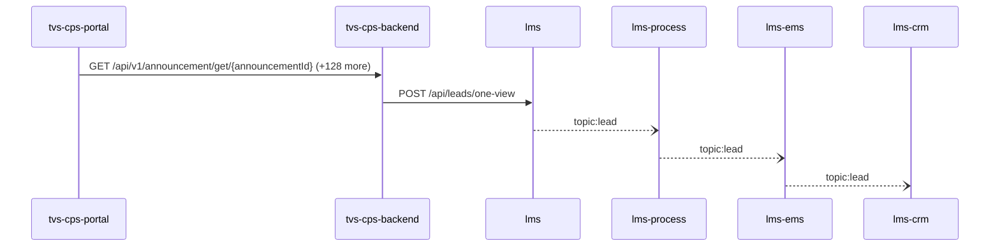

Steps:
| # | From | To | Via | Data (schema names) | Sync/Async | Confidence |
|---|---|---|---|---|---|---|
| 1 | tvs-cps-portal | tvs-cps-backend | GET /api/v1/announcement/get/{announcementId}, GET /api/v1/announcement/user/banners, GET /api/v1/appointments/{appointmentId} (+126 more) | APIResponse<AnnouncementResponseDto>, APIResponse<AnnouncementResponseDto[]>, APIResponse<AppointmentCountResponseDTO>, APIResponse<AppointmentDashboardResponseDTO>, APIResponse<AppointmentDetailResponseDTO> (+105 more) | sync | medium |
| 2 | tvs-cps-backend | lms | POST /api/leads/one-view | LeadOneViewRequest | sync | medium |
| 3 | lms | lms-process | topic:lead | Unknown | async | medium |
| 4 | lms-process | lms-ems | topic:lead | Unknown | async | medium |
| 5 | lms-ems | lms-crm | topic:lead | Unknown | async | medium |

Data touched: tvs-cps-backend: postgres, postgres:nmazcpsdbsdev01-cmn-postgres-uks.postgres.database.azure.com:nmazcpsdbdev01-cps; lms: mssql, mssql:icubemobappsqlstg.database.windows.net:tazlmssqldbdev01; lms-process: mssql; lms-ems: mssql; lms-crm: mssql

Failure points: hop 1 tvs-cps-portal → tvs-cps-backend: criticality hard; hop 2 tvs-cps-backend → lms: criticality hard; hop 3 lms → lms-process: criticality async; hop 4 lms-process → lms-ems: criticality async; hop 5 lms-ems → lms-crm: criticality async

Evidence:
- hop 1 (tvs-cps-portal → tvs-cps-backend): `TVS-CPS-BACKEND/announcement-service/src/main/java/com/tvsm/announcement/controller/AnnouncementController.java:31`, `TVS-CPS-PORTAL/channel-partner-system/src/services/notification.service.ts:140`, `TVS-CPS-PORTAL/channel-partner-system/src/services/notification.service.ts:144` (+194 more)
- hop 2 (tvs-cps-backend → lms): `TVS-CPS-BACKEND/bff-service/src/main/java/com/tvsm/bff/client/ServiceReminderClient.java:209`, `lms/leadLogs/Controllers/LeadGetController.cs:90`
- hop 3 (lms → lms-process): `lms/leadLogs/Services/LeadDispatchService.cs:21`, `lms_process/processLeadService/Const/Constants.cs:10`, `lms_process/processLeadService/ListenerService/QueueConsumer.cs:36`
- hop 4 (lms-process → lms-ems): `lms_ems/emsService/Const/Constants.cs:14`, `lms_ems/emsService/ListenerService/EmsListenerService.cs:43`, `lms_process/processLeadService/Const/Constants.cs:6` (+1 more)
- hop 5 (lms-ems → lms-crm): `lms_crm/ListenerService/CrmListenerService.cs:44`, `lms_crm/Utils/Constants.cs:16`, `lms_ems/emsService/Const/Constants.cs:13` (+1 more)

## Flow: tvs-cps-portal--lms-crm-f79cdd
Summary: Starting at `tvs-cps-portal` (user action in tvs-cps-portal (frontend)), the flow passes through `tvs-cps-backend`, `lms`, `lms-ems`, `lms-process` and ends at `lms-crm`, using 2 sync HTTP hop(s) and 3 async event hop(s); lms role: participant; confidence medium; truncated at the depth cap.


Steps:
| # | From | To | Via | Data (schema names) | Sync/Async | Confidence |
|---|---|---|---|---|---|---|
| 1 | tvs-cps-portal | tvs-cps-backend | GET /api/v1/announcement/get/{announcementId}, GET /api/v1/announcement/user/banners, GET /api/v1/appointments/{appointmentId} (+126 more) | APIResponse<AnnouncementResponseDto>, APIResponse<AnnouncementResponseDto[]>, APIResponse<AppointmentCountResponseDTO>, APIResponse<AppointmentDashboardResponseDTO>, APIResponse<AppointmentDetailResponseDTO> (+105 more) | sync | medium |
| 2 | tvs-cps-backend | lms | POST /api/leads/one-view | LeadOneViewRequest | sync | medium |
| 3 | lms | lms-ems | topic:lead | Unknown | async | medium |
| 4 | lms-ems | lms-process | topic:lead | Unknown | async | medium |
| 5 | lms-process | lms-crm | topic:lead | Unknown | async | medium |

Data touched: tvs-cps-backend: postgres, postgres:nmazcpsdbsdev01-cmn-postgres-uks.postgres.database.azure.com:nmazcpsdbdev01-cps; lms: mssql, mssql:icubemobappsqlstg.database.windows.net:tazlmssqldbdev01; lms-ems: mssql; lms-process: mssql; lms-crm: mssql

Failure points: hop 1 tvs-cps-portal → tvs-cps-backend: criticality hard; hop 2 tvs-cps-backend → lms: criticality hard; hop 3 lms → lms-ems: criticality async; hop 4 lms-ems → lms-process: criticality async; hop 5 lms-process → lms-crm: criticality async

Evidence:
- hop 1 (tvs-cps-portal → tvs-cps-backend): `TVS-CPS-BACKEND/announcement-service/src/main/java/com/tvsm/announcement/controller/AnnouncementController.java:31`, `TVS-CPS-PORTAL/channel-partner-system/src/services/notification.service.ts:140`, `TVS-CPS-PORTAL/channel-partner-system/src/services/notification.service.ts:144` (+194 more)
- hop 2 (tvs-cps-backend → lms): `TVS-CPS-BACKEND/bff-service/src/main/java/com/tvsm/bff/client/ServiceReminderClient.java:209`, `lms/leadLogs/Controllers/LeadGetController.cs:90`
- hop 3 (lms → lms-ems): `lms/leadLogs/Services/LeadDispatchService.cs:21`, `lms_ems/emsService/Const/Constants.cs:14`, `lms_ems/emsService/ListenerService/EmsListenerService.cs:43`
- hop 4 (lms-ems → lms-process): `lms_ems/emsService/Const/Constants.cs:13`, `lms_ems/emsService/Services/EmsService.cs:191`, `lms_process/processLeadService/Const/Constants.cs:10` (+1 more)
- hop 5 (lms-process → lms-crm): `lms_crm/ListenerService/CrmListenerService.cs:44`, `lms_crm/Utils/Constants.cs:16`, `lms_process/processLeadService/Const/Constants.cs:6` (+1 more)

## Flow: tvs-cps-portal--lms-tvs-credit-dc3a7e
Summary: Starting at `tvs-cps-portal` (user action in tvs-cps-portal (frontend)), the flow passes through `tvs-cps-backend`, `lms`, `lms-ems`, `lms-process` and ends at `lms-tvs-credit`, using 2 sync HTTP hop(s) and 3 async event hop(s); lms role: participant; confidence medium.

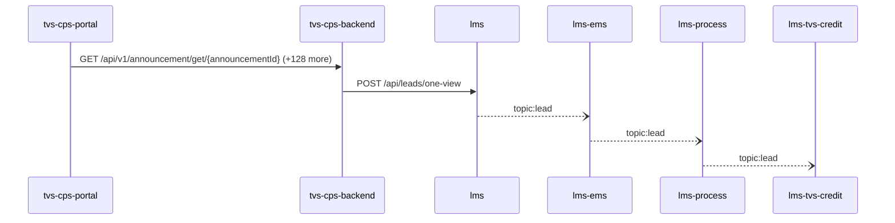

Steps:
| # | From | To | Via | Data (schema names) | Sync/Async | Confidence |
|---|---|---|---|---|---|---|
| 1 | tvs-cps-portal | tvs-cps-backend | GET /api/v1/announcement/get/{announcementId}, GET /api/v1/announcement/user/banners, GET /api/v1/appointments/{appointmentId} (+126 more) | APIResponse<AnnouncementResponseDto>, APIResponse<AnnouncementResponseDto[]>, APIResponse<AppointmentCountResponseDTO>, APIResponse<AppointmentDashboardResponseDTO>, APIResponse<AppointmentDetailResponseDTO> (+105 more) | sync | medium |
| 2 | tvs-cps-backend | lms | POST /api/leads/one-view | LeadOneViewRequest | sync | medium |
| 3 | lms | lms-ems | topic:lead | Unknown | async | medium |
| 4 | lms-ems | lms-process | topic:lead | Unknown | async | medium |
| 5 | lms-process | lms-tvs-credit | topic:lead | Unknown | async | medium |

Data touched: tvs-cps-backend: postgres, postgres:nmazcpsdbsdev01-cmn-postgres-uks.postgres.database.azure.com:nmazcpsdbdev01-cps; lms: mssql, mssql:icubemobappsqlstg.database.windows.net:tazlmssqldbdev01; lms-ems: mssql; lms-process: mssql; lms-tvs-credit: mssql

Failure points: hop 1 tvs-cps-portal → tvs-cps-backend: criticality hard; hop 2 tvs-cps-backend → lms: criticality hard; hop 3 lms → lms-ems: criticality async; hop 4 lms-ems → lms-process: criticality async; hop 5 lms-process → lms-tvs-credit: criticality async

Evidence:
- hop 1 (tvs-cps-portal → tvs-cps-backend): `TVS-CPS-BACKEND/announcement-service/src/main/java/com/tvsm/announcement/controller/AnnouncementController.java:31`, `TVS-CPS-PORTAL/channel-partner-system/src/services/notification.service.ts:140`, `TVS-CPS-PORTAL/channel-partner-system/src/services/notification.service.ts:144` (+194 more)
- hop 2 (tvs-cps-backend → lms): `TVS-CPS-BACKEND/bff-service/src/main/java/com/tvsm/bff/client/ServiceReminderClient.java:209`, `lms/leadLogs/Controllers/LeadGetController.cs:90`
- hop 3 (lms → lms-ems): `lms/leadLogs/Services/LeadDispatchService.cs:21`, `lms_ems/emsService/Const/Constants.cs:14`, `lms_ems/emsService/ListenerService/EmsListenerService.cs:43`
- hop 4 (lms-ems → lms-process): `lms_ems/emsService/Const/Constants.cs:13`, `lms_ems/emsService/Services/EmsService.cs:191`, `lms_process/processLeadService/Const/Constants.cs:10` (+1 more)
- hop 5 (lms-process → lms-tvs-credit): `lms_process/processLeadService/Const/Constants.cs:6`, `lms_process/processLeadService/Services/TwoWheelerService.cs:97`, `lms_tvs_credit/lms_tvs_credit/ListenerService/TvscreditListenerService.cs:46` (+1 more)

## Flow: tvs-cps-portal--lms-tvs-credit-deda48
Summary: Starting at `tvs-cps-portal` (user action in tvs-cps-portal (frontend)), the flow passes through `tvs-cps-backend`, `lms`, `lms-process`, `lms-ems` and ends at `lms-tvs-credit`, using 2 sync HTTP hop(s) and 3 async event hop(s); lms role: participant; confidence medium.

```mermaid
sequenceDiagram
  participant tvs_cps_portal as tvs-cps-portal
  participant tvs_cps_backend as tvs-cps-backend
  participant lms as lms
  participant lms_process as lms-process
  participant lms_ems as lms-ems
  participant lms_tvs_credit as lms-tvs-credit
  tvs_cps_portal->>tvs_cps_backend: GET /api/v1/announcement/get/{announcementId} (+128 more)
  tvs_cps_backend->>lms: POST /api/leads/one-view
  lms--)lms_process: topic:lead
  lms_process--)lms_ems: topic:lead
  lms_ems--)lms_tvs_credit: topic:lead
```

Steps:
| # | From | To | Via | Data (schema names) | Sync/Async | Confidence |
|---|---|---|---|---|---|---|
| 1 | tvs-cps-portal | tvs-cps-backend | GET /api/v1/announcement/get/{announcementId}, GET /api/v1/announcement/user/banners, GET /api/v1/appointments/{appointmentId} (+126 more) | APIResponse<AnnouncementResponseDto>, APIResponse<AnnouncementResponseDto[]>, APIResponse<AppointmentCountResponseDTO>, APIResponse<AppointmentDashboardResponseDTO>, APIResponse<AppointmentDetailResponseDTO> (+105 more) | sync | medium |
| 2 | tvs-cps-backend | lms | POST /api/leads/one-view | LeadOneViewRequest | sync | medium |
| 3 | lms | lms-process | topic:lead | Unknown | async | medium |
| 4 | lms-process | lms-ems | topic:lead | Unknown | async | medium |
| 5 | lms-ems | lms-tvs-credit | topic:lead | Unknown | async | medium |

Data touched: tvs-cps-backend: postgres, postgres:nmazcpsdbsdev01-cmn-postgres-uks.postgres.database.azure.com:nmazcpsdbdev01-cps; lms: mssql, mssql:icubemobappsqlstg.database.windows.net:tazlmssqldbdev01; lms-process: mssql; lms-ems: mssql; lms-tvs-credit: mssql

Failure points: hop 1 tvs-cps-portal → tvs-cps-backend: criticality hard; hop 2 tvs-cps-backend → lms: criticality hard; hop 3 lms → lms-process: criticality async; hop 4 lms-process → lms-ems: criticality async; hop 5 lms-ems → lms-tvs-credit: criticality async

Evidence:
- hop 1 (tvs-cps-portal → tvs-cps-backend): `TVS-CPS-BACKEND/announcement-service/src/main/java/com/tvsm/announcement/controller/AnnouncementController.java:31`, `TVS-CPS-PORTAL/channel-partner-system/src/services/notification.service.ts:140`, `TVS-CPS-PORTAL/channel-partner-system/src/services/notification.service.ts:144` (+194 more)
- hop 2 (tvs-cps-backend → lms): `TVS-CPS-BACKEND/bff-service/src/main/java/com/tvsm/bff/client/ServiceReminderClient.java:209`, `lms/leadLogs/Controllers/LeadGetController.cs:90`
- hop 3 (lms → lms-process): `lms/leadLogs/Services/LeadDispatchService.cs:21`, `lms_process/processLeadService/Const/Constants.cs:10`, `lms_process/processLeadService/ListenerService/QueueConsumer.cs:36`
- hop 4 (lms-process → lms-ems): `lms_ems/emsService/Const/Constants.cs:14`, `lms_ems/emsService/ListenerService/EmsListenerService.cs:43`, `lms_process/processLeadService/Const/Constants.cs:6` (+1 more)
- hop 5 (lms-ems → lms-tvs-credit): `lms_ems/emsService/Const/Constants.cs:13`, `lms_ems/emsService/Services/EmsService.cs:191`, `lms_tvs_credit/lms_tvs_credit/ListenerService/TvscreditListenerService.cs:46` (+1 more)

## Flow: tvsm-marketplace-service--external-salesforce-1dcb9e
Summary: Starting at `tvsm-marketplace-service` (scheduled job(s) in tvsm-marketplace-service (job-to-call link not resolved): AmazonPriceUpdateExecutorService.scheduledDrain, FlipkartPriceUpdateExecutorService.scheduledDrain, MarketplacePriceUpdateTaskService.cleanupDoneTasks (+2 more); request to tvsm-marketplace-service from outside the registry (no internal caller)), the flow passes through `lms`, `lms-ems`, `lms-process`, `lms-crm` and ends at `external:salesforce`, using 2 sync HTTP hop(s) and 3 async event hop(s); lms role: participant; confidence medium.

```mermaid
sequenceDiagram
  participant tvsm_marketplace_service as tvsm-marketplace-service
  participant lms as lms
  participant lms_ems as lms-ems
  participant lms_process as lms-process
  participant lms_crm as lms-crm
  participant external_salesforce as external:salesforce
  tvsm_marketplace_service->>lms: POST /api/lead (+1 more)
  lms--)lms_ems: topic:lead
  lms_ems--)lms_process: topic:lead
  lms_process--)lms_crm: topic:lead
  lms_crm->>external_salesforce: host:tvsm-c360a--dev.sandbox.my.salesforce.com
```

Steps:
| # | From | To | Via | Data (schema names) | Sync/Async | Confidence |
|---|---|---|---|---|---|---|
| 1 | tvsm-marketplace-service | lms | POST /api/lead, POST /api/leads/getDetails | LeadRequestModel, LeadsFilterRequestForSingleLead | sync | medium |
| 2 | lms | lms-ems | topic:lead | Unknown | async | medium |
| 3 | lms-ems | lms-process | topic:lead | Unknown | async | medium |
| 4 | lms-process | lms-crm | topic:lead | Unknown | async | medium |
| 5 | lms-crm | external:salesforce | host:tvsm-c360a--dev.sandbox.my.salesforce.com | Unknown | sync | high |

Data touched: tvsm-marketplace-service: mysql, mysql:localhost:marketplace; lms: mssql, mssql:icubemobappsqlstg.database.windows.net:tazlmssqldbdev01; lms-ems: mssql; lms-process: mssql; lms-crm: mssql

Failure points: hop 1 tvsm-marketplace-service → lms: criticality hard; hop 2 lms → lms-ems: criticality async; hop 3 lms-ems → lms-process: criticality async; hop 4 lms-process → lms-crm: criticality async; hop 5 lms-crm → external:salesforce: criticality hard

Evidence:
- hop 1 (tvsm-marketplace-service → lms): `lms/leadLogs/Controllers/LeadAcquisitionController.cs:61`, `tvsm-marketplace-service/src/main/java/com/tvsmotor/marketplace/service/LeadApiCallerService.java:42`, `tvsm-marketplace-service/src/main/java/com/tvsmotor/marketplace/service/OkHttpService.java:85` (+2 more)
- hop 2 (lms → lms-ems): `lms/leadLogs/Services/LeadDispatchService.cs:21`, `lms_ems/emsService/Const/Constants.cs:14`, `lms_ems/emsService/ListenerService/EmsListenerService.cs:43`
- hop 3 (lms-ems → lms-process): `lms_ems/emsService/Const/Constants.cs:13`, `lms_ems/emsService/Services/EmsService.cs:191`, `lms_process/processLeadService/Const/Constants.cs:10` (+1 more)
- hop 4 (lms-process → lms-crm): `lms_crm/ListenerService/CrmListenerService.cs:44`, `lms_crm/Utils/Constants.cs:16`, `lms_process/processLeadService/Const/Constants.cs:6` (+1 more)
- hop 5 (lms-crm → external:salesforce): `lms_crm/appsettings.Development.json:16`, `lms_crm/appsettings.Production.json:17`, `lms_crm/appsettings.Uat.json:17`

## Flow: tvsm-marketplace-service--external-salesforce-c207f1
Summary: Starting at `tvsm-marketplace-service` (scheduled job(s) in tvsm-marketplace-service (job-to-call link not resolved): AmazonPriceUpdateExecutorService.scheduledDrain, FlipkartPriceUpdateExecutorService.scheduledDrain, MarketplacePriceUpdateTaskService.cleanupDoneTasks (+2 more); request to tvsm-marketplace-service from outside the registry (no internal caller)), the flow passes through `lms`, `lms-process`, `lms-ems`, `lms-crm` and ends at `external:salesforce`, using 2 sync HTTP hop(s) and 3 async event hop(s); lms role: participant; confidence medium.

```mermaid
sequenceDiagram
  participant tvsm_marketplace_service as tvsm-marketplace-service
  participant lms as lms
  participant lms_process as lms-process
  participant lms_ems as lms-ems
  participant lms_crm as lms-crm
  participant external_salesforce as external:salesforce
  tvsm_marketplace_service->>lms: POST /api/lead (+1 more)
  lms--)lms_process: topic:lead
  lms_process--)lms_ems: topic:lead
  lms_ems--)lms_crm: topic:lead
  lms_crm->>external_salesforce: host:tvsm-c360a--dev.sandbox.my.salesforce.com
```

Steps:
| # | From | To | Via | Data (schema names) | Sync/Async | Confidence |
|---|---|---|---|---|---|---|
| 1 | tvsm-marketplace-service | lms | POST /api/lead, POST /api/leads/getDetails | LeadRequestModel, LeadsFilterRequestForSingleLead | sync | medium |
| 2 | lms | lms-process | topic:lead | Unknown | async | medium |
| 3 | lms-process | lms-ems | topic:lead | Unknown | async | medium |
| 4 | lms-ems | lms-crm | topic:lead | Unknown | async | medium |
| 5 | lms-crm | external:salesforce | host:tvsm-c360a--dev.sandbox.my.salesforce.com | Unknown | sync | high |

Data touched: tvsm-marketplace-service: mysql, mysql:localhost:marketplace; lms: mssql, mssql:icubemobappsqlstg.database.windows.net:tazlmssqldbdev01; lms-process: mssql; lms-ems: mssql; lms-crm: mssql

Failure points: hop 1 tvsm-marketplace-service → lms: criticality hard; hop 2 lms → lms-process: criticality async; hop 3 lms-process → lms-ems: criticality async; hop 4 lms-ems → lms-crm: criticality async; hop 5 lms-crm → external:salesforce: criticality hard

Evidence:
- hop 1 (tvsm-marketplace-service → lms): `lms/leadLogs/Controllers/LeadAcquisitionController.cs:61`, `tvsm-marketplace-service/src/main/java/com/tvsmotor/marketplace/service/LeadApiCallerService.java:42`, `tvsm-marketplace-service/src/main/java/com/tvsmotor/marketplace/service/OkHttpService.java:85` (+2 more)
- hop 2 (lms → lms-process): `lms/leadLogs/Services/LeadDispatchService.cs:21`, `lms_process/processLeadService/Const/Constants.cs:10`, `lms_process/processLeadService/ListenerService/QueueConsumer.cs:36`
- hop 3 (lms-process → lms-ems): `lms_ems/emsService/Const/Constants.cs:14`, `lms_ems/emsService/ListenerService/EmsListenerService.cs:43`, `lms_process/processLeadService/Const/Constants.cs:6` (+1 more)
- hop 4 (lms-ems → lms-crm): `lms_crm/ListenerService/CrmListenerService.cs:44`, `lms_crm/Utils/Constants.cs:16`, `lms_ems/emsService/Const/Constants.cs:13` (+1 more)
- hop 5 (lms-crm → external:salesforce): `lms_crm/appsettings.Development.json:16`, `lms_crm/appsettings.Production.json:17`, `lms_crm/appsettings.Uat.json:17`

## Flow: tvsmbe-location--external-salesforce-0a67ad
Summary: Starting at `tvsmbe-location` (scheduled job(s) in tvsmbe-location (job-to-call link not resolved): CronService.logMetricsPeriodically), the flow passes through `lms`, `lms-process`, `lms-ems`, `lms-crm` and ends at `external:salesforce`, using 2 sync HTTP hop(s) and 3 async event hop(s); lms role: participant; confidence medium.

```mermaid
sequenceDiagram
  participant tvsmbe_location as tvsmbe-location
  participant lms as lms
  participant lms_process as lms-process
  participant lms_ems as lms-ems
  participant lms_crm as lms-crm
  participant external_salesforce as external:salesforce
  tvsmbe_location->>lms: POST /api/lead
  lms--)lms_process: topic:lead
  lms_process--)lms_ems: topic:lead
  lms_ems--)lms_crm: topic:lead
  lms_crm->>external_salesforce: host:tvsm-c360a--dev.sandbox.my.salesforce.com
```

Steps:
| # | From | To | Via | Data (schema names) | Sync/Async | Confidence |
|---|---|---|---|---|---|---|
| 1 | tvsmbe-location | lms | POST /api/lead | LeadRequestModel | sync | medium |
| 2 | lms | lms-process | topic:lead | Unknown | async | medium |
| 3 | lms-process | lms-ems | topic:lead | Unknown | async | medium |
| 4 | lms-ems | lms-crm | topic:lead | Unknown | async | medium |
| 5 | lms-crm | external:salesforce | host:tvsm-c360a--dev.sandbox.my.salesforce.com | Unknown | sync | high |

Data touched: tvsmbe-location: mongo, mysql; lms: mssql, mssql:icubemobappsqlstg.database.windows.net:tazlmssqldbdev01; lms-process: mssql; lms-ems: mssql; lms-crm: mssql

Failure points: hop 1 tvsmbe-location → lms: criticality hard; hop 2 lms → lms-process: criticality async; hop 3 lms-process → lms-ems: criticality async; hop 4 lms-ems → lms-crm: criticality async; hop 5 lms-crm → external:salesforce: criticality hard

Evidence:
- hop 1 (tvsmbe-location → lms): `lms/leadLogs/Controllers/LeadAcquisitionController.cs:61`, `tvsmbe-location/src/main/java/com/tvsmotor/location_master/service/LeadService.java:58`, `tvsmbe-location/src/main/java/com/tvsmotor/location_master/utils/OkHttpUtil.java:54`
- hop 2 (lms → lms-process): `lms/leadLogs/Services/LeadDispatchService.cs:21`, `lms_process/processLeadService/Const/Constants.cs:10`, `lms_process/processLeadService/ListenerService/QueueConsumer.cs:36`
- hop 3 (lms-process → lms-ems): `lms_ems/emsService/Const/Constants.cs:14`, `lms_ems/emsService/ListenerService/EmsListenerService.cs:43`, `lms_process/processLeadService/Const/Constants.cs:6` (+1 more)
- hop 4 (lms-ems → lms-crm): `lms_crm/ListenerService/CrmListenerService.cs:44`, `lms_crm/Utils/Constants.cs:16`, `lms_ems/emsService/Const/Constants.cs:13` (+1 more)
- hop 5 (lms-crm → external:salesforce): `lms_crm/appsettings.Development.json:16`, `lms_crm/appsettings.Production.json:17`, `lms_crm/appsettings.Uat.json:17`

## Flow: tvsmbe-location--external-salesforce-5b3d0e
Summary: Starting at `tvsmbe-location` (scheduled job(s) in tvsmbe-location (job-to-call link not resolved): CronService.logMetricsPeriodically), the flow passes through `lms`, `lms-ems`, `lms-process`, `lms-crm` and ends at `external:salesforce`, using 2 sync HTTP hop(s) and 3 async event hop(s); lms role: participant; confidence medium.

```mermaid
sequenceDiagram
  participant tvsmbe_location as tvsmbe-location
  participant lms as lms
  participant lms_ems as lms-ems
  participant lms_process as lms-process
  participant lms_crm as lms-crm
  participant external_salesforce as external:salesforce
  tvsmbe_location->>lms: POST /api/lead
  lms--)lms_ems: topic:lead
  lms_ems--)lms_process: topic:lead
  lms_process--)lms_crm: topic:lead
  lms_crm->>external_salesforce: host:tvsm-c360a--dev.sandbox.my.salesforce.com
```

Steps:
| # | From | To | Via | Data (schema names) | Sync/Async | Confidence |
|---|---|---|---|---|---|---|
| 1 | tvsmbe-location | lms | POST /api/lead | LeadRequestModel | sync | medium |
| 2 | lms | lms-ems | topic:lead | Unknown | async | medium |
| 3 | lms-ems | lms-process | topic:lead | Unknown | async | medium |
| 4 | lms-process | lms-crm | topic:lead | Unknown | async | medium |
| 5 | lms-crm | external:salesforce | host:tvsm-c360a--dev.sandbox.my.salesforce.com | Unknown | sync | high |

Data touched: tvsmbe-location: mongo, mysql; lms: mssql, mssql:icubemobappsqlstg.database.windows.net:tazlmssqldbdev01; lms-ems: mssql; lms-process: mssql; lms-crm: mssql

Failure points: hop 1 tvsmbe-location → lms: criticality hard; hop 2 lms → lms-ems: criticality async; hop 3 lms-ems → lms-process: criticality async; hop 4 lms-process → lms-crm: criticality async; hop 5 lms-crm → external:salesforce: criticality hard

Evidence:
- hop 1 (tvsmbe-location → lms): `lms/leadLogs/Controllers/LeadAcquisitionController.cs:61`, `tvsmbe-location/src/main/java/com/tvsmotor/location_master/service/LeadService.java:58`, `tvsmbe-location/src/main/java/com/tvsmotor/location_master/utils/OkHttpUtil.java:54`
- hop 2 (lms → lms-ems): `lms/leadLogs/Services/LeadDispatchService.cs:21`, `lms_ems/emsService/Const/Constants.cs:14`, `lms_ems/emsService/ListenerService/EmsListenerService.cs:43`
- hop 3 (lms-ems → lms-process): `lms_ems/emsService/Const/Constants.cs:13`, `lms_ems/emsService/Services/EmsService.cs:191`, `lms_process/processLeadService/Const/Constants.cs:10` (+1 more)
- hop 4 (lms-process → lms-crm): `lms_crm/ListenerService/CrmListenerService.cs:44`, `lms_crm/Utils/Constants.cs:16`, `lms_process/processLeadService/Const/Constants.cs:6` (+1 more)
- hop 5 (lms-crm → external:salesforce): `lms_crm/appsettings.Development.json:16`, `lms_crm/appsettings.Production.json:17`, `lms_crm/appsettings.Uat.json:17`

## Request Flows
lms request/message flows traced in code (narrative; the registry flows above are generated). All LMS workers share topic `lead` (Azure Service Bus topic; `AppSettings:TOPIC_NAME`) and are selected by subscription (`EMS`, `CRM`, `FINANCE`, `PROCESS`) with the target carried in the `EventTarget` application property.

### lead acquisition (POST /api/lead)
```mermaid
sequenceDiagram
  participant C as caller (tvsm-marketplace-service / tvsmbe-location)
  participant L as lms
  participant DB as LMS SQL (mssql)
  participant SB as Service Bus (TOPIC_NAME)
  C->>L: POST /api/lead (LeadRequestModel)
  L->>DB: log lead (lead_logs) + read source/flow config
  L->>L: PrimaryLeadValidation + DuplicateValidation
  L->>DB: persist lead / duplicate / invalid record
  L->>SB: publish lead (EventType = lead type)
  L-->>C: status + response
```

| # | Step | Evidence |
|---|---|---|
| 1 | Controller receives the lead | `leadLogs/Controllers/LeadAcquisitionController.cs:61-69` |
| 2 | Lead logged, source + lead-flow config loaded | `leadLogs/Services/LeadDelegate.cs:23-29` |
| 3 | Primary validation | `leadLogs/Services/LeadLogService.cs:65` |
| 4 | Duplicate validation; dealer duplicates go to ProcessDuplicateLeadService | `leadLogs/Services/LeadLogService.cs:82-90` |
| 5 | Valid/invalid/duplicate lead dispatched to the topic | `leadLogs/Services/ProcessValidLeadService.cs:106, ProcessInvalidLeadService.cs:48, ProcessDuplicateLeadService.cs:63` |
| 6 | Sender bound to `TOPIC_NAME` (value not in repo; env var) | `leadLogs/Services/LeadDispatchService.cs:21` |
