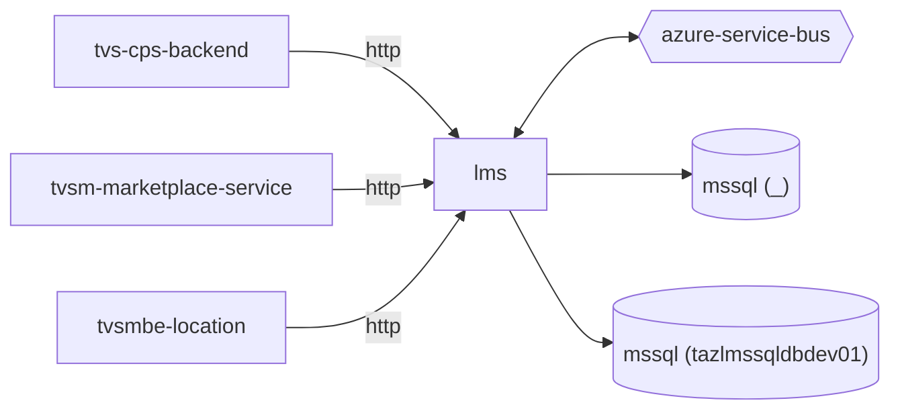

# lms — High-Level Design

## Context
lms is a `backend-api` in the TVS-CS Lead Management System (domain: lead-management). It is one of five LMS repos: `lms` (acquisition API) and the listener workers `lms-process`, `lms-ems`, `lms-crm`, `lms-tvs-credit`, connected through Service Bus topic `lead`.

## Architecture
lms components and connections (from service.yaml / registry edges):

## Integration Points
lms registry edges (4):

| Direction | Peer | Kind | Via | Criticality | Source | Match |
|---|---|---|---|---|---|---|
| in | `tvs-cps-backend` | http | POST /api/leads/one-view | hard | code | path-suffix |
| in | `tvsm-marketplace-service` | http | POST /api/lead | hard | code | path-suffix |
| in | `tvsm-marketplace-service` | http | POST /api/leads/getDetails | hard | code | path-suffix |
| in | `tvsmbe-location` | http | POST /api/lead | hard | code | path-suffix |

lms → listener event edges are missing because lms's `TOPIC_NAME` is supplied by environment variables only (`leadLogs/Const/AppSettingsService.cs:14,22`); the listeners subscribe to topic `lead`.

## Data Ownership
lms data stores (service.yaml `data_stores`). All LMS repos map the same LMS SQL schema (tables such as `leads`, `lead_push_logs`, `dealer_mediation_controls`, `lead_flow_configuration`); ownership is not declared in code.

| Store | Type | Owned | Key entities |
|---|---|---|---|
| `_` | mssql | Unknown | AccountMaster, AdditionalDetail, AdditionalDetailsLogMapping, BrandDetailLogMapping, BrandMaster, ClassifiedLead, CommsBrandDetail, CountryMaster, DealerContact, DealerFlag, DealerLocation, DealerMaster, DealerMasterList, DealerMediationControl, DuplicateLead, EventConfigurator, FinanceDetail, FormBrandMapping, FormConfiguration, FormMaster, LatlongPushLog, Lead, LeadAcquisitionLog, LeadBrandDetail, LeadCatalogueDetail, LeadComm, LeadEnquiryTag, LeadEventLog, LeadExtraAttribute, LeadFlowConfiguration, LeadFollowup, LeadInvoiceDetail, LeadLog, LeadLogResponse, LeadPushLog, LeadSource, LeadTestRide, LeadsCommsMapping, MetaLog, ModelIdPartIdMaster, PageMaster, PincodeMaster, ReferralCustomerDetail, StatusCode, TestRideLogMapping, WebhookLog |
| `tazlmssqldbdev01` | mssql | Unknown | DealerMediationControl |

## Key Design Decisions
lms design decisions evidenced in code:

| Decision | Alternatives considered | Evidence |
|---|---|---|
| Async hand-off of every accepted lead to a Service Bus topic; downstream routing by `EventTarget` property / subscription | Unknown | `leadLogs/Services/LeadDispatchService.cs:21-34` |

## Non-Functional Requirements
lms NFR targets: N/A — not determinable from code.

## Security
lms security: No `[Authorize]` attribute and no authentication scheme registration found; `Startup.cs:120-121` calls `UseAuthentication()`/`UseAuthorization()` without a configured scheme, and CORS is configured at `leadLogs/Startup.cs:49,110`. Effective endpoint auth: none evidenced in code (gateway-level auth Unknown). Secrets (connection strings, client secrets, API keys) are read from configuration keys listed by name in OVERVIEW.md; values are not reproduced. PII handling: leads carry customer contact data (see request schemas); masking/encryption Unknown.

## Resilience and Failure Modes
lms: No retry, timeout or circuit-breaker configuration found around the Service Bus sender or SQL access. Controller exceptions are logged and mapped to HTTP 422 (`leadLogs/Controllers/LeadAcquisitionController.cs:71-74`).

## Deployment Topology
lms deployment artefacts (platform/regions: Unknown):

| Kind | File | Environments | Base images | Ports |
|---|---|---|---|---|
| azure-pipeline | `azure-pipeline/norton-ls-acquisition-CD-UK-PROD.yaml` | - | - | - |
| azure-pipeline | `azure-pipeline/norton-ls-acquisition-CD-dev.yml` | - | - | - |
| azure-pipeline | `azure-pipeline/norton-ls-acquisition-CI-dev.yml` | - | - | - |
| azure-pipeline | `azure-pipeline/norton-ls-acqusition-CI-UK-PROD.yaml` | - | - | - |
| azure-pipeline | `azure-pipelines-domestic/Ls-acquisition-CD-dev.yml` | dev, uat | - | - |
| azure-pipeline | `azure-pipelines-domestic/ls-acquisition-CI-dev.yml` | - | - | - |
| azure-pipeline | `cd-pipeline.yaml` | dev | - | - |
| azure-pipeline | `ci-pipeline.yaml` | - | - | - |
| dockerfile | `Dockerfile` | - | mcr.microsoft.com/dotnet/aspnet:8.0, mcr.microsoft.com/dotnet/sdk:8.0 | 8080, 8081 |

## Observability
lms observability: Microsoft.Extensions.Logging (`ILogger`) only; log levels in `leadLogs/appsettings.json`. No OpenTelemetry/App Insights configuration found. Dashboards/alerts: Unknown.
