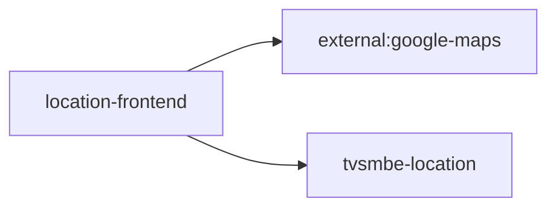

# location-frontend — High-Level Design

## Context
location-frontend is a `frontend-web` in the TVS-CS org (domain: Unknown). Neighbours: callers Unknown; downstream `external:google-maps`, `tvsmbe-location`.

## Architecture
location-frontend components and connections (from service.yaml):

## Integration Points
location-frontend registry edges (30):

| Direction | Peer | Kind | Via | Criticality | Source | Match |
|---|---|---|---|---|---|---|
| out | `external:google-maps` | http | host:maps.googleapis.com | hard | code | host |
| out | `tvsmbe-location` | http | GET /location-master/api/v1/admin-flow/dealer/{sapDealerCode}/location-type/{dealerLocationType} | hard | code | path-unique |
| out | `tvsmbe-location` | http | GET /location-master/api/v1/admin-flow/rejection-comments | hard | code | path-unique |
| out | `tvsmbe-location` | http | GET /location-master/api/v1/admin-flow/summary | hard | code | path-unique |
| out | `tvsmbe-location` | http | GET /location-master/api/v1/admin-flow/{sapDealerCode}/contacts/{dealerLocationType} | hard | code | path-unique |
| out | `tvsmbe-location` | http | GET /location-master/api/v1/country/{countryCode}/filter-config | hard | code | path-unique |
| out | `tvsmbe-location` | http | GET /location-master/api/v1/country/{countryCode}/provinces | hard | code | path-unique |
| out | `tvsmbe-location` | http | GET /location-master/api/v1/dealer-flow/dealer/{sapDealerCode} | hard | code | path-unique |
| out | `tvsmbe-location` | http | GET /location-master/api/v1/dealer-flow/dealer/{sapDealerCode}/location-type/{dealerLocationType} | hard | code | path-unique |
| out | `tvsmbe-location` | http | GET /location-master/api/v1/dealer-flow/dealerInfo | hard | code | path-unique |
| out | `tvsmbe-location` | http | GET /location-master/api/v1/dealer/summary | hard | code | path-unique |
| out | `tvsmbe-location` | http | GET /location-master/api/v1/dealer/template | hard | code | path-unique |
| out | `tvsmbe-location` | http | GET /location-master/api/v1/geo/geocode | hard | code | path-unique |
| out | `tvsmbe-location` | http | GET /location-master/api/v1/user-x/{userId}/countries | hard | code | path-unique |
| out | `tvsmbe-location` | http | POST /location-master/api/v1/admin-flow/list | hard | code | path-unique |
| out | `tvsmbe-location` | http | POST /location-master/api/v1/admin-flow/send-location-update-sms | hard | code | path-unique |
| out | `tvsmbe-location` | http | POST /location-master/api/v1/admin-flow/verification | hard | code | path-unique |
| out | `tvsmbe-location` | http | POST /location-master/api/v1/admin/migrate/import-dealership-locations | hard | code | path-unique |
| out | `tvsmbe-location` | http | POST /location-master/api/v1/charging-station/nearby | hard | code | path-unique |
| out | `tvsmbe-location` | http | POST /location-master/api/v1/dealer | hard | code | path-unique |
| out | `tvsmbe-location` | http | POST /location-master/api/v1/dealer-search | hard | code | path-unique |
| out | `tvsmbe-location` | http | POST /location-master/api/v1/dealer/export | hard | code | path-unique |
| out | `tvsmbe-location` | http | POST /location-master/api/v1/dealer/list | hard | code | path-unique |
| out | `tvsmbe-location` | http | POST /location-master/api/v1/domestic-dealer/brands | hard | code | path-unique |
| out | `tvsmbe-location` | http | POST /location-master/api/v1/domestic-dealer/clusters | hard | code | path-unique |
| out | `tvsmbe-location` | http | POST /location-master/api/v1/domestic-dealer/get-sms | hard | code | path-unique |
| out | `tvsmbe-location` | http | POST /location-master/api/v1/domestic-dealer/send-otp | hard | code | path-unique |
| out | `tvsmbe-location` | http | POST /location-master/api/v1/finder/dealers | hard | code | path-unique |
| out | `tvsmbe-location` | http | POST /location-master/v1/dealer-location/submit | hard | code | path-unique |
| out | `tvsmbe-location` | http | PUT /location-master/api/v1/dealer/{id} | hard | code | path-unique |
| out | `external:google-maps` | http | - | Unknown | code | external |

## Data Ownership
location-frontend data stores (service.yaml `data_stores`; ownership flag not determinable unless set):

| Store | Type | Access | Owned | Key entities |
|---|---|---|---|---|
| N/A | | | | no data stores extracted |

## Key Design Decisions
location-frontend: N/A — not determinable from code.

| Decision | Alternatives considered | Reason |
|---|---|---|
| Unknown | Unknown | Unknown |

## Non-Functional Requirements
location-frontend NFR targets: N/A — not determinable from code.

## Security
location-frontend security: endpoint auth values n/a. No auth middleware found in code. 2 secret config key(s), sourced via: {'env-file': 1, 'None': 1} (names in OVERVIEW.md). PII handling: Unknown.

## Resilience and Failure Modes
location-frontend hard dependencies: `tvsmbe-location`. No retry/circuit-breaker code found; failure behaviour Unknown.

## Deployment Topology
location-frontend deployment artefacts (platform/regions: Unknown unless listed):

| Kind | Name | File | Environments | Image | Ports | Variable groups |
|---|---|---|---|---|---|---|
| azure-pipeline | azure-pipelines/dev-ci.yaml | `azure-pipelines/dev-ci.yaml:6` | - | - | - | - |
| azure-pipeline | azure-pipelines/prod-ci.yaml | `azure-pipelines/prod-ci.yaml:6` | - | - | - | - |
| azure-pipeline | azure-pipelines/uat-ci.yaml | `azure-pipelines/uat-ci.yaml:6` | - | - | - | - |

## Observability
location-frontend observability libraries: none found. Related config keys: none. Dashboards/alerts: Unknown.
