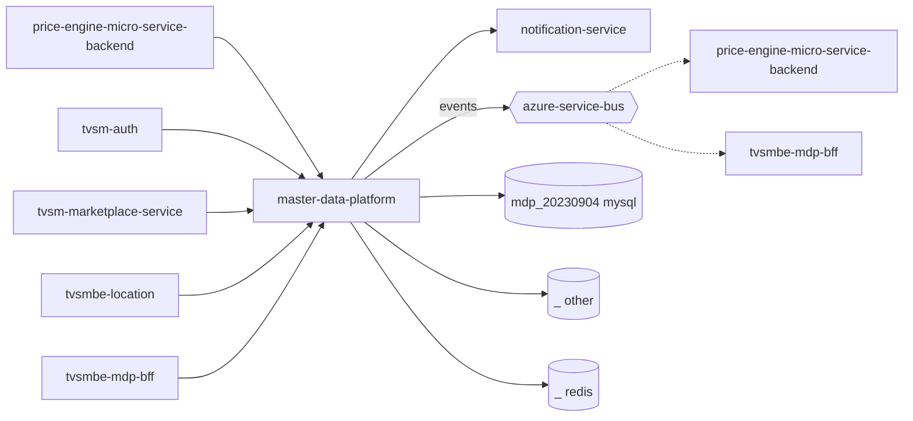

# master-data-platform — High-Level Design

## Context
master-data-platform is the TVS master-data backend (MDP) for dealers, products, parts and prices. Neighbours from registry: callers `tvsm-auth`, `tvsm-marketplace-service`, `tvsmbe-location` etc.; event consumers `tvsmbe-mdp-bff`, `price-engine-micro-service-backend`; downstream `notification-service`.

## Architecture
master-data-platform architecture (nodes from service.yaml/registry only).

Layers: controllers (`controller/`, `dealer/`, `product*/`, `price/`, `part_price/`) → services (`service/`) → Spring Data JPA repositories (`repository/`) on MySQL; Service Bus senders under `*/service/service_bus/`; Redis cache via `common/cache/CacheService.java`; batch processors in `service/batch_processing/`.

## Integration Points
master-data-platform registry edges (22 total, grouped):

| From | To | Kind | Source | Criticality | Count |
|---|---|---|---|---|---|
| master-data-platform | master-data-platform | event | code | async | 2 |
| master-data-platform | price-engine-micro-service-backend | event | code | async | 2 |
| master-data-platform | tvsmbe-mdp-bff | event | code | async | 1 |
| master-data-platform | notification-service | http | code | hard | 1 |
| price-engine-micro-service-backend | master-data-platform | http | code | hard | 2 |
| tvsm-auth | master-data-platform | http | code | hard | 2 |
| tvsm-marketplace-service | master-data-platform | http | code | hard | 3 |
| tvsmbe-location | master-data-platform | http | code | hard | 6 |
| tvsmbe-mdp-bff | master-data-platform | http | code | hard | 2 |
| tvsmbe-location | master-data-platform | tests | code | hard | 1 |

## Data Ownership
master-data-platform data stores (service.yaml `data_stores`):
- `mdp_20230904` — type mysql, access read-write, owned Unknown, owner Unknown; key entities: `AuditLog`, `AuthClientUser`, `Dealer`, `DealerContact`, `DealerDetails`, `DealerEmployee`, `DealerFlag`, `DealerFlagNew`, `DealerFlagTypeNew`, `DealerLocation`, `DealerLocationSapData`, `DealerTestRideVehicle`, `IndianStateDetail`, `IndianStates`, `Part`, `PartMarket`, `PartPrice`, `PartPriceSapData`, `PartSapData`, `PriceLocationDetail`, `PriceVehicleModel`, `PriceVehicleSapData`, `ProductMna`, `ProductMnaNew`, `ProductMnaNewSapData`, `ProductMnaSapData`, `SapData`, `SapDealerSalesCenterData`, `SharepointData`, `VehicleHierarchySapData`, `VehicleModel`, `VehiclePart`, `VehiclePartSapData`, `VehiclePartSpecifications`, `VehicleSpecificationSapData`, `dealer_contacts`, `dealer_details`, `dealer_employees`, `dealer_flags`, `dealer_locations` (+4 more)
- `_` — type other, access write, owned Unknown, owner Unknown; key entities: `audit_log`, `dealer`, `dealer_contacts`, `dealer_details`, `dealer_flags`, `dealer_locations`, `dealers`, `hibernate_sequence`, `vehicle_models`, `vehicle_part_specifications`, `vehicle_parts`
- `_` — type redis, access Unknown, owned Unknown, owner Unknown; key entities: none extracted

## Key Design Decisions
master-data-platform: N/A — not determinable from code.

## Non-Functional Requirements
master-data-platform: OkHttp read timeout 30s (`config/OkHttpClientConfig.java:26`); JVM `-XX:MaxRAMPercentage=75` (`Dockerfile:30`). Other NFRs N/A — not determinable from code.

## Security
master-data-platform authN: Azure B2C JWT validation in `config/MdpOncePerRequestFilter.java:86`; client→userType mapping in `AuthClientUser`. gitleaks scan pipeline (`gitleaks-scan.yaml`).
Secrets are configured by name only: `AZURE_B2C_CLIENT_SECRET` (env-file), `AZURE_B2C_GENERATE_AUTH_TOKEN_API_URL` (env-file), `AZ_CLIENT_SECRET` (env-file), `CLIENT_SECRET` (env-file), `DATABASE_PASSWORD` (env-file), `DB_PASSWORD` (env-file), `DMS_DATABASE_PASSWORD` (env-file), `MDP_DEV_AZURE_B2C_CLIENT_SECRET` (env-file), `MDP_PROD_AZURE_B2C_CLIENT_SECRET` (env-file), `MDP_PROD_DATABASE_PASSWORD` (env-file), `MDP_UAT_AZURE_B2C_CLIENT_SECRET` (env-file), `NOTIFICATION_GENERATE_B2C_TOKEN_API_URL` (env-file), `NOTIFICATION_GENERATE_B2C_TOKEN_CLIENT_ID` (env-file), `NOTIFICATION_GENERATE_B2C_TOKEN_CLIENT_SECRET` (env-file), `ONLINE_DMS_PASSWORD` (env-file), `REDIS_PASSWORD` (env-file), `SERVICE_BUS_DEALER_DATA_CONNECTION_STRING` (env-file), `SERVICE_BUS_DMS_DEALER_DATA_CONNECTION_STRING` (env-file), `SERVICE_BUS_PART_DATA_CONNECTION_STRING` (env-file), `SERVICE_BUS_PART_PRICE_DATA_CONNECTION_STRING` (env-file), `SERVICE_BUS_PRICE_DATA_CONNECTION_STRING` (env-file), `SERVICE_BUS_PRODUCT_MNA_DATA_CONNECTION_STRING` (env-file), `SERVICE_BUS_VEHICLE_DATA_CONNECTION_STRING` (env-file), `azure.b2c.token.url` (app-settings), `cache.redis.password` (app-settings), `latlong.brandCreds[3]` (app-settings), `latlong.brandCreds[4]` (app-settings), `latlong.brandCreds[6]` (app-settings), `latlong.brandCreds[7]` (app-settings), `local.servicebus.common.connection-string` (app-settings), `spring.datasource.password` (app-settings), `spring.jms.servicebus.topic.dealerData.connection-string` (app-settings), `spring.jms.servicebus.topic.dmsDealerData.connection-string` (app-settings), `spring.jms.servicebus.topic.partData.connection-string` (app-settings), `spring.jms.servicebus.topic.partPriceData.connection-string` (app-settings), `spring.jms.servicebus.topic.priceVehicleData.connection-string` (app-settings), `spring.jms.servicebus.topic.productMnaData.connection-string` (app-settings), `spring.jms.servicebus.topic.productVehicleData.connection-string` (app-settings).

## Resilience and Failure Modes
master-data-platform: Spring Retry enabled (`MdpApplication.java:12`); `@Retryable` on DMS DB connection (5 attempts, `config/DmsDatabaseConfig.java:25`) and Redis cache ops (3 attempts, `common/cache/CacheService.java:27`). Service Bus processor uses PEEK_LOCK with an error handler (see API_SPEC Events Consumed). Hard dependency `notification-service` (email) — failure handling Unknown.

## Deployment Topology
master-data-platform: Docker image (multi-stage, port 8080, `Dockerfile`); Azure Pipelines for UAT/PROD CI/CD, image scan, Sonar and gitleaks; manual builder script `20240608_docker_manual_builder_and_pusher_MDP.sh`. Pipeline/infra files:
- azure-pipeline: `AST_Image_Scan_MDP_Pipeline.yml` variable groups ['Checkmarx_Common', 'UAT_Threshold']
- azure-pipeline: `AST_MDP_master_data_platform_PROD_Pipeline.yml` variable groups ['PROD_Threshold', 'Tenable']
- azure-pipeline: `AST_MDP_master_data_platform_UAT_Pipeline.yml` variable groups ['Checkmarx_Common', 'Tenable', 'UAT_Threshold']
- azure-pipeline: `azure-pipelines/prod.cd.yml`
- azure-pipeline: `azure-pipelines/prod.ci.yml`
- azure-pipeline: `azure-pipelines/uat.ci.yml` variable groups ['Checkmarx_Common', 'UAT_Threshold']
- azure-pipeline: `cd-pipeline.yaml`
- azure-pipeline: `ci-pipeline.yaml`
- azure-pipeline: `gitleaks-scan.yaml`
- azure-pipeline: `sonar_ci_pr_pipelines.yml`
- dockerfile: `Dockerfile`

## Observability
master-data-platform: request logging with transactionId and timing in `config/MdpOncePerRequestFilter.java:71-116`; audit log table via `AuditLogService` (`MdpOncePerRequestFilter.java:104`); periodic metrics log job `CronService.logMetricsPeriodically` (fixed rate 60000 ms, `common/service/CronService.java:36`); Spring Boot Actuator dependency; New Relic agent toggle `NEW_RELIC_AGENT_ENABLED` (config).
