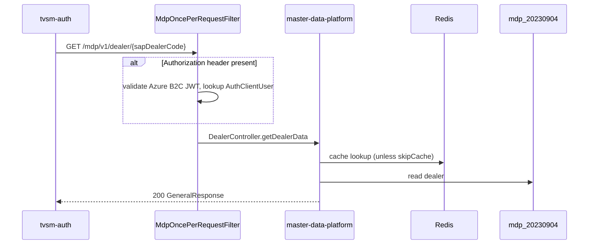

# master-data-platform — Low-Level Design

## Data Model
master-data-platform data entities (from inventory `data_access`; columns per schema items where extracted).
### Store `mdp_20230904` (mysql) — `src/main/java/com/tvsmotor/mdp/common/entity/AuditLog.java:11`

| Entity | Table | Operation | Defined in |
|---|---|---|---|
| `AuditLog` | audit_log | write | `src/main/java/com/tvsmotor/mdp/common/entity/AuditLog.java:10` |
| `AuthClientUser` | auth_client_users | read | `src/main/java/com/tvsmotor/mdp/entity/AuthClientUser.java:10` |
| `Dealer` | dealers | both | `src/main/java/com/tvsmotor/mdp/entity/Dealer.java:13` |
| `DealerContact` | dealer_contacts | both | `src/main/java/com/tvsmotor/mdp/entity/DealerContact.java:10` |
| `DealerDetails` | dealer_details | both | `src/main/java/com/tvsmotor/mdp/entity/DealerDetails.java:11` |
| `DealerEmployee` | dealer_employees | both | `src/main/java/com/tvsmotor/mdp/entity/DealerEmployee.java:10` |
| `DealerFlag` | dealer_flags | both | `src/main/java/com/tvsmotor/mdp/entity/DealerFlag.java:10` |
| `DealerFlagNew` | dealer_flags_new | both | `src/main/java/com/tvsmotor/mdp/entity/DealerFlagNew.java:11` |
| `DealerFlagTypeNew` | dealer_flags_types | both | `src/main/java/com/tvsmotor/mdp/entity/DealerFlagTypeNew.java:11` |
| `DealerLocation` | dealer_locations | both | `src/main/java/com/tvsmotor/mdp/entity/DealerLocation.java:10` |
| `DealerLocationSapData` | temp_dealer_location_sap_data | both | `src/main/java/com/tvsmotor/mdp/entity/batch_processing/DealerLocationSapData.java:13` |
| `DealerTestRideVehicle` | dealer_test_ride_vehicles | Unknown | `src/main/java/com/tvsmotor/mdp/entity/DealerTestRideVehicle.java:11` |
| `IndianStateDetail` | indian_state_details | both | `src/main/java/com/tvsmotor/mdp/common/entity/IndianStateDetail.java:13` |
| `IndianStates` | indian_states | both | `src/main/java/com/tvsmotor/mdp/common/entity/IndianStates.java:11` |
| `Part` | parts | both | `src/main/java/com/tvsmotor/mdp/product_part/entity/Part.java:14` |
| `PartMarket` | part_market | both | `src/main/java/com/tvsmotor/mdp/product_part/entity/PartMarket.java:12` |
| `PartPrice` | parts_price | both | `src/main/java/com/tvsmotor/mdp/part_price/entity/PartPrice.java:13` |
| `PartPriceSapData` | temp_price_part_data | both | `src/main/java/com/tvsmotor/mdp/part_price/entity/batch_processing/PartPriceSapData.java:10` |
| `PartSapData` | temp_part_data | both | `src/main/java/com/tvsmotor/mdp/product_part/entity/batch_processing/PartSapData.java:10` |
| `PriceLocationDetail` | price_location_details | both | `src/main/java/com/tvsmotor/mdp/price/entity/PriceLocationDetail.java:11` |
| `PriceVehicleModel` | price_vehicle_model | both | `src/main/java/com/tvsmotor/mdp/price/entity/PriceVehicleModel.java:14` |
| `PriceVehicleSapData` | temp_price_vehicle_data | both | `src/main/java/com/tvsmotor/mdp/price/entity/batch_processing/PriceVehicleSapData.java:10` |
| `ProductMna` | products_mna | both | `src/main/java/com/tvsmotor/mdp/product_mna/entity/ProductMna.java:12` |
| `ProductMnaNew` | products_mna_new | both | `src/main/java/com/tvsmotor/mdp/product_mna/entity/ProductMnaNew.java:14` |
| `ProductMnaNewSapData` | temp_product_mna_new | both | `src/main/java/com/tvsmotor/mdp/product_mna/entity/batch_processing/ProductMnaNewSapData.java:10` |
| `ProductMnaSapData` | temp_product_mna | both | `src/main/java/com/tvsmotor/mdp/product_mna/entity/batch_processing/ProductMnaSapData.java:10` |
| `SapData` | temp_sap_dealer_data | both | `src/main/java/com/tvsmotor/mdp/entity/batch_processing/SapData.java:10` |
| `SapDealerSalesCenterData` | temp_sap_dealer_sales_center_data | both | `src/main/java/com/tvsmotor/mdp/entity/batch_processing/SapDealerSalesCenterData.java:16` |
| `SharepointData` | temp_sharepoint_data | both | `src/main/java/com/tvsmotor/mdp/entity/batch_processing/SharepointData.java:8` |
| `VehicleHierarchySapData` | temp_vehicle_hierarchy | both | `src/main/java/com/tvsmotor/mdp/product/entity/batch_processing/VehicleHierarchySapData.java:10` |
| `VehicleModel` | vehicle_models | both | `src/main/java/com/tvsmotor/mdp/product/entity/VehicleModel.java:15` |
| `VehiclePart` | vehicle_parts | both | `src/main/java/com/tvsmotor/mdp/product/entity/VehiclePart.java:11` |
| `VehiclePartSapData` | temp_vehicle_part | both | `src/main/java/com/tvsmotor/mdp/product/entity/batch_processing/VehiclePartSapData.java:10` |
| `VehiclePartSpecifications` | vehicle_part_specifications | both | `src/main/java/com/tvsmotor/mdp/product/entity/VehiclePartSpecifications.java:12` |
| `VehicleSpecificationSapData` | temp_vehicle_specification | both | `src/main/java/com/tvsmotor/mdp/product/entity/batch_processing/VehicleSpecificationSapData.java:10` |
| `dealer_contacts` | dealer_contacts | read | `src/main/java/com/tvsmotor/mdp/repository/DealerContactRepository.java:21` |
| `dealer_details` | dealer_details | read | `src/main/java/com/tvsmotor/mdp/repository/DealerDetailsRepository.java:18` |
| `dealer_employees` | dealer_employees | read | `src/main/java/com/tvsmotor/mdp/repository/DealerContactRepository.java:21` |
| `dealer_flags` | dealer_flags | read | `src/main/java/com/tvsmotor/mdp/repository/DealerDetailsRepository.java:18` |
| `dealer_locations` | dealer_locations | read | `src/main/java/com/tvsmotor/mdp/repository/DealerDetailsRepository.java:18` |
| `dealers` | dealers | read | `src/main/java/com/tvsmotor/mdp/repository/DealerDetailsRepository.java:18` |
| `temp_dealer_location_sap_data` | temp_dealer_location_sap_data | read | `src/main/java/com/tvsmotor/mdp/repository/batch_processing/DealerLocationSapDataRepository.java:13` |
| `temp_part_data` | temp_part_data | read | `src/main/java/com/tvsmotor/mdp/product_part/repository/batch_processing/PartSapDataRepository.java:17` |
| `temp_price_vehicle_data` | temp_price_vehicle_data | read | `src/main/java/com/tvsmotor/mdp/price/repository/batch_processing/PriceVehicleSapDataRepository.java:16` |

### Store `_` (other) — `archive/sql/20230519_microsoft_SQL-DDLs.sql:17`

| Entity | Table | Operation | Defined in |
|---|---|---|---|
| `audit_log` | audit_log | write | `src/main/resources/db/migration/v1.6__sharepoint_temp_table_new_columns_20240213.sql:68` |
| `dealer` | dealer | write | `archive/sql/20230621_mySQL_8_triggers_POC.sql:106` |
| `dealer_contacts` | dealer_contacts | write | `src/main/resources/db/migration/v1.9__dealer_location_and_contact_changes_20240517.sql:39` |
| `dealer_details` | dealer_details | write | `src/main/resources/db/migration/v1.9__dealer_location_and_contact_changes_20240517.sql:34` |
| `dealer_flags` | dealer_flags | write | `src/main/resources/db/migration/v1.37_sharepoint_temp_table_new_column_20251204.sql:14` |
| `dealer_locations` | dealer_locations | write | `src/main/resources/db/migration/v1.9__dealer_location_and_contact_changes_20240517.sql:44` |
| `dealers` | dealers | write | `src/main/resources/db/migration/v1.16__new_changes_20240822.sql:9` |
| `hibernate_sequence` | hibernate_sequence | write | `src/main/resources/db/migration/v1.3__audit_logging_20231023.sql:5` |
| `vehicle_models` | vehicle_models | write | `src/main/resources/db/migration/v1.13_product_vehicle_tables_changes_20240724.sql:3` |
| `vehicle_part_specifications` | vehicle_part_specifications | write | `src/main/resources/db/migration/v1.33_product_vehicle_new_columns_20250611.sql:63` |
| `vehicle_parts` | vehicle_parts | write | `src/main/resources/db/migration/v1.13_product_vehicle_tables_changes_20240724.sql:11` |

### Store `_` (redis) — `src/main/java/com/tvsmotor/mdp/common/cache/CacheService.java:25`

| Entity | Table | Operation | Defined in |
|---|---|---|---|
| none extracted | | | |

## State Machines
master-data-platform dealer status enums:
- `SapStatus`: PRE_ACTIVE (initial) → ACTIVE / TEMPORARILY_BLOCKED / PERMANENTLY_BLOCKED (final); NOT_PRESENT_IN_SAP for unauthorized DMS dealers (`enums/SapStatus.java:4-8`).
- `DmsStatus`: PRE_ACTIVE (not yet in DMS) → ACTIVE / INACTIVE (`enums/DmsStatus.java:4-6`).
- `MdpDealerStatus`: PRE_ACTIVE / ACTIVE / INACTIVE; PRE_ACTIVE if DMS status is PRE_ACTIVE regardless of SAP status (`enums/MdpDealerStatus.java:4`). Transition triggers: migration endpoints `updateSapStatus` / `updateMdpDealerStatus` (`controller/migration/DealerMigrationController.java:20`).

## Business Rules
- master-data-platform: only soft deletes; no DELETE queries (`README.md`).
- Timestamps `createdAt`/`updatedAt` generated in the application (`README.md`).
- `sapDealerCode` is the unique dealer key from SAP (`README.md` glossary).
- Services must not call other aggregates' repositories directly (`README.md` coding guidelines).

## Key Classes and Functions
master-data-platform key classes:

| Class / Function | File | Responsibility |
|---|---|---|
| `MdpApplication` | `src/main/java/com/tvsmotor/mdp/MdpApplication.java` | Spring Boot entry, @EnableRetry |
| `MdpOncePerRequestFilter` | `src/main/java/com/tvsmotor/mdp/config/MdpOncePerRequestFilter.java` | JWT validation, context, request logging |
| `RestExceptionHandler` | `src/main/java/com/tvsmotor/mdp/common/exceptions/handlers/RestExceptionHandler.java` | Exception → HTTP status |
| `DealerController` | `src/main/java/com/tvsmotor/mdp/controller/DealerController.java` | Dealer APIs |
| `DE_PipelineController` | `src/main/java/com/tvsmotor/mdp/controller/DE_PipelineController.java` | Batch trigger |
| `DealerDataSenderService` | `src/main/java/com/tvsmotor/mdp/service/service_bus/DealerDataSenderService.java` | Publishes dealer topics |
| `DealerMasterServiceBusConfig` | `src/main/java/com/tvsmotor/mdp/config/DealerMasterServiceBusConfig.java` | Service Bus processor for dealer topics |
| `CacheService` | `src/main/java/com/tvsmotor/mdp/common/cache/CacheService.java` | Redis cache with retry |
| `LatLongService` | `src/main/java/com/tvsmotor/mdp/service/LatLongService.java` | LatLong store sync via OkHttp |
| `CronService` | `src/main/java/com/tvsmotor/mdp/common/service/CronService.java` | Periodic metrics logging |

## Sequence Details
master-data-platform request pipeline:

## Error Handling
master-data-platform `RestExceptionHandler` (`common/exceptions/handlers/RestExceptionHandler.java`): method not supported → 405 (`:52`); `Exception` → 500 (`:71-91`, details controlled by `SHOW_HTTP_500_DETAILS` config); `AccessDeniedException` → 401 (`:95-105`); `ValidationException`/`NoSuchElementException` → 400 (`:109-119`); further 400 mappings at `:134`, `:149`. Filter exceptions are audit-logged (`config/MdpOncePerRequestFilter.java:104`).

## Configuration Details
master-data-platform: `ACTIVE_ENVIRONMENT` selects profile (README); `DATABASE_*`/`DB_*` main MySQL; `DMS_DATABASE_*` DMS source DB; `REDIS_*` cache; `SERVICE_BUS_*_CONNECTION_STRING` / `SERVICE_BUS_*_TOPIC_NAME` per topic; `NOTIFICATION_*` email notification settings; `AZURE_B2C_*` token generation; `SHOW_HTTP_500_DETAILS` error detail toggle; `NEW_RELIC_AGENT_ENABLED`. Values never documented.

## Edge Cases
- master-data-platform: requests without `Authorization` header are not rejected by the filter (`config/MdpOncePerRequestFilter.java:85`).
- `skipCache` query param bypasses Redis on dealer lookup (service.yaml params).
- `skipUnofficialBranches` filter on branches endpoint (service.yaml params).
