# notification-dispatcher-service — Data Flows

## Flow Index
notification-dispatcher-service takes part in 30 end-to-end flow(s) in registry/flows.json; showing the top 25 by confidence, then length.

| flow_id | Name | Role of notification-dispatcher-service | Trigger |
|---|---|---|---|
| catalog-scheduler--external-salesforce-7dacdd | catalog-scheduler → external:salesforce (5 hops) | participant | scheduled job(s) in catalog-scheduler (job-to-call link not resolved): merchandise-accessories-ingestion-job, product-price-ingestion-job; request to catalog-scheduler from outside the registry (no internal caller) |
| catalog-scheduler--notification-dispatcher-service | catalog-scheduler → notification-dispatcher-service (5 hops) | terminal | scheduled job(s) in catalog-scheduler (job-to-call link not resolved): merchandise-accessories-ingestion-job, product-price-ingestion-job; request to catalog-scheduler from outside the registry (no internal caller) |
| cbs-admin-portal--external-salesforce-50c8e5 | cbs-admin-portal → external:salesforce (5 hops) | participant | user action in cbs-admin-portal (frontend) |
| cbs-admin-portal--external-salesforce-c202d0 | cbs-admin-portal → external:salesforce (4 hops) | participant | user action in cbs-admin-portal (frontend) |
| location-frontend--external-salesforce-1790d3 | location-frontend → external:salesforce (5 hops) | participant | user action in location-frontend (frontend) |
| location-frontend--external-salesforce-9f4abc | location-frontend → external:salesforce (5 hops) | participant | user action in location-frontend (frontend) |
| location-frontend--external-salesforce-a5f52d | location-frontend → external:salesforce (4 hops) | participant | user action in location-frontend (frontend) |
| location-frontend--notification-dispatcher-service-115620 | location-frontend → notification-dispatcher-service (5 hops) | terminal | user action in location-frontend (frontend) |
| location-frontend--notification-dispatcher-service-48fe37 | location-frontend → notification-dispatcher-service (5 hops) | terminal | user action in location-frontend (frontend) |
| master-data-platform--external-salesforce-6c65ac | master-data-platform → external:salesforce (4 hops) | participant | scheduled job(s) in master-data-platform (job-to-call link not resolved): CronService.logMetricsPeriodically; master-data-platform publishes mdp.dealer_data |
| master-data-platform--external-salesforce-e67cbf | master-data-platform → external:salesforce (3 hops) | participant | scheduled job(s) in master-data-platform (job-to-call link not resolved): CronService.logMetricsPeriodically |
| notification-dispatcher-service--external-salesforce | notification-dispatcher-service → external:salesforce (1 hop) | entry | scheduled job(s) in notification-dispatcher-service (job-to-call link not resolved): ThreadPoolMonitor.logThreadPoolStats |
| tvs-cps-backend--external-salesforce-2bffce | tvs-cps-backend → external:salesforce (3 hops) | participant | scheduled job(s) in tvs-cps-backend (job-to-call link not resolved): JobScheduler.loadCatalogData, JobScheduler.retrieveMDPDealers, JobScheduler.retrieveMerchandiseStock (+2 more) |
| tvs-cps-jobs--external-salesforce-bb6648 | tvs-cps-jobs → external:salesforce (4 hops) | participant | scheduled job(s) in tvs-cps-jobs (job-to-call link not resolved): CronJobScheduler.allBookingsScheduler, CronJobScheduler.allEnquiriesScheduler, CronJobScheduler.availableStockScheduler (+27 more); request to tvs-cps-jobs from outside the registry (no internal caller) |
| tvs-cps-portal--external-salesforce-38bf3e | tvs-cps-portal → external:salesforce (4 hops) | participant | user action in tvs-cps-portal (frontend) |
| tvsm-auth--external-salesforce-8065ac | tvsm-auth → external:salesforce (4 hops) | participant | scheduled job(s) in tvsm-auth (job-to-call link not resolved): CacheClearScheduler.evictAllCachesAtIntervals, NotificationReminder.sendSMSForFaceLogin |
| tvsm-auth--external-salesforce-c5b275 | tvsm-auth → external:salesforce (5 hops) | participant | scheduled job(s) in tvsm-auth (job-to-call link not resolved): CacheClearScheduler.evictAllCachesAtIntervals, NotificationReminder.sendSMSForFaceLogin |
| tvsm-marketplace-service--external-salesforce-551358 | tvsm-marketplace-service → external:salesforce (4 hops) | participant | scheduled job(s) in tvsm-marketplace-service (job-to-call link not resolved): AmazonPriceUpdateExecutorService.scheduledDrain, FlipkartPriceUpdateExecutorService.scheduledDrain, MarketplacePriceUpdateTaskService.cleanupDoneTasks (+2 more); request to tvsm-marketplace-service from outside the registry (no internal caller) |
| tvsm-marketplace-service--external-salesforce-eddaa5 | tvsm-marketplace-service → external:salesforce (5 hops) | participant | scheduled job(s) in tvsm-marketplace-service (job-to-call link not resolved): AmazonPriceUpdateExecutorService.scheduledDrain, FlipkartPriceUpdateExecutorService.scheduledDrain, MarketplacePriceUpdateTaskService.cleanupDoneTasks (+2 more); request to tvsm-marketplace-service from outside the registry (no internal caller) |
| tvsmbe-location--external-salesforce-7d2323 | tvsmbe-location → external:salesforce (4 hops) | participant | scheduled job(s) in tvsmbe-location (job-to-call link not resolved): CronService.logMetricsPeriodically |
| tvsmbe-location--external-salesforce-ae0174 | tvsmbe-location → external:salesforce (4 hops) | participant | scheduled job(s) in tvsmbe-location (job-to-call link not resolved): CronService.logMetricsPeriodically |
| tvsmbe-location--external-salesforce-b48009 | tvsmbe-location → external:salesforce (5 hops) | participant | scheduled job(s) in tvsmbe-location (job-to-call link not resolved): CronService.logMetricsPeriodically |
| tvsmbe-location--external-salesforce-e8e8d4 | tvsmbe-location → external:salesforce (5 hops) | participant | scheduled job(s) in tvsmbe-location (job-to-call link not resolved): CronService.logMetricsPeriodically |
| tvsmbe-location--notification-dispatcher-service | tvsmbe-location → notification-dispatcher-service (5 hops) | terminal | scheduled job(s) in tvsmbe-location (job-to-call link not resolved): CronService.logMetricsPeriodically |
| tvsmbe-mdp-bff--external-salesforce-cf3a42 | tvsmbe-mdp-bff → external:salesforce (4 hops) | participant | scheduled job(s) in tvsmbe-mdp-bff (job-to-call link not resolved): CronService.logMetricsPeriodically |

## Flow: catalog-scheduler--external-salesforce-7dacdd
Summary: Starting at `catalog-scheduler` (scheduled job(s) in catalog-scheduler (job-to-call link not resolved): merchandise-accessories-ingestion-job, product-price-ingestion-job; request to catalog-scheduler from outside the registry (no internal caller)), the flow passes through `price-engine-micro-service-backend`, `master-data-platform`, `notification-service`, `notification-dispatcher-service` and ends at `external:salesforce`, using 4 sync HTTP hop(s) and 1 async event hop(s); notification-dispatcher-service role: participant; confidence medium.

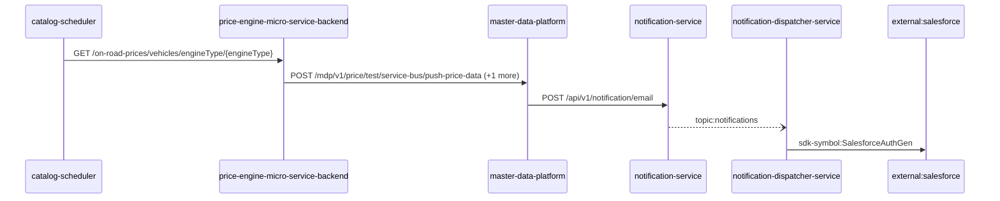

Steps:
| # | From | To | Via | Data (schema names) | Sync/Async | Confidence |
|---|---|---|---|---|---|---|
| 1 | catalog-scheduler | price-engine-micro-service-backend | GET /on-road-prices/vehicles/engineType/{engineType} | Unknown | sync | medium |
| 2 | price-engine-micro-service-backend | master-data-platform | POST /mdp/v1/price/test/service-bus/push-price-data, POST /mdp/v1/product/test/service-bus/push-product-data | GeneralResponse | sync | high |
| 3 | master-data-platform | notification-service | POST /api/v1/notification/email | EmailNotification, NotificationResponse | sync | high |
| 4 | notification-service | notification-dispatcher-service | topic:notifications | Unknown | async | medium |
| 5 | notification-dispatcher-service | external:salesforce | sdk-symbol:SalesforceAuthGen | Unknown | sync | high |

Data touched: catalog-scheduler: mongo; price-engine-micro-service-backend: mongo, redis; master-data-platform: mysql:xxxx.mysql.database.azure.com:mdp_20230904, other, redis; notification-service: mongo; notification-dispatcher-service: mongo

Failure points: hop 1 catalog-scheduler → price-engine-micro-service-backend: criticality hard; hop 2 price-engine-micro-service-backend → master-data-platform: criticality hard; hop 3 master-data-platform → notification-service: criticality hard; hop 4 notification-service → notification-dispatcher-service: criticality async; hop 5 notification-dispatcher-service → external:salesforce: criticality hard

Evidence:
- hop 1 (catalog-scheduler → price-engine-micro-service-backend): `Catalog-Scheduler/src/product-price-ingestion-job/data-sources/price-engine-data-source/price-engine-data-source.js:21`, `Price-Engine-MicroService-Backend/src/routes/api/on-road-price-routes.ts:31`
- hop 2 (price-engine-micro-service-backend → master-data-platform): `Price-Engine-MicroService-Backend/sonar-exclusion-function/service-bus/service-bus.ts:23`, `master-data-platform/src/main/java/com/tvsmotor/mdp/price/controller/TestPriceServiceBusController.java:18`, `Price-Engine-MicroService-Backend/sonar-exclusion-function/service-bus/service-bus.ts:9` (+1 more)
- hop 3 (master-data-platform → notification-service): `master-data-platform/src/main/java/com/tvsmotor/mdp/service/OkHttpService.java:24`, `master-data-platform/src/main/java/com/tvsmotor/mdp/service/notification_service/NotificationSenderService.java:69`, `notification-service/src/main/java/com/tvsmotor/notification/controller/NotificationController.java:23`
- hop 4 (notification-service → notification-dispatcher-service): `notification-dispatcher-service/src/main/java/com/tvsmotor/notificationdispatcher/config/ServiceBusConfig.java:33`, `notification-dispatcher-service/src/main/java/com/tvsmotor/notificationdispatcher/config/ServiceBusConfig.java:34`, `notification-service/src/main/java/com/tvsmotor/notification/config/ServiceBusConfig.java:37` (+1 more)
- hop 5 (notification-dispatcher-service → external:salesforce): `notification-dispatcher-service/src/main/java/com/tvsmotor/notificationdispatcher/controller/SalesforceTokenController.java:18`, `notification-dispatcher-service/src/main/java/com/tvsmotor/notificationdispatcher/model/dto/salesforce/SalesforceData.java:5`, `notification-dispatcher-service/src/main/java/com/tvsmotor/notificationdispatcher/model/dto/salesforce/SalesforceTemplateKeys.java:8`

## Flow: catalog-scheduler--notification-dispatcher-service
Summary: Starting at `catalog-scheduler` (scheduled job(s) in catalog-scheduler (job-to-call link not resolved): merchandise-accessories-ingestion-job, product-price-ingestion-job; request to catalog-scheduler from outside the registry (no internal caller)), the flow passes through `price-engine-micro-service-backend`, `master-data-platform`, `tvsmbe-mdp-bff`, `notification-service` and ends at `notification-dispatcher-service`, using 3 sync HTTP hop(s) and 2 async event hop(s); notification-dispatcher-service role: terminal; confidence medium; truncated at the depth cap.

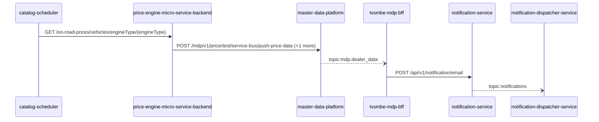

Steps:
| # | From | To | Via | Data (schema names) | Sync/Async | Confidence |
|---|---|---|---|---|---|---|
| 1 | catalog-scheduler | price-engine-micro-service-backend | GET /on-road-prices/vehicles/engineType/{engineType} | Unknown | sync | medium |
| 2 | price-engine-micro-service-backend | master-data-platform | POST /mdp/v1/price/test/service-bus/push-price-data, POST /mdp/v1/product/test/service-bus/push-product-data | GeneralResponse | sync | high |
| 3 | master-data-platform | tvsmbe-mdp-bff | topic:mdp.dealer_data | DealerData | async | medium |
| 4 | tvsmbe-mdp-bff | notification-service | POST /api/v1/notification/email | EmailNotification, NotificationResponse | sync | high |
| 5 | notification-service | notification-dispatcher-service | topic:notifications | Unknown | async | medium |

Data touched: catalog-scheduler: mongo; price-engine-micro-service-backend: mongo, redis; master-data-platform: mysql:xxxx.mysql.database.azure.com:mdp_20230904, other, redis; tvsmbe-mdp-bff: mysql, mysql:tvsmazcmndbsdev01-ci.mysql.database.azure.com:tvsmazebffsdbdev01; notification-service: mongo; notification-dispatcher-service: mongo

Failure points: hop 1 catalog-scheduler → price-engine-micro-service-backend: criticality hard; hop 2 price-engine-micro-service-backend → master-data-platform: criticality hard; hop 3 master-data-platform → tvsmbe-mdp-bff: criticality async; hop 4 tvsmbe-mdp-bff → notification-service: criticality hard; hop 5 notification-service → notification-dispatcher-service: criticality async

Evidence:
- hop 1 (catalog-scheduler → price-engine-micro-service-backend): `Catalog-Scheduler/src/product-price-ingestion-job/data-sources/price-engine-data-source/price-engine-data-source.js:21`, `Price-Engine-MicroService-Backend/src/routes/api/on-road-price-routes.ts:31`
- hop 2 (price-engine-micro-service-backend → master-data-platform): `Price-Engine-MicroService-Backend/sonar-exclusion-function/service-bus/service-bus.ts:23`, `master-data-platform/src/main/java/com/tvsmotor/mdp/price/controller/TestPriceServiceBusController.java:18`, `Price-Engine-MicroService-Backend/sonar-exclusion-function/service-bus/service-bus.ts:9` (+1 more)
- hop 3 (master-data-platform → tvsmbe-mdp-bff): `master-data-platform/src/main/java/com/tvsmotor/mdp/config/DealerMasterServiceBusConfig.java:26`, `master-data-platform/src/main/java/com/tvsmotor/mdp/config/DealerMasterServiceBusConfig.java:27`, `tvsmbe-mdp-bff/outbound/src/main/java/com/tvsmotor/mdp_bff/outbound/config/BffServiceBusConfig.java:24` (+1 more)
- hop 4 (tvsmbe-mdp-bff → notification-service): `notification-service/src/main/java/com/tvsmotor/notification/controller/NotificationController.java:23`, `tvsmbe-mdp-bff/outbound/src/main/java/com/tvsmotor/mdp_bff/outbound/service/NotificationSenderService.java:46`, `tvsmbe-mdp-bff/outbound/src/main/java/com/tvsmotor/mdp_bff/outbound/service/OkHttpService.java:88`
- hop 5 (notification-service → notification-dispatcher-service): `notification-dispatcher-service/src/main/java/com/tvsmotor/notificationdispatcher/config/ServiceBusConfig.java:33`, `notification-dispatcher-service/src/main/java/com/tvsmotor/notificationdispatcher/config/ServiceBusConfig.java:34`, `notification-service/src/main/java/com/tvsmotor/notification/config/ServiceBusConfig.java:37` (+1 more)

## Flow: cbs-admin-portal--external-salesforce-50c8e5
Summary: Starting at `cbs-admin-portal` (user action in cbs-admin-portal (frontend)), the flow passes through `tvsmbe-mdp-bff`, `master-data-platform`, `notification-service`, `notification-dispatcher-service` and ends at `external:salesforce`, using 4 sync HTTP hop(s) and 1 async event hop(s); notification-dispatcher-service role: participant; confidence medium.

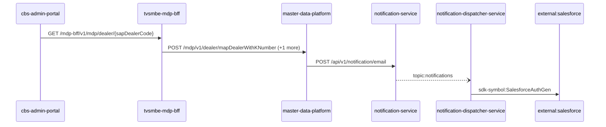

Steps:
| # | From | To | Via | Data (schema names) | Sync/Async | Confidence |
|---|---|---|---|---|---|---|
| 1 | cbs-admin-portal | tvsmbe-mdp-bff | GET /mdp-bff/v1/mdp/dealer/{sapDealerCode} | GeneralResponse | sync | medium |
| 2 | tvsmbe-mdp-bff | master-data-platform | POST /mdp/v1/dealer/mapDealerWithKNumber, POST /mdp/v1/dealers/basedOnFilters | DealerTypeStatusFlagsFilterRequest, GeneralResponse, MapDealerWithKNumberRequest | sync | high |
| 3 | master-data-platform | notification-service | POST /api/v1/notification/email | EmailNotification, NotificationResponse | sync | high |
| 4 | notification-service | notification-dispatcher-service | topic:notifications | Unknown | async | medium |
| 5 | notification-dispatcher-service | external:salesforce | sdk-symbol:SalesforceAuthGen | Unknown | sync | high |

Data touched: tvsmbe-mdp-bff: mysql, mysql:tvsmazcmndbsdev01-ci.mysql.database.azure.com:tvsmazebffsdbdev01; master-data-platform: mysql:xxxx.mysql.database.azure.com:mdp_20230904, other, redis; notification-service: mongo; notification-dispatcher-service: mongo

Failure points: hop 1 cbs-admin-portal → tvsmbe-mdp-bff: criticality hard; hop 2 tvsmbe-mdp-bff → master-data-platform: criticality hard; hop 3 master-data-platform → notification-service: criticality hard; hop 4 notification-service → notification-dispatcher-service: criticality async; hop 5 notification-dispatcher-service → external:salesforce: criticality hard

Evidence:
- hop 1 (cbs-admin-portal → tvsmbe-mdp-bff): `cbs-admin-portal/src/services/dataService.js:225`, `tvsmbe-mdp-bff/inbound/src/main/java/com/tvsmotor/bff/controller/MdpController.java:14`
- hop 2 (tvsmbe-mdp-bff → master-data-platform): `master-data-platform/src/main/java/com/tvsmotor/mdp/controller/DealerKnowlarityDataController.java:16`, `tvsmbe-mdp-bff/outbound/src/main/java/com/tvsmotor/mdp_bff/outbound/service/MdpDealerOperationsService.java:54`, `tvsmbe-mdp-bff/outbound/src/main/java/com/tvsmotor/mdp_bff/outbound/service/OkHttpService.java:88` (+3 more)
- hop 3 (master-data-platform → notification-service): `master-data-platform/src/main/java/com/tvsmotor/mdp/service/OkHttpService.java:24`, `master-data-platform/src/main/java/com/tvsmotor/mdp/service/notification_service/NotificationSenderService.java:69`, `notification-service/src/main/java/com/tvsmotor/notification/controller/NotificationController.java:23`
- hop 4 (notification-service → notification-dispatcher-service): `notification-dispatcher-service/src/main/java/com/tvsmotor/notificationdispatcher/config/ServiceBusConfig.java:33`, `notification-dispatcher-service/src/main/java/com/tvsmotor/notificationdispatcher/config/ServiceBusConfig.java:34`, `notification-service/src/main/java/com/tvsmotor/notification/config/ServiceBusConfig.java:37` (+1 more)
- hop 5 (notification-dispatcher-service → external:salesforce): `notification-dispatcher-service/src/main/java/com/tvsmotor/notificationdispatcher/controller/SalesforceTokenController.java:18`, `notification-dispatcher-service/src/main/java/com/tvsmotor/notificationdispatcher/model/dto/salesforce/SalesforceData.java:5`, `notification-dispatcher-service/src/main/java/com/tvsmotor/notificationdispatcher/model/dto/salesforce/SalesforceTemplateKeys.java:8`

## Flow: cbs-admin-portal--external-salesforce-c202d0
Summary: Starting at `cbs-admin-portal` (user action in cbs-admin-portal (frontend)), the flow passes through `tvsmbe-mdp-bff`, `notification-service`, `notification-dispatcher-service` and ends at `external:salesforce`, using 3 sync HTTP hop(s) and 1 async event hop(s); notification-dispatcher-service role: participant; confidence medium.

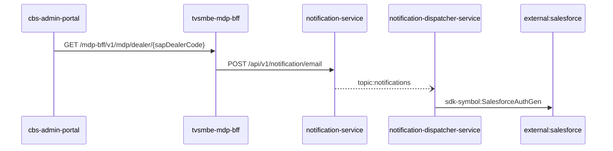

Steps:
| # | From | To | Via | Data (schema names) | Sync/Async | Confidence |
|---|---|---|---|---|---|---|
| 1 | cbs-admin-portal | tvsmbe-mdp-bff | GET /mdp-bff/v1/mdp/dealer/{sapDealerCode} | GeneralResponse | sync | medium |
| 2 | tvsmbe-mdp-bff | notification-service | POST /api/v1/notification/email | EmailNotification, NotificationResponse | sync | high |
| 3 | notification-service | notification-dispatcher-service | topic:notifications | Unknown | async | medium |
| 4 | notification-dispatcher-service | external:salesforce | sdk-symbol:SalesforceAuthGen | Unknown | sync | high |

Data touched: tvsmbe-mdp-bff: mysql, mysql:tvsmazcmndbsdev01-ci.mysql.database.azure.com:tvsmazebffsdbdev01; notification-service: mongo; notification-dispatcher-service: mongo

Failure points: hop 1 cbs-admin-portal → tvsmbe-mdp-bff: criticality hard; hop 2 tvsmbe-mdp-bff → notification-service: criticality hard; hop 3 notification-service → notification-dispatcher-service: criticality async; hop 4 notification-dispatcher-service → external:salesforce: criticality hard

Evidence:
- hop 1 (cbs-admin-portal → tvsmbe-mdp-bff): `cbs-admin-portal/src/services/dataService.js:225`, `tvsmbe-mdp-bff/inbound/src/main/java/com/tvsmotor/bff/controller/MdpController.java:14`
- hop 2 (tvsmbe-mdp-bff → notification-service): `notification-service/src/main/java/com/tvsmotor/notification/controller/NotificationController.java:23`, `tvsmbe-mdp-bff/outbound/src/main/java/com/tvsmotor/mdp_bff/outbound/service/NotificationSenderService.java:46`, `tvsmbe-mdp-bff/outbound/src/main/java/com/tvsmotor/mdp_bff/outbound/service/OkHttpService.java:88`
- hop 3 (notification-service → notification-dispatcher-service): `notification-dispatcher-service/src/main/java/com/tvsmotor/notificationdispatcher/config/ServiceBusConfig.java:33`, `notification-dispatcher-service/src/main/java/com/tvsmotor/notificationdispatcher/config/ServiceBusConfig.java:34`, `notification-service/src/main/java/com/tvsmotor/notification/config/ServiceBusConfig.java:37` (+1 more)
- hop 4 (notification-dispatcher-service → external:salesforce): `notification-dispatcher-service/src/main/java/com/tvsmotor/notificationdispatcher/controller/SalesforceTokenController.java:18`, `notification-dispatcher-service/src/main/java/com/tvsmotor/notificationdispatcher/model/dto/salesforce/SalesforceData.java:5`, `notification-dispatcher-service/src/main/java/com/tvsmotor/notificationdispatcher/model/dto/salesforce/SalesforceTemplateKeys.java:8`

## Flow: location-frontend--external-salesforce-1790d3
Summary: Starting at `location-frontend` (user action in location-frontend (frontend)), the flow passes through `tvsmbe-location`, `tvsm-auth`, `notification-service`, `notification-dispatcher-service` and ends at `external:salesforce`, using 4 sync HTTP hop(s) and 1 async event hop(s); notification-dispatcher-service role: participant; confidence medium.

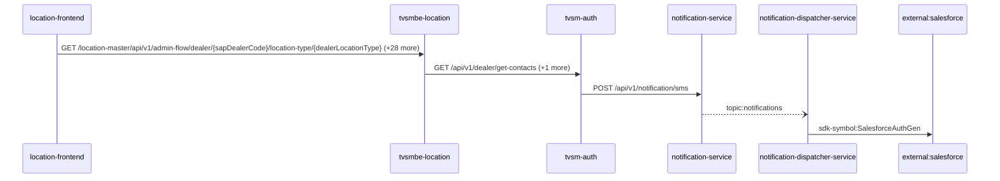

Steps:
| # | From | To | Via | Data (schema names) | Sync/Async | Confidence |
|---|---|---|---|---|---|---|
| 1 | location-frontend | tvsmbe-location | GET /location-master/api/v1/admin-flow/dealer/{sapDealerCode}/location-type/{dealerLocationType}, GET /location-master/api/v1/admin-flow/rejection-comments, GET /location-master/api/v1/admin-flow/summary (+26 more) | CreateDealerRequest, DealerListRequest, DealerResponse, DealerSearchFilterRequest, DealerSearchRequest (+8 more) | sync | high |
| 2 | tvsmbe-location | tvsm-auth | GET /api/v1/dealer/get-contacts, POST /auth/v1/app/token/validate | DealerContacts, TokenVerificationRequest, TokenVerificationResponse | sync | high |
| 3 | tvsm-auth | notification-service | POST /api/v1/notification/sms | NotificationResponse, SMSNotification | sync | medium |
| 4 | notification-service | notification-dispatcher-service | topic:notifications | Unknown | async | medium |
| 5 | notification-dispatcher-service | external:salesforce | sdk-symbol:SalesforceAuthGen | Unknown | sync | high |

Data touched: tvsmbe-location: mongo, mysql; tvsm-auth: mysql; notification-service: mongo; notification-dispatcher-service: mongo

Failure points: hop 1 location-frontend → tvsmbe-location: criticality hard; hop 2 tvsmbe-location → tvsm-auth: criticality hard; hop 3 tvsm-auth → notification-service: criticality hard; hop 4 notification-service → notification-dispatcher-service: criticality async; hop 5 notification-dispatcher-service → external:salesforce: criticality hard

Evidence:
- hop 1 (location-frontend → tvsmbe-location): `location-frontend/src/services/DealerDetailsService.ts:38`, `tvsmbe-location/src/main/java/com/tvsmotor/location_master/controller/AdminFlowController.java:28`, `location-frontend/src/services/DealerDetailsService.ts:69` (+42 more)
- hop 2 (tvsmbe-location → tvsm-auth): `tvsm-auth/src/main/java/com/tvsmotor/tvsmauth/user/profile/api/DealerController.java:42`, `tvsmbe-location/src/main/java/com/tvsmotor/location_master/service/UMSService.java:49`, `tvsmbe-location/src/main/java/com/tvsmotor/location_master/utils/OkHttpUtil.java:35` (+3 more)
- hop 3 (tvsm-auth → notification-service): `notification-service/src/main/java/com/tvsmotor/notification/controller/NotificationController.java:23`, `tvsm-auth/src/main/java/com/tvsmotor/tvsmauth/user/gateway/NotificationGateway.java:38`, `tvsm-auth/src/main/java/com/tvsmotor/tvsmauth/user/gateway/NotificationGateway.java:39` (+1 more)
- hop 4 (notification-service → notification-dispatcher-service): `notification-dispatcher-service/src/main/java/com/tvsmotor/notificationdispatcher/config/ServiceBusConfig.java:33`, `notification-dispatcher-service/src/main/java/com/tvsmotor/notificationdispatcher/config/ServiceBusConfig.java:34`, `notification-service/src/main/java/com/tvsmotor/notification/config/ServiceBusConfig.java:37` (+1 more)
- hop 5 (notification-dispatcher-service → external:salesforce): `notification-dispatcher-service/src/main/java/com/tvsmotor/notificationdispatcher/controller/SalesforceTokenController.java:18`, `notification-dispatcher-service/src/main/java/com/tvsmotor/notificationdispatcher/model/dto/salesforce/SalesforceData.java:5`, `notification-dispatcher-service/src/main/java/com/tvsmotor/notificationdispatcher/model/dto/salesforce/SalesforceTemplateKeys.java:8`

## Flow: location-frontend--external-salesforce-9f4abc
Summary: Starting at `location-frontend` (user action in location-frontend (frontend)), the flow passes through `tvsmbe-location`, `master-data-platform`, `notification-service`, `notification-dispatcher-service` and ends at `external:salesforce`, using 4 sync HTTP hop(s) and 1 async event hop(s); notification-dispatcher-service role: participant; confidence medium.

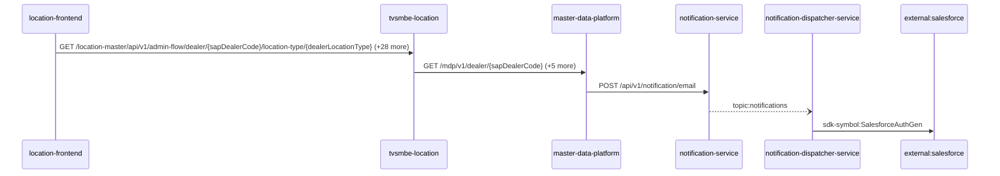

Steps:
| # | From | To | Via | Data (schema names) | Sync/Async | Confidence |
|---|---|---|---|---|---|---|
| 1 | location-frontend | tvsmbe-location | GET /location-master/api/v1/admin-flow/dealer/{sapDealerCode}/location-type/{dealerLocationType}, GET /location-master/api/v1/admin-flow/rejection-comments, GET /location-master/api/v1/admin-flow/summary (+26 more) | CreateDealerRequest, DealerListRequest, DealerResponse, DealerSearchFilterRequest, DealerSearchRequest (+8 more) | sync | high |
| 2 | tvsmbe-location | master-data-platform | GET /mdp/v1/dealer/{sapDealerCode}, GET /mdp/v1/dealer/{sapDealerCode}/branches, POST /mdp/v1/dealers/data (+3 more) | DealerStateWiseCountFilterRequest, DealerTypeStatusFlagsFilterRequest, GeneralResponse, ProximityRequest | sync | high |
| 3 | master-data-platform | notification-service | POST /api/v1/notification/email | EmailNotification, NotificationResponse | sync | high |
| 4 | notification-service | notification-dispatcher-service | topic:notifications | Unknown | async | medium |
| 5 | notification-dispatcher-service | external:salesforce | sdk-symbol:SalesforceAuthGen | Unknown | sync | high |

Data touched: tvsmbe-location: mongo, mysql; master-data-platform: mysql:xxxx.mysql.database.azure.com:mdp_20230904, other, redis; notification-service: mongo; notification-dispatcher-service: mongo

Failure points: hop 1 location-frontend → tvsmbe-location: criticality hard; hop 2 tvsmbe-location → master-data-platform: criticality hard; hop 3 master-data-platform → notification-service: criticality hard; hop 4 notification-service → notification-dispatcher-service: criticality async; hop 5 notification-dispatcher-service → external:salesforce: criticality hard

Evidence:
- hop 1 (location-frontend → tvsmbe-location): `location-frontend/src/services/DealerDetailsService.ts:38`, `tvsmbe-location/src/main/java/com/tvsmotor/location_master/controller/AdminFlowController.java:28`, `location-frontend/src/services/DealerDetailsService.ts:69` (+42 more)
- hop 2 (tvsmbe-location → master-data-platform): `master-data-platform/src/main/java/com/tvsmotor/mdp/controller/DealerController.java:20`, `tvsmbe-location/src/main/java/com/tvsmotor/location_master/service/MDPDealerService.java:68`, `tvsmbe-location/src/main/java/com/tvsmotor/location_master/utils/OkHttpUtil.java:35` (+7 more)
- hop 3 (master-data-platform → notification-service): `master-data-platform/src/main/java/com/tvsmotor/mdp/service/OkHttpService.java:24`, `master-data-platform/src/main/java/com/tvsmotor/mdp/service/notification_service/NotificationSenderService.java:69`, `notification-service/src/main/java/com/tvsmotor/notification/controller/NotificationController.java:23`
- hop 4 (notification-service → notification-dispatcher-service): `notification-dispatcher-service/src/main/java/com/tvsmotor/notificationdispatcher/config/ServiceBusConfig.java:33`, `notification-dispatcher-service/src/main/java/com/tvsmotor/notificationdispatcher/config/ServiceBusConfig.java:34`, `notification-service/src/main/java/com/tvsmotor/notification/config/ServiceBusConfig.java:37` (+1 more)
- hop 5 (notification-dispatcher-service → external:salesforce): `notification-dispatcher-service/src/main/java/com/tvsmotor/notificationdispatcher/controller/SalesforceTokenController.java:18`, `notification-dispatcher-service/src/main/java/com/tvsmotor/notificationdispatcher/model/dto/salesforce/SalesforceData.java:5`, `notification-dispatcher-service/src/main/java/com/tvsmotor/notificationdispatcher/model/dto/salesforce/SalesforceTemplateKeys.java:8`

## Flow: location-frontend--external-salesforce-a5f52d
Summary: Starting at `location-frontend` (user action in location-frontend (frontend)), the flow passes through `tvsmbe-location`, `notification-service`, `notification-dispatcher-service` and ends at `external:salesforce`, using 3 sync HTTP hop(s) and 1 async event hop(s); notification-dispatcher-service role: participant; confidence medium.

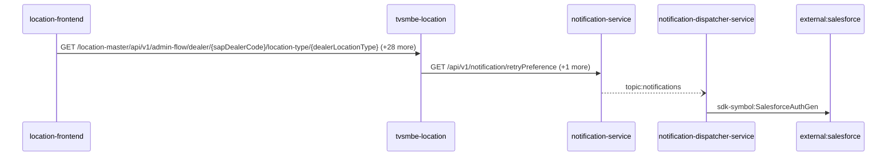

Steps:
| # | From | To | Via | Data (schema names) | Sync/Async | Confidence |
|---|---|---|---|---|---|---|
| 1 | location-frontend | tvsmbe-location | GET /location-master/api/v1/admin-flow/dealer/{sapDealerCode}/location-type/{dealerLocationType}, GET /location-master/api/v1/admin-flow/rejection-comments, GET /location-master/api/v1/admin-flow/summary (+26 more) | CreateDealerRequest, DealerListRequest, DealerResponse, DealerSearchFilterRequest, DealerSearchRequest (+8 more) | sync | high |
| 2 | tvsmbe-location | notification-service | GET /api/v1/notification/retryPreference, POST /api/v1/notification/sms | NotificationResponse, NotificationRetryPreference[], SMSNotification | sync | high |
| 3 | notification-service | notification-dispatcher-service | topic:notifications | Unknown | async | medium |
| 4 | notification-dispatcher-service | external:salesforce | sdk-symbol:SalesforceAuthGen | Unknown | sync | high |

Data touched: tvsmbe-location: mongo, mysql; notification-service: mongo; notification-dispatcher-service: mongo

Failure points: hop 1 location-frontend → tvsmbe-location: criticality hard; hop 2 tvsmbe-location → notification-service: criticality hard; hop 3 notification-service → notification-dispatcher-service: criticality async; hop 4 notification-dispatcher-service → external:salesforce: criticality hard

Evidence:
- hop 1 (location-frontend → tvsmbe-location): `location-frontend/src/services/DealerDetailsService.ts:38`, `tvsmbe-location/src/main/java/com/tvsmotor/location_master/controller/AdminFlowController.java:28`, `location-frontend/src/services/DealerDetailsService.ts:69` (+42 more)
- hop 2 (tvsmbe-location → notification-service): `notification-service/src/main/java/com/tvsmotor/notification/controller/NotificationRetryPreferenceController.java:17`, `tvsmbe-location/src/main/java/com/tvsmotor/location_master/service/NotificationSmsDispatcherService.java:62`, `tvsmbe-location/src/main/java/com/tvsmotor/location_master/utils/OkHttpUtil.java:35` (+3 more)
- hop 3 (notification-service → notification-dispatcher-service): `notification-dispatcher-service/src/main/java/com/tvsmotor/notificationdispatcher/config/ServiceBusConfig.java:33`, `notification-dispatcher-service/src/main/java/com/tvsmotor/notificationdispatcher/config/ServiceBusConfig.java:34`, `notification-service/src/main/java/com/tvsmotor/notification/config/ServiceBusConfig.java:37` (+1 more)
- hop 4 (notification-dispatcher-service → external:salesforce): `notification-dispatcher-service/src/main/java/com/tvsmotor/notificationdispatcher/controller/SalesforceTokenController.java:18`, `notification-dispatcher-service/src/main/java/com/tvsmotor/notificationdispatcher/model/dto/salesforce/SalesforceData.java:5`, `notification-dispatcher-service/src/main/java/com/tvsmotor/notificationdispatcher/model/dto/salesforce/SalesforceTemplateKeys.java:8`

## Flow: location-frontend--notification-dispatcher-service-115620
Summary: Starting at `location-frontend` (user action in location-frontend (frontend)), the flow passes through `tvsmbe-location`, `master-data-platform`, `tvsmbe-mdp-bff`, `notification-service` and ends at `notification-dispatcher-service`, using 3 sync HTTP hop(s) and 2 async event hop(s); notification-dispatcher-service role: terminal; confidence medium; truncated at the depth cap.

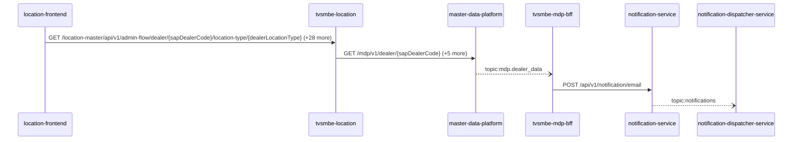

Steps:
| # | From | To | Via | Data (schema names) | Sync/Async | Confidence |
|---|---|---|---|---|---|---|
| 1 | location-frontend | tvsmbe-location | GET /location-master/api/v1/admin-flow/dealer/{sapDealerCode}/location-type/{dealerLocationType}, GET /location-master/api/v1/admin-flow/rejection-comments, GET /location-master/api/v1/admin-flow/summary (+26 more) | CreateDealerRequest, DealerListRequest, DealerResponse, DealerSearchFilterRequest, DealerSearchRequest (+8 more) | sync | high |
| 2 | tvsmbe-location | master-data-platform | GET /mdp/v1/dealer/{sapDealerCode}, GET /mdp/v1/dealer/{sapDealerCode}/branches, POST /mdp/v1/dealers/data (+3 more) | DealerStateWiseCountFilterRequest, DealerTypeStatusFlagsFilterRequest, GeneralResponse, ProximityRequest | sync | high |
| 3 | master-data-platform | tvsmbe-mdp-bff | topic:mdp.dealer_data | DealerData | async | medium |
| 4 | tvsmbe-mdp-bff | notification-service | POST /api/v1/notification/email | EmailNotification, NotificationResponse | sync | high |
| 5 | notification-service | notification-dispatcher-service | topic:notifications | Unknown | async | medium |

Data touched: tvsmbe-location: mongo, mysql; master-data-platform: mysql:xxxx.mysql.database.azure.com:mdp_20230904, other, redis; tvsmbe-mdp-bff: mysql, mysql:tvsmazcmndbsdev01-ci.mysql.database.azure.com:tvsmazebffsdbdev01; notification-service: mongo; notification-dispatcher-service: mongo

Failure points: hop 1 location-frontend → tvsmbe-location: criticality hard; hop 2 tvsmbe-location → master-data-platform: criticality hard; hop 3 master-data-platform → tvsmbe-mdp-bff: criticality async; hop 4 tvsmbe-mdp-bff → notification-service: criticality hard; hop 5 notification-service → notification-dispatcher-service: criticality async

Evidence:
- hop 1 (location-frontend → tvsmbe-location): `location-frontend/src/services/DealerDetailsService.ts:38`, `tvsmbe-location/src/main/java/com/tvsmotor/location_master/controller/AdminFlowController.java:28`, `location-frontend/src/services/DealerDetailsService.ts:69` (+42 more)
- hop 2 (tvsmbe-location → master-data-platform): `master-data-platform/src/main/java/com/tvsmotor/mdp/controller/DealerController.java:20`, `tvsmbe-location/src/main/java/com/tvsmotor/location_master/service/MDPDealerService.java:68`, `tvsmbe-location/src/main/java/com/tvsmotor/location_master/utils/OkHttpUtil.java:35` (+7 more)
- hop 3 (master-data-platform → tvsmbe-mdp-bff): `master-data-platform/src/main/java/com/tvsmotor/mdp/config/DealerMasterServiceBusConfig.java:26`, `master-data-platform/src/main/java/com/tvsmotor/mdp/config/DealerMasterServiceBusConfig.java:27`, `tvsmbe-mdp-bff/outbound/src/main/java/com/tvsmotor/mdp_bff/outbound/config/BffServiceBusConfig.java:24` (+1 more)
- hop 4 (tvsmbe-mdp-bff → notification-service): `notification-service/src/main/java/com/tvsmotor/notification/controller/NotificationController.java:23`, `tvsmbe-mdp-bff/outbound/src/main/java/com/tvsmotor/mdp_bff/outbound/service/NotificationSenderService.java:46`, `tvsmbe-mdp-bff/outbound/src/main/java/com/tvsmotor/mdp_bff/outbound/service/OkHttpService.java:88`
- hop 5 (notification-service → notification-dispatcher-service): `notification-dispatcher-service/src/main/java/com/tvsmotor/notificationdispatcher/config/ServiceBusConfig.java:33`, `notification-dispatcher-service/src/main/java/com/tvsmotor/notificationdispatcher/config/ServiceBusConfig.java:34`, `notification-service/src/main/java/com/tvsmotor/notification/config/ServiceBusConfig.java:37` (+1 more)

## Flow: location-frontend--notification-dispatcher-service-48fe37
Summary: Starting at `location-frontend` (user action in location-frontend (frontend)), the flow passes through `tvsmbe-location`, `tvsm-auth`, `master-data-platform`, `notification-service` and ends at `notification-dispatcher-service`, using 4 sync HTTP hop(s) and 1 async event hop(s); notification-dispatcher-service role: terminal; confidence medium; truncated at the depth cap.

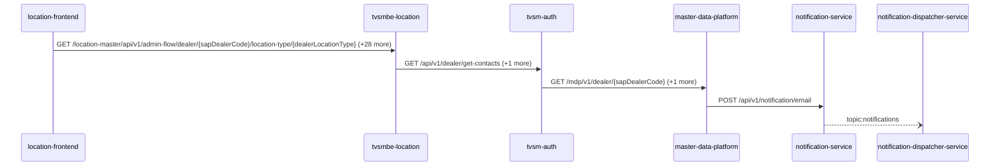

Steps:
| # | From | To | Via | Data (schema names) | Sync/Async | Confidence |
|---|---|---|---|---|---|---|
| 1 | location-frontend | tvsmbe-location | GET /location-master/api/v1/admin-flow/dealer/{sapDealerCode}/location-type/{dealerLocationType}, GET /location-master/api/v1/admin-flow/rejection-comments, GET /location-master/api/v1/admin-flow/summary (+26 more) | CreateDealerRequest, DealerListRequest, DealerResponse, DealerSearchFilterRequest, DealerSearchRequest (+8 more) | sync | high |
| 2 | tvsmbe-location | tvsm-auth | GET /api/v1/dealer/get-contacts, POST /auth/v1/app/token/validate | DealerContacts, TokenVerificationRequest, TokenVerificationResponse | sync | high |
| 3 | tvsm-auth | master-data-platform | GET /mdp/v1/dealer/{sapDealerCode}, GET /mdp/v1/dealer/{sapDealerCode}/branches | GeneralResponse | sync | medium |
| 4 | master-data-platform | notification-service | POST /api/v1/notification/email | EmailNotification, NotificationResponse | sync | high |
| 5 | notification-service | notification-dispatcher-service | topic:notifications | Unknown | async | medium |

Data touched: tvsmbe-location: mongo, mysql; tvsm-auth: mysql; master-data-platform: mysql:xxxx.mysql.database.azure.com:mdp_20230904, other, redis; notification-service: mongo; notification-dispatcher-service: mongo

Failure points: hop 1 location-frontend → tvsmbe-location: criticality hard; hop 2 tvsmbe-location → tvsm-auth: criticality hard; hop 3 tvsm-auth → master-data-platform: criticality hard; hop 4 master-data-platform → notification-service: criticality hard; hop 5 notification-service → notification-dispatcher-service: criticality async

Evidence:
- hop 1 (location-frontend → tvsmbe-location): `location-frontend/src/services/DealerDetailsService.ts:38`, `tvsmbe-location/src/main/java/com/tvsmotor/location_master/controller/AdminFlowController.java:28`, `location-frontend/src/services/DealerDetailsService.ts:69` (+42 more)
- hop 2 (tvsmbe-location → tvsm-auth): `tvsm-auth/src/main/java/com/tvsmotor/tvsmauth/user/profile/api/DealerController.java:42`, `tvsmbe-location/src/main/java/com/tvsmotor/location_master/service/UMSService.java:49`, `tvsmbe-location/src/main/java/com/tvsmotor/location_master/utils/OkHttpUtil.java:35` (+3 more)
- hop 3 (tvsm-auth → master-data-platform): `master-data-platform/src/main/java/com/tvsmotor/mdp/controller/DealerController.java:20`, `tvsm-auth/src/main/java/com/tvsmotor/tvsmauth/user/gateway/MDPServiceClient.java:86`, `tvsm-auth/src/main/java/com/tvsmotor/tvsmauth/user/gateway/MDPServiceClient.java:110` (+2 more)
- hop 4 (master-data-platform → notification-service): `master-data-platform/src/main/java/com/tvsmotor/mdp/service/OkHttpService.java:24`, `master-data-platform/src/main/java/com/tvsmotor/mdp/service/notification_service/NotificationSenderService.java:69`, `notification-service/src/main/java/com/tvsmotor/notification/controller/NotificationController.java:23`
- hop 5 (notification-service → notification-dispatcher-service): `notification-dispatcher-service/src/main/java/com/tvsmotor/notificationdispatcher/config/ServiceBusConfig.java:33`, `notification-dispatcher-service/src/main/java/com/tvsmotor/notificationdispatcher/config/ServiceBusConfig.java:34`, `notification-service/src/main/java/com/tvsmotor/notification/config/ServiceBusConfig.java:37` (+1 more)

## Flow: master-data-platform--external-salesforce-6c65ac
Summary: Starting at `master-data-platform` (scheduled job(s) in master-data-platform (job-to-call link not resolved): CronService.logMetricsPeriodically; master-data-platform publishes mdp.dealer_data), the flow passes through `tvsmbe-mdp-bff`, `notification-service`, `notification-dispatcher-service` and ends at `external:salesforce`, using 2 sync HTTP hop(s) and 2 async event hop(s); notification-dispatcher-service role: participant; confidence medium.

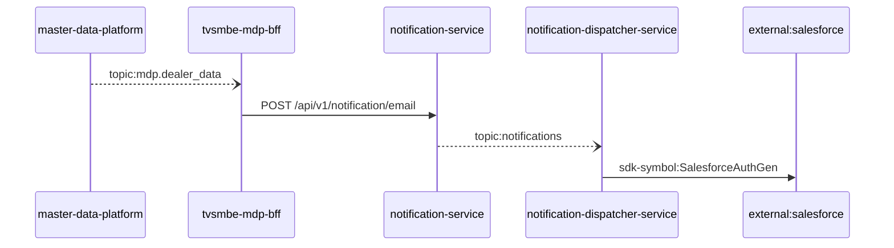

Steps:
| # | From | To | Via | Data (schema names) | Sync/Async | Confidence |
|---|---|---|---|---|---|---|
| 1 | master-data-platform | tvsmbe-mdp-bff | topic:mdp.dealer_data | DealerData | async | medium |
| 2 | tvsmbe-mdp-bff | notification-service | POST /api/v1/notification/email | EmailNotification, NotificationResponse | sync | high |
| 3 | notification-service | notification-dispatcher-service | topic:notifications | Unknown | async | medium |
| 4 | notification-dispatcher-service | external:salesforce | sdk-symbol:SalesforceAuthGen | Unknown | sync | high |

Data touched: master-data-platform: mysql:xxxx.mysql.database.azure.com:mdp_20230904, other, redis; tvsmbe-mdp-bff: mysql, mysql:tvsmazcmndbsdev01-ci.mysql.database.azure.com:tvsmazebffsdbdev01; notification-service: mongo; notification-dispatcher-service: mongo

Failure points: hop 1 master-data-platform → tvsmbe-mdp-bff: criticality async; hop 2 tvsmbe-mdp-bff → notification-service: criticality hard; hop 3 notification-service → notification-dispatcher-service: criticality async; hop 4 notification-dispatcher-service → external:salesforce: criticality hard

Evidence:
- hop 1 (master-data-platform → tvsmbe-mdp-bff): `master-data-platform/src/main/java/com/tvsmotor/mdp/config/DealerMasterServiceBusConfig.java:26`, `master-data-platform/src/main/java/com/tvsmotor/mdp/config/DealerMasterServiceBusConfig.java:27`, `tvsmbe-mdp-bff/outbound/src/main/java/com/tvsmotor/mdp_bff/outbound/config/BffServiceBusConfig.java:24` (+1 more)
- hop 2 (tvsmbe-mdp-bff → notification-service): `notification-service/src/main/java/com/tvsmotor/notification/controller/NotificationController.java:23`, `tvsmbe-mdp-bff/outbound/src/main/java/com/tvsmotor/mdp_bff/outbound/service/NotificationSenderService.java:46`, `tvsmbe-mdp-bff/outbound/src/main/java/com/tvsmotor/mdp_bff/outbound/service/OkHttpService.java:88`
- hop 3 (notification-service → notification-dispatcher-service): `notification-dispatcher-service/src/main/java/com/tvsmotor/notificationdispatcher/config/ServiceBusConfig.java:33`, `notification-dispatcher-service/src/main/java/com/tvsmotor/notificationdispatcher/config/ServiceBusConfig.java:34`, `notification-service/src/main/java/com/tvsmotor/notification/config/ServiceBusConfig.java:37` (+1 more)
- hop 4 (notification-dispatcher-service → external:salesforce): `notification-dispatcher-service/src/main/java/com/tvsmotor/notificationdispatcher/controller/SalesforceTokenController.java:18`, `notification-dispatcher-service/src/main/java/com/tvsmotor/notificationdispatcher/model/dto/salesforce/SalesforceData.java:5`, `notification-dispatcher-service/src/main/java/com/tvsmotor/notificationdispatcher/model/dto/salesforce/SalesforceTemplateKeys.java:8`

## Flow: master-data-platform--external-salesforce-e67cbf
Summary: Starting at `master-data-platform` (scheduled job(s) in master-data-platform (job-to-call link not resolved): CronService.logMetricsPeriodically), the flow passes through `notification-service`, `notification-dispatcher-service` and ends at `external:salesforce`, using 2 sync HTTP hop(s) and 1 async event hop(s); notification-dispatcher-service role: participant; confidence medium.

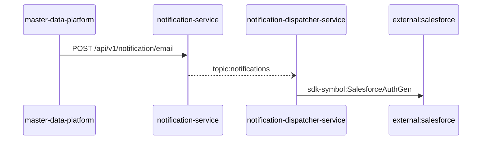

Steps:
| # | From | To | Via | Data (schema names) | Sync/Async | Confidence |
|---|---|---|---|---|---|---|
| 1 | master-data-platform | notification-service | POST /api/v1/notification/email | EmailNotification, NotificationResponse | sync | high |
| 2 | notification-service | notification-dispatcher-service | topic:notifications | Unknown | async | medium |
| 3 | notification-dispatcher-service | external:salesforce | sdk-symbol:SalesforceAuthGen | Unknown | sync | high |

Data touched: master-data-platform: mysql:xxxx.mysql.database.azure.com:mdp_20230904, other, redis; notification-service: mongo; notification-dispatcher-service: mongo

Failure points: hop 1 master-data-platform → notification-service: criticality hard; hop 2 notification-service → notification-dispatcher-service: criticality async; hop 3 notification-dispatcher-service → external:salesforce: criticality hard

Evidence:
- hop 1 (master-data-platform → notification-service): `master-data-platform/src/main/java/com/tvsmotor/mdp/service/OkHttpService.java:24`, `master-data-platform/src/main/java/com/tvsmotor/mdp/service/notification_service/NotificationSenderService.java:69`, `notification-service/src/main/java/com/tvsmotor/notification/controller/NotificationController.java:23`
- hop 2 (notification-service → notification-dispatcher-service): `notification-dispatcher-service/src/main/java/com/tvsmotor/notificationdispatcher/config/ServiceBusConfig.java:33`, `notification-dispatcher-service/src/main/java/com/tvsmotor/notificationdispatcher/config/ServiceBusConfig.java:34`, `notification-service/src/main/java/com/tvsmotor/notification/config/ServiceBusConfig.java:37` (+1 more)
- hop 3 (notification-dispatcher-service → external:salesforce): `notification-dispatcher-service/src/main/java/com/tvsmotor/notificationdispatcher/controller/SalesforceTokenController.java:18`, `notification-dispatcher-service/src/main/java/com/tvsmotor/notificationdispatcher/model/dto/salesforce/SalesforceData.java:5`, `notification-dispatcher-service/src/main/java/com/tvsmotor/notificationdispatcher/model/dto/salesforce/SalesforceTemplateKeys.java:8`

## Flow: notification-dispatcher-service--external-salesforce
Summary: Starting at `notification-dispatcher-service` (scheduled job(s) in notification-dispatcher-service (job-to-call link not resolved): ThreadPoolMonitor.logThreadPoolStats), the flow ends at `external:salesforce`, using 1 sync HTTP hop(s) and 0 async event hop(s); notification-dispatcher-service role: entry; confidence high.

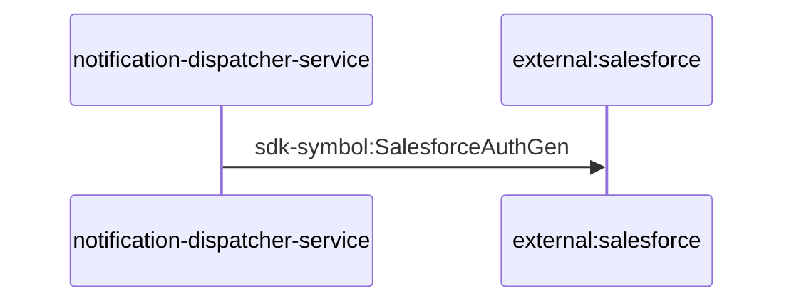

Steps:
| # | From | To | Via | Data (schema names) | Sync/Async | Confidence |
|---|---|---|---|---|---|---|
| 1 | notification-dispatcher-service | external:salesforce | sdk-symbol:SalesforceAuthGen | Unknown | sync | high |

Data touched: notification-dispatcher-service: mongo

Failure points: hop 1 notification-dispatcher-service → external:salesforce: criticality hard

Evidence:
- hop 1 (notification-dispatcher-service → external:salesforce): `notification-dispatcher-service/src/main/java/com/tvsmotor/notificationdispatcher/controller/SalesforceTokenController.java:18`, `notification-dispatcher-service/src/main/java/com/tvsmotor/notificationdispatcher/model/dto/salesforce/SalesforceData.java:5`, `notification-dispatcher-service/src/main/java/com/tvsmotor/notificationdispatcher/model/dto/salesforce/SalesforceTemplateKeys.java:8`

## Flow: tvs-cps-backend--external-salesforce-2bffce
Summary: Starting at `tvs-cps-backend` (scheduled job(s) in tvs-cps-backend (job-to-call link not resolved): JobScheduler.loadCatalogData, JobScheduler.retrieveMDPDealers, JobScheduler.retrieveMerchandiseStock (+2 more)), the flow passes through `notification-service`, `notification-dispatcher-service` and ends at `external:salesforce`, using 2 sync HTTP hop(s) and 1 async event hop(s); notification-dispatcher-service role: participant; confidence medium.

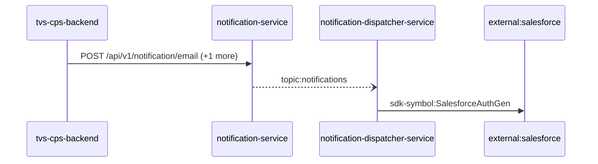

Steps:
| # | From | To | Via | Data (schema names) | Sync/Async | Confidence |
|---|---|---|---|---|---|---|
| 1 | tvs-cps-backend | notification-service | POST /api/v1/notification/email, POST /api/v1/notification/sms | EmailNotification, NotificationResponse, SMSNotification | sync | medium |
| 2 | notification-service | notification-dispatcher-service | topic:notifications | Unknown | async | medium |
| 3 | notification-dispatcher-service | external:salesforce | sdk-symbol:SalesforceAuthGen | Unknown | sync | high |

Data touched: tvs-cps-backend: postgres, postgres:nmazcpsdbsdev01-cmn-postgres-uks.postgres.database.azure.com:nmazcpsdbdev01-cps; notification-service: mongo; notification-dispatcher-service: mongo

Failure points: hop 1 tvs-cps-backend → notification-service: criticality hard; hop 2 notification-service → notification-dispatcher-service: criticality async; hop 3 notification-dispatcher-service → external:salesforce: criticality hard

Evidence:
- hop 1 (tvs-cps-backend → notification-service): `TVS-CPS-BACKEND/bff-service/src/main/java/com/tvsm/bff/client/OptAndNotificationClient.java:176`, `TVS-CPS-BACKEND/bff-service/src/main/java/com/tvsm/bff/client/OptAndNotificationClient.java:226`, `notification-service/src/main/java/com/tvsmotor/notification/controller/NotificationController.java:23` (+1 more)
- hop 2 (notification-service → notification-dispatcher-service): `notification-dispatcher-service/src/main/java/com/tvsmotor/notificationdispatcher/config/ServiceBusConfig.java:33`, `notification-dispatcher-service/src/main/java/com/tvsmotor/notificationdispatcher/config/ServiceBusConfig.java:34`, `notification-service/src/main/java/com/tvsmotor/notification/config/ServiceBusConfig.java:37` (+1 more)
- hop 3 (notification-dispatcher-service → external:salesforce): `notification-dispatcher-service/src/main/java/com/tvsmotor/notificationdispatcher/controller/SalesforceTokenController.java:18`, `notification-dispatcher-service/src/main/java/com/tvsmotor/notificationdispatcher/model/dto/salesforce/SalesforceData.java:5`, `notification-dispatcher-service/src/main/java/com/tvsmotor/notificationdispatcher/model/dto/salesforce/SalesforceTemplateKeys.java:8`

## Flow: tvs-cps-jobs--external-salesforce-bb6648
Summary: Starting at `tvs-cps-jobs` (scheduled job(s) in tvs-cps-jobs (job-to-call link not resolved): CronJobScheduler.allBookingsScheduler, CronJobScheduler.allEnquiriesScheduler, CronJobScheduler.availableStockScheduler (+27 more); request to tvs-cps-jobs from outside the registry (no internal caller)), the flow passes through `tvs-cps-backend`, `notification-service`, `notification-dispatcher-service` and ends at `external:salesforce`, using 3 sync HTTP hop(s) and 1 async event hop(s); notification-dispatcher-service role: participant; confidence medium.

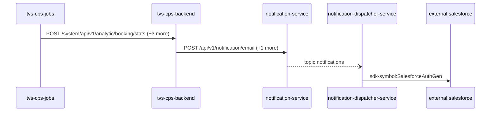

Steps:
| # | From | To | Via | Data (schema names) | Sync/Async | Confidence |
|---|---|---|---|---|---|---|
| 1 | tvs-cps-jobs | tvs-cps-backend | POST /system/api/v1/analytic/booking/stats, POST /system/api/v1/analytics-dashboard/indicators/calculate, POST /system/api/v1/appointments/auto-close (+1 more) | APIResponse<map<string,object>>, AnalyticsDto, AnalyticsRequestDTO | sync | high |
| 2 | tvs-cps-backend | notification-service | POST /api/v1/notification/email, POST /api/v1/notification/sms | EmailNotification, NotificationResponse, SMSNotification | sync | medium |
| 3 | notification-service | notification-dispatcher-service | topic:notifications | Unknown | async | medium |
| 4 | notification-dispatcher-service | external:salesforce | sdk-symbol:SalesforceAuthGen | Unknown | sync | high |

Data touched: tvs-cps-backend: postgres, postgres:nmazcpsdbsdev01-cmn-postgres-uks.postgres.database.azure.com:nmazcpsdbdev01-cps; notification-service: mongo; notification-dispatcher-service: mongo

Failure points: hop 1 tvs-cps-jobs → tvs-cps-backend: criticality hard; hop 2 tvs-cps-backend → notification-service: criticality hard; hop 3 notification-service → notification-dispatcher-service: criticality async; hop 4 notification-dispatcher-service → external:salesforce: criticality hard

Evidence:
- hop 1 (tvs-cps-jobs → tvs-cps-backend): `TVS-CPS-BACKEND/bff-service/src/main/java/com/tvsm/bff/controller/AnalyticsController.java:23`, `TVS-CPS-JOBS/src/main/java/com/tvsm/jobs/service/AnalyticsService.java:32`, `TVS-CPS-JOBS/src/main/java/com/tvsm/jobs/service/RestCallService.java:50` (+4 more)
- hop 2 (tvs-cps-backend → notification-service): `TVS-CPS-BACKEND/bff-service/src/main/java/com/tvsm/bff/client/OptAndNotificationClient.java:176`, `TVS-CPS-BACKEND/bff-service/src/main/java/com/tvsm/bff/client/OptAndNotificationClient.java:226`, `notification-service/src/main/java/com/tvsmotor/notification/controller/NotificationController.java:23` (+1 more)
- hop 3 (notification-service → notification-dispatcher-service): `notification-dispatcher-service/src/main/java/com/tvsmotor/notificationdispatcher/config/ServiceBusConfig.java:33`, `notification-dispatcher-service/src/main/java/com/tvsmotor/notificationdispatcher/config/ServiceBusConfig.java:34`, `notification-service/src/main/java/com/tvsmotor/notification/config/ServiceBusConfig.java:37` (+1 more)
- hop 4 (notification-dispatcher-service → external:salesforce): `notification-dispatcher-service/src/main/java/com/tvsmotor/notificationdispatcher/controller/SalesforceTokenController.java:18`, `notification-dispatcher-service/src/main/java/com/tvsmotor/notificationdispatcher/model/dto/salesforce/SalesforceData.java:5`, `notification-dispatcher-service/src/main/java/com/tvsmotor/notificationdispatcher/model/dto/salesforce/SalesforceTemplateKeys.java:8`

## Flow: tvs-cps-portal--external-salesforce-38bf3e
Summary: Starting at `tvs-cps-portal` (user action in tvs-cps-portal (frontend)), the flow passes through `tvs-cps-backend`, `notification-service`, `notification-dispatcher-service` and ends at `external:salesforce`, using 3 sync HTTP hop(s) and 1 async event hop(s); notification-dispatcher-service role: participant; confidence medium.

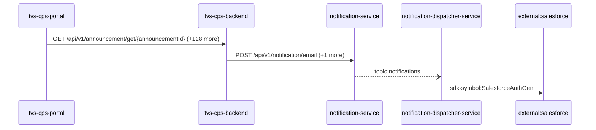

Steps:
| # | From | To | Via | Data (schema names) | Sync/Async | Confidence |
|---|---|---|---|---|---|---|
| 1 | tvs-cps-portal | tvs-cps-backend | GET /api/v1/announcement/get/{announcementId}, GET /api/v1/announcement/user/banners, GET /api/v1/appointments/{appointmentId} (+126 more) | APIResponse<AnnouncementResponseDto>, APIResponse<AnnouncementResponseDto[]>, APIResponse<AppointmentCountResponseDTO>, APIResponse<AppointmentDashboardResponseDTO>, APIResponse<AppointmentDetailResponseDTO> (+105 more) | sync | medium |
| 2 | tvs-cps-backend | notification-service | POST /api/v1/notification/email, POST /api/v1/notification/sms | EmailNotification, NotificationResponse, SMSNotification | sync | medium |
| 3 | notification-service | notification-dispatcher-service | topic:notifications | Unknown | async | medium |
| 4 | notification-dispatcher-service | external:salesforce | sdk-symbol:SalesforceAuthGen | Unknown | sync | high |

Data touched: tvs-cps-backend: postgres, postgres:nmazcpsdbsdev01-cmn-postgres-uks.postgres.database.azure.com:nmazcpsdbdev01-cps; notification-service: mongo; notification-dispatcher-service: mongo

Failure points: hop 1 tvs-cps-portal → tvs-cps-backend: criticality hard; hop 2 tvs-cps-backend → notification-service: criticality hard; hop 3 notification-service → notification-dispatcher-service: criticality async; hop 4 notification-dispatcher-service → external:salesforce: criticality hard

Evidence:
- hop 1 (tvs-cps-portal → tvs-cps-backend): `TVS-CPS-BACKEND/announcement-service/src/main/java/com/tvsm/announcement/controller/AnnouncementController.java:31`, `TVS-CPS-PORTAL/channel-partner-system/src/services/notification.service.ts:140`, `TVS-CPS-PORTAL/channel-partner-system/src/services/notification.service.ts:144` (+194 more)
- hop 2 (tvs-cps-backend → notification-service): `TVS-CPS-BACKEND/bff-service/src/main/java/com/tvsm/bff/client/OptAndNotificationClient.java:176`, `TVS-CPS-BACKEND/bff-service/src/main/java/com/tvsm/bff/client/OptAndNotificationClient.java:226`, `notification-service/src/main/java/com/tvsmotor/notification/controller/NotificationController.java:23` (+1 more)
- hop 3 (notification-service → notification-dispatcher-service): `notification-dispatcher-service/src/main/java/com/tvsmotor/notificationdispatcher/config/ServiceBusConfig.java:33`, `notification-dispatcher-service/src/main/java/com/tvsmotor/notificationdispatcher/config/ServiceBusConfig.java:34`, `notification-service/src/main/java/com/tvsmotor/notification/config/ServiceBusConfig.java:37` (+1 more)
- hop 4 (notification-dispatcher-service → external:salesforce): `notification-dispatcher-service/src/main/java/com/tvsmotor/notificationdispatcher/controller/SalesforceTokenController.java:18`, `notification-dispatcher-service/src/main/java/com/tvsmotor/notificationdispatcher/model/dto/salesforce/SalesforceData.java:5`, `notification-dispatcher-service/src/main/java/com/tvsmotor/notificationdispatcher/model/dto/salesforce/SalesforceTemplateKeys.java:8`

## Flow: tvsm-auth--external-salesforce-8065ac
Summary: Starting at `tvsm-auth` (scheduled job(s) in tvsm-auth (job-to-call link not resolved): CacheClearScheduler.evictAllCachesAtIntervals, NotificationReminder.sendSMSForFaceLogin), the flow passes through `master-data-platform`, `notification-service`, `notification-dispatcher-service` and ends at `external:salesforce`, using 3 sync HTTP hop(s) and 1 async event hop(s); notification-dispatcher-service role: participant; confidence medium.

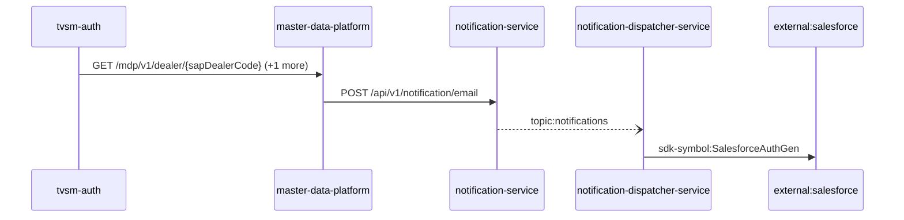

Steps:
| # | From | To | Via | Data (schema names) | Sync/Async | Confidence |
|---|---|---|---|---|---|---|
| 1 | tvsm-auth | master-data-platform | GET /mdp/v1/dealer/{sapDealerCode}, GET /mdp/v1/dealer/{sapDealerCode}/branches | GeneralResponse | sync | medium |
| 2 | master-data-platform | notification-service | POST /api/v1/notification/email | EmailNotification, NotificationResponse | sync | high |
| 3 | notification-service | notification-dispatcher-service | topic:notifications | Unknown | async | medium |
| 4 | notification-dispatcher-service | external:salesforce | sdk-symbol:SalesforceAuthGen | Unknown | sync | high |

Data touched: tvsm-auth: mysql; master-data-platform: mysql:xxxx.mysql.database.azure.com:mdp_20230904, other, redis; notification-service: mongo; notification-dispatcher-service: mongo

Failure points: hop 1 tvsm-auth → master-data-platform: criticality hard; hop 2 master-data-platform → notification-service: criticality hard; hop 3 notification-service → notification-dispatcher-service: criticality async; hop 4 notification-dispatcher-service → external:salesforce: criticality hard

Evidence:
- hop 1 (tvsm-auth → master-data-platform): `master-data-platform/src/main/java/com/tvsmotor/mdp/controller/DealerController.java:20`, `tvsm-auth/src/main/java/com/tvsmotor/tvsmauth/user/gateway/MDPServiceClient.java:86`, `tvsm-auth/src/main/java/com/tvsmotor/tvsmauth/user/gateway/MDPServiceClient.java:110` (+2 more)
- hop 2 (master-data-platform → notification-service): `master-data-platform/src/main/java/com/tvsmotor/mdp/service/OkHttpService.java:24`, `master-data-platform/src/main/java/com/tvsmotor/mdp/service/notification_service/NotificationSenderService.java:69`, `notification-service/src/main/java/com/tvsmotor/notification/controller/NotificationController.java:23`
- hop 3 (notification-service → notification-dispatcher-service): `notification-dispatcher-service/src/main/java/com/tvsmotor/notificationdispatcher/config/ServiceBusConfig.java:33`, `notification-dispatcher-service/src/main/java/com/tvsmotor/notificationdispatcher/config/ServiceBusConfig.java:34`, `notification-service/src/main/java/com/tvsmotor/notification/config/ServiceBusConfig.java:37` (+1 more)
- hop 4 (notification-dispatcher-service → external:salesforce): `notification-dispatcher-service/src/main/java/com/tvsmotor/notificationdispatcher/controller/SalesforceTokenController.java:18`, `notification-dispatcher-service/src/main/java/com/tvsmotor/notificationdispatcher/model/dto/salesforce/SalesforceData.java:5`, `notification-dispatcher-service/src/main/java/com/tvsmotor/notificationdispatcher/model/dto/salesforce/SalesforceTemplateKeys.java:8`

## Flow: tvsm-auth--external-salesforce-c5b275
Summary: Starting at `tvsm-auth` (scheduled job(s) in tvsm-auth (job-to-call link not resolved): CacheClearScheduler.evictAllCachesAtIntervals, NotificationReminder.sendSMSForFaceLogin), the flow passes through `master-data-platform`, `tvsmbe-mdp-bff`, `notification-service`, `notification-dispatcher-service` and ends at `external:salesforce`, using 3 sync HTTP hop(s) and 2 async event hop(s); notification-dispatcher-service role: participant; confidence medium.

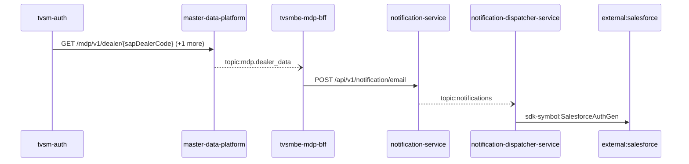

Steps:
| # | From | To | Via | Data (schema names) | Sync/Async | Confidence |
|---|---|---|---|---|---|---|
| 1 | tvsm-auth | master-data-platform | GET /mdp/v1/dealer/{sapDealerCode}, GET /mdp/v1/dealer/{sapDealerCode}/branches | GeneralResponse | sync | medium |
| 2 | master-data-platform | tvsmbe-mdp-bff | topic:mdp.dealer_data | DealerData | async | medium |
| 3 | tvsmbe-mdp-bff | notification-service | POST /api/v1/notification/email | EmailNotification, NotificationResponse | sync | high |
| 4 | notification-service | notification-dispatcher-service | topic:notifications | Unknown | async | medium |
| 5 | notification-dispatcher-service | external:salesforce | sdk-symbol:SalesforceAuthGen | Unknown | sync | high |

Data touched: tvsm-auth: mysql; master-data-platform: mysql:xxxx.mysql.database.azure.com:mdp_20230904, other, redis; tvsmbe-mdp-bff: mysql, mysql:tvsmazcmndbsdev01-ci.mysql.database.azure.com:tvsmazebffsdbdev01; notification-service: mongo; notification-dispatcher-service: mongo

Failure points: hop 1 tvsm-auth → master-data-platform: criticality hard; hop 2 master-data-platform → tvsmbe-mdp-bff: criticality async; hop 3 tvsmbe-mdp-bff → notification-service: criticality hard; hop 4 notification-service → notification-dispatcher-service: criticality async; hop 5 notification-dispatcher-service → external:salesforce: criticality hard

Evidence:
- hop 1 (tvsm-auth → master-data-platform): `master-data-platform/src/main/java/com/tvsmotor/mdp/controller/DealerController.java:20`, `tvsm-auth/src/main/java/com/tvsmotor/tvsmauth/user/gateway/MDPServiceClient.java:86`, `tvsm-auth/src/main/java/com/tvsmotor/tvsmauth/user/gateway/MDPServiceClient.java:110` (+2 more)
- hop 2 (master-data-platform → tvsmbe-mdp-bff): `master-data-platform/src/main/java/com/tvsmotor/mdp/config/DealerMasterServiceBusConfig.java:26`, `master-data-platform/src/main/java/com/tvsmotor/mdp/config/DealerMasterServiceBusConfig.java:27`, `tvsmbe-mdp-bff/outbound/src/main/java/com/tvsmotor/mdp_bff/outbound/config/BffServiceBusConfig.java:24` (+1 more)
- hop 3 (tvsmbe-mdp-bff → notification-service): `notification-service/src/main/java/com/tvsmotor/notification/controller/NotificationController.java:23`, `tvsmbe-mdp-bff/outbound/src/main/java/com/tvsmotor/mdp_bff/outbound/service/NotificationSenderService.java:46`, `tvsmbe-mdp-bff/outbound/src/main/java/com/tvsmotor/mdp_bff/outbound/service/OkHttpService.java:88`
- hop 4 (notification-service → notification-dispatcher-service): `notification-dispatcher-service/src/main/java/com/tvsmotor/notificationdispatcher/config/ServiceBusConfig.java:33`, `notification-dispatcher-service/src/main/java/com/tvsmotor/notificationdispatcher/config/ServiceBusConfig.java:34`, `notification-service/src/main/java/com/tvsmotor/notification/config/ServiceBusConfig.java:37` (+1 more)
- hop 5 (notification-dispatcher-service → external:salesforce): `notification-dispatcher-service/src/main/java/com/tvsmotor/notificationdispatcher/controller/SalesforceTokenController.java:18`, `notification-dispatcher-service/src/main/java/com/tvsmotor/notificationdispatcher/model/dto/salesforce/SalesforceData.java:5`, `notification-dispatcher-service/src/main/java/com/tvsmotor/notificationdispatcher/model/dto/salesforce/SalesforceTemplateKeys.java:8`

## Flow: tvsm-marketplace-service--external-salesforce-551358
Summary: Starting at `tvsm-marketplace-service` (scheduled job(s) in tvsm-marketplace-service (job-to-call link not resolved): AmazonPriceUpdateExecutorService.scheduledDrain, FlipkartPriceUpdateExecutorService.scheduledDrain, MarketplacePriceUpdateTaskService.cleanupDoneTasks (+2 more); request to tvsm-marketplace-service from outside the registry (no internal caller)), the flow passes through `master-data-platform`, `notification-service`, `notification-dispatcher-service` and ends at `external:salesforce`, using 3 sync HTTP hop(s) and 1 async event hop(s); notification-dispatcher-service role: participant; confidence medium.

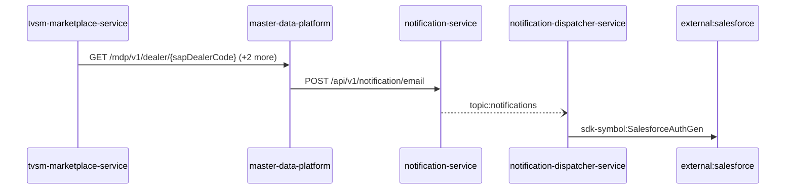

Steps:
| # | From | To | Via | Data (schema names) | Sync/Async | Confidence |
|---|---|---|---|---|---|---|
| 1 | tvsm-marketplace-service | master-data-platform | GET /mdp/v1/dealer/{sapDealerCode}, GET /mdp/v1/product/vehicle/part/{sapPartId}, POST /mdp/v1/dealers/listOfDealerDetails/basedOnProximity | GeneralResponse, ProximityRequest | sync | high |
| 2 | master-data-platform | notification-service | POST /api/v1/notification/email | EmailNotification, NotificationResponse | sync | high |
| 3 | notification-service | notification-dispatcher-service | topic:notifications | Unknown | async | medium |
| 4 | notification-dispatcher-service | external:salesforce | sdk-symbol:SalesforceAuthGen | Unknown | sync | high |

Data touched: tvsm-marketplace-service: mysql, mysql:localhost:marketplace; master-data-platform: mysql:xxxx.mysql.database.azure.com:mdp_20230904, other, redis; notification-service: mongo; notification-dispatcher-service: mongo

Failure points: hop 1 tvsm-marketplace-service → master-data-platform: criticality hard; hop 2 master-data-platform → notification-service: criticality hard; hop 3 notification-service → notification-dispatcher-service: criticality async; hop 4 notification-dispatcher-service → external:salesforce: criticality hard

Evidence:
- hop 1 (tvsm-marketplace-service → master-data-platform): `master-data-platform/src/main/java/com/tvsmotor/mdp/controller/DealerController.java:20`, `tvsm-marketplace-service/src/main/java/com/tvsmotor/marketplace/service/OkHttpService.java:39`, `tvsm-marketplace-service/src/main/java/com/tvsmotor/marketplace/service/mdp/MdpApiCallerService.java:72` (+4 more)
- hop 2 (master-data-platform → notification-service): `master-data-platform/src/main/java/com/tvsmotor/mdp/service/OkHttpService.java:24`, `master-data-platform/src/main/java/com/tvsmotor/mdp/service/notification_service/NotificationSenderService.java:69`, `notification-service/src/main/java/com/tvsmotor/notification/controller/NotificationController.java:23`
- hop 3 (notification-service → notification-dispatcher-service): `notification-dispatcher-service/src/main/java/com/tvsmotor/notificationdispatcher/config/ServiceBusConfig.java:33`, `notification-dispatcher-service/src/main/java/com/tvsmotor/notificationdispatcher/config/ServiceBusConfig.java:34`, `notification-service/src/main/java/com/tvsmotor/notification/config/ServiceBusConfig.java:37` (+1 more)
- hop 4 (notification-dispatcher-service → external:salesforce): `notification-dispatcher-service/src/main/java/com/tvsmotor/notificationdispatcher/controller/SalesforceTokenController.java:18`, `notification-dispatcher-service/src/main/java/com/tvsmotor/notificationdispatcher/model/dto/salesforce/SalesforceData.java:5`, `notification-dispatcher-service/src/main/java/com/tvsmotor/notificationdispatcher/model/dto/salesforce/SalesforceTemplateKeys.java:8`

## Flow: tvsm-marketplace-service--external-salesforce-eddaa5
Summary: Starting at `tvsm-marketplace-service` (scheduled job(s) in tvsm-marketplace-service (job-to-call link not resolved): AmazonPriceUpdateExecutorService.scheduledDrain, FlipkartPriceUpdateExecutorService.scheduledDrain, MarketplacePriceUpdateTaskService.cleanupDoneTasks (+2 more); request to tvsm-marketplace-service from outside the registry (no internal caller)), the flow passes through `master-data-platform`, `tvsmbe-mdp-bff`, `notification-service`, `notification-dispatcher-service` and ends at `external:salesforce`, using 3 sync HTTP hop(s) and 2 async event hop(s); notification-dispatcher-service role: participant; confidence medium.

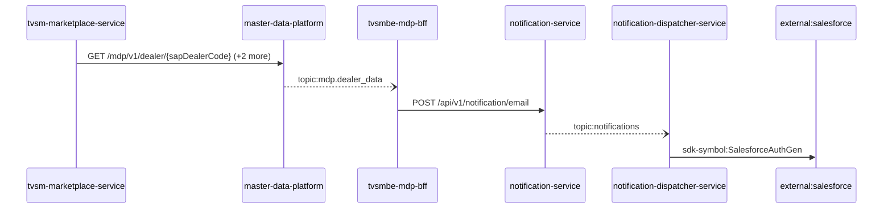

Steps:
| # | From | To | Via | Data (schema names) | Sync/Async | Confidence |
|---|---|---|---|---|---|---|
| 1 | tvsm-marketplace-service | master-data-platform | GET /mdp/v1/dealer/{sapDealerCode}, GET /mdp/v1/product/vehicle/part/{sapPartId}, POST /mdp/v1/dealers/listOfDealerDetails/basedOnProximity | GeneralResponse, ProximityRequest | sync | high |
| 2 | master-data-platform | tvsmbe-mdp-bff | topic:mdp.dealer_data | DealerData | async | medium |
| 3 | tvsmbe-mdp-bff | notification-service | POST /api/v1/notification/email | EmailNotification, NotificationResponse | sync | high |
| 4 | notification-service | notification-dispatcher-service | topic:notifications | Unknown | async | medium |
| 5 | notification-dispatcher-service | external:salesforce | sdk-symbol:SalesforceAuthGen | Unknown | sync | high |

Data touched: tvsm-marketplace-service: mysql, mysql:localhost:marketplace; master-data-platform: mysql:xxxx.mysql.database.azure.com:mdp_20230904, other, redis; tvsmbe-mdp-bff: mysql, mysql:tvsmazcmndbsdev01-ci.mysql.database.azure.com:tvsmazebffsdbdev01; notification-service: mongo; notification-dispatcher-service: mongo

Failure points: hop 1 tvsm-marketplace-service → master-data-platform: criticality hard; hop 2 master-data-platform → tvsmbe-mdp-bff: criticality async; hop 3 tvsmbe-mdp-bff → notification-service: criticality hard; hop 4 notification-service → notification-dispatcher-service: criticality async; hop 5 notification-dispatcher-service → external:salesforce: criticality hard

Evidence:
- hop 1 (tvsm-marketplace-service → master-data-platform): `master-data-platform/src/main/java/com/tvsmotor/mdp/controller/DealerController.java:20`, `tvsm-marketplace-service/src/main/java/com/tvsmotor/marketplace/service/OkHttpService.java:39`, `tvsm-marketplace-service/src/main/java/com/tvsmotor/marketplace/service/mdp/MdpApiCallerService.java:72` (+4 more)
- hop 2 (master-data-platform → tvsmbe-mdp-bff): `master-data-platform/src/main/java/com/tvsmotor/mdp/config/DealerMasterServiceBusConfig.java:26`, `master-data-platform/src/main/java/com/tvsmotor/mdp/config/DealerMasterServiceBusConfig.java:27`, `tvsmbe-mdp-bff/outbound/src/main/java/com/tvsmotor/mdp_bff/outbound/config/BffServiceBusConfig.java:24` (+1 more)
- hop 3 (tvsmbe-mdp-bff → notification-service): `notification-service/src/main/java/com/tvsmotor/notification/controller/NotificationController.java:23`, `tvsmbe-mdp-bff/outbound/src/main/java/com/tvsmotor/mdp_bff/outbound/service/NotificationSenderService.java:46`, `tvsmbe-mdp-bff/outbound/src/main/java/com/tvsmotor/mdp_bff/outbound/service/OkHttpService.java:88`
- hop 4 (notification-service → notification-dispatcher-service): `notification-dispatcher-service/src/main/java/com/tvsmotor/notificationdispatcher/config/ServiceBusConfig.java:33`, `notification-dispatcher-service/src/main/java/com/tvsmotor/notificationdispatcher/config/ServiceBusConfig.java:34`, `notification-service/src/main/java/com/tvsmotor/notification/config/ServiceBusConfig.java:37` (+1 more)
- hop 5 (notification-dispatcher-service → external:salesforce): `notification-dispatcher-service/src/main/java/com/tvsmotor/notificationdispatcher/controller/SalesforceTokenController.java:18`, `notification-dispatcher-service/src/main/java/com/tvsmotor/notificationdispatcher/model/dto/salesforce/SalesforceData.java:5`, `notification-dispatcher-service/src/main/java/com/tvsmotor/notificationdispatcher/model/dto/salesforce/SalesforceTemplateKeys.java:8`

## Flow: tvsmbe-location--external-salesforce-7d2323
Summary: Starting at `tvsmbe-location` (scheduled job(s) in tvsmbe-location (job-to-call link not resolved): CronService.logMetricsPeriodically), the flow passes through `master-data-platform`, `notification-service`, `notification-dispatcher-service` and ends at `external:salesforce`, using 3 sync HTTP hop(s) and 1 async event hop(s); notification-dispatcher-service role: participant; confidence medium.


Steps:
| # | From | To | Via | Data (schema names) | Sync/Async | Confidence |
|---|---|---|---|---|---|---|
| 1 | tvsmbe-location | master-data-platform | GET /mdp/v1/dealer/{sapDealerCode}, GET /mdp/v1/dealer/{sapDealerCode}/branches, POST /mdp/v1/dealers/data (+3 more) | DealerStateWiseCountFilterRequest, DealerTypeStatusFlagsFilterRequest, GeneralResponse, ProximityRequest | sync | high |
| 2 | master-data-platform | notification-service | POST /api/v1/notification/email | EmailNotification, NotificationResponse | sync | high |
| 3 | notification-service | notification-dispatcher-service | topic:notifications | Unknown | async | medium |
| 4 | notification-dispatcher-service | external:salesforce | sdk-symbol:SalesforceAuthGen | Unknown | sync | high |

Data touched: tvsmbe-location: mongo, mysql; master-data-platform: mysql:xxxx.mysql.database.azure.com:mdp_20230904, other, redis; notification-service: mongo; notification-dispatcher-service: mongo

Failure points: hop 1 tvsmbe-location → master-data-platform: criticality hard; hop 2 master-data-platform → notification-service: criticality hard; hop 3 notification-service → notification-dispatcher-service: criticality async; hop 4 notification-dispatcher-service → external:salesforce: criticality hard

Evidence:
- hop 1 (tvsmbe-location → master-data-platform): `master-data-platform/src/main/java/com/tvsmotor/mdp/controller/DealerController.java:20`, `tvsmbe-location/src/main/java/com/tvsmotor/location_master/service/MDPDealerService.java:68`, `tvsmbe-location/src/main/java/com/tvsmotor/location_master/utils/OkHttpUtil.java:35` (+7 more)
- hop 2 (master-data-platform → notification-service): `master-data-platform/src/main/java/com/tvsmotor/mdp/service/OkHttpService.java:24`, `master-data-platform/src/main/java/com/tvsmotor/mdp/service/notification_service/NotificationSenderService.java:69`, `notification-service/src/main/java/com/tvsmotor/notification/controller/NotificationController.java:23`
- hop 3 (notification-service → notification-dispatcher-service): `notification-dispatcher-service/src/main/java/com/tvsmotor/notificationdispatcher/config/ServiceBusConfig.java:33`, `notification-dispatcher-service/src/main/java/com/tvsmotor/notificationdispatcher/config/ServiceBusConfig.java:34`, `notification-service/src/main/java/com/tvsmotor/notification/config/ServiceBusConfig.java:37` (+1 more)
- hop 4 (notification-dispatcher-service → external:salesforce): `notification-dispatcher-service/src/main/java/com/tvsmotor/notificationdispatcher/controller/SalesforceTokenController.java:18`, `notification-dispatcher-service/src/main/java/com/tvsmotor/notificationdispatcher/model/dto/salesforce/SalesforceData.java:5`, `notification-dispatcher-service/src/main/java/com/tvsmotor/notificationdispatcher/model/dto/salesforce/SalesforceTemplateKeys.java:8`

## Flow: tvsmbe-location--external-salesforce-ae0174
Summary: Starting at `tvsmbe-location` (scheduled job(s) in tvsmbe-location (job-to-call link not resolved): CronService.logMetricsPeriodically), the flow passes through `tvsm-auth`, `notification-service`, `notification-dispatcher-service` and ends at `external:salesforce`, using 3 sync HTTP hop(s) and 1 async event hop(s); notification-dispatcher-service role: participant; confidence medium.

```mermaid
sequenceDiagram
  participant tvsmbe_location as tvsmbe-location
  participant tvsm_auth as tvsm-auth
  participant notification_service as notification-service
  participant notification_dispatcher_service as notification-dispatcher-service
  participant external_salesforce as external:salesforce
  tvsmbe_location->>tvsm_auth: GET /api/v1/dealer/get-contacts (+1 more)
  tvsm_auth->>notification_service: POST /api/v1/notification/sms
  notification_service--)notification_dispatcher_service: topic:notifications
  notification_dispatcher_service->>external_salesforce: sdk-symbol:SalesforceAuthGen
```

Steps:
| # | From | To | Via | Data (schema names) | Sync/Async | Confidence |
|---|---|---|---|---|---|---|
| 1 | tvsmbe-location | tvsm-auth | GET /api/v1/dealer/get-contacts, POST /auth/v1/app/token/validate | DealerContacts, TokenVerificationRequest, TokenVerificationResponse | sync | high |
| 2 | tvsm-auth | notification-service | POST /api/v1/notification/sms | NotificationResponse, SMSNotification | sync | medium |
| 3 | notification-service | notification-dispatcher-service | topic:notifications | Unknown | async | medium |
| 4 | notification-dispatcher-service | external:salesforce | sdk-symbol:SalesforceAuthGen | Unknown | sync | high |

Data touched: tvsmbe-location: mongo, mysql; tvsm-auth: mysql; notification-service: mongo; notification-dispatcher-service: mongo

Failure points: hop 1 tvsmbe-location → tvsm-auth: criticality hard; hop 2 tvsm-auth → notification-service: criticality hard; hop 3 notification-service → notification-dispatcher-service: criticality async; hop 4 notification-dispatcher-service → external:salesforce: criticality hard

Evidence:
- hop 1 (tvsmbe-location → tvsm-auth): `tvsm-auth/src/main/java/com/tvsmotor/tvsmauth/user/profile/api/DealerController.java:42`, `tvsmbe-location/src/main/java/com/tvsmotor/location_master/service/UMSService.java:49`, `tvsmbe-location/src/main/java/com/tvsmotor/location_master/utils/OkHttpUtil.java:35` (+3 more)
- hop 2 (tvsm-auth → notification-service): `notification-service/src/main/java/com/tvsmotor/notification/controller/NotificationController.java:23`, `tvsm-auth/src/main/java/com/tvsmotor/tvsmauth/user/gateway/NotificationGateway.java:38`, `tvsm-auth/src/main/java/com/tvsmotor/tvsmauth/user/gateway/NotificationGateway.java:39` (+1 more)
- hop 3 (notification-service → notification-dispatcher-service): `notification-dispatcher-service/src/main/java/com/tvsmotor/notificationdispatcher/config/ServiceBusConfig.java:33`, `notification-dispatcher-service/src/main/java/com/tvsmotor/notificationdispatcher/config/ServiceBusConfig.java:34`, `notification-service/src/main/java/com/tvsmotor/notification/config/ServiceBusConfig.java:37` (+1 more)
- hop 4 (notification-dispatcher-service → external:salesforce): `notification-dispatcher-service/src/main/java/com/tvsmotor/notificationdispatcher/controller/SalesforceTokenController.java:18`, `notification-dispatcher-service/src/main/java/com/tvsmotor/notificationdispatcher/model/dto/salesforce/SalesforceData.java:5`, `notification-dispatcher-service/src/main/java/com/tvsmotor/notificationdispatcher/model/dto/salesforce/SalesforceTemplateKeys.java:8`

## Flow: tvsmbe-location--external-salesforce-b48009
Summary: Starting at `tvsmbe-location` (scheduled job(s) in tvsmbe-location (job-to-call link not resolved): CronService.logMetricsPeriodically), the flow passes through `master-data-platform`, `tvsmbe-mdp-bff`, `notification-service`, `notification-dispatcher-service` and ends at `external:salesforce`, using 3 sync HTTP hop(s) and 2 async event hop(s); notification-dispatcher-service role: participant; confidence medium.

```mermaid
sequenceDiagram
  participant tvsmbe_location as tvsmbe-location
  participant master_data_platform as master-data-platform
  participant tvsmbe_mdp_bff as tvsmbe-mdp-bff
  participant notification_service as notification-service
  participant notification_dispatcher_service as notification-dispatcher-service
  participant external_salesforce as external:salesforce
  tvsmbe_location->>master_data_platform: GET /mdp/v1/dealer/{sapDealerCode} (+5 more)
  master_data_platform--)tvsmbe_mdp_bff: topic:mdp.dealer_data
  tvsmbe_mdp_bff->>notification_service: POST /api/v1/notification/email
  notification_service--)notification_dispatcher_service: topic:notifications
  notification_dispatcher_service->>external_salesforce: sdk-symbol:SalesforceAuthGen
```

Steps:
| # | From | To | Via | Data (schema names) | Sync/Async | Confidence |
|---|---|---|---|---|---|---|
| 1 | tvsmbe-location | master-data-platform | GET /mdp/v1/dealer/{sapDealerCode}, GET /mdp/v1/dealer/{sapDealerCode}/branches, POST /mdp/v1/dealers/data (+3 more) | DealerStateWiseCountFilterRequest, DealerTypeStatusFlagsFilterRequest, GeneralResponse, ProximityRequest | sync | high |
| 2 | master-data-platform | tvsmbe-mdp-bff | topic:mdp.dealer_data | DealerData | async | medium |
| 3 | tvsmbe-mdp-bff | notification-service | POST /api/v1/notification/email | EmailNotification, NotificationResponse | sync | high |
| 4 | notification-service | notification-dispatcher-service | topic:notifications | Unknown | async | medium |
| 5 | notification-dispatcher-service | external:salesforce | sdk-symbol:SalesforceAuthGen | Unknown | sync | high |

Data touched: tvsmbe-location: mongo, mysql; master-data-platform: mysql:xxxx.mysql.database.azure.com:mdp_20230904, other, redis; tvsmbe-mdp-bff: mysql, mysql:tvsmazcmndbsdev01-ci.mysql.database.azure.com:tvsmazebffsdbdev01; notification-service: mongo; notification-dispatcher-service: mongo

Failure points: hop 1 tvsmbe-location → master-data-platform: criticality hard; hop 2 master-data-platform → tvsmbe-mdp-bff: criticality async; hop 3 tvsmbe-mdp-bff → notification-service: criticality hard; hop 4 notification-service → notification-dispatcher-service: criticality async; hop 5 notification-dispatcher-service → external:salesforce: criticality hard

Evidence:
- hop 1 (tvsmbe-location → master-data-platform): `master-data-platform/src/main/java/com/tvsmotor/mdp/controller/DealerController.java:20`, `tvsmbe-location/src/main/java/com/tvsmotor/location_master/service/MDPDealerService.java:68`, `tvsmbe-location/src/main/java/com/tvsmotor/location_master/utils/OkHttpUtil.java:35` (+7 more)
- hop 2 (master-data-platform → tvsmbe-mdp-bff): `master-data-platform/src/main/java/com/tvsmotor/mdp/config/DealerMasterServiceBusConfig.java:26`, `master-data-platform/src/main/java/com/tvsmotor/mdp/config/DealerMasterServiceBusConfig.java:27`, `tvsmbe-mdp-bff/outbound/src/main/java/com/tvsmotor/mdp_bff/outbound/config/BffServiceBusConfig.java:24` (+1 more)
- hop 3 (tvsmbe-mdp-bff → notification-service): `notification-service/src/main/java/com/tvsmotor/notification/controller/NotificationController.java:23`, `tvsmbe-mdp-bff/outbound/src/main/java/com/tvsmotor/mdp_bff/outbound/service/NotificationSenderService.java:46`, `tvsmbe-mdp-bff/outbound/src/main/java/com/tvsmotor/mdp_bff/outbound/service/OkHttpService.java:88`
- hop 4 (notification-service → notification-dispatcher-service): `notification-dispatcher-service/src/main/java/com/tvsmotor/notificationdispatcher/config/ServiceBusConfig.java:33`, `notification-dispatcher-service/src/main/java/com/tvsmotor/notificationdispatcher/config/ServiceBusConfig.java:34`, `notification-service/src/main/java/com/tvsmotor/notification/config/ServiceBusConfig.java:37` (+1 more)
- hop 5 (notification-dispatcher-service → external:salesforce): `notification-dispatcher-service/src/main/java/com/tvsmotor/notificationdispatcher/controller/SalesforceTokenController.java:18`, `notification-dispatcher-service/src/main/java/com/tvsmotor/notificationdispatcher/model/dto/salesforce/SalesforceData.java:5`, `notification-dispatcher-service/src/main/java/com/tvsmotor/notificationdispatcher/model/dto/salesforce/SalesforceTemplateKeys.java:8`

## Flow: tvsmbe-location--external-salesforce-e8e8d4
Summary: Starting at `tvsmbe-location` (scheduled job(s) in tvsmbe-location (job-to-call link not resolved): CronService.logMetricsPeriodically), the flow passes through `tvsm-auth`, `master-data-platform`, `notification-service`, `notification-dispatcher-service` and ends at `external:salesforce`, using 4 sync HTTP hop(s) and 1 async event hop(s); notification-dispatcher-service role: participant; confidence medium.

```mermaid
sequenceDiagram
  participant tvsmbe_location as tvsmbe-location
  participant tvsm_auth as tvsm-auth
  participant master_data_platform as master-data-platform
  participant notification_service as notification-service
  participant notification_dispatcher_service as notification-dispatcher-service
  participant external_salesforce as external:salesforce
  tvsmbe_location->>tvsm_auth: GET /api/v1/dealer/get-contacts (+1 more)
  tvsm_auth->>master_data_platform: GET /mdp/v1/dealer/{sapDealerCode} (+1 more)
  master_data_platform->>notification_service: POST /api/v1/notification/email
  notification_service--)notification_dispatcher_service: topic:notifications
  notification_dispatcher_service->>external_salesforce: sdk-symbol:SalesforceAuthGen
```

Steps:
| # | From | To | Via | Data (schema names) | Sync/Async | Confidence |
|---|---|---|---|---|---|---|
| 1 | tvsmbe-location | tvsm-auth | GET /api/v1/dealer/get-contacts, POST /auth/v1/app/token/validate | DealerContacts, TokenVerificationRequest, TokenVerificationResponse | sync | high |
| 2 | tvsm-auth | master-data-platform | GET /mdp/v1/dealer/{sapDealerCode}, GET /mdp/v1/dealer/{sapDealerCode}/branches | GeneralResponse | sync | medium |
| 3 | master-data-platform | notification-service | POST /api/v1/notification/email | EmailNotification, NotificationResponse | sync | high |
| 4 | notification-service | notification-dispatcher-service | topic:notifications | Unknown | async | medium |
| 5 | notification-dispatcher-service | external:salesforce | sdk-symbol:SalesforceAuthGen | Unknown | sync | high |

Data touched: tvsmbe-location: mongo, mysql; tvsm-auth: mysql; master-data-platform: mysql:xxxx.mysql.database.azure.com:mdp_20230904, other, redis; notification-service: mongo; notification-dispatcher-service: mongo

Failure points: hop 1 tvsmbe-location → tvsm-auth: criticality hard; hop 2 tvsm-auth → master-data-platform: criticality hard; hop 3 master-data-platform → notification-service: criticality hard; hop 4 notification-service → notification-dispatcher-service: criticality async; hop 5 notification-dispatcher-service → external:salesforce: criticality hard

Evidence:
- hop 1 (tvsmbe-location → tvsm-auth): `tvsm-auth/src/main/java/com/tvsmotor/tvsmauth/user/profile/api/DealerController.java:42`, `tvsmbe-location/src/main/java/com/tvsmotor/location_master/service/UMSService.java:49`, `tvsmbe-location/src/main/java/com/tvsmotor/location_master/utils/OkHttpUtil.java:35` (+3 more)
- hop 2 (tvsm-auth → master-data-platform): `master-data-platform/src/main/java/com/tvsmotor/mdp/controller/DealerController.java:20`, `tvsm-auth/src/main/java/com/tvsmotor/tvsmauth/user/gateway/MDPServiceClient.java:86`, `tvsm-auth/src/main/java/com/tvsmotor/tvsmauth/user/gateway/MDPServiceClient.java:110` (+2 more)
- hop 3 (master-data-platform → notification-service): `master-data-platform/src/main/java/com/tvsmotor/mdp/service/OkHttpService.java:24`, `master-data-platform/src/main/java/com/tvsmotor/mdp/service/notification_service/NotificationSenderService.java:69`, `notification-service/src/main/java/com/tvsmotor/notification/controller/NotificationController.java:23`
- hop 4 (notification-service → notification-dispatcher-service): `notification-dispatcher-service/src/main/java/com/tvsmotor/notificationdispatcher/config/ServiceBusConfig.java:33`, `notification-dispatcher-service/src/main/java/com/tvsmotor/notificationdispatcher/config/ServiceBusConfig.java:34`, `notification-service/src/main/java/com/tvsmotor/notification/config/ServiceBusConfig.java:37` (+1 more)
- hop 5 (notification-dispatcher-service → external:salesforce): `notification-dispatcher-service/src/main/java/com/tvsmotor/notificationdispatcher/controller/SalesforceTokenController.java:18`, `notification-dispatcher-service/src/main/java/com/tvsmotor/notificationdispatcher/model/dto/salesforce/SalesforceData.java:5`, `notification-dispatcher-service/src/main/java/com/tvsmotor/notificationdispatcher/model/dto/salesforce/SalesforceTemplateKeys.java:8`

## Flow: tvsmbe-location--notification-dispatcher-service
Summary: Starting at `tvsmbe-location` (scheduled job(s) in tvsmbe-location (job-to-call link not resolved): CronService.logMetricsPeriodically), the flow passes through `tvsm-auth`, `master-data-platform`, `tvsmbe-mdp-bff`, `notification-service` and ends at `notification-dispatcher-service`, using 3 sync HTTP hop(s) and 2 async event hop(s); notification-dispatcher-service role: terminal; confidence medium; truncated at the depth cap.

```mermaid
sequenceDiagram
  participant tvsmbe_location as tvsmbe-location
  participant tvsm_auth as tvsm-auth
  participant master_data_platform as master-data-platform
  participant tvsmbe_mdp_bff as tvsmbe-mdp-bff
  participant notification_service as notification-service
  participant notification_dispatcher_service as notification-dispatcher-service
  tvsmbe_location->>tvsm_auth: GET /api/v1/dealer/get-contacts (+1 more)
  tvsm_auth->>master_data_platform: GET /mdp/v1/dealer/{sapDealerCode} (+1 more)
  master_data_platform--)tvsmbe_mdp_bff: topic:mdp.dealer_data
  tvsmbe_mdp_bff->>notification_service: POST /api/v1/notification/email
  notification_service--)notification_dispatcher_service: topic:notifications
```

Steps:
| # | From | To | Via | Data (schema names) | Sync/Async | Confidence |
|---|---|---|---|---|---|---|
| 1 | tvsmbe-location | tvsm-auth | GET /api/v1/dealer/get-contacts, POST /auth/v1/app/token/validate | DealerContacts, TokenVerificationRequest, TokenVerificationResponse | sync | high |
| 2 | tvsm-auth | master-data-platform | GET /mdp/v1/dealer/{sapDealerCode}, GET /mdp/v1/dealer/{sapDealerCode}/branches | GeneralResponse | sync | medium |
| 3 | master-data-platform | tvsmbe-mdp-bff | topic:mdp.dealer_data | DealerData | async | medium |
| 4 | tvsmbe-mdp-bff | notification-service | POST /api/v1/notification/email | EmailNotification, NotificationResponse | sync | high |
| 5 | notification-service | notification-dispatcher-service | topic:notifications | Unknown | async | medium |

Data touched: tvsmbe-location: mongo, mysql; tvsm-auth: mysql; master-data-platform: mysql:xxxx.mysql.database.azure.com:mdp_20230904, other, redis; tvsmbe-mdp-bff: mysql, mysql:tvsmazcmndbsdev01-ci.mysql.database.azure.com:tvsmazebffsdbdev01; notification-service: mongo; notification-dispatcher-service: mongo

Failure points: hop 1 tvsmbe-location → tvsm-auth: criticality hard; hop 2 tvsm-auth → master-data-platform: criticality hard; hop 3 master-data-platform → tvsmbe-mdp-bff: criticality async; hop 4 tvsmbe-mdp-bff → notification-service: criticality hard; hop 5 notification-service → notification-dispatcher-service: criticality async

Evidence:
- hop 1 (tvsmbe-location → tvsm-auth): `tvsm-auth/src/main/java/com/tvsmotor/tvsmauth/user/profile/api/DealerController.java:42`, `tvsmbe-location/src/main/java/com/tvsmotor/location_master/service/UMSService.java:49`, `tvsmbe-location/src/main/java/com/tvsmotor/location_master/utils/OkHttpUtil.java:35` (+3 more)
- hop 2 (tvsm-auth → master-data-platform): `master-data-platform/src/main/java/com/tvsmotor/mdp/controller/DealerController.java:20`, `tvsm-auth/src/main/java/com/tvsmotor/tvsmauth/user/gateway/MDPServiceClient.java:86`, `tvsm-auth/src/main/java/com/tvsmotor/tvsmauth/user/gateway/MDPServiceClient.java:110` (+2 more)
- hop 3 (master-data-platform → tvsmbe-mdp-bff): `master-data-platform/src/main/java/com/tvsmotor/mdp/config/DealerMasterServiceBusConfig.java:26`, `master-data-platform/src/main/java/com/tvsmotor/mdp/config/DealerMasterServiceBusConfig.java:27`, `tvsmbe-mdp-bff/outbound/src/main/java/com/tvsmotor/mdp_bff/outbound/config/BffServiceBusConfig.java:24` (+1 more)
- hop 4 (tvsmbe-mdp-bff → notification-service): `notification-service/src/main/java/com/tvsmotor/notification/controller/NotificationController.java:23`, `tvsmbe-mdp-bff/outbound/src/main/java/com/tvsmotor/mdp_bff/outbound/service/NotificationSenderService.java:46`, `tvsmbe-mdp-bff/outbound/src/main/java/com/tvsmotor/mdp_bff/outbound/service/OkHttpService.java:88`
- hop 5 (notification-service → notification-dispatcher-service): `notification-dispatcher-service/src/main/java/com/tvsmotor/notificationdispatcher/config/ServiceBusConfig.java:33`, `notification-dispatcher-service/src/main/java/com/tvsmotor/notificationdispatcher/config/ServiceBusConfig.java:34`, `notification-service/src/main/java/com/tvsmotor/notification/config/ServiceBusConfig.java:37` (+1 more)

## Flow: tvsmbe-mdp-bff--external-salesforce-cf3a42
Summary: Starting at `tvsmbe-mdp-bff` (scheduled job(s) in tvsmbe-mdp-bff (job-to-call link not resolved): CronService.logMetricsPeriodically), the flow passes through `master-data-platform`, `notification-service`, `notification-dispatcher-service` and ends at `external:salesforce`, using 3 sync HTTP hop(s) and 1 async event hop(s); notification-dispatcher-service role: participant; confidence medium.

```mermaid
sequenceDiagram
  participant tvsmbe_mdp_bff as tvsmbe-mdp-bff
  participant master_data_platform as master-data-platform
  participant notification_service as notification-service
  participant notification_dispatcher_service as notification-dispatcher-service
  participant external_salesforce as external:salesforce
  tvsmbe_mdp_bff->>master_data_platform: POST /mdp/v1/dealer/mapDealerWithKNumber (+1 more)
  master_data_platform->>notification_service: POST /api/v1/notification/email
  notification_service--)notification_dispatcher_service: topic:notifications
  notification_dispatcher_service->>external_salesforce: sdk-symbol:SalesforceAuthGen
```

Steps:
| # | From | To | Via | Data (schema names) | Sync/Async | Confidence |
|---|---|---|---|---|---|---|
| 1 | tvsmbe-mdp-bff | master-data-platform | POST /mdp/v1/dealer/mapDealerWithKNumber, POST /mdp/v1/dealers/basedOnFilters | DealerTypeStatusFlagsFilterRequest, GeneralResponse, MapDealerWithKNumberRequest | sync | high |
| 2 | master-data-platform | notification-service | POST /api/v1/notification/email | EmailNotification, NotificationResponse | sync | high |
| 3 | notification-service | notification-dispatcher-service | topic:notifications | Unknown | async | medium |
| 4 | notification-dispatcher-service | external:salesforce | sdk-symbol:SalesforceAuthGen | Unknown | sync | high |

Data touched: tvsmbe-mdp-bff: mysql, mysql:tvsmazcmndbsdev01-ci.mysql.database.azure.com:tvsmazebffsdbdev01; master-data-platform: mysql:xxxx.mysql.database.azure.com:mdp_20230904, other, redis; notification-service: mongo; notification-dispatcher-service: mongo

Failure points: hop 1 tvsmbe-mdp-bff → master-data-platform: criticality hard; hop 2 master-data-platform → notification-service: criticality hard; hop 3 notification-service → notification-dispatcher-service: criticality async; hop 4 notification-dispatcher-service → external:salesforce: criticality hard

Evidence:
- hop 1 (tvsmbe-mdp-bff → master-data-platform): `master-data-platform/src/main/java/com/tvsmotor/mdp/controller/DealerKnowlarityDataController.java:16`, `tvsmbe-mdp-bff/outbound/src/main/java/com/tvsmotor/mdp_bff/outbound/service/MdpDealerOperationsService.java:54`, `tvsmbe-mdp-bff/outbound/src/main/java/com/tvsmotor/mdp_bff/outbound/service/OkHttpService.java:88` (+3 more)
- hop 2 (master-data-platform → notification-service): `master-data-platform/src/main/java/com/tvsmotor/mdp/service/OkHttpService.java:24`, `master-data-platform/src/main/java/com/tvsmotor/mdp/service/notification_service/NotificationSenderService.java:69`, `notification-service/src/main/java/com/tvsmotor/notification/controller/NotificationController.java:23`
- hop 3 (notification-service → notification-dispatcher-service): `notification-dispatcher-service/src/main/java/com/tvsmotor/notificationdispatcher/config/ServiceBusConfig.java:33`, `notification-dispatcher-service/src/main/java/com/tvsmotor/notificationdispatcher/config/ServiceBusConfig.java:34`, `notification-service/src/main/java/com/tvsmotor/notification/config/ServiceBusConfig.java:37` (+1 more)
- hop 4 (notification-dispatcher-service → external:salesforce): `notification-dispatcher-service/src/main/java/com/tvsmotor/notificationdispatcher/controller/SalesforceTokenController.java:18`, `notification-dispatcher-service/src/main/java/com/tvsmotor/notificationdispatcher/model/dto/salesforce/SalesforceData.java:5`, `notification-dispatcher-service/src/main/java/com/tvsmotor/notificationdispatcher/model/dto/salesforce/SalesforceTemplateKeys.java:8`
