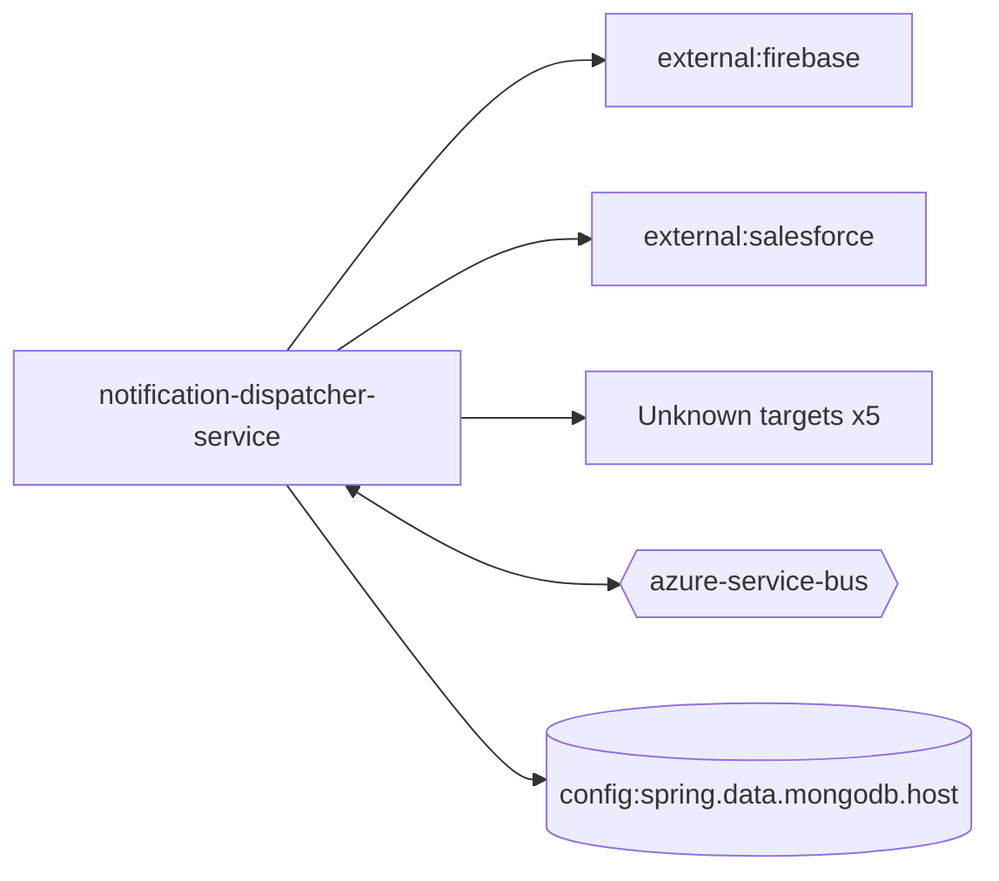

# notification-dispatcher-service — High-Level Design

## Context
notification-dispatcher-service is a `backend-api` in the TVS-CS org (domain: Unknown). Neighbours: callers Unknown; downstream `external:firebase`, `external:salesforce`.

## Architecture
notification-dispatcher-service components and connections (from service.yaml):

## Integration Points
notification-dispatcher-service registry edges (4):

| Direction | Peer | Kind | Via | Criticality | Source | Match |
|---|---|---|---|---|---|---|
| in | `notification-service` | event | azure-service-bus:topic:notifications | async | code | entity |
| out | `external:salesforce` | http | sdk-symbol:SalesforceAuthGen | hard | code | sdk-symbol |
| out | `external:firebase` | library_dependency | package:com.google.firebase:firebase-admin | hard | code | artifact |
| out | `notification-service` | shared_db | mongo:_:_/notificationtracker | hard | code | table |
| out | `external:firebase` | http | - | Unknown | code | external |
| out | `external:salesforce` | http | - | hard | code | external |

## Data Ownership
notification-dispatcher-service data stores (service.yaml `data_stores`; ownership flag not determinable unless set):

| Store | Type | Access | Owned | Key entities |
|---|---|---|---|---|
| `config:spring.data.mongodb.host` | mongo | read-write | False | NotificationTemplate, NotificationTracker |

## Key Design Decisions
notification-dispatcher-service: N/A — not determinable from code.

| Decision | Alternatives considered | Reason |
|---|---|---|
| Unknown | Unknown | Unknown |

## Non-Functional Requirements
notification-dispatcher-service NFR targets: N/A — not determinable from code. Tuning-related config keys: `spring.jms.servicebus.idle-timeout`.

## Security
notification-dispatcher-service security: endpoint auth values None. No auth middleware found in code. 6 secret config key(s), sourced via: {'app-settings': 6} (names in OVERVIEW.md). PII handling: Unknown.

## Resilience and Failure Modes
notification-dispatcher-service hard dependencies: `external:salesforce`. Retry/circuit-breaker code: `src/main/java/com/tvsmotor/notificationdispatcher/service/sms/salesforce/SalesforceSMSSender.java:77` (@Retryable). Subscriber error handling: `src/main/java/com/tvsmotor/notificationdispatcher/config/ServiceBusConfig.java:88` {"error_handler": true}

## Deployment Topology
notification-dispatcher-service deployment artefacts (platform/regions: Unknown unless listed):

| Kind | Name | File | Environments | Image | Ports | Variable groups |
|---|---|---|---|---|---|---|
| azure-pipeline | AST_Image_Scan_notification_dispatcher_service_Pipeline.yml | `AST_Image_Scan_notification_dispatcher_service_Pipeline.yml:2` | - | - | - | Checkmarx_Common, UAT_Threshold |
| azure-pipeline | AST_notification_dispatcher_service_PROD_Pipeline.yml | `AST_notification_dispatcher_service_PROD_Pipeline.yml:1` | - | - | - | PROD_Threshold, Tenable |
| azure-pipeline | AST_notification_dispatcher_service_UAT_Pipeline.yml | `AST_notification_dispatcher_service_UAT_Pipeline.yml:2` | - | - | - | Checkmarx_Common, Tenable, UAT_Threshold |
| azure-pipeline | cd-pipeline.yaml | `cd-pipeline.yaml:1` | dev, prod, uat | - | - | - |
| azure-pipeline | ci-pipeline.yaml | `ci-pipeline.yaml:1` | - | - | - | - |
| azure-pipeline | sonar_ci_pr_pipeline.yml | `sonar_ci_pr_pipeline.yml:6` | - | - | - | - |
| azure-pipeline | uk-cd-pipeline.yaml | `uk-cd-pipeline.yaml:1` | dev, prod, uat | - | - | - |
| azure-pipeline | uk-training-cd-pipeline.yaml | `uk-training-cd-pipeline.yaml:1` | training | - | - | - |
| dockerfile | Dockerfile | `Dockerfile:3` | - | maven:3.9.16-amazoncorretto-21-alpine, amazoncorretto:25.0.4-alpine3.22 | 8080 | - |

## Observability
notification-dispatcher-service observability libraries: `io.micrometer:micrometer-observation`, `io.sentry:sentry-logback`, `io.sentry:sentry-spring-boot-starter`. Related config keys: `SENTRY_AUTH_TOKEN`, `sentry.dsn`, `sentry.send-default-pii`, `sentry.traces-sample-rate`. Dashboards/alerts: Unknown.
