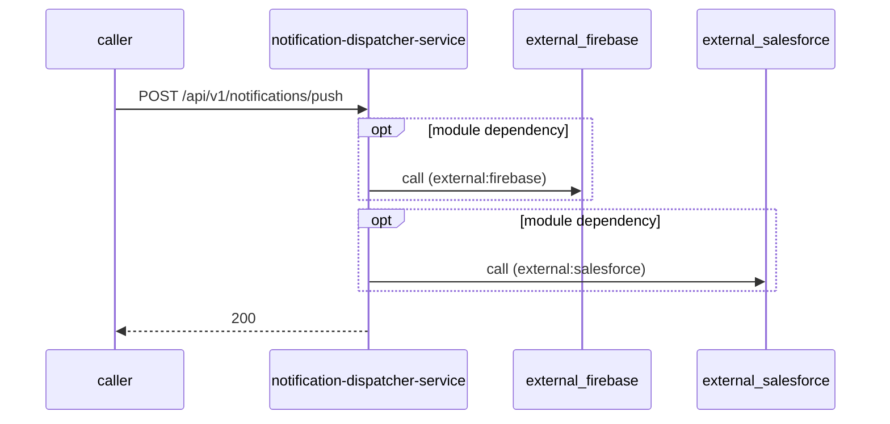

# notification-dispatcher-service — Low-Level Design

## Data Model
notification-dispatcher-service entities from `data_access` items (1).

Store access at `src/main/java/com/tvsmotor/notificationdispatcher/model/NotificationTemplate.java:17`: database Unknown; collections notification_template, notification_tracker.

### NotificationTemplate
Entity `NotificationTemplate` defined in `src/main/java/com/tvsmotor/notificationdispatcher/model/NotificationTemplate.java:16`; table Unknown; operation read.
Columns: Unknown (no fields extracted).
Relationships: Unknown.

### NotificationTracker
Entity `NotificationTracker` defined in `src/main/java/com/tvsmotor/notificationdispatcher/model/NotificationTracker.java:20`; table Unknown; operation both.
Columns: Unknown (no fields extracted).
Relationships: Unknown.

## State Machines
notification-dispatcher-service: N/A — no status/state enums found in code.

## Business Rules
notification-dispatcher-service validation rules on DTO fields (from schema `validation`):
N/A — no declarative validation found; other rules not determinable without manual review.

## Key Classes and Functions
notification-dispatcher-service key classes:

| Class / Function | File | Responsibility |
|---|---|---|
| `HealthCheckController` | `src/main/java/com/tvsmotor/notificationdispatcher/controller/HealthCheckController.java` | HTTP handlers |
| `PushNotificationController` | `src/main/java/com/tvsmotor/notificationdispatcher/controller/PushNotificationController.java` | HTTP handlers |
| `SalesforceTokenController` | `src/main/java/com/tvsmotor/notificationdispatcher/controller/SalesforceTokenController.java` | HTTP handlers |
| `ThreadPoolMonitor.logThreadPoolStats` | `src/main/java/com/tvsmotor/notificationdispatcher/service/ThreadPoolMonitor.java:15` | scheduled job |
| subscribe local.notifications | `src/main/java/com/tvsmotor/notificationdispatcher/config/ServiceBusConfig.java:88` | azure-service-bus messaging |

## Sequence Details
notification-dispatcher-service sequence for `POST /api/v1/notifications/push` (handler `PushNotificationController.sendPushNotification`); downstream calls inside the handler are not traced from code, module-level targets shown as optional.

## Error Handling
notification-dispatcher-service error handling: no global exception handler found in code. Status mapping: Unknown. Retry evidence: `src/main/java/com/tvsmotor/notificationdispatcher/service/sms/salesforce/SalesforceSMSSender.java:77`.

## Configuration Details
notification-dispatcher-service behaviour-relevant config keys (names only; full list in OVERVIEW.md):
- `config:infobip.baseUri`: base URL for outbound calls
- `config:salesforce.api.authUrl`: base URL for outbound calls
- `spring.jms.servicebus.topic.notifications`: subscribe entity name

## Edge Cases
notification-dispatcher-service edge cases: N/A — not determinable from code without manual review.
