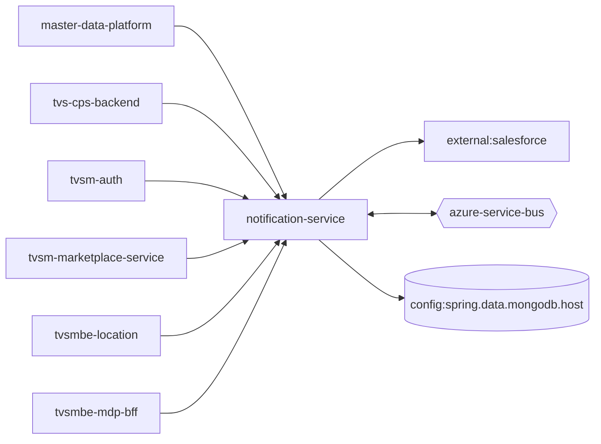

# notification-service — High-Level Design

## Context
notification-service is a `backend-api` in the TVS-CS org (domain: Unknown). Neighbours: callers `master-data-platform`, `tvs-cps-backend`, `tvsm-auth`, `tvsm-marketplace-service`, `tvsmbe-location`, `tvsmbe-mdp-bff`; downstream `external:salesforce`.

## Architecture
notification-service components and connections (from service.yaml):

## Integration Points
notification-service registry edges (11):

| Direction | Peer | Kind | Via | Criticality | Source | Match |
|---|---|---|---|---|---|---|
| out | `notification-dispatcher-service` | event | azure-service-bus:topic:notifications | async | code | entity |
| in | `master-data-platform` | http | POST /api/v1/notification/email | hard | code | path-unique |
| out | `external:salesforce` | http | sdk-symbol:SalesforceBlobConfig | hard | code | sdk-symbol |
| in | `tvs-cps-backend` | http | POST /api/v1/notification/email | hard | code | path-suffix |
| in | `tvs-cps-backend` | http | POST /api/v1/notification/sms | hard | code | path-suffix |
| in | `tvsm-auth` | http | POST /api/v1/notification/sms | hard | code | path-unique |
| in | `tvsm-marketplace-service` | http | POST /api/v1/notification/email | hard | code | path-unique |
| in | `tvsmbe-location` | http | GET /api/v1/notification/retryPreference | hard | code | path-unique |
| in | `tvsmbe-location` | http | POST /api/v1/notification/sms | hard | code | path-unique |
| in | `tvsmbe-mdp-bff` | http | POST /api/v1/notification/email | hard | code | path-unique |
| in | `notification-dispatcher-service` | shared_db | mongo:_:_/notificationtracker | hard | code | table |
| out | `external:salesforce` | http | - | hard | code | external |

## Data Ownership
notification-service data stores (service.yaml `data_stores`; ownership flag not determinable unless set):

| Store | Type | Access | Owned | Key entities |
|---|---|---|---|---|
| `config:spring.data.mongodb.host` | mongo | read-write | Unknown | NotificationRetryPreference, NotificationTemplate, NotificationTracker, NotificationUserPreference, ProcessedBlobFile |

## Key Design Decisions
notification-service: N/A — not determinable from code.

| Decision | Alternatives considered | Reason |
|---|---|---|
| Unknown | Unknown | Unknown |

## Non-Functional Requirements
notification-service NFR targets: N/A — not determinable from code. Tuning-related config keys: `salesforce.blob.batchSize`, `spring.jms.servicebus.idle-timeout`.

## Security
notification-service security: endpoint auth values None. Auth code: `src/main/java/com/tvsmotor/notification/config/NotificationOncePerFilter.java:13`. 7 secret config key(s), sourced via: {'app-settings': 6, 'None': 1} (names in OVERVIEW.md). PII handling: Unknown.

## Resilience and Failure Modes
notification-service hard dependencies: `external:salesforce`. No retry/circuit-breaker code found; failure behaviour Unknown. Subscriber error handling: `src/main/java/com/tvsmotor/notification/config/ServiceBusConfig.java:117` {"error_handler": true}

## Deployment Topology
notification-service deployment artefacts (platform/regions: Unknown unless listed):

| Kind | Name | File | Environments | Image | Ports | Variable groups |
|---|---|---|---|---|---|---|
| azure-pipeline | AST_Image_Scan_notification_service_Pipeline.yml | `AST_Image_Scan_notification_service_Pipeline.yml:1` | - | - | - | Checkmarx_Common, UAT_Threshold |
| azure-pipeline | AST_notification_service_PROD_Pipeline.yml | `AST_notification_service_PROD_Pipeline.yml:1` | - | - | - | PROD_Threshold, Tenable |
| azure-pipeline | AST_notification_service_UAT_Pipeline.yml | `AST_notification_service_UAT_Pipeline.yml:2` | - | - | - | Checkmarx_Common, Tenable, UAT_Threshold |
| azure-pipeline | cd-pipeline.yaml | `cd-pipeline.yaml:1` | dev, prod, uat | - | - | - |
| azure-pipeline | ci-pipeline.yaml | `ci-pipeline.yaml:1` | - | - | - | - |
| azure-pipeline | sonar_ci_pr_pipeline.yml | `sonar_ci_pr_pipeline.yml:1` | - | - | - | - |
| azure-pipeline | uk-cd-pipeline.yaml | `uk-cd-pipeline.yaml:1` | dev, prod, uat | - | - | - |
| azure-pipeline | uk-training-cd-pipeline.yaml | `uk-training-cd-pipeline.yaml:1` | training | - | - | - |
| dockerfile | Dockerfile | `Dockerfile:3` | - | maven:3.9.16-amazoncorretto-17-al2023, amazoncorretto:21.0.11-alpine3.20 | 8080 | - |

## Observability
notification-service observability libraries: `io.micrometer:micrometer-observation`, `io.sentry:sentry-logback`. Related config keys: `SENTRY_AUTH_TOKEN`, `logging.level.org.springframework`, `sentry.dsn`, `sentry.send-default-pii`, `sentry.traces-sample-rate`. Dashboards/alerts: Unknown.
