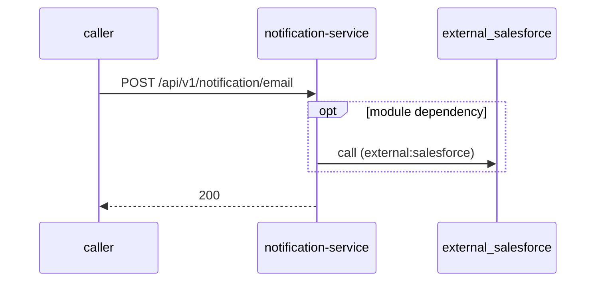

# notification-service — Low-Level Design

## Data Model
notification-service entities from `data_access` items (1).

Store access at `src/main/java/com/tvsmotor/notification/model/NotificationRetryPreference.java:12`: database Unknown; collections notification_processed_blob_files, notification_retry_preference, notification_template, notification_tracker, notification_user_preference.

### NotificationRetryPreference
Entity `NotificationRetryPreference` defined in `src/main/java/com/tvsmotor/notification/model/NotificationRetryPreference.java:11`; table Unknown; operation both.

| Column | Type | Nullable | Notes |
|---|---|---|---|
| id | string | Unknown | - |
| channel | string | Unknown | - |
| priority | string | Unknown | - |
| failureType | string | Unknown | - |
| retryCount | integer | Unknown | - |
| retryChannel | string | Unknown | - |
| queueName | string | Unknown | - |
Relationships: Unknown.

### NotificationTemplate
Entity `NotificationTemplate` defined in `src/main/java/com/tvsmotor/notification/model/NotificationTemplate.java:15`; table Unknown; operation both.

| Column | Type | Nullable | Notes |
|---|---|---|---|
| id | string | Unknown | - |
| templateId | string | Unknown | - |
| templateName | string | Unknown | - |
| templateOwner | string | Unknown | - |
| channelType | string | Unknown | - |
| templateCategory | enum[UTILITY,AUTHENTICATION,MARKETING] | Unknown | - |
| headerType | enum[IMAGE,LOCATION,VIDEO,DOCUMENT,TEXT,NO_HEADER] | Unknown | - |
| language | string | Unknown | - |
| sender | string | Unknown | - |
| subject | string | Unknown | - |
| body | string | Unknown | - |
| salesforceTemplateKeys | SalesforceTemplateKeys | Unknown | - |
Relationships: Unknown.

### NotificationTracker
Entity `NotificationTracker` defined in `src/main/java/com/tvsmotor/notification/model/NotificationTracker.java:20`; table Unknown; operation both.

| Column | Type | Nullable | Notes |
|---|---|---|---|
| id | string | Unknown | - |
| serviceProvider | enum[INFOBIP,SALESFORCE,FIREBASE,NOT_REGISTERED] | Unknown | - |
| smsNotification | SMSNotification | Unknown | - |
| emailNotification | EmailNotification | Unknown | - |
| whatsAppNotification | WhatsAppNotification | Unknown | - |
| inAppPushNotification | FCMNotification | Unknown | - |
| createdAt | datetime | Unknown | - |
Relationships: Unknown.

### NotificationUserPreference
Entity `NotificationUserPreference` defined in `src/main/java/com/tvsmotor/notification/model/NotificationUserPreference.java:14`; table Unknown; operation both.

| Column | Type | Nullable | Notes |
|---|---|---|---|
| id | string | Unknown | - |
| clientId | string | Unknown | - |
| clientName | string | Unknown | - |
| smsPrimaryProvider | enum[INFOBIP,SALESFORCE,FIREBASE,NOT_REGISTERED] | Unknown | - |
| smsSecondaryProvider | enum[INFOBIP,SALESFORCE,FIREBASE,NOT_REGISTERED] | Unknown | - |
| emailPrimaryProvider | enum[INFOBIP,SALESFORCE,FIREBASE,NOT_REGISTERED] | Unknown | - |
| emailSecondaryProvider | enum[INFOBIP,SALESFORCE,FIREBASE,NOT_REGISTERED] | Unknown | - |
| whatsappPrimaryProvider | enum[INFOBIP,SALESFORCE,FIREBASE,NOT_REGISTERED] | Unknown | - |
| whatsappSecondaryProvider | enum[INFOBIP,SALESFORCE,FIREBASE,NOT_REGISTERED] | Unknown | - |
Relationships: Unknown.

### ProcessedBlobFile
Entity `ProcessedBlobFile` defined in `src/main/java/com/tvsmotor/notification/model/ProcessedBlobFile.java:15`; table Unknown; operation both.
Columns: Unknown (no fields extracted).
Relationships: Unknown.

## State Machines
notification-service status/state enums found in code (2); transitions are not determinable from code.
- `InfobipNotificationStatus` (`src/main/java/com/tvsmotor/notification/enums/infobip/InfobipNotificationStatus.java:3`): PENDING, UNDELIVERABLE, DELIVERED, EXPIRED, REJECTED
- `NotificationStatus` (`src/main/java/com/tvsmotor/notification/enums/NotificationStatus.java:3`): RECEIVED_BY_NOTIFICATION_SERVICE, PUSHED_TO_SERVICEBUS, RECEIVED_BY_NOTIFICATION_DISPATCHER_SERVICE, IN_RETRY, FAILURE

## Business Rules
notification-service validation rules on DTO fields (from schema `validation`):

| Schema.field | Rule | Defined in |
|---|---|---|
| `Email.templateId` | pattern=^\d{15}$ | `src/main/java/com/tvsmotor/notification/model/dto/request/Email.java:14` |
| `EmailNotification.email` | valid | `src/main/java/com/tvsmotor/notification/model/dto/request/EmailNotification.java:12` |
| `FCMNotification.fcmPush` | valid | `src/main/java/com/tvsmotor/notification/model/dto/request/FCMNotification.java:11` |
| `NotificationTemplateRequest.notificationTemplate` | valid | `src/main/java/com/tvsmotor/notification/model/dto/request/NotificationTemplateRequest.java:11` |
| `NotificationUserPreferenceRequest.notificationUserPreference` | valid | `src/main/java/com/tvsmotor/notification/model/dto/request/NotificationUserPreferenceRequest.java:11` |
| `SMS.templateId` | pattern=^\d{19}$ | `src/main/java/com/tvsmotor/notification/model/dto/request/SMS.java:10` |
| `SMS.toPhoneNumber` | pattern=^\+?91[6789]\d{9}$ | `src/main/java/com/tvsmotor/notification/model/dto/request/SMS.java:10` |
| `SMSNotification.sms` | valid | `src/main/java/com/tvsmotor/notification/model/dto/request/SMSNotification.java:11` |
| `WhatsApp.templateId` | pattern=^\d{13,25}$ | `src/main/java/com/tvsmotor/notification/model/dto/request/WhatsApp.java:11` |
| `WhatsApp.toPhoneNumber` | pattern=^\+?([1-9]{1,3})\d{4,14}$ | `src/main/java/com/tvsmotor/notification/model/dto/request/WhatsApp.java:11` |
| `WhatsApp.smsFailover` | valid | `src/main/java/com/tvsmotor/notification/model/dto/request/WhatsApp.java:11` |
| `WhatsAppNotification.whatsApp` | valid | `src/main/java/com/tvsmotor/notification/model/dto/request/WhatsAppNotification.java:11` |

## Key Classes and Functions
notification-service key classes:

| Class / Function | File | Responsibility |
|---|---|---|
| `NotificationRetryPreferenceController` | `src/main/java/com/tvsmotor/notification/controller/NotificationRetryPreferenceController.java` | HTTP handlers |
| `NotificationTemplateController` | `src/main/java/com/tvsmotor/notification/controller/NotificationTemplateController.java` | HTTP handlers |
| `NotificationUserPreferenceController` | `src/main/java/com/tvsmotor/notification/controller/NotificationUserPreferenceController.java` | HTTP handlers |
| `NotificationController` | `src/main/java/com/tvsmotor/notification/controller/NotificationController.java` | HTTP handlers |
| `HealthCheckController` | `src/main/java/com/tvsmotor/notification/controller/HealthCheckController.java` | HTTP handlers |
| `InfobipAPIErrorRetryController` | `src/main/java/com/tvsmotor/notification/controller/infobip/InfobipAPIErrorRetryController.java` | HTTP handlers |
| `InfobipCallbackController` | `src/main/java/com/tvsmotor/notification/controller/infobip/InfobipCallbackController.java` | HTTP handlers |
| `QueueToTopicService.processQueueMessages` | `src/main/java/com/tvsmotor/notification/service_bus/QueueToTopicService.java:17` | scheduled job |
| publish local.notifications | `src/main/java/com/tvsmotor/notification/service_bus/ServiceBusNotifier.java:100` | azure-service-bus messaging |
| publish notifications-status-update | `src/main/java/com/tvsmotor/notification/service_bus/ServiceBusNotifier.java:158` | azure-service-bus messaging |
| publish Unknown (`unresolved`) | `src/main/java/com/tvsmotor/notification/config/ServiceBusConfig.java:93` | azure-service-bus messaging |
| subscribe Unknown (`unresolved`) | `src/main/java/com/tvsmotor/notification/config/ServiceBusConfig.java:117` | azure-service-bus messaging |
| `@ControllerAdvice` | `src/main/java/com/tvsmotor/notification/handler/ValidationHandler.java:22` | error handling |

## Sequence Details
notification-service sequence for `POST /api/v1/notification/email` (handler `NotificationController.pushEmailNotification`); downstream calls inside the handler are not traced from code, module-level targets shown as optional.

## Error Handling
notification-service error handling: `src/main/java/com/tvsmotor/notification/handler/ValidationHandler.java:22` (@ControllerAdvice). Status mapping: Unknown.

## Configuration Details
notification-service behaviour-relevant config keys (names only; full list in OVERVIEW.md):
- `spring.jms.servicebus.topic.notifications`: publish entity name
- `spring.jms.servicebus.topic.notifications.status-update`: publish entity name

## Edge Cases
notification-service edge cases: N/A — not determinable from code without manual review.
