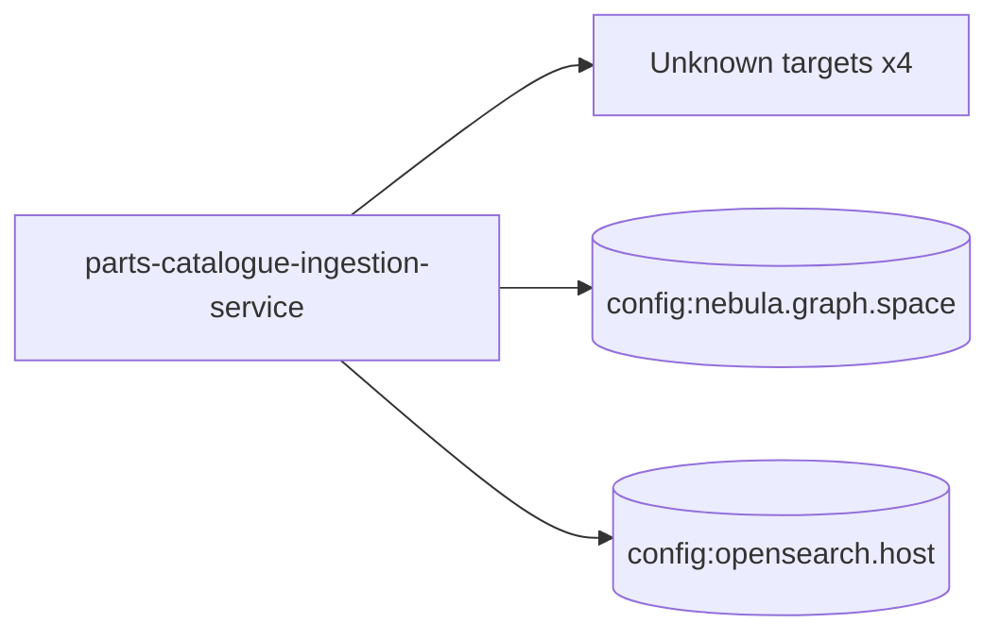

# parts-catalogue-ingestion-service — High-Level Design

## Context
parts-catalogue-ingestion-service is a `Unknown` in the TVS-CS org (domain: Unknown). Neighbours: callers Unknown; downstream none resolved.

## Architecture
parts-catalogue-ingestion-service components and connections (from service.yaml):

## Integration Points
parts-catalogue-ingestion-service registry edges (0):

| Direction | Peer | Kind | Via | Criticality | Source | Match |
|---|---|---|---|---|---|---|
| N/A | | | | | | no registry edges |

## Data Ownership
parts-catalogue-ingestion-service data stores (service.yaml `data_stores`; ownership flag not determinable unless set):

| Store | Type | Access | Owned | Key entities |
|---|---|---|---|---|
| `config:nebula.graph.space` | nebula | read-write | Unknown | HAS_ASSEMBLY, HAS_CATALOGUE, HAS_COLOR, HAS_MODEL, HAS_PART, HAS_VARIANT, HAS_VEHICLE, assembly, catalogue, color, model, part, product, variant, vehicle |
| `config:opensearch.host` | opensearch | read-write | Unknown | Unknown |

## Key Design Decisions
parts-catalogue-ingestion-service: N/A — not determinable from code.

| Decision | Alternatives considered | Reason |
|---|---|---|
| Unknown | Unknown | Unknown |

## Non-Functional Requirements
parts-catalogue-ingestion-service NFR targets: N/A — not determinable from code. Tuning-related config keys: `async.executor.core-pool-size`, `async.executor.max-pool-size`, `async.executor.thread-name-prefix`, `catalogue.api.mdp.timeout-seconds`, `catalogue.api.norton.max-retries`, `catalogue.api.norton.timeout-seconds`, `catalogue.api.price.batch-size`, `catalogue.api.price.max-retries`, `catalogue.api.price.timeout-seconds`, `catalogue.api.tvs.max-retries`, `catalogue.api.tvs.timeout-seconds`, `nebula.graph.max-conn-size`, `nebula.graph.timeout-ms`, `opensearch.connection-timeout-ms`, `opensearch.max-concurrent-indexing`, `opensearch.socket-timeout-ms`, `price.ingestion.nebula.timeout-seconds`, `price.ingestion.opensearch.timeout-seconds`, `price.ingestion.parallelism.core-threads`, `price.ingestion.parallelism.max-threads`, `price.ingestion.retry.max-attempts`, `resilience4j.retry.instances.catalogueApi.max-attempts`, `resilience4j.retry.instances.mdpApi.max-attempts`, `resilience4j.retry.instances.nebulaGraph.max-attempts`, `resilience4j.retry.instances.openSearch.max-attempts`.

## Security
parts-catalogue-ingestion-service security: endpoint auth values n/a. No auth middleware found in code. 10 secret config key(s), sourced via: {'app-settings': 10} (names in OVERVIEW.md). PII handling: Unknown.

## Resilience and Failure Modes
parts-catalogue-ingestion-service hard dependencies: none resolved. Retry/circuit-breaker code: `src/main/java/org/com/graph/config/ResilienceConfig.java:208` (.retry(), `src/main/java/org/com/graph/config/CatalogueApiProperties.java:23` (maxRetries).

## Deployment Topology
parts-catalogue-ingestion-service deployment artefacts (platform/regions: Unknown unless listed):

| Kind | Name | File | Environments | Image | Ports | Variable groups |
|---|---|---|---|---|---|---|
| azure-pipeline | azure_pipelines/ast-image-scan-parts-catalogue-ingestion-pipeline.yaml | `azure_pipelines/ast-image-scan-parts-catalogue-ingestion-pipeline.yaml:1` | - | - | - | Checkmarx_Common, UAT_Threshold |
| azure-pipeline | azure_pipelines/ast-parts-catalogue-ingestion-service-prod.yaml | `azure_pipelines/ast-parts-catalogue-ingestion-service-prod.yaml:1` | - | - | - | PROD_Threshold, Tenable |
| azure-pipeline | azure_pipelines/ast-parts-catalogue-ingestion-uat-pipeline.yaml | `azure_pipelines/ast-parts-catalogue-ingestion-uat-pipeline.yaml:1` | - | - | - | Checkmarx_Common, UAT_Threshold |
| azure-pipeline | azure_pipelines/sonar-pr-pipeline.yaml | `azure_pipelines/sonar-pr-pipeline.yaml:7` | - | - | - | - |
| azure-pipeline | cd-pipeline.yaml | `cd-pipeline.yaml:1` | dev, prod, uat | - | - | - |
| azure-pipeline | ci-pipeline.yaml | `ci-pipeline.yaml:1` | - | - | - | - |
| azure-pipeline | sonar-cipipeline.yml | `sonar-cipipeline.yml:3` | - | - | - | - |
| azure-pipeline | uk-cd-pipeline.yaml | `uk-cd-pipeline.yaml:1` | dev, prod, uat | - | - | - |
| azure-pipeline | uk-cd-training-pipeline.yaml | `uk-cd-training-pipeline.yaml:1` | training | - | - | - |
| dockerfile | Dockerfile | `Dockerfile:2` | - | maven:3-amazoncorretto-25-alpine, eclipse-temurin:25-jre-ubi10-minimal | - | - |

## Observability
parts-catalogue-ingestion-service observability libraries: `ch.qos.logback:logback-classic`, `ch.qos.logback:logback-core`, `io.micrometer:micrometer-core`, `org.springframework.boot:spring-boot-starter-actuator`. Related config keys: `logging.level.com.vesoft.nebula`, `logging.level.io.github.resilience4j`, `logging.level.org.com.graph`, `logging.level.org.opensearch.client`, `logging.pattern.console`. Dashboards/alerts: Unknown.
