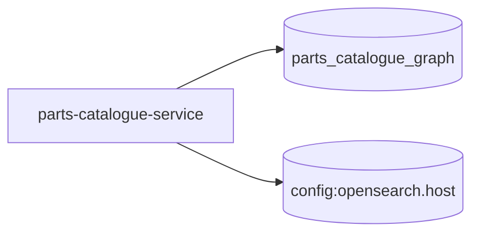

# parts-catalogue-service — High-Level Design

## Context
parts-catalogue-service is a `backend-api` in the TVS-CS org (domain: Unknown). Neighbours: callers Unknown; downstream none resolved.

## Architecture
parts-catalogue-service components and connections (from service.yaml):

## Integration Points
parts-catalogue-service registry edges (0):

| Direction | Peer | Kind | Via | Criticality | Source | Match |
|---|---|---|---|---|---|---|
| N/A | | | | | | no registry edges |

## Data Ownership
parts-catalogue-service data stores (service.yaml `data_stores`; ownership flag not determinable unless set):

| Store | Type | Access | Owned | Key entities |
|---|---|---|---|---|
| `parts_catalogue_graph` | nebula | read | Unknown | HAS_ASSEMBLY, HAS_CATALOGUE, HAS_COLOR, HAS_MODEL, HAS_PART, HAS_VARIANT, HAS_VEHICLE, assembly, catalogue, color, model, part, price, product, variant … |
| `config:opensearch.host` | opensearch | read-write | Unknown | parts_catalogue, parts_hierarchies, parts_prices, parts_warranties |

## Key Design Decisions
parts-catalogue-service: N/A — not determinable from code.

| Decision | Alternatives considered | Reason |
|---|---|---|
| Unknown | Unknown | Unknown |

## Non-Functional Requirements
parts-catalogue-service NFR targets: N/A — not determinable from code. Tuning-related config keys: `async.executor.core-pool-size`, `async.executor.max-pool-size`, `async.executor.thread-name-prefix`, `azure.blob.cache-max-size`, `batch.operation-timeout-ms`, `nebula.max-conn-size`, `nebula.timeout-ms`, `opensearch.connection-timeout-ms`, `opensearch.socket-timeout-ms`, `resilience4j.retry.instances.azureBlobRetry.max-attempts`, `resilience4j.retry.instances.nebulaRetry.max-attempts`, `resilience4j.retry.instances.opensearchRetry.max-attempts`.

## Security
parts-catalogue-service security: endpoint auth values None. No auth middleware found in code. 9 secret config key(s), sourced via: {'None': 3, 'app-settings': 6} (names in OVERVIEW.md). PII handling: Unknown.

## Resilience and Failure Modes
parts-catalogue-service hard dependencies: none resolved. Retry/circuit-breaker code: `src/main/java/org/com/graph/repository/AzureBlobRepository.java:35` (@CircuitBreaker), `src/main/java/org/com/graph/repository/nebula/PriceRepository.java:39` (@CircuitBreaker), `src/main/java/org/com/graph/repository/nebula/CatalogueRepository.java:47` (@CircuitBreaker), `src/main/java/org/com/graph/repository/nebula/ModelRepository.java:47` (@CircuitBreaker), `src/main/java/org/com/graph/repository/nebula/WarrantyRepository.java:38` (@CircuitBreaker), `src/main/java/org/com/graph/repository/nebula/ProductRepository.java:35` (@CircuitBreaker), `src/main/java/org/com/graph/repository/nebula/VariantRepository.java:47` (@CircuitBreaker), `src/main/java/org/com/graph/repository/nebula/PartRepository.java:61` (@CircuitBreaker), `src/main/java/org/com/graph/repository/nebula/VehicleRepository.java:47` (@CircuitBreaker), `src/main/java/org/com/graph/repository/nebula/AssemblyRepository.java:37` (@CircuitBreaker).

## Deployment Topology
parts-catalogue-service deployment artefacts (platform/regions: Unknown unless listed):

| Kind | Name | File | Environments | Image | Ports | Variable groups |
|---|---|---|---|---|---|---|
| azure-pipeline | azure-pipelines/ast-image-scan.yaml | `azure-pipelines/ast-image-scan.yaml:1` | - | - | - | Checkmarx_Common, UAT_Threshold |
| azure-pipeline | azure-pipelines/ast-prod.yaml | `azure-pipelines/ast-prod.yaml:1` | - | - | - | PROD_Threshold, Tenable |
| azure-pipeline | azure-pipelines/ast-uat.yaml | `azure-pipelines/ast-uat.yaml:1` | - | - | - | Checkmarx_Common, Tenable, UAT_Threshold |
| azure-pipeline | cd-pipeline.yaml | `cd-pipeline.yaml:1` | dev, prod, uat | - | - | - |
| azure-pipeline | ci-pipeline.yaml | `ci-pipeline.yaml:1` | - | - | - | - |
| azure-pipeline | sonar.yml | `sonar.yml:1` | - | - | - | - |
| azure-pipeline | uk-cd-pipeline.yaml | `uk-cd-pipeline.yaml:1` | dev, prod, uat | - | - | - |
| azure-pipeline | uk-training-cd-pipeline.yaml | `uk-training-cd-pipeline.yaml:1` | training | - | - | - |
| dockerfile | Dockerfile | `Dockerfile:2` | - | maven:3-amazoncorretto-25-alpine, eclipse-temurin:25-jre-ubi10-minimal | 3001 | - |

## Observability
parts-catalogue-service observability libraries: `ch.qos.logback:logback-classic`, `ch.qos.logback:logback-core`, `org.springframework.boot:spring-boot-starter-actuator`. Related config keys: `logging.level.com.vesoft.nebula`, `logging.level.io.github.resilience4j`, `logging.level.org.com.graph`, `logging.level.org.opensearch.client`, `logging.pattern.console`, `management.endpoint.health.show-details`, `management.endpoints.web.exposure.include`, `management.health.circuitbreakers.enabled`. Dashboards/alerts: Unknown.
