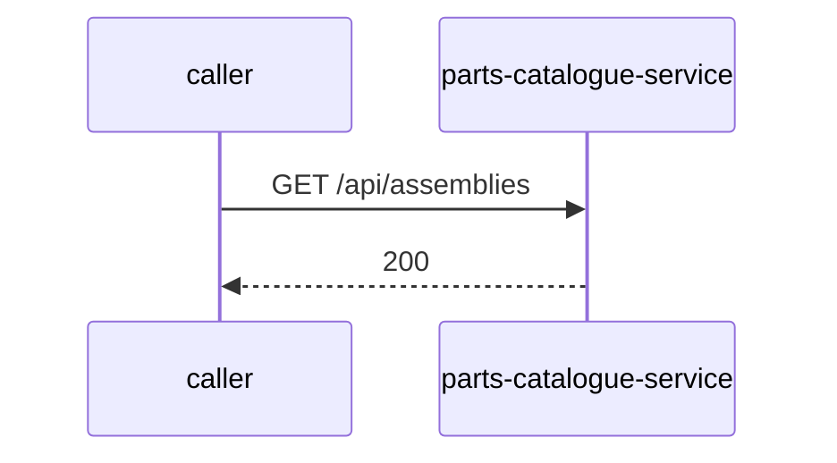

# parts-catalogue-service — Low-Level Design

## Data Model
parts-catalogue-service entities from `data_access` items (2).

Store access at `src/main/java/org/com/graph/config/NebulaGraphConfig.java:38`: database parts_catalogue_graph; collections -.

### HAS_ASSEMBLY
Entity `HAS_ASSEMBLY` defined in `src/main/java/org/com/graph/repository/nebula/AssemblyRepository.java:53`; table HAS_ASSEMBLY; operation read.
Columns: Unknown (no fields extracted).
Relationships: Unknown.

### HAS_CATALOGUE
Entity `HAS_CATALOGUE` defined in `src/main/java/org/com/graph/repository/nebula/CatalogueRepository.java:64`; table HAS_CATALOGUE; operation read.
Columns: Unknown (no fields extracted).
Relationships: Unknown.

### HAS_COLOR
Entity `HAS_COLOR` defined in `src/main/java/org/com/graph/repository/nebula/PartRepository.java:225`; table HAS_COLOR; operation read.
Columns: Unknown (no fields extracted).
Relationships: Unknown.

### HAS_MODEL
Entity `HAS_MODEL` defined in `src/main/java/org/com/graph/repository/nebula/ModelRepository.java:64`; table HAS_MODEL; operation read.
Columns: Unknown (no fields extracted).
Relationships: Unknown.

### HAS_PART
Entity `HAS_PART` defined in `src/main/java/org/com/graph/repository/nebula/PartRepository.java:95`; table HAS_PART; operation read.
Columns: Unknown (no fields extracted).
Relationships: Unknown.

### HAS_VARIANT
Entity `HAS_VARIANT` defined in `src/main/java/org/com/graph/repository/nebula/PartRepository.java:225`; table HAS_VARIANT; operation read.
Columns: Unknown (no fields extracted).
Relationships: Unknown.

### HAS_VEHICLE
Entity `HAS_VEHICLE` defined in `src/main/java/org/com/graph/repository/nebula/VehicleRepository.java:64`; table HAS_VEHICLE; operation read.
Columns: Unknown (no fields extracted).
Relationships: Unknown.

### assembly
Entity `assembly` defined in `src/main/java/org/com/graph/repository/nebula/AssemblyRepository.java:53`; table assembly; operation read.
Columns: Unknown (no fields extracted).
Relationships: Unknown.

### catalogue
Entity `catalogue` defined in `src/main/java/org/com/graph/repository/nebula/AssemblyRepository.java:53`; table catalogue; operation read.
Columns: Unknown (no fields extracted).
Relationships: Unknown.

### color
Entity `color` defined in `src/main/java/org/com/graph/repository/nebula/PartRepository.java:225`; table color; operation read.
Columns: Unknown (no fields extracted).
Relationships: Unknown.

### model
Entity `model` defined in `src/main/java/org/com/graph/repository/nebula/ModelRepository.java:64`; table model; operation read.
Columns: Unknown (no fields extracted).
Relationships: Unknown.

### part
Entity `part` defined in `src/main/java/org/com/graph/repository/nebula/PartRepository.java:95`; table part; operation read.
Columns: Unknown (no fields extracted).
Relationships: Unknown.

### price
Entity `price` defined in `src/main/java/org/com/graph/repository/nebula/PriceRepository.java:63`; table price; operation read.
Columns: Unknown (no fields extracted).
Relationships: Unknown.

### product
Entity `product` defined in `src/main/java/org/com/graph/repository/nebula/NebulaGraphRepository.java:68`; table product; operation read.
Columns: Unknown (no fields extracted).
Relationships: Unknown.

### variant
Entity `variant` defined in `src/main/java/org/com/graph/repository/nebula/CatalogueRepository.java:64`; table variant; operation read.
Columns: Unknown (no fields extracted).
Relationships: Unknown.

### vehicle
Entity `vehicle` defined in `src/main/java/org/com/graph/repository/nebula/ModelRepository.java:64`; table vehicle; operation read.
Columns: Unknown (no fields extracted).
Relationships: Unknown.

### warranty
Entity `warranty` defined in `src/main/java/org/com/graph/repository/nebula/WarrantyRepository.java:61`; table warranty; operation read.
Columns: Unknown (no fields extracted).
Relationships: Unknown.

Store access at `src/main/java/org/com/graph/config/OpenSearchConfig.java:60`: database Unknown; collections parts_catalogue, parts_hierarchies, parts_prices, parts_warranties.

### parts_catalogue
Entity `parts_catalogue` defined in `src/main/java/org/com/graph/repository/opensearch/OpenSearchRepository.java:75`; table parts_catalogue; operation both.
Columns: Unknown (no fields extracted).
Relationships: Unknown.

### parts_hierarchies
Entity `parts_hierarchies` defined in `src/main/java/org/com/graph/repository/opensearch/HierarchyDataRepository.java:47`; table parts_hierarchies; operation read.
Columns: Unknown (no fields extracted).
Relationships: Unknown.

### parts_prices
Entity `parts_prices` defined in `src/main/java/org/com/graph/repository/opensearch/PriceRepository.java:77`; table parts_prices; operation read.
Columns: Unknown (no fields extracted).
Relationships: Unknown.

### parts_warranties
Entity `parts_warranties` defined in `src/main/java/org/com/graph/repository/opensearch/WarrantyRepository.java:71`; table parts_warranties; operation read.
Columns: Unknown (no fields extracted).
Relationships: Unknown.

## State Machines
parts-catalogue-service: N/A — no status/state enums found in code.

## Business Rules
parts-catalogue-service validation rules on DTO fields (from schema `validation`):
N/A — no declarative validation found; other rules not determinable without manual review.

## Key Classes and Functions
parts-catalogue-service key classes:

| Class / Function | File | Responsibility |
|---|---|---|
| `EntitiesController` | `src/main/java/org/com/graph/controller/EntitiesController.java` | HTTP handlers |
| `ChartController` | `src/main/java/org/com/graph/controller/ChartController.java` | HTTP handlers |
| `ProductDetailsController` | `src/main/java/org/com/graph/controller/ProductDetailsController.java` | HTTP handlers |
| `TraversalController` | `src/main/java/org/com/graph/controller/TraversalController.java` | HTTP handlers |
| `SearchController` | `src/main/java/org/com/graph/controller/SearchController.java` | HTTP handlers |
| `EpcController` | `src/main/java/org/com/graph/controller/EpcController.java` | HTTP handlers |
| `ProductDetailsControllerV2` | `src/main/java/org/com/graph/controller/ProductDetailsControllerV2.java` | HTTP handlers |
| `TraversalControllerV2` | `src/main/java/org/com/graph/controller/TraversalControllerV2.java` | HTTP handlers |
| `SearchControllerV2` | `src/main/java/org/com/graph/controller/SearchControllerV2.java` | HTTP handlers |
| `@RestControllerAdvice` | `src/main/java/org/com/graph/exception/GlobalExceptionHandler.java:24` | error handling |

## Sequence Details
parts-catalogue-service sequence for `GET /api/assemblies` (handler `EntitiesController.getAssemblies`); downstream calls inside the handler are not traced from code, module-level targets shown as optional.

## Error Handling
parts-catalogue-service error handling: `src/main/java/org/com/graph/exception/GlobalExceptionHandler.java:24` (@RestControllerAdvice). Documented error statuses come from response annotations in API_SPEC.md. Retry evidence: `src/main/java/org/com/graph/repository/AzureBlobRepository.java:35`, `src/main/java/org/com/graph/repository/nebula/PriceRepository.java:39`, `src/main/java/org/com/graph/repository/nebula/CatalogueRepository.java:47`, `src/main/java/org/com/graph/repository/nebula/ModelRepository.java:47`, `src/main/java/org/com/graph/repository/nebula/WarrantyRepository.java:38`, `src/main/java/org/com/graph/repository/nebula/ProductRepository.java:35`, `src/main/java/org/com/graph/repository/nebula/VariantRepository.java:47`, `src/main/java/org/com/graph/repository/nebula/PartRepository.java:61`, `src/main/java/org/com/graph/repository/nebula/VehicleRepository.java:47`, `src/main/java/org/com/graph/repository/nebula/AssemblyRepository.java:37`.

## Configuration Details
parts-catalogue-service behaviour-relevant config keys (names only; full list in OVERVIEW.md):
- N/A — no behaviour-switching keys identified

## Edge Cases
parts-catalogue-service edge cases: N/A — not determinable from code without manual review.
