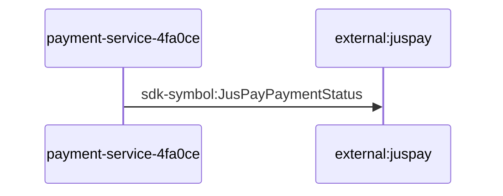

# payment-service-4fa0ce — Data Flows

## Flow Index
payment-service-4fa0ce takes part in 1 end-to-end flow(s) in registry/flows.json.

| flow_id | Name | Role of payment-service-4fa0ce | Trigger |
|---|---|---|---|
| payment-service-4fa0ce--external-juspay | payment-service-4fa0ce → external:juspay (1 hop) | entry | request to payment-service-4fa0ce from outside the registry (no internal caller) |

## Flow: payment-service-4fa0ce--external-juspay
Summary: Starting at `payment-service-4fa0ce` (request to payment-service-4fa0ce from outside the registry (no internal caller)), the flow ends at `external:juspay`, using 1 sync HTTP hop(s) and 0 async event hop(s); payment-service-4fa0ce role: entry; confidence high.

Steps:
| # | From | To | Via | Data (schema names) | Sync/Async | Confidence |
|---|---|---|---|---|---|---|
| 1 | payment-service-4fa0ce | external:juspay | sdk-symbol:JusPayPaymentStatus | Unknown | sync | high |

Data touched: Unknown (no data stores in registry)

Failure points: hop 1 payment-service-4fa0ce → external:juspay: criticality hard

Evidence:
- hop 1 (payment-service-4fa0ce → external:juspay): `PaymentService/Constants/JusPayPaymentStatus.cs:3`, `PaymentService/Constants/JusPayPayoutStatus.cs:3`, `PaymentService/Constants/JusPayRefundStatus.cs:3`
