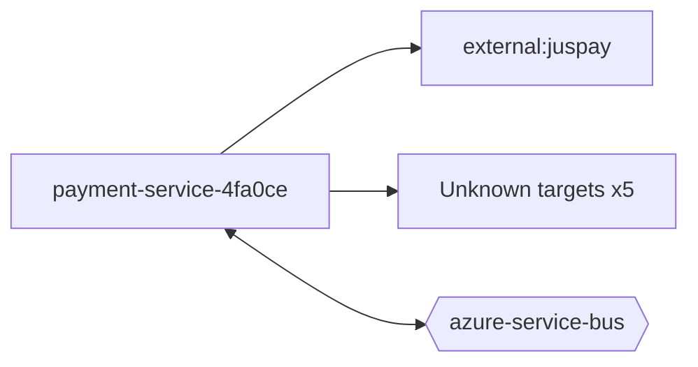

# payment-service-4fa0ce — High-Level Design

## Context
payment-service-4fa0ce is a `function` in the TVS-CS org (domain: Unknown). Neighbours: callers Unknown; downstream `external:juspay`.

## Architecture
payment-service-4fa0ce components and connections (from service.yaml):

## Integration Points
payment-service-4fa0ce registry edges (1):

| Direction | Peer | Kind | Via | Criticality | Source | Match |
|---|---|---|---|---|---|---|
| out | `external:juspay` | http | sdk-symbol:JusPayPaymentStatus | hard | code | sdk-symbol |
| out | `external:juspay` | http | - | hard | code | external |

## Data Ownership
payment-service-4fa0ce data stores (service.yaml `data_stores`; ownership flag not determinable unless set):

| Store | Type | Access | Owned | Key entities |
|---|---|---|---|---|
| N/A | | | | no data stores extracted |

## Key Design Decisions
payment-service-4fa0ce: N/A — not determinable from code.

| Decision | Alternatives considered | Reason |
|---|---|---|
| Unknown | Unknown | Unknown |

## Non-Functional Requirements
payment-service-4fa0ce NFR targets: N/A — not determinable from code.

## Security
payment-service-4fa0ce security: endpoint auth values n/a. No auth middleware found in code. 0 secret config key(s), sourced via: n/a (names in OVERVIEW.md). PII handling: Unknown.

## Resilience and Failure Modes
payment-service-4fa0ce hard dependencies: `external:juspay`. No retry/circuit-breaker code found; failure behaviour Unknown.

## Deployment Topology
payment-service-4fa0ce deployment artefacts (platform/regions: Unknown unless listed):

| Kind | Name | File | Environments | Image | Ports | Variable groups |
|---|---|---|---|---|---|---|
| N/A | | | | | | no infra files |

## Observability
payment-service-4fa0ce observability libraries: `Microsoft.ApplicationInsights.WorkerService`, `Microsoft.Azure.Functions.Worker.ApplicationInsights`. Related config keys: `logging:applicationInsights:enableLiveMetricsFilters`, `logging:applicationInsights:samplingSettings:excludedTypes`, `logging:applicationInsights:samplingSettings:isEnabled`. Dashboards/alerts: Unknown.
