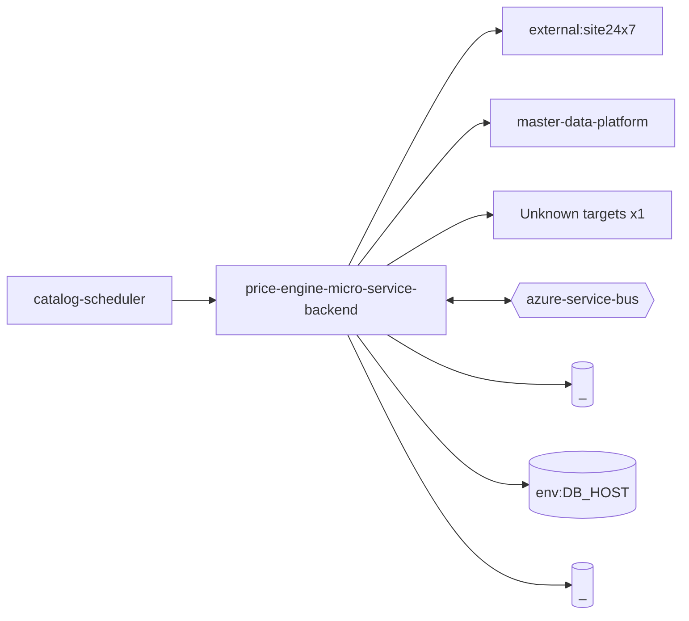

# price-engine-micro-service-backend — High-Level Design

## Context
price-engine-micro-service-backend is a `backend-api` in the TVS-CS org (domain: Unknown). Neighbours: callers `catalog-scheduler`; downstream `external:site24x7`, `master-data-platform`.

## Architecture
price-engine-micro-service-backend components and connections (from service.yaml):

## Integration Points
price-engine-micro-service-backend registry edges (6):

| Direction | Peer | Kind | Via | Criticality | Source | Match |
|---|---|---|---|---|---|---|
| in | `master-data-platform` | event | azure-service-bus:topic:mdp.price.vehicle | async | code | entity |
| in | `master-data-platform` | event | azure-service-bus:topic:mdp.product.vehicle | async | code | entity |
| in | `catalog-scheduler` | http | GET /on-road-prices/vehicles/engineType/{engineType} | hard | code | path-unique |
| out | `master-data-platform` | http | POST /mdp/v1/price/test/service-bus/push-price-data | hard | code | path-unique |
| out | `master-data-platform` | http | POST /mdp/v1/product/test/service-bus/push-product-data | hard | code | path-unique |
| out | `external:site24x7` | library_dependency | package:apminsight | hard | code | artifact |
| out | `external:site24x7` | http | - | Unknown | code | external |

## Data Ownership
price-engine-micro-service-backend data stores (service.yaml `data_stores`; ownership flag not determinable unless set):

| Store | Type | Access | Owned | Key entities |
|---|---|---|---|---|
| `_` | mongo | Unknown | Unknown | Unknown |
| `env:DB_HOST` | mongo | Unknown | Unknown | Unknown |
| `_` | redis | Unknown | Unknown | Unknown |

## Key Design Decisions
price-engine-micro-service-backend: N/A — not determinable from code.

| Decision | Alternatives considered | Reason |
|---|---|---|
| Unknown | Unknown | Unknown |

## Non-Functional Requirements
price-engine-micro-service-backend NFR targets: N/A — not determinable from code.

## Security
price-engine-micro-service-backend security: endpoint auth values None. No auth middleware found in code. 5 secret config key(s), sourced via: {'None': 4, 'env-file': 1} (names in OVERVIEW.md). PII handling: Unknown.

## Resilience and Failure Modes
price-engine-micro-service-backend hard dependencies: `master-data-platform`. No retry/circuit-breaker code found; failure behaviour Unknown.

## Deployment Topology
price-engine-micro-service-backend deployment artefacts (platform/regions: Unknown unless listed):

| Kind | Name | File | Environments | Image | Ports | Variable groups |
|---|---|---|---|---|---|---|
| azure-pipeline | AST_MDP_Price-Engine-MicroService-Backend_release_Pipeline.yml | `AST_MDP_Price-Engine-MicroService-Backend_release_Pipeline.yml:1` | - | - | - | Checkmarx_Common, PROD_Threshold, Tenable |
| azure-pipeline | pe-ms-be-prod-cd.yml | `pe-ms-be-prod-cd.yml:1` | staging | - | - | - |
| azure-pipeline | pe-ms-be-prod-ci.yml | `pe-ms-be-prod-ci.yml:1` | - | - | - | - |
| dockerfile | Dockerfile | `Dockerfile:2` | - | node:20-alpine | 8080 | - |

## Observability
price-engine-micro-service-backend observability libraries: `winston`. Related config keys: none. Dashboards/alerts: Unknown.
