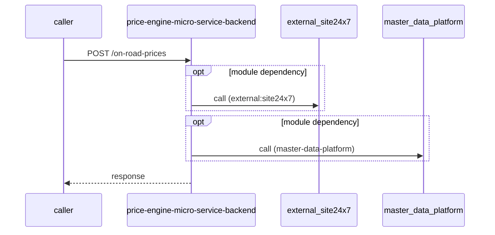

# price-engine-micro-service-backend — Low-Level Design

## Data Model
price-engine-micro-service-backend entities from `data_access` items (3).

Store access at `sonar-exclusion-function/scripts/insert-states-data.ts:35`: database Unknown; collections AuditLog, DeadLetterMessages, OnRoadPrice, PriceComponents, ProductPriceComponents, cities, product_price_components, realtime_price_update_logs, states, temp_price_messages, temp_price_messages_from_excel, temp_product_messages, vehicleModels.

Store access at `src/db/mongodb/db.ts:16`: database Unknown; collections -.

Store access at `src/config/redis-config.ts:24`: database Unknown; collections -.

## State Machines
price-engine-micro-service-backend: N/A — no status/state enums found in code.

## Business Rules
price-engine-micro-service-backend validation rules on DTO fields (from schema `validation`):
N/A — no declarative validation found; other rules not determinable without manual review.

## Key Classes and Functions
price-engine-micro-service-backend key classes:

| Class / Function | File | Responsibility |
|---|---|---|
| `cacheHandler` | `src/routes/api/cache-routes.ts` | HTTP handlers |
| `onRoadPriceHandler` | `src/routes/api/on-road-price-routes.ts` | HTTP handlers |
| `priceComponentHandler` | `src/routes/api/price-component-routes.ts` | HTTP handlers |
| `productPriceComponentsHandler` | `src/routes/api/product-price-components-routes.ts` | HTTP handlers |
| `productHandler` | `src/routes/api/product-routes.ts` | HTTP handlers |
| `regionHandler` | `src/routes/api/region-routes.ts` | HTTP handlers |
| `priceUploadHandler` | `src/routes/api/price-upload-routes.ts` | HTTP handlers |
| publish Unknown (name from `env:TOPIC_NAME_MARKETPLACE`) | `src/services/price-engine-price-publisher.ts:17` | azure-service-bus messaging |
| subscribe Unknown (name from `env:TOPIC_NAME_PRICE`) | `src/utils/service-bus-implementors/service-bus-connection-implementer.ts:21` | azure-service-bus messaging |
| subscribe Unknown (name from `env:TOPIC_NAME_PRODUCT`) | `src/utils/service-bus-implementors/service-bus-connection-implementer.ts:21` | azure-service-bus messaging |
| subscribe uat.mdp.price.vehicle | `sonar-exclusion-function/service-bus/implemeters/price-service-bus-implementer.ts:18` | azure-service-bus messaging |
| subscribe uat.mdp.product.vehicle | `sonar-exclusion-function/service-bus/implemeters/product-service-bus-implementer.ts:28` | azure-service-bus messaging |

## Sequence Details
price-engine-micro-service-backend sequence for `POST /on-road-prices` (handler `onRoadPriceHandler.generateOnRoadPrice`); downstream calls inside the handler are not traced from code, module-level targets shown as optional.

## Error Handling
price-engine-micro-service-backend error handling: no global exception handler found in code. Status mapping: Unknown.

## Configuration Details
price-engine-micro-service-backend behaviour-relevant config keys (names only; full list in OVERVIEW.md):
- `TOPIC_NAME_MARKETPLACE`: publish entity name
- `TOPIC_NAME_PRICE`: subscribe entity name
- `TOPIC_NAME_PRODUCT`: subscribe entity name

## Edge Cases
price-engine-micro-service-backend edge cases: N/A — not determinable from code without manual review.
