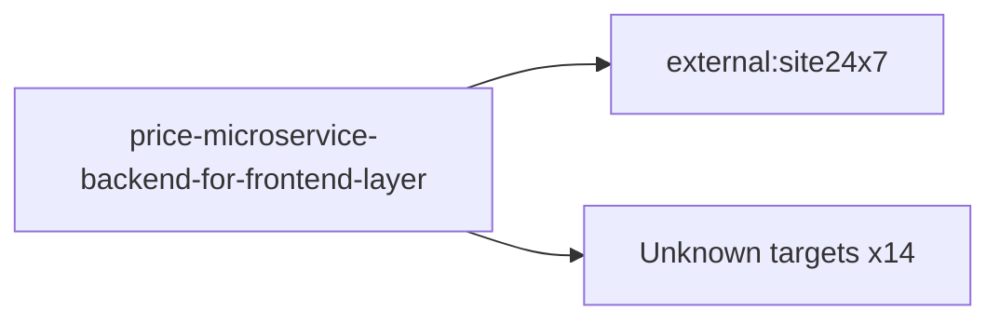

# price-microservice-backend-for-frontend-layer — High-Level Design

## Context
price-microservice-backend-for-frontend-layer is a `bff` in the TVS-CS org (domain: Unknown). Neighbours: callers Unknown; downstream `external:site24x7`.

## Architecture
price-microservice-backend-for-frontend-layer components and connections (from service.yaml):

## Integration Points
price-microservice-backend-for-frontend-layer registry edges (1):

| Direction | Peer | Kind | Via | Criticality | Source | Match |
|---|---|---|---|---|---|---|
| out | `external:site24x7` | library_dependency | package:apminsight | hard | code | artifact |
| out | `external:site24x7` | http | - | Unknown | code | external |

## Data Ownership
price-microservice-backend-for-frontend-layer data stores (service.yaml `data_stores`; ownership flag not determinable unless set):

| Store | Type | Access | Owned | Key entities |
|---|---|---|---|---|
| N/A | | | | no data stores extracted |

## Key Design Decisions
price-microservice-backend-for-frontend-layer: N/A — not determinable from code.

| Decision | Alternatives considered | Reason |
|---|---|---|
| Unknown | Unknown | Unknown |

## Non-Functional Requirements
price-microservice-backend-for-frontend-layer NFR targets: N/A — not determinable from code.

## Security
price-microservice-backend-for-frontend-layer security: endpoint auth values None. No auth middleware found in code. 0 secret config key(s), sourced via: n/a (names in OVERVIEW.md). PII handling: Unknown.

## Resilience and Failure Modes
price-microservice-backend-for-frontend-layer hard dependencies: none resolved. No retry/circuit-breaker code found; failure behaviour Unknown.

## Deployment Topology
price-microservice-backend-for-frontend-layer deployment artefacts (platform/regions: Unknown unless listed):

| Kind | Name | File | Environments | Image | Ports | Variable groups |
|---|---|---|---|---|---|---|
| azure-pipeline | azure-pipelines.yaml | `azure-pipelines.yaml:6` | - | - | - | - |

## Observability
price-microservice-backend-for-frontend-layer observability libraries: `winston`. Related config keys: none. Dashboards/alerts: Unknown.
