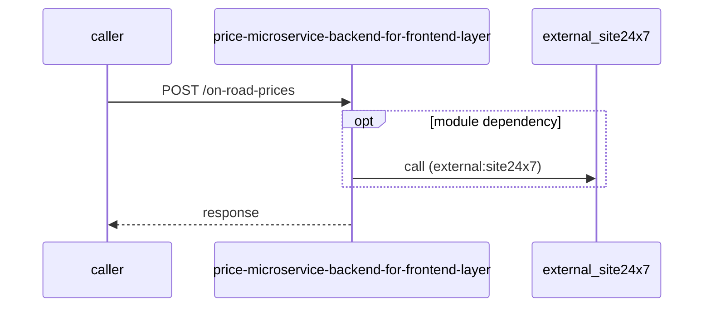

# price-microservice-backend-for-frontend-layer — Low-Level Design

## Data Model
price-microservice-backend-for-frontend-layer entities from `data_access` items (0).
N/A — no data access in this repo.

## State Machines
price-microservice-backend-for-frontend-layer: N/A — no status/state enums found in code.

## Business Rules
price-microservice-backend-for-frontend-layer validation rules on DTO fields (from schema `validation`):
N/A — no declarative validation found; other rules not determinable without manual review.

## Key Classes and Functions
price-microservice-backend-for-frontend-layer key classes:

| Class / Function | File | Responsibility |
|---|---|---|
| `onRoadPriceHandler` | `src/routes/api/on-road-price-routes.ts` | HTTP handlers |
| `priceComponentHandler` | `src/routes/api/price-component-route.ts` | HTTP handlers |
| `productPriceComponentsHandler` | `src/routes/api/product-price-components-route.ts` | HTTP handlers |
| `productHandler` | `src/routes/api/product-route.ts` | HTTP handlers |
| `regionHandler` | `src/routes/api/region-routes.ts` | HTTP handlers |

## Sequence Details
price-microservice-backend-for-frontend-layer sequence for `POST /on-road-prices` (handler `onRoadPriceHandler.generateOnRoadPrice`); downstream calls inside the handler are not traced from code, module-level targets shown as optional.

## Error Handling
price-microservice-backend-for-frontend-layer error handling: no global exception handler found in code. Status mapping: Unknown.

## Configuration Details
price-microservice-backend-for-frontend-layer behaviour-relevant config keys (names only; full list in OVERVIEW.md):
- `env:PRICE_MICROSERVICE_BASE_URL`: base URL for outbound calls

## Edge Cases
price-microservice-backend-for-frontend-layer edge cases: N/A — not determinable from code without manual review.
