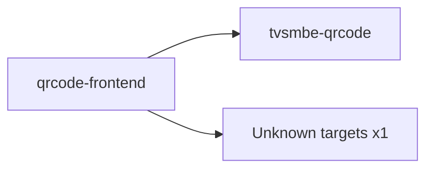

# qrcode-frontend — High-Level Design

## Context
qrcode-frontend is a `frontend-web` in the TVS-CS org (domain: Unknown). Neighbours: callers Unknown; downstream `tvsmbe-qrcode`.

## Architecture
qrcode-frontend components and connections (from service.yaml):

## Integration Points
qrcode-frontend registry edges (14):

| Direction | Peer | Kind | Via | Criticality | Source | Match |
|---|---|---|---|---|---|---|
| out | `tvsmbe-qrcode` | http | GET /api/analytics/summary | hard | code | path-unique |
| out | `tvsmbe-qrcode` | http | GET /api/analytics/timeline | hard | code | path-unique |
| out | `tvsmbe-qrcode` | http | GET /api/analytics/top | hard | code | path-unique |
| out | `tvsmbe-qrcode` | http | GET /api/auth/config | hard | code | path-unique |
| out | `tvsmbe-qrcode` | http | GET /api/auth/me | hard | code | path-unique |
| out | `tvsmbe-qrcode` | http | PATCH /api/qr-library/{id}/redirect | hard | code | path-unique |
| out | `tvsmbe-qrcode` | http | PATCH /api/qr-library/{id}/status | hard | code | path-unique |
| out | `tvsmbe-qrcode` | http | POST /api/auth/login | hard | code | path-unique |
| out | `tvsmbe-qrcode` | http | POST /api/auth/logout | hard | code | path-unique |
| out | `tvsmbe-qrcode` | http | POST /api/auth/refresh | hard | code | path-unique |
| out | `tvsmbe-qrcode` | http | POST /api/qr-create/preview | hard | code | path-unique |
| out | `tvsmbe-qrcode` | http | POST /api/qr-create/save | hard | code | path-unique |
| out | `tvsmbe-qrcode` | http | POST /api/qr/generate | hard | code | path-unique |
| out | `tvsmbe-qrcode` | http | POST /api/qr/save | hard | code | path-unique |

## Data Ownership
qrcode-frontend data stores (service.yaml `data_stores`; ownership flag not determinable unless set):

| Store | Type | Access | Owned | Key entities |
|---|---|---|---|---|
| N/A | | | | no data stores extracted |

## Key Design Decisions
qrcode-frontend: N/A — not determinable from code.

| Decision | Alternatives considered | Reason |
|---|---|---|
| Unknown | Unknown | Unknown |

## Non-Functional Requirements
qrcode-frontend NFR targets: N/A — not determinable from code.

## Security
qrcode-frontend security: endpoint auth values n/a. No auth middleware found in code. 0 secret config key(s), sourced via: n/a (names in OVERVIEW.md). PII handling: Unknown.

## Resilience and Failure Modes
qrcode-frontend hard dependencies: `tvsmbe-qrcode`. No retry/circuit-breaker code found; failure behaviour Unknown.

## Deployment Topology
qrcode-frontend deployment artefacts (platform/regions: Unknown unless listed):

| Kind | Name | File | Environments | Image | Ports | Variable groups |
|---|---|---|---|---|---|---|
| compose-service | frontend | `docker-compose.yml:2` | - | - | 3000:80 | - |
| dockerfile | Dockerfile | `Dockerfile:2` | - | node:18-alpine, nginx:alpine | 80 | - |

## Observability
qrcode-frontend observability libraries: none found. Related config keys: none. Dashboards/alerts: Unknown.
