# tvs-cps-backend — Data Flows

## Flow Index
tvs-cps-backend takes part in 57 end-to-end flow(s) in registry/flows.json; showing the top 25 by confidence, then length.

| flow_id | Name | Role of tvs-cps-backend | Trigger |
|---|---|---|---|
| tvs-cps-backend--external-onetrust | tvs-cps-backend → external:onetrust (1 hop) | entry | scheduled job(s) in tvs-cps-backend (job-to-call link not resolved): JobScheduler.loadCatalogData, JobScheduler.retrieveMDPDealers, JobScheduler.retrieveMerchandiseStock (+2 more) |
| tvs-cps-backend--external-salesforce-27d8cb | tvs-cps-backend → external:salesforce (4 hops) | entry | scheduled job(s) in tvs-cps-backend (job-to-call link not resolved): JobScheduler.loadCatalogData, JobScheduler.retrieveMDPDealers, JobScheduler.retrieveMerchandiseStock (+2 more) |
| tvs-cps-backend--external-salesforce-4e791f | tvs-cps-backend → external:salesforce (5 hops) | entry | scheduled job(s) in tvs-cps-backend (job-to-call link not resolved): JobScheduler.loadCatalogData, JobScheduler.retrieveMDPDealers, JobScheduler.retrieveMerchandiseStock (+2 more) |
| tvs-cps-backend--external-salesforce-5bee04 | tvs-cps-backend → external:salesforce (5 hops) | entry | scheduled job(s) in tvs-cps-backend (job-to-call link not resolved): JobScheduler.loadCatalogData, JobScheduler.retrieveMDPDealers, JobScheduler.retrieveMerchandiseStock (+2 more) |
| tvs-cps-backend--tvs-cps-billing | tvs-cps-backend → tvs-cps-billing (1 hop) | entry | scheduled job(s) in tvs-cps-backend (job-to-call link not resolved): JobScheduler.loadCatalogData, JobScheduler.retrieveMDPDealers, JobScheduler.retrieveMerchandiseStock (+2 more) |
| tvs-cps-backend--tvs-cps-customer | tvs-cps-backend → tvs-cps-customer (1 hop) | entry | scheduled job(s) in tvs-cps-backend (job-to-call link not resolved): JobScheduler.loadCatalogData, JobScheduler.retrieveMDPDealers, JobScheduler.retrieveMerchandiseStock (+2 more) |
| tvs-cps-backend--tvs-cps-inventory | tvs-cps-backend → tvs-cps-inventory (1 hop) | entry | scheduled job(s) in tvs-cps-backend (job-to-call link not resolved): JobScheduler.loadCatalogData, JobScheduler.retrieveMDPDealers, JobScheduler.retrieveMerchandiseStock (+2 more) |
| tvs-cps-backend--tvs-cps-job-card-service | tvs-cps-backend → tvs-cps-job-card-service (1 hop) | entry | scheduled job(s) in tvs-cps-backend (job-to-call link not resolved): JobScheduler.loadCatalogData, JobScheduler.retrieveMDPDealers, JobScheduler.retrieveMerchandiseStock (+2 more) |
| tvs-cps-jobs--external-onetrust | tvs-cps-jobs → external:onetrust (2 hops) | participant | scheduled job(s) in tvs-cps-jobs (job-to-call link not resolved): CronJobScheduler.allBookingsScheduler, CronJobScheduler.allEnquiriesScheduler, CronJobScheduler.availableStockScheduler (+27 more); request to tvs-cps-jobs from outside the registry (no internal caller) |
| tvs-cps-jobs--external-salesforce-62e84d | tvs-cps-jobs → external:salesforce (5 hops) | participant | scheduled job(s) in tvs-cps-jobs (job-to-call link not resolved): CronJobScheduler.allBookingsScheduler, CronJobScheduler.allEnquiriesScheduler, CronJobScheduler.availableStockScheduler (+27 more); request to tvs-cps-jobs from outside the registry (no internal caller) |
| tvs-cps-jobs--external-salesforce-cd1252 | tvs-cps-jobs → external:salesforce (5 hops) | participant | scheduled job(s) in tvs-cps-jobs (job-to-call link not resolved): CronJobScheduler.allBookingsScheduler, CronJobScheduler.allEnquiriesScheduler, CronJobScheduler.availableStockScheduler (+27 more); request to tvs-cps-jobs from outside the registry (no internal caller) |
| tvs-cps-jobs--lms-crm-735e1f | tvs-cps-jobs → lms-crm (5 hops) | participant | scheduled job(s) in tvs-cps-jobs (job-to-call link not resolved): CronJobScheduler.allBookingsScheduler, CronJobScheduler.allEnquiriesScheduler, CronJobScheduler.availableStockScheduler (+27 more); request to tvs-cps-jobs from outside the registry (no internal caller) |
| tvs-cps-jobs--lms-crm-80b689 | tvs-cps-jobs → lms-crm (5 hops) | participant | scheduled job(s) in tvs-cps-jobs (job-to-call link not resolved): CronJobScheduler.allBookingsScheduler, CronJobScheduler.allEnquiriesScheduler, CronJobScheduler.availableStockScheduler (+27 more); request to tvs-cps-jobs from outside the registry (no internal caller) |
| tvs-cps-jobs--lms-tvs-credit-ce3ec7 | tvs-cps-jobs → lms-tvs-credit (5 hops) | participant | scheduled job(s) in tvs-cps-jobs (job-to-call link not resolved): CronJobScheduler.allBookingsScheduler, CronJobScheduler.allEnquiriesScheduler, CronJobScheduler.availableStockScheduler (+27 more); request to tvs-cps-jobs from outside the registry (no internal caller) |
| tvs-cps-jobs--lms-tvs-credit-e20095 | tvs-cps-jobs → lms-tvs-credit (5 hops) | participant | scheduled job(s) in tvs-cps-jobs (job-to-call link not resolved): CronJobScheduler.allBookingsScheduler, CronJobScheduler.allEnquiriesScheduler, CronJobScheduler.availableStockScheduler (+27 more); request to tvs-cps-jobs from outside the registry (no internal caller) |
| tvs-cps-jobs--tvs-cps-billing | tvs-cps-jobs → tvs-cps-billing (2 hops) | participant | scheduled job(s) in tvs-cps-jobs (job-to-call link not resolved): CronJobScheduler.allBookingsScheduler, CronJobScheduler.allEnquiriesScheduler, CronJobScheduler.availableStockScheduler (+27 more); request to tvs-cps-jobs from outside the registry (no internal caller) |
| tvs-cps-jobs--tvs-cps-customer | tvs-cps-jobs → tvs-cps-customer (2 hops) | participant | scheduled job(s) in tvs-cps-jobs (job-to-call link not resolved): CronJobScheduler.allBookingsScheduler, CronJobScheduler.allEnquiriesScheduler, CronJobScheduler.availableStockScheduler (+27 more); request to tvs-cps-jobs from outside the registry (no internal caller) |
| tvs-cps-jobs--tvs-cps-inventory | tvs-cps-jobs → tvs-cps-inventory (2 hops) | participant | scheduled job(s) in tvs-cps-jobs (job-to-call link not resolved): CronJobScheduler.allBookingsScheduler, CronJobScheduler.allEnquiriesScheduler, CronJobScheduler.availableStockScheduler (+27 more); request to tvs-cps-jobs from outside the registry (no internal caller) |
| tvs-cps-jobs--tvs-cps-job-card-service | tvs-cps-jobs → tvs-cps-job-card-service (2 hops) | participant | scheduled job(s) in tvs-cps-jobs (job-to-call link not resolved): CronJobScheduler.allBookingsScheduler, CronJobScheduler.allEnquiriesScheduler, CronJobScheduler.availableStockScheduler (+27 more); request to tvs-cps-jobs from outside the registry (no internal caller) |
| tvs-cps-portal--external-salesforce-59d84e | tvs-cps-portal → external:salesforce (5 hops) | participant | user action in tvs-cps-portal (frontend) |
| tvs-cps-portal--external-salesforce-af08bd | tvs-cps-portal → external:salesforce (5 hops) | participant | user action in tvs-cps-portal (frontend) |
| tvs-cps-portal--lms-crm-27db64 | tvs-cps-portal → lms-crm (5 hops) | participant | user action in tvs-cps-portal (frontend) |
| tvs-cps-portal--lms-crm-f79cdd | tvs-cps-portal → lms-crm (5 hops) | participant | user action in tvs-cps-portal (frontend) |
| tvs-cps-portal--lms-tvs-credit-dc3a7e | tvs-cps-portal → lms-tvs-credit (5 hops) | participant | user action in tvs-cps-portal (frontend) |
| tvs-cps-portal--lms-tvs-credit-deda48 | tvs-cps-portal → lms-tvs-credit (5 hops) | participant | user action in tvs-cps-portal (frontend) |

## Flow: tvs-cps-backend--external-onetrust
Summary: Starting at `tvs-cps-backend` (scheduled job(s) in tvs-cps-backend (job-to-call link not resolved): JobScheduler.loadCatalogData, JobScheduler.retrieveMDPDealers, JobScheduler.retrieveMerchandiseStock (+2 more)), the flow ends at `external:onetrust`, using 1 sync HTTP hop(s) and 0 async event hop(s); tvs-cps-backend role: entry; confidence high.

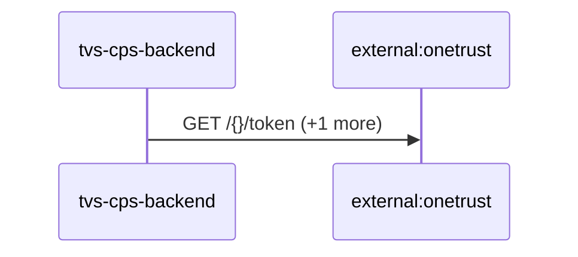

Steps:
| # | From | To | Via | Data (schema names) | Sync/Async | Confidence |
|---|---|---|---|---|---|---|
| 1 | tvs-cps-backend | external:onetrust | GET /{}/token, host:privacyportaluat.onetrust.com | Unknown | sync | high |

Data touched: tvs-cps-backend: postgres, postgres:nmazcpsdbsdev01-cmn-postgres-uks.postgres.database.azure.com:nmazcpsdbdev01-cps

Failure points: hop 1 tvs-cps-backend → external:onetrust: criticality hard

Evidence:
- hop 1 (tvs-cps-backend → external:onetrust): `TVS-CPS-BACKEND/bff-service/src/main/java/com/tvsm/bff/auth/AuthService.java:142`, `TVS-CPS-BACKEND/bff-service/src/main/java/com/tvsm/bff/client/OneTrustIntegration.java:18`, `TVS-CPS-BACKEND/bff-service/src/main/java/com/tvsm/bff/client/OneTrustIntegration.java:86` (+3 more)

## Flow: tvs-cps-backend--external-salesforce-27d8cb
Summary: Starting at `tvs-cps-backend` (scheduled job(s) in tvs-cps-backend (job-to-call link not resolved): JobScheduler.loadCatalogData, JobScheduler.retrieveMDPDealers, JobScheduler.retrieveMerchandiseStock (+2 more)), the flow passes through `lms`, `lms-process`, `lms-crm` and ends at `external:salesforce`, using 2 sync HTTP hop(s) and 2 async event hop(s); tvs-cps-backend role: entry; confidence medium.

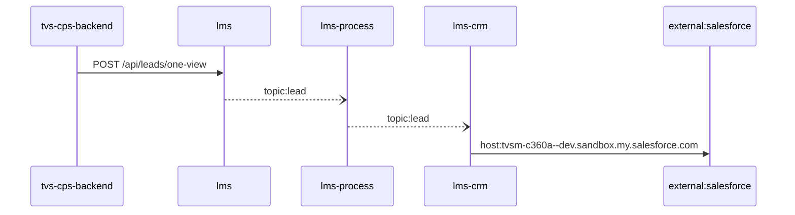

Steps:
| # | From | To | Via | Data (schema names) | Sync/Async | Confidence |
|---|---|---|---|---|---|---|
| 1 | tvs-cps-backend | lms | POST /api/leads/one-view | LeadOneViewRequest | sync | medium |
| 2 | lms | lms-process | topic:lead | Unknown | async | medium |
| 3 | lms-process | lms-crm | topic:lead | Unknown | async | medium |
| 4 | lms-crm | external:salesforce | host:tvsm-c360a--dev.sandbox.my.salesforce.com | Unknown | sync | high |

Data touched: tvs-cps-backend: postgres, postgres:nmazcpsdbsdev01-cmn-postgres-uks.postgres.database.azure.com:nmazcpsdbdev01-cps; lms: mssql, mssql:icubemobappsqlstg.database.windows.net:tazlmssqldbdev01; lms-process: mssql; lms-crm: mssql

Failure points: hop 1 tvs-cps-backend → lms: criticality hard; hop 2 lms → lms-process: criticality async; hop 3 lms-process → lms-crm: criticality async; hop 4 lms-crm → external:salesforce: criticality hard

Evidence:
- hop 1 (tvs-cps-backend → lms): `TVS-CPS-BACKEND/bff-service/src/main/java/com/tvsm/bff/client/ServiceReminderClient.java:209`, `lms/leadLogs/Controllers/LeadGetController.cs:90`
- hop 2 (lms → lms-process): `lms/leadLogs/Services/LeadDispatchService.cs:21`, `lms_process/processLeadService/Const/Constants.cs:10`, `lms_process/processLeadService/ListenerService/QueueConsumer.cs:36`
- hop 3 (lms-process → lms-crm): `lms_crm/ListenerService/CrmListenerService.cs:44`, `lms_crm/Utils/Constants.cs:16`, `lms_process/processLeadService/Const/Constants.cs:6` (+1 more)
- hop 4 (lms-crm → external:salesforce): `lms_crm/appsettings.Development.json:16`, `lms_crm/appsettings.Production.json:17`, `lms_crm/appsettings.Uat.json:17`

## Flow: tvs-cps-backend--external-salesforce-4e791f
Summary: Starting at `tvs-cps-backend` (scheduled job(s) in tvs-cps-backend (job-to-call link not resolved): JobScheduler.loadCatalogData, JobScheduler.retrieveMDPDealers, JobScheduler.retrieveMerchandiseStock (+2 more)), the flow passes through `lms`, `lms-process`, `lms-ems`, `lms-crm` and ends at `external:salesforce`, using 2 sync HTTP hop(s) and 3 async event hop(s); tvs-cps-backend role: entry; confidence medium.

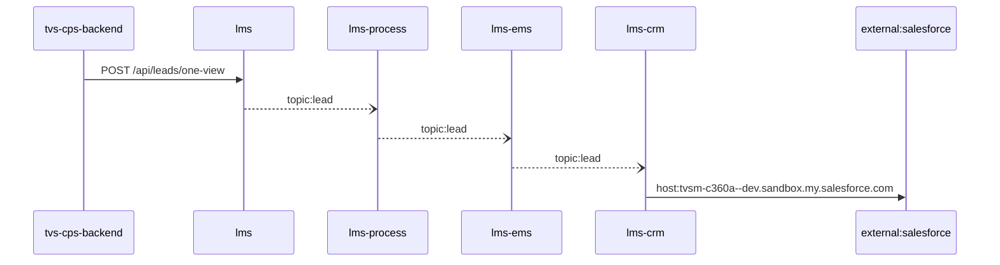

Steps:
| # | From | To | Via | Data (schema names) | Sync/Async | Confidence |
|---|---|---|---|---|---|---|
| 1 | tvs-cps-backend | lms | POST /api/leads/one-view | LeadOneViewRequest | sync | medium |
| 2 | lms | lms-process | topic:lead | Unknown | async | medium |
| 3 | lms-process | lms-ems | topic:lead | Unknown | async | medium |
| 4 | lms-ems | lms-crm | topic:lead | Unknown | async | medium |
| 5 | lms-crm | external:salesforce | host:tvsm-c360a--dev.sandbox.my.salesforce.com | Unknown | sync | high |

Data touched: tvs-cps-backend: postgres, postgres:nmazcpsdbsdev01-cmn-postgres-uks.postgres.database.azure.com:nmazcpsdbdev01-cps; lms: mssql, mssql:icubemobappsqlstg.database.windows.net:tazlmssqldbdev01; lms-process: mssql; lms-ems: mssql; lms-crm: mssql

Failure points: hop 1 tvs-cps-backend → lms: criticality hard; hop 2 lms → lms-process: criticality async; hop 3 lms-process → lms-ems: criticality async; hop 4 lms-ems → lms-crm: criticality async; hop 5 lms-crm → external:salesforce: criticality hard

Evidence:
- hop 1 (tvs-cps-backend → lms): `TVS-CPS-BACKEND/bff-service/src/main/java/com/tvsm/bff/client/ServiceReminderClient.java:209`, `lms/leadLogs/Controllers/LeadGetController.cs:90`
- hop 2 (lms → lms-process): `lms/leadLogs/Services/LeadDispatchService.cs:21`, `lms_process/processLeadService/Const/Constants.cs:10`, `lms_process/processLeadService/ListenerService/QueueConsumer.cs:36`
- hop 3 (lms-process → lms-ems): `lms_ems/emsService/Const/Constants.cs:14`, `lms_ems/emsService/ListenerService/EmsListenerService.cs:43`, `lms_process/processLeadService/Const/Constants.cs:6` (+1 more)
- hop 4 (lms-ems → lms-crm): `lms_crm/ListenerService/CrmListenerService.cs:44`, `lms_crm/Utils/Constants.cs:16`, `lms_ems/emsService/Const/Constants.cs:13` (+1 more)
- hop 5 (lms-crm → external:salesforce): `lms_crm/appsettings.Development.json:16`, `lms_crm/appsettings.Production.json:17`, `lms_crm/appsettings.Uat.json:17`

## Flow: tvs-cps-backend--external-salesforce-5bee04
Summary: Starting at `tvs-cps-backend` (scheduled job(s) in tvs-cps-backend (job-to-call link not resolved): JobScheduler.loadCatalogData, JobScheduler.retrieveMDPDealers, JobScheduler.retrieveMerchandiseStock (+2 more)), the flow passes through `lms`, `lms-ems`, `lms-process`, `lms-crm` and ends at `external:salesforce`, using 2 sync HTTP hop(s) and 3 async event hop(s); tvs-cps-backend role: entry; confidence medium.


Steps:
| # | From | To | Via | Data (schema names) | Sync/Async | Confidence |
|---|---|---|---|---|---|---|
| 1 | tvs-cps-backend | lms | POST /api/leads/one-view | LeadOneViewRequest | sync | medium |
| 2 | lms | lms-ems | topic:lead | Unknown | async | medium |
| 3 | lms-ems | lms-process | topic:lead | Unknown | async | medium |
| 4 | lms-process | lms-crm | topic:lead | Unknown | async | medium |
| 5 | lms-crm | external:salesforce | host:tvsm-c360a--dev.sandbox.my.salesforce.com | Unknown | sync | high |

Data touched: tvs-cps-backend: postgres, postgres:nmazcpsdbsdev01-cmn-postgres-uks.postgres.database.azure.com:nmazcpsdbdev01-cps; lms: mssql, mssql:icubemobappsqlstg.database.windows.net:tazlmssqldbdev01; lms-ems: mssql; lms-process: mssql; lms-crm: mssql

Failure points: hop 1 tvs-cps-backend → lms: criticality hard; hop 2 lms → lms-ems: criticality async; hop 3 lms-ems → lms-process: criticality async; hop 4 lms-process → lms-crm: criticality async; hop 5 lms-crm → external:salesforce: criticality hard

Evidence:
- hop 1 (tvs-cps-backend → lms): `TVS-CPS-BACKEND/bff-service/src/main/java/com/tvsm/bff/client/ServiceReminderClient.java:209`, `lms/leadLogs/Controllers/LeadGetController.cs:90`
- hop 2 (lms → lms-ems): `lms/leadLogs/Services/LeadDispatchService.cs:21`, `lms_ems/emsService/Const/Constants.cs:14`, `lms_ems/emsService/ListenerService/EmsListenerService.cs:43`
- hop 3 (lms-ems → lms-process): `lms_ems/emsService/Const/Constants.cs:13`, `lms_ems/emsService/Services/EmsService.cs:191`, `lms_process/processLeadService/Const/Constants.cs:10` (+1 more)
- hop 4 (lms-process → lms-crm): `lms_crm/ListenerService/CrmListenerService.cs:44`, `lms_crm/Utils/Constants.cs:16`, `lms_process/processLeadService/Const/Constants.cs:6` (+1 more)
- hop 5 (lms-crm → external:salesforce): `lms_crm/appsettings.Development.json:16`, `lms_crm/appsettings.Production.json:17`, `lms_crm/appsettings.Uat.json:17`

## Flow: tvs-cps-backend--tvs-cps-billing
Summary: Starting at `tvs-cps-backend` (scheduled job(s) in tvs-cps-backend (job-to-call link not resolved): JobScheduler.loadCatalogData, JobScheduler.retrieveMDPDealers, JobScheduler.retrieveMerchandiseStock (+2 more)), the flow ends at `tvs-cps-billing`, using 1 sync HTTP hop(s) and 0 async event hop(s); tvs-cps-backend role: entry; confidence high.

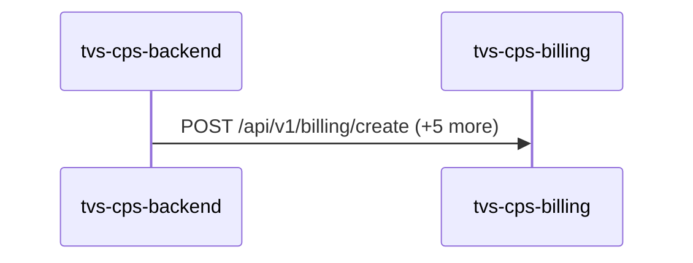

Steps:
| # | From | To | Via | Data (schema names) | Sync/Async | Confidence |
|---|---|---|---|---|---|---|
| 1 | tvs-cps-backend | tvs-cps-billing | POST /api/v1/billing/create, POST /api/v1/billing/discard, POST /api/v1/billing/invoices/search (+3 more) | APIResponse<GetInvoiceResponseDto>, APIResponse<InvoiceDiscardResponseDto>, APIResponse<PaginatedResponse<PostInvoiceResponseDto>>, APIResponse<PaginatedResponse<object>>, APIResponse<PostInvoiceResponseDto> (+5 more) | sync | high |

Data touched: tvs-cps-backend: postgres, postgres:nmazcpsdbsdev01-cmn-postgres-uks.postgres.database.azure.com:nmazcpsdbdev01-cps; tvs-cps-billing: postgres:localhost:billing_db

Failure points: hop 1 tvs-cps-backend → tvs-cps-billing: criticality hard

Evidence:
- hop 1 (tvs-cps-backend → tvs-cps-billing): `TVS-CPS-BACKEND/bff-service/src/main/java/com/tvsm/bff/controller/BillingBFFController.java:69`, `TVS-CPS-BACKEND/bff-service/src/main/java/com/tvsm/bff/util/ApiPassthroughUtil.java:285`, `TVS-CPS-BILLING/src/main/java/com/tvsm/billing/controller/BillingController.java:18` (+6 more)

## Flow: tvs-cps-backend--tvs-cps-customer
Summary: Starting at `tvs-cps-backend` (scheduled job(s) in tvs-cps-backend (job-to-call link not resolved): JobScheduler.loadCatalogData, JobScheduler.retrieveMDPDealers, JobScheduler.retrieveMerchandiseStock (+2 more)), the flow ends at `tvs-cps-customer`, using 1 sync HTTP hop(s) and 0 async event hop(s); tvs-cps-backend role: entry; confidence high.

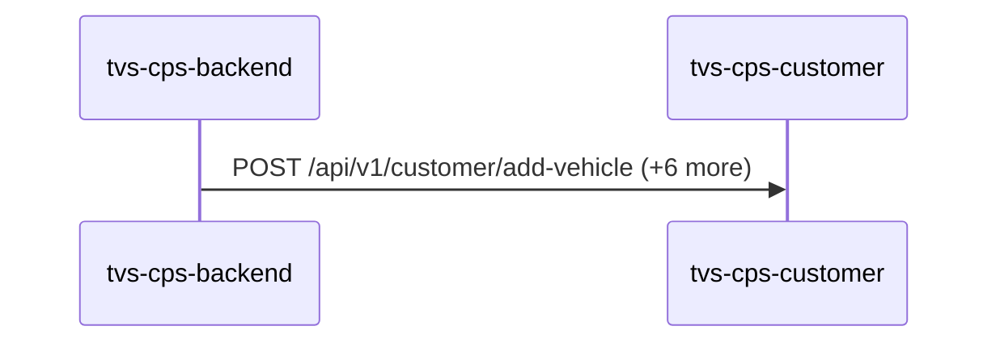

Steps:
| # | From | To | Via | Data (schema names) | Sync/Async | Confidence |
|---|---|---|---|---|---|---|
| 1 | tvs-cps-backend | tvs-cps-customer | POST /api/v1/customer/add-vehicle, POST /api/v1/customer/create, POST /api/v1/customer/delete (+4 more) | APIResponse, AddVehicleRequest, CustomerCreateRequest, CustomerDeleteRequest, CustomerSearchRequest (+1 more) | sync | high |

Data touched: tvs-cps-backend: postgres, postgres:nmazcpsdbsdev01-cmn-postgres-uks.postgres.database.azure.com:nmazcpsdbdev01-cps; tvs-cps-customer: postgres:localhost:customer

Failure points: hop 1 tvs-cps-backend → tvs-cps-customer: criticality hard

Evidence:
- hop 1 (tvs-cps-backend → tvs-cps-customer): `TVS-CPS-BACKEND/bff-service/src/main/java/com/tvsm/bff/controller/CustomerBFFController.java:250`, `TVS-CPS-BACKEND/bff-service/src/main/java/com/tvsm/bff/util/ApiPassthroughUtil.java:285`, `TVS-CPS-CUSTOMER/src/main/java/com/tvsm/customer/controller/CustomerController.java:22` (+11 more)

## Flow: tvs-cps-backend--tvs-cps-inventory
Summary: Starting at `tvs-cps-backend` (scheduled job(s) in tvs-cps-backend (job-to-call link not resolved): JobScheduler.loadCatalogData, JobScheduler.retrieveMDPDealers, JobScheduler.retrieveMerchandiseStock (+2 more)), the flow ends at `tvs-cps-inventory`, using 1 sync HTTP hop(s) and 0 async event hop(s); tvs-cps-backend role: entry; confidence high.

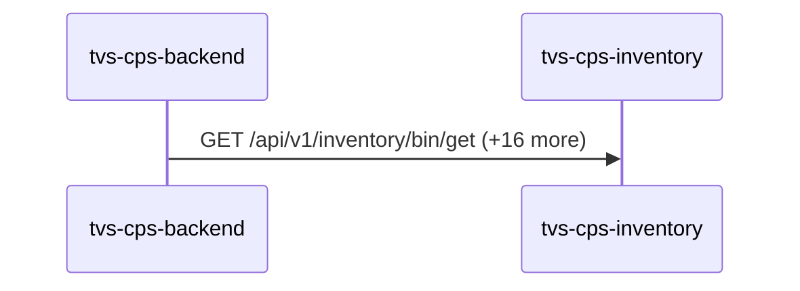

Steps:
| # | From | To | Via | Data (schema names) | Sync/Async | Confidence |
|---|---|---|---|---|---|---|
| 1 | tvs-cps-backend | tvs-cps-inventory | GET /api/v1/inventory/bin/get, GET /api/v1/inventory/location/get, GET /api/v1/inventory/rack/get (+14 more) | APIResponse<AddDeliveryDateResponseDto>, APIResponse<BinResponseDto>, APIResponse<BinResponseDto[]>, APIResponse<LocationResponseDto>, APIResponse<LocationResponseDto[]> (+22 more) | sync | high |

Data touched: tvs-cps-backend: postgres, postgres:nmazcpsdbsdev01-cmn-postgres-uks.postgres.database.azure.com:nmazcpsdbdev01-cps; tvs-cps-inventory: postgres:localhost:inventory_db

Failure points: hop 1 tvs-cps-backend → tvs-cps-inventory: criticality hard

Evidence:
- hop 1 (tvs-cps-backend → tvs-cps-inventory): `TVS-CPS-BACKEND/bff-service/src/main/java/com/tvsm/bff/controller/InventoryBFFController.java:315`, `TVS-CPS-BACKEND/bff-service/src/main/java/com/tvsm/bff/util/ApiPassthroughUtil.java:132`, `TVS-CPS-INVENTORY/src/main/java/com/tvsm/inventory/controller/BinController.java:24` (+32 more)

## Flow: tvs-cps-backend--tvs-cps-job-card-service
Summary: Starting at `tvs-cps-backend` (scheduled job(s) in tvs-cps-backend (job-to-call link not resolved): JobScheduler.loadCatalogData, JobScheduler.retrieveMDPDealers, JobScheduler.retrieveMerchandiseStock (+2 more)), the flow ends at `tvs-cps-job-card-service`, using 1 sync HTTP hop(s) and 0 async event hop(s); tvs-cps-backend role: entry; confidence high.

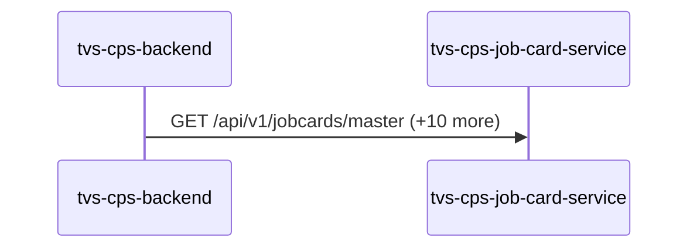

Steps:
| # | From | To | Via | Data (schema names) | Sync/Async | Confidence |
|---|---|---|---|---|---|---|
| 1 | tvs-cps-backend | tvs-cps-job-card-service | GET /api/v1/jobcards/master, POST /api/v1/jobcards, POST /api/v1/jobcards/analytics/stats (+8 more) | APIResponse<AnalyticsResponseDTO[]>, APIResponse<JobCardMasterDataResponseDTO>, APIResponse<JobcardCreateResponseDTO>, APIResponse<JobcardDashboardResponseDTO>, APIResponse<JobcardDownloadDTO> (+12 more) | sync | high |

Data touched: tvs-cps-backend: postgres, postgres:nmazcpsdbsdev01-cmn-postgres-uks.postgres.database.azure.com:nmazcpsdbdev01-cps; tvs-cps-job-card-service: postgres:nmazcpsdbsdev01-cmn-postgres-uks.postgres.database.azure.com:nmazcpsdbdev01-jobcard

Failure points: hop 1 tvs-cps-backend → tvs-cps-job-card-service: criticality hard

Evidence:
- hop 1 (tvs-cps-backend → tvs-cps-job-card-service): `TVS-CPS-BACKEND/bff-service/src/main/java/com/tvsm/bff/client/JobCardClient.java:106`, `TVS-CPS-JOB-CARD-SERVICE/src/main/java/com/tvsm/jobcard/controller/JobcardController.java:36`, `TVS-CPS-BACKEND/bff-service/src/main/java/com/tvsm/bff/controller/JobcardBFFController.java:131` (+15 more)

## Flow: tvs-cps-jobs--external-onetrust
Summary: Starting at `tvs-cps-jobs` (scheduled job(s) in tvs-cps-jobs (job-to-call link not resolved): CronJobScheduler.allBookingsScheduler, CronJobScheduler.allEnquiriesScheduler, CronJobScheduler.availableStockScheduler (+27 more); request to tvs-cps-jobs from outside the registry (no internal caller)), the flow passes through `tvs-cps-backend` and ends at `external:onetrust`, using 2 sync HTTP hop(s) and 0 async event hop(s); tvs-cps-backend role: participant; confidence high.

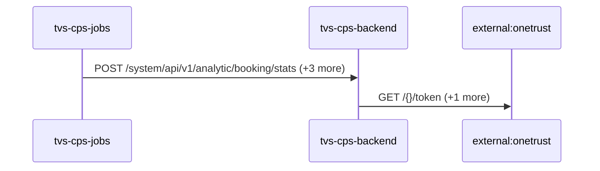

Steps:
| # | From | To | Via | Data (schema names) | Sync/Async | Confidence |
|---|---|---|---|---|---|---|
| 1 | tvs-cps-jobs | tvs-cps-backend | POST /system/api/v1/analytic/booking/stats, POST /system/api/v1/analytics-dashboard/indicators/calculate, POST /system/api/v1/appointments/auto-close (+1 more) | APIResponse<map<string,object>>, AnalyticsDto, AnalyticsRequestDTO | sync | high |
| 2 | tvs-cps-backend | external:onetrust | GET /{}/token, host:privacyportaluat.onetrust.com | Unknown | sync | high |

Data touched: tvs-cps-backend: postgres, postgres:nmazcpsdbsdev01-cmn-postgres-uks.postgres.database.azure.com:nmazcpsdbdev01-cps

Failure points: hop 1 tvs-cps-jobs → tvs-cps-backend: criticality hard; hop 2 tvs-cps-backend → external:onetrust: criticality hard

Evidence:
- hop 1 (tvs-cps-jobs → tvs-cps-backend): `TVS-CPS-BACKEND/bff-service/src/main/java/com/tvsm/bff/controller/AnalyticsController.java:23`, `TVS-CPS-JOBS/src/main/java/com/tvsm/jobs/service/AnalyticsService.java:32`, `TVS-CPS-JOBS/src/main/java/com/tvsm/jobs/service/RestCallService.java:50` (+4 more)
- hop 2 (tvs-cps-backend → external:onetrust): `TVS-CPS-BACKEND/bff-service/src/main/java/com/tvsm/bff/auth/AuthService.java:142`, `TVS-CPS-BACKEND/bff-service/src/main/java/com/tvsm/bff/client/OneTrustIntegration.java:18`, `TVS-CPS-BACKEND/bff-service/src/main/java/com/tvsm/bff/client/OneTrustIntegration.java:86` (+3 more)

## Flow: tvs-cps-jobs--external-salesforce-62e84d
Summary: Starting at `tvs-cps-jobs` (scheduled job(s) in tvs-cps-jobs (job-to-call link not resolved): CronJobScheduler.allBookingsScheduler, CronJobScheduler.allEnquiriesScheduler, CronJobScheduler.availableStockScheduler (+27 more); request to tvs-cps-jobs from outside the registry (no internal caller)), the flow passes through `tvs-cps-backend`, `lms`, `lms-ems`, `lms-crm` and ends at `external:salesforce`, using 3 sync HTTP hop(s) and 2 async event hop(s); tvs-cps-backend role: participant; confidence medium.


Steps:
| # | From | To | Via | Data (schema names) | Sync/Async | Confidence |
|---|---|---|---|---|---|---|
| 1 | tvs-cps-jobs | tvs-cps-backend | POST /system/api/v1/analytic/booking/stats, POST /system/api/v1/analytics-dashboard/indicators/calculate, POST /system/api/v1/appointments/auto-close (+1 more) | APIResponse<map<string,object>>, AnalyticsDto, AnalyticsRequestDTO | sync | high |
| 2 | tvs-cps-backend | lms | POST /api/leads/one-view | LeadOneViewRequest | sync | medium |
| 3 | lms | lms-ems | topic:lead | Unknown | async | medium |
| 4 | lms-ems | lms-crm | topic:lead | Unknown | async | medium |
| 5 | lms-crm | external:salesforce | host:tvsm-c360a--dev.sandbox.my.salesforce.com | Unknown | sync | high |

Data touched: tvs-cps-backend: postgres, postgres:nmazcpsdbsdev01-cmn-postgres-uks.postgres.database.azure.com:nmazcpsdbdev01-cps; lms: mssql, mssql:icubemobappsqlstg.database.windows.net:tazlmssqldbdev01; lms-ems: mssql; lms-crm: mssql

Failure points: hop 1 tvs-cps-jobs → tvs-cps-backend: criticality hard; hop 2 tvs-cps-backend → lms: criticality hard; hop 3 lms → lms-ems: criticality async; hop 4 lms-ems → lms-crm: criticality async; hop 5 lms-crm → external:salesforce: criticality hard

Evidence:
- hop 1 (tvs-cps-jobs → tvs-cps-backend): `TVS-CPS-BACKEND/bff-service/src/main/java/com/tvsm/bff/controller/AnalyticsController.java:23`, `TVS-CPS-JOBS/src/main/java/com/tvsm/jobs/service/AnalyticsService.java:32`, `TVS-CPS-JOBS/src/main/java/com/tvsm/jobs/service/RestCallService.java:50` (+4 more)
- hop 2 (tvs-cps-backend → lms): `TVS-CPS-BACKEND/bff-service/src/main/java/com/tvsm/bff/client/ServiceReminderClient.java:209`, `lms/leadLogs/Controllers/LeadGetController.cs:90`
- hop 3 (lms → lms-ems): `lms/leadLogs/Services/LeadDispatchService.cs:21`, `lms_ems/emsService/Const/Constants.cs:14`, `lms_ems/emsService/ListenerService/EmsListenerService.cs:43`
- hop 4 (lms-ems → lms-crm): `lms_crm/ListenerService/CrmListenerService.cs:44`, `lms_crm/Utils/Constants.cs:16`, `lms_ems/emsService/Const/Constants.cs:13` (+1 more)
- hop 5 (lms-crm → external:salesforce): `lms_crm/appsettings.Development.json:16`, `lms_crm/appsettings.Production.json:17`, `lms_crm/appsettings.Uat.json:17`

## Flow: tvs-cps-jobs--external-salesforce-cd1252
Summary: Starting at `tvs-cps-jobs` (scheduled job(s) in tvs-cps-jobs (job-to-call link not resolved): CronJobScheduler.allBookingsScheduler, CronJobScheduler.allEnquiriesScheduler, CronJobScheduler.availableStockScheduler (+27 more); request to tvs-cps-jobs from outside the registry (no internal caller)), the flow passes through `tvs-cps-backend`, `lms`, `lms-process`, `lms-crm` and ends at `external:salesforce`, using 3 sync HTTP hop(s) and 2 async event hop(s); tvs-cps-backend role: participant; confidence medium.

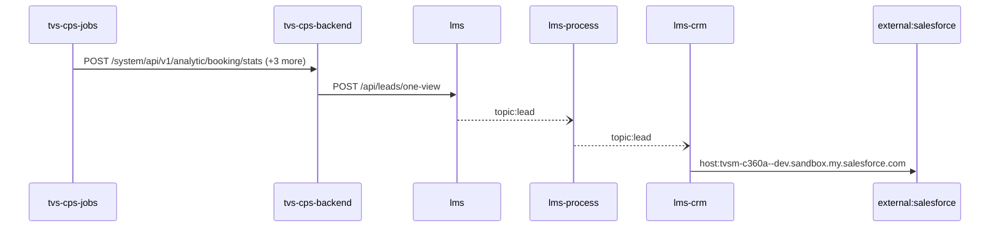

Steps:
| # | From | To | Via | Data (schema names) | Sync/Async | Confidence |
|---|---|---|---|---|---|---|
| 1 | tvs-cps-jobs | tvs-cps-backend | POST /system/api/v1/analytic/booking/stats, POST /system/api/v1/analytics-dashboard/indicators/calculate, POST /system/api/v1/appointments/auto-close (+1 more) | APIResponse<map<string,object>>, AnalyticsDto, AnalyticsRequestDTO | sync | high |
| 2 | tvs-cps-backend | lms | POST /api/leads/one-view | LeadOneViewRequest | sync | medium |
| 3 | lms | lms-process | topic:lead | Unknown | async | medium |
| 4 | lms-process | lms-crm | topic:lead | Unknown | async | medium |
| 5 | lms-crm | external:salesforce | host:tvsm-c360a--dev.sandbox.my.salesforce.com | Unknown | sync | high |

Data touched: tvs-cps-backend: postgres, postgres:nmazcpsdbsdev01-cmn-postgres-uks.postgres.database.azure.com:nmazcpsdbdev01-cps; lms: mssql, mssql:icubemobappsqlstg.database.windows.net:tazlmssqldbdev01; lms-process: mssql; lms-crm: mssql

Failure points: hop 1 tvs-cps-jobs → tvs-cps-backend: criticality hard; hop 2 tvs-cps-backend → lms: criticality hard; hop 3 lms → lms-process: criticality async; hop 4 lms-process → lms-crm: criticality async; hop 5 lms-crm → external:salesforce: criticality hard

Evidence:
- hop 1 (tvs-cps-jobs → tvs-cps-backend): `TVS-CPS-BACKEND/bff-service/src/main/java/com/tvsm/bff/controller/AnalyticsController.java:23`, `TVS-CPS-JOBS/src/main/java/com/tvsm/jobs/service/AnalyticsService.java:32`, `TVS-CPS-JOBS/src/main/java/com/tvsm/jobs/service/RestCallService.java:50` (+4 more)
- hop 2 (tvs-cps-backend → lms): `TVS-CPS-BACKEND/bff-service/src/main/java/com/tvsm/bff/client/ServiceReminderClient.java:209`, `lms/leadLogs/Controllers/LeadGetController.cs:90`
- hop 3 (lms → lms-process): `lms/leadLogs/Services/LeadDispatchService.cs:21`, `lms_process/processLeadService/Const/Constants.cs:10`, `lms_process/processLeadService/ListenerService/QueueConsumer.cs:36`
- hop 4 (lms-process → lms-crm): `lms_crm/ListenerService/CrmListenerService.cs:44`, `lms_crm/Utils/Constants.cs:16`, `lms_process/processLeadService/Const/Constants.cs:6` (+1 more)
- hop 5 (lms-crm → external:salesforce): `lms_crm/appsettings.Development.json:16`, `lms_crm/appsettings.Production.json:17`, `lms_crm/appsettings.Uat.json:17`

## Flow: tvs-cps-jobs--lms-crm-735e1f
Summary: Starting at `tvs-cps-jobs` (scheduled job(s) in tvs-cps-jobs (job-to-call link not resolved): CronJobScheduler.allBookingsScheduler, CronJobScheduler.allEnquiriesScheduler, CronJobScheduler.availableStockScheduler (+27 more); request to tvs-cps-jobs from outside the registry (no internal caller)), the flow passes through `tvs-cps-backend`, `lms`, `lms-process`, `lms-ems` and ends at `lms-crm`, using 2 sync HTTP hop(s) and 3 async event hop(s); tvs-cps-backend role: participant; confidence medium; truncated at the depth cap.


Steps:
| # | From | To | Via | Data (schema names) | Sync/Async | Confidence |
|---|---|---|---|---|---|---|
| 1 | tvs-cps-jobs | tvs-cps-backend | POST /system/api/v1/analytic/booking/stats, POST /system/api/v1/analytics-dashboard/indicators/calculate, POST /system/api/v1/appointments/auto-close (+1 more) | APIResponse<map<string,object>>, AnalyticsDto, AnalyticsRequestDTO | sync | high |
| 2 | tvs-cps-backend | lms | POST /api/leads/one-view | LeadOneViewRequest | sync | medium |
| 3 | lms | lms-process | topic:lead | Unknown | async | medium |
| 4 | lms-process | lms-ems | topic:lead | Unknown | async | medium |
| 5 | lms-ems | lms-crm | topic:lead | Unknown | async | medium |

Data touched: tvs-cps-backend: postgres, postgres:nmazcpsdbsdev01-cmn-postgres-uks.postgres.database.azure.com:nmazcpsdbdev01-cps; lms: mssql, mssql:icubemobappsqlstg.database.windows.net:tazlmssqldbdev01; lms-process: mssql; lms-ems: mssql; lms-crm: mssql

Failure points: hop 1 tvs-cps-jobs → tvs-cps-backend: criticality hard; hop 2 tvs-cps-backend → lms: criticality hard; hop 3 lms → lms-process: criticality async; hop 4 lms-process → lms-ems: criticality async; hop 5 lms-ems → lms-crm: criticality async

Evidence:
- hop 1 (tvs-cps-jobs → tvs-cps-backend): `TVS-CPS-BACKEND/bff-service/src/main/java/com/tvsm/bff/controller/AnalyticsController.java:23`, `TVS-CPS-JOBS/src/main/java/com/tvsm/jobs/service/AnalyticsService.java:32`, `TVS-CPS-JOBS/src/main/java/com/tvsm/jobs/service/RestCallService.java:50` (+4 more)
- hop 2 (tvs-cps-backend → lms): `TVS-CPS-BACKEND/bff-service/src/main/java/com/tvsm/bff/client/ServiceReminderClient.java:209`, `lms/leadLogs/Controllers/LeadGetController.cs:90`
- hop 3 (lms → lms-process): `lms/leadLogs/Services/LeadDispatchService.cs:21`, `lms_process/processLeadService/Const/Constants.cs:10`, `lms_process/processLeadService/ListenerService/QueueConsumer.cs:36`
- hop 4 (lms-process → lms-ems): `lms_ems/emsService/Const/Constants.cs:14`, `lms_ems/emsService/ListenerService/EmsListenerService.cs:43`, `lms_process/processLeadService/Const/Constants.cs:6` (+1 more)
- hop 5 (lms-ems → lms-crm): `lms_crm/ListenerService/CrmListenerService.cs:44`, `lms_crm/Utils/Constants.cs:16`, `lms_ems/emsService/Const/Constants.cs:13` (+1 more)

## Flow: tvs-cps-jobs--lms-crm-80b689
Summary: Starting at `tvs-cps-jobs` (scheduled job(s) in tvs-cps-jobs (job-to-call link not resolved): CronJobScheduler.allBookingsScheduler, CronJobScheduler.allEnquiriesScheduler, CronJobScheduler.availableStockScheduler (+27 more); request to tvs-cps-jobs from outside the registry (no internal caller)), the flow passes through `tvs-cps-backend`, `lms`, `lms-ems`, `lms-process` and ends at `lms-crm`, using 2 sync HTTP hop(s) and 3 async event hop(s); tvs-cps-backend role: participant; confidence medium; truncated at the depth cap.

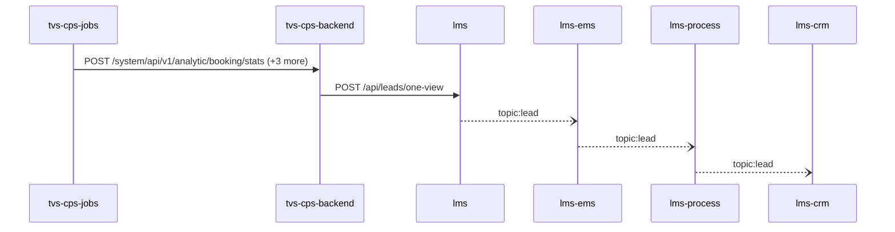

Steps:
| # | From | To | Via | Data (schema names) | Sync/Async | Confidence |
|---|---|---|---|---|---|---|
| 1 | tvs-cps-jobs | tvs-cps-backend | POST /system/api/v1/analytic/booking/stats, POST /system/api/v1/analytics-dashboard/indicators/calculate, POST /system/api/v1/appointments/auto-close (+1 more) | APIResponse<map<string,object>>, AnalyticsDto, AnalyticsRequestDTO | sync | high |
| 2 | tvs-cps-backend | lms | POST /api/leads/one-view | LeadOneViewRequest | sync | medium |
| 3 | lms | lms-ems | topic:lead | Unknown | async | medium |
| 4 | lms-ems | lms-process | topic:lead | Unknown | async | medium |
| 5 | lms-process | lms-crm | topic:lead | Unknown | async | medium |

Data touched: tvs-cps-backend: postgres, postgres:nmazcpsdbsdev01-cmn-postgres-uks.postgres.database.azure.com:nmazcpsdbdev01-cps; lms: mssql, mssql:icubemobappsqlstg.database.windows.net:tazlmssqldbdev01; lms-ems: mssql; lms-process: mssql; lms-crm: mssql

Failure points: hop 1 tvs-cps-jobs → tvs-cps-backend: criticality hard; hop 2 tvs-cps-backend → lms: criticality hard; hop 3 lms → lms-ems: criticality async; hop 4 lms-ems → lms-process: criticality async; hop 5 lms-process → lms-crm: criticality async

Evidence:
- hop 1 (tvs-cps-jobs → tvs-cps-backend): `TVS-CPS-BACKEND/bff-service/src/main/java/com/tvsm/bff/controller/AnalyticsController.java:23`, `TVS-CPS-JOBS/src/main/java/com/tvsm/jobs/service/AnalyticsService.java:32`, `TVS-CPS-JOBS/src/main/java/com/tvsm/jobs/service/RestCallService.java:50` (+4 more)
- hop 2 (tvs-cps-backend → lms): `TVS-CPS-BACKEND/bff-service/src/main/java/com/tvsm/bff/client/ServiceReminderClient.java:209`, `lms/leadLogs/Controllers/LeadGetController.cs:90`
- hop 3 (lms → lms-ems): `lms/leadLogs/Services/LeadDispatchService.cs:21`, `lms_ems/emsService/Const/Constants.cs:14`, `lms_ems/emsService/ListenerService/EmsListenerService.cs:43`
- hop 4 (lms-ems → lms-process): `lms_ems/emsService/Const/Constants.cs:13`, `lms_ems/emsService/Services/EmsService.cs:191`, `lms_process/processLeadService/Const/Constants.cs:10` (+1 more)
- hop 5 (lms-process → lms-crm): `lms_crm/ListenerService/CrmListenerService.cs:44`, `lms_crm/Utils/Constants.cs:16`, `lms_process/processLeadService/Const/Constants.cs:6` (+1 more)

## Flow: tvs-cps-jobs--lms-tvs-credit-ce3ec7
Summary: Starting at `tvs-cps-jobs` (scheduled job(s) in tvs-cps-jobs (job-to-call link not resolved): CronJobScheduler.allBookingsScheduler, CronJobScheduler.allEnquiriesScheduler, CronJobScheduler.availableStockScheduler (+27 more); request to tvs-cps-jobs from outside the registry (no internal caller)), the flow passes through `tvs-cps-backend`, `lms`, `lms-ems`, `lms-process` and ends at `lms-tvs-credit`, using 2 sync HTTP hop(s) and 3 async event hop(s); tvs-cps-backend role: participant; confidence medium.


Steps:
| # | From | To | Via | Data (schema names) | Sync/Async | Confidence |
|---|---|---|---|---|---|---|
| 1 | tvs-cps-jobs | tvs-cps-backend | POST /system/api/v1/analytic/booking/stats, POST /system/api/v1/analytics-dashboard/indicators/calculate, POST /system/api/v1/appointments/auto-close (+1 more) | APIResponse<map<string,object>>, AnalyticsDto, AnalyticsRequestDTO | sync | high |
| 2 | tvs-cps-backend | lms | POST /api/leads/one-view | LeadOneViewRequest | sync | medium |
| 3 | lms | lms-ems | topic:lead | Unknown | async | medium |
| 4 | lms-ems | lms-process | topic:lead | Unknown | async | medium |
| 5 | lms-process | lms-tvs-credit | topic:lead | Unknown | async | medium |

Data touched: tvs-cps-backend: postgres, postgres:nmazcpsdbsdev01-cmn-postgres-uks.postgres.database.azure.com:nmazcpsdbdev01-cps; lms: mssql, mssql:icubemobappsqlstg.database.windows.net:tazlmssqldbdev01; lms-ems: mssql; lms-process: mssql; lms-tvs-credit: mssql

Failure points: hop 1 tvs-cps-jobs → tvs-cps-backend: criticality hard; hop 2 tvs-cps-backend → lms: criticality hard; hop 3 lms → lms-ems: criticality async; hop 4 lms-ems → lms-process: criticality async; hop 5 lms-process → lms-tvs-credit: criticality async

Evidence:
- hop 1 (tvs-cps-jobs → tvs-cps-backend): `TVS-CPS-BACKEND/bff-service/src/main/java/com/tvsm/bff/controller/AnalyticsController.java:23`, `TVS-CPS-JOBS/src/main/java/com/tvsm/jobs/service/AnalyticsService.java:32`, `TVS-CPS-JOBS/src/main/java/com/tvsm/jobs/service/RestCallService.java:50` (+4 more)
- hop 2 (tvs-cps-backend → lms): `TVS-CPS-BACKEND/bff-service/src/main/java/com/tvsm/bff/client/ServiceReminderClient.java:209`, `lms/leadLogs/Controllers/LeadGetController.cs:90`
- hop 3 (lms → lms-ems): `lms/leadLogs/Services/LeadDispatchService.cs:21`, `lms_ems/emsService/Const/Constants.cs:14`, `lms_ems/emsService/ListenerService/EmsListenerService.cs:43`
- hop 4 (lms-ems → lms-process): `lms_ems/emsService/Const/Constants.cs:13`, `lms_ems/emsService/Services/EmsService.cs:191`, `lms_process/processLeadService/Const/Constants.cs:10` (+1 more)
- hop 5 (lms-process → lms-tvs-credit): `lms_process/processLeadService/Const/Constants.cs:6`, `lms_process/processLeadService/Services/TwoWheelerService.cs:97`, `lms_tvs_credit/lms_tvs_credit/ListenerService/TvscreditListenerService.cs:46` (+1 more)

## Flow: tvs-cps-jobs--lms-tvs-credit-e20095
Summary: Starting at `tvs-cps-jobs` (scheduled job(s) in tvs-cps-jobs (job-to-call link not resolved): CronJobScheduler.allBookingsScheduler, CronJobScheduler.allEnquiriesScheduler, CronJobScheduler.availableStockScheduler (+27 more); request to tvs-cps-jobs from outside the registry (no internal caller)), the flow passes through `tvs-cps-backend`, `lms`, `lms-process`, `lms-ems` and ends at `lms-tvs-credit`, using 2 sync HTTP hop(s) and 3 async event hop(s); tvs-cps-backend role: participant; confidence medium.

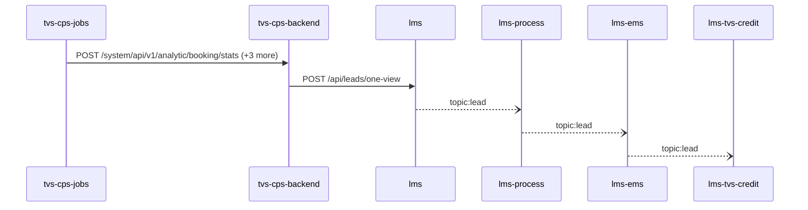

Steps:
| # | From | To | Via | Data (schema names) | Sync/Async | Confidence |
|---|---|---|---|---|---|---|
| 1 | tvs-cps-jobs | tvs-cps-backend | POST /system/api/v1/analytic/booking/stats, POST /system/api/v1/analytics-dashboard/indicators/calculate, POST /system/api/v1/appointments/auto-close (+1 more) | APIResponse<map<string,object>>, AnalyticsDto, AnalyticsRequestDTO | sync | high |
| 2 | tvs-cps-backend | lms | POST /api/leads/one-view | LeadOneViewRequest | sync | medium |
| 3 | lms | lms-process | topic:lead | Unknown | async | medium |
| 4 | lms-process | lms-ems | topic:lead | Unknown | async | medium |
| 5 | lms-ems | lms-tvs-credit | topic:lead | Unknown | async | medium |

Data touched: tvs-cps-backend: postgres, postgres:nmazcpsdbsdev01-cmn-postgres-uks.postgres.database.azure.com:nmazcpsdbdev01-cps; lms: mssql, mssql:icubemobappsqlstg.database.windows.net:tazlmssqldbdev01; lms-process: mssql; lms-ems: mssql; lms-tvs-credit: mssql

Failure points: hop 1 tvs-cps-jobs → tvs-cps-backend: criticality hard; hop 2 tvs-cps-backend → lms: criticality hard; hop 3 lms → lms-process: criticality async; hop 4 lms-process → lms-ems: criticality async; hop 5 lms-ems → lms-tvs-credit: criticality async

Evidence:
- hop 1 (tvs-cps-jobs → tvs-cps-backend): `TVS-CPS-BACKEND/bff-service/src/main/java/com/tvsm/bff/controller/AnalyticsController.java:23`, `TVS-CPS-JOBS/src/main/java/com/tvsm/jobs/service/AnalyticsService.java:32`, `TVS-CPS-JOBS/src/main/java/com/tvsm/jobs/service/RestCallService.java:50` (+4 more)
- hop 2 (tvs-cps-backend → lms): `TVS-CPS-BACKEND/bff-service/src/main/java/com/tvsm/bff/client/ServiceReminderClient.java:209`, `lms/leadLogs/Controllers/LeadGetController.cs:90`
- hop 3 (lms → lms-process): `lms/leadLogs/Services/LeadDispatchService.cs:21`, `lms_process/processLeadService/Const/Constants.cs:10`, `lms_process/processLeadService/ListenerService/QueueConsumer.cs:36`
- hop 4 (lms-process → lms-ems): `lms_ems/emsService/Const/Constants.cs:14`, `lms_ems/emsService/ListenerService/EmsListenerService.cs:43`, `lms_process/processLeadService/Const/Constants.cs:6` (+1 more)
- hop 5 (lms-ems → lms-tvs-credit): `lms_ems/emsService/Const/Constants.cs:13`, `lms_ems/emsService/Services/EmsService.cs:191`, `lms_tvs_credit/lms_tvs_credit/ListenerService/TvscreditListenerService.cs:46` (+1 more)

## Flow: tvs-cps-jobs--tvs-cps-billing
Summary: Starting at `tvs-cps-jobs` (scheduled job(s) in tvs-cps-jobs (job-to-call link not resolved): CronJobScheduler.allBookingsScheduler, CronJobScheduler.allEnquiriesScheduler, CronJobScheduler.availableStockScheduler (+27 more); request to tvs-cps-jobs from outside the registry (no internal caller)), the flow passes through `tvs-cps-backend` and ends at `tvs-cps-billing`, using 2 sync HTTP hop(s) and 0 async event hop(s); tvs-cps-backend role: participant; confidence high.

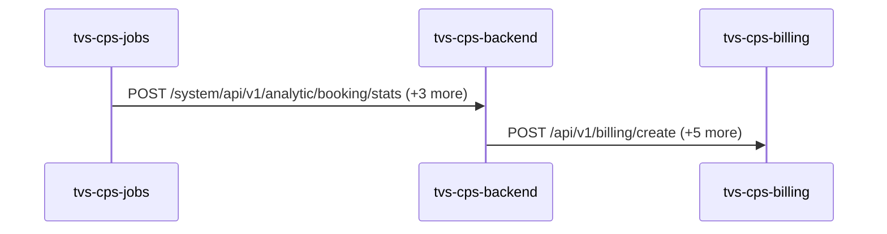

Steps:
| # | From | To | Via | Data (schema names) | Sync/Async | Confidence |
|---|---|---|---|---|---|---|
| 1 | tvs-cps-jobs | tvs-cps-backend | POST /system/api/v1/analytic/booking/stats, POST /system/api/v1/analytics-dashboard/indicators/calculate, POST /system/api/v1/appointments/auto-close (+1 more) | APIResponse<map<string,object>>, AnalyticsDto, AnalyticsRequestDTO | sync | high |
| 2 | tvs-cps-backend | tvs-cps-billing | POST /api/v1/billing/create, POST /api/v1/billing/discard, POST /api/v1/billing/invoices/search (+3 more) | APIResponse<GetInvoiceResponseDto>, APIResponse<InvoiceDiscardResponseDto>, APIResponse<PaginatedResponse<PostInvoiceResponseDto>>, APIResponse<PaginatedResponse<object>>, APIResponse<PostInvoiceResponseDto> (+5 more) | sync | high |

Data touched: tvs-cps-backend: postgres, postgres:nmazcpsdbsdev01-cmn-postgres-uks.postgres.database.azure.com:nmazcpsdbdev01-cps; tvs-cps-billing: postgres:localhost:billing_db

Failure points: hop 1 tvs-cps-jobs → tvs-cps-backend: criticality hard; hop 2 tvs-cps-backend → tvs-cps-billing: criticality hard

Evidence:
- hop 1 (tvs-cps-jobs → tvs-cps-backend): `TVS-CPS-BACKEND/bff-service/src/main/java/com/tvsm/bff/controller/AnalyticsController.java:23`, `TVS-CPS-JOBS/src/main/java/com/tvsm/jobs/service/AnalyticsService.java:32`, `TVS-CPS-JOBS/src/main/java/com/tvsm/jobs/service/RestCallService.java:50` (+4 more)
- hop 2 (tvs-cps-backend → tvs-cps-billing): `TVS-CPS-BACKEND/bff-service/src/main/java/com/tvsm/bff/controller/BillingBFFController.java:69`, `TVS-CPS-BACKEND/bff-service/src/main/java/com/tvsm/bff/util/ApiPassthroughUtil.java:285`, `TVS-CPS-BILLING/src/main/java/com/tvsm/billing/controller/BillingController.java:18` (+6 more)

## Flow: tvs-cps-jobs--tvs-cps-customer
Summary: Starting at `tvs-cps-jobs` (scheduled job(s) in tvs-cps-jobs (job-to-call link not resolved): CronJobScheduler.allBookingsScheduler, CronJobScheduler.allEnquiriesScheduler, CronJobScheduler.availableStockScheduler (+27 more); request to tvs-cps-jobs from outside the registry (no internal caller)), the flow passes through `tvs-cps-backend` and ends at `tvs-cps-customer`, using 2 sync HTTP hop(s) and 0 async event hop(s); tvs-cps-backend role: participant; confidence high.

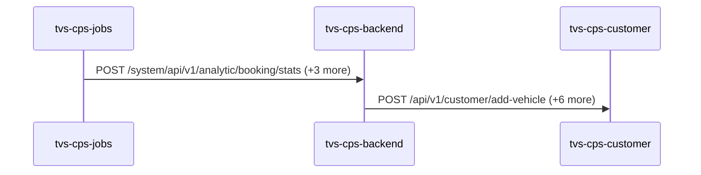

Steps:
| # | From | To | Via | Data (schema names) | Sync/Async | Confidence |
|---|---|---|---|---|---|---|
| 1 | tvs-cps-jobs | tvs-cps-backend | POST /system/api/v1/analytic/booking/stats, POST /system/api/v1/analytics-dashboard/indicators/calculate, POST /system/api/v1/appointments/auto-close (+1 more) | APIResponse<map<string,object>>, AnalyticsDto, AnalyticsRequestDTO | sync | high |
| 2 | tvs-cps-backend | tvs-cps-customer | POST /api/v1/customer/add-vehicle, POST /api/v1/customer/create, POST /api/v1/customer/delete (+4 more) | APIResponse, AddVehicleRequest, CustomerCreateRequest, CustomerDeleteRequest, CustomerSearchRequest (+1 more) | sync | high |

Data touched: tvs-cps-backend: postgres, postgres:nmazcpsdbsdev01-cmn-postgres-uks.postgres.database.azure.com:nmazcpsdbdev01-cps; tvs-cps-customer: postgres:localhost:customer

Failure points: hop 1 tvs-cps-jobs → tvs-cps-backend: criticality hard; hop 2 tvs-cps-backend → tvs-cps-customer: criticality hard

Evidence:
- hop 1 (tvs-cps-jobs → tvs-cps-backend): `TVS-CPS-BACKEND/bff-service/src/main/java/com/tvsm/bff/controller/AnalyticsController.java:23`, `TVS-CPS-JOBS/src/main/java/com/tvsm/jobs/service/AnalyticsService.java:32`, `TVS-CPS-JOBS/src/main/java/com/tvsm/jobs/service/RestCallService.java:50` (+4 more)
- hop 2 (tvs-cps-backend → tvs-cps-customer): `TVS-CPS-BACKEND/bff-service/src/main/java/com/tvsm/bff/controller/CustomerBFFController.java:250`, `TVS-CPS-BACKEND/bff-service/src/main/java/com/tvsm/bff/util/ApiPassthroughUtil.java:285`, `TVS-CPS-CUSTOMER/src/main/java/com/tvsm/customer/controller/CustomerController.java:22` (+11 more)

## Flow: tvs-cps-jobs--tvs-cps-inventory
Summary: Starting at `tvs-cps-jobs` (scheduled job(s) in tvs-cps-jobs (job-to-call link not resolved): CronJobScheduler.allBookingsScheduler, CronJobScheduler.allEnquiriesScheduler, CronJobScheduler.availableStockScheduler (+27 more); request to tvs-cps-jobs from outside the registry (no internal caller)), the flow passes through `tvs-cps-backend` and ends at `tvs-cps-inventory`, using 2 sync HTTP hop(s) and 0 async event hop(s); tvs-cps-backend role: participant; confidence high.

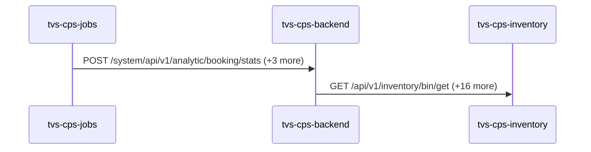

Steps:
| # | From | To | Via | Data (schema names) | Sync/Async | Confidence |
|---|---|---|---|---|---|---|
| 1 | tvs-cps-jobs | tvs-cps-backend | POST /system/api/v1/analytic/booking/stats, POST /system/api/v1/analytics-dashboard/indicators/calculate, POST /system/api/v1/appointments/auto-close (+1 more) | APIResponse<map<string,object>>, AnalyticsDto, AnalyticsRequestDTO | sync | high |
| 2 | tvs-cps-backend | tvs-cps-inventory | GET /api/v1/inventory/bin/get, GET /api/v1/inventory/location/get, GET /api/v1/inventory/rack/get (+14 more) | APIResponse<AddDeliveryDateResponseDto>, APIResponse<BinResponseDto>, APIResponse<BinResponseDto[]>, APIResponse<LocationResponseDto>, APIResponse<LocationResponseDto[]> (+22 more) | sync | high |

Data touched: tvs-cps-backend: postgres, postgres:nmazcpsdbsdev01-cmn-postgres-uks.postgres.database.azure.com:nmazcpsdbdev01-cps; tvs-cps-inventory: postgres:localhost:inventory_db

Failure points: hop 1 tvs-cps-jobs → tvs-cps-backend: criticality hard; hop 2 tvs-cps-backend → tvs-cps-inventory: criticality hard

Evidence:
- hop 1 (tvs-cps-jobs → tvs-cps-backend): `TVS-CPS-BACKEND/bff-service/src/main/java/com/tvsm/bff/controller/AnalyticsController.java:23`, `TVS-CPS-JOBS/src/main/java/com/tvsm/jobs/service/AnalyticsService.java:32`, `TVS-CPS-JOBS/src/main/java/com/tvsm/jobs/service/RestCallService.java:50` (+4 more)
- hop 2 (tvs-cps-backend → tvs-cps-inventory): `TVS-CPS-BACKEND/bff-service/src/main/java/com/tvsm/bff/controller/InventoryBFFController.java:315`, `TVS-CPS-BACKEND/bff-service/src/main/java/com/tvsm/bff/util/ApiPassthroughUtil.java:132`, `TVS-CPS-INVENTORY/src/main/java/com/tvsm/inventory/controller/BinController.java:24` (+32 more)

## Flow: tvs-cps-jobs--tvs-cps-job-card-service
Summary: Starting at `tvs-cps-jobs` (scheduled job(s) in tvs-cps-jobs (job-to-call link not resolved): CronJobScheduler.allBookingsScheduler, CronJobScheduler.allEnquiriesScheduler, CronJobScheduler.availableStockScheduler (+27 more); request to tvs-cps-jobs from outside the registry (no internal caller)), the flow passes through `tvs-cps-backend` and ends at `tvs-cps-job-card-service`, using 2 sync HTTP hop(s) and 0 async event hop(s); tvs-cps-backend role: participant; confidence high.

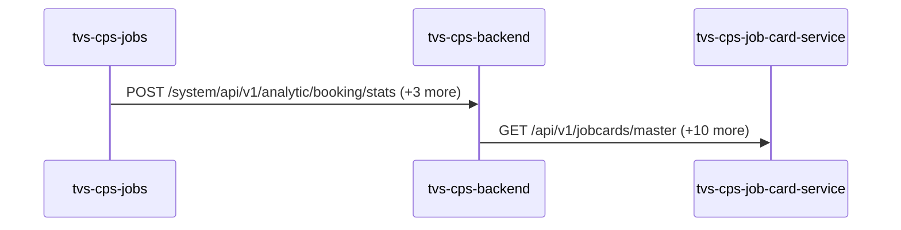

Steps:
| # | From | To | Via | Data (schema names) | Sync/Async | Confidence |
|---|---|---|---|---|---|---|
| 1 | tvs-cps-jobs | tvs-cps-backend | POST /system/api/v1/analytic/booking/stats, POST /system/api/v1/analytics-dashboard/indicators/calculate, POST /system/api/v1/appointments/auto-close (+1 more) | APIResponse<map<string,object>>, AnalyticsDto, AnalyticsRequestDTO | sync | high |
| 2 | tvs-cps-backend | tvs-cps-job-card-service | GET /api/v1/jobcards/master, POST /api/v1/jobcards, POST /api/v1/jobcards/analytics/stats (+8 more) | APIResponse<AnalyticsResponseDTO[]>, APIResponse<JobCardMasterDataResponseDTO>, APIResponse<JobcardCreateResponseDTO>, APIResponse<JobcardDashboardResponseDTO>, APIResponse<JobcardDownloadDTO> (+12 more) | sync | high |

Data touched: tvs-cps-backend: postgres, postgres:nmazcpsdbsdev01-cmn-postgres-uks.postgres.database.azure.com:nmazcpsdbdev01-cps; tvs-cps-job-card-service: postgres:nmazcpsdbsdev01-cmn-postgres-uks.postgres.database.azure.com:nmazcpsdbdev01-jobcard

Failure points: hop 1 tvs-cps-jobs → tvs-cps-backend: criticality hard; hop 2 tvs-cps-backend → tvs-cps-job-card-service: criticality hard

Evidence:
- hop 1 (tvs-cps-jobs → tvs-cps-backend): `TVS-CPS-BACKEND/bff-service/src/main/java/com/tvsm/bff/controller/AnalyticsController.java:23`, `TVS-CPS-JOBS/src/main/java/com/tvsm/jobs/service/AnalyticsService.java:32`, `TVS-CPS-JOBS/src/main/java/com/tvsm/jobs/service/RestCallService.java:50` (+4 more)
- hop 2 (tvs-cps-backend → tvs-cps-job-card-service): `TVS-CPS-BACKEND/bff-service/src/main/java/com/tvsm/bff/client/JobCardClient.java:106`, `TVS-CPS-JOB-CARD-SERVICE/src/main/java/com/tvsm/jobcard/controller/JobcardController.java:36`, `TVS-CPS-BACKEND/bff-service/src/main/java/com/tvsm/bff/controller/JobcardBFFController.java:131` (+15 more)

## Flow: tvs-cps-portal--external-salesforce-59d84e
Summary: Starting at `tvs-cps-portal` (user action in tvs-cps-portal (frontend)), the flow passes through `tvs-cps-backend`, `lms`, `lms-process`, `lms-crm` and ends at `external:salesforce`, using 3 sync HTTP hop(s) and 2 async event hop(s); tvs-cps-backend role: participant; confidence medium.

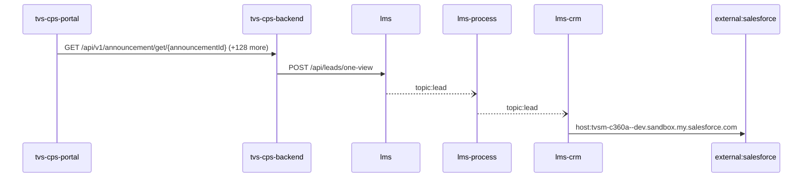

Steps:
| # | From | To | Via | Data (schema names) | Sync/Async | Confidence |
|---|---|---|---|---|---|---|
| 1 | tvs-cps-portal | tvs-cps-backend | GET /api/v1/announcement/get/{announcementId}, GET /api/v1/announcement/user/banners, GET /api/v1/appointments/{appointmentId} (+126 more) | APIResponse<AnnouncementResponseDto>, APIResponse<AnnouncementResponseDto[]>, APIResponse<AppointmentCountResponseDTO>, APIResponse<AppointmentDashboardResponseDTO>, APIResponse<AppointmentDetailResponseDTO> (+105 more) | sync | medium |
| 2 | tvs-cps-backend | lms | POST /api/leads/one-view | LeadOneViewRequest | sync | medium |
| 3 | lms | lms-process | topic:lead | Unknown | async | medium |
| 4 | lms-process | lms-crm | topic:lead | Unknown | async | medium |
| 5 | lms-crm | external:salesforce | host:tvsm-c360a--dev.sandbox.my.salesforce.com | Unknown | sync | high |

Data touched: tvs-cps-backend: postgres, postgres:nmazcpsdbsdev01-cmn-postgres-uks.postgres.database.azure.com:nmazcpsdbdev01-cps; lms: mssql, mssql:icubemobappsqlstg.database.windows.net:tazlmssqldbdev01; lms-process: mssql; lms-crm: mssql

Failure points: hop 1 tvs-cps-portal → tvs-cps-backend: criticality hard; hop 2 tvs-cps-backend → lms: criticality hard; hop 3 lms → lms-process: criticality async; hop 4 lms-process → lms-crm: criticality async; hop 5 lms-crm → external:salesforce: criticality hard

Evidence:
- hop 1 (tvs-cps-portal → tvs-cps-backend): `TVS-CPS-BACKEND/announcement-service/src/main/java/com/tvsm/announcement/controller/AnnouncementController.java:31`, `TVS-CPS-PORTAL/channel-partner-system/src/services/notification.service.ts:140`, `TVS-CPS-PORTAL/channel-partner-system/src/services/notification.service.ts:144` (+194 more)
- hop 2 (tvs-cps-backend → lms): `TVS-CPS-BACKEND/bff-service/src/main/java/com/tvsm/bff/client/ServiceReminderClient.java:209`, `lms/leadLogs/Controllers/LeadGetController.cs:90`
- hop 3 (lms → lms-process): `lms/leadLogs/Services/LeadDispatchService.cs:21`, `lms_process/processLeadService/Const/Constants.cs:10`, `lms_process/processLeadService/ListenerService/QueueConsumer.cs:36`
- hop 4 (lms-process → lms-crm): `lms_crm/ListenerService/CrmListenerService.cs:44`, `lms_crm/Utils/Constants.cs:16`, `lms_process/processLeadService/Const/Constants.cs:6` (+1 more)
- hop 5 (lms-crm → external:salesforce): `lms_crm/appsettings.Development.json:16`, `lms_crm/appsettings.Production.json:17`, `lms_crm/appsettings.Uat.json:17`

## Flow: tvs-cps-portal--external-salesforce-af08bd
Summary: Starting at `tvs-cps-portal` (user action in tvs-cps-portal (frontend)), the flow passes through `tvs-cps-backend`, `lms`, `lms-ems`, `lms-crm` and ends at `external:salesforce`, using 3 sync HTTP hop(s) and 2 async event hop(s); tvs-cps-backend role: participant; confidence medium.

```mermaid
sequenceDiagram
  participant tvs_cps_portal as tvs-cps-portal
  participant tvs_cps_backend as tvs-cps-backend
  participant lms as lms
  participant lms_ems as lms-ems
  participant lms_crm as lms-crm
  participant external_salesforce as external:salesforce
  tvs_cps_portal->>tvs_cps_backend: GET /api/v1/announcement/get/{announcementId} (+128 more)
  tvs_cps_backend->>lms: POST /api/leads/one-view
  lms--)lms_ems: topic:lead
  lms_ems--)lms_crm: topic:lead
  lms_crm->>external_salesforce: host:tvsm-c360a--dev.sandbox.my.salesforce.com
```

Steps:
| # | From | To | Via | Data (schema names) | Sync/Async | Confidence |
|---|---|---|---|---|---|---|
| 1 | tvs-cps-portal | tvs-cps-backend | GET /api/v1/announcement/get/{announcementId}, GET /api/v1/announcement/user/banners, GET /api/v1/appointments/{appointmentId} (+126 more) | APIResponse<AnnouncementResponseDto>, APIResponse<AnnouncementResponseDto[]>, APIResponse<AppointmentCountResponseDTO>, APIResponse<AppointmentDashboardResponseDTO>, APIResponse<AppointmentDetailResponseDTO> (+105 more) | sync | medium |
| 2 | tvs-cps-backend | lms | POST /api/leads/one-view | LeadOneViewRequest | sync | medium |
| 3 | lms | lms-ems | topic:lead | Unknown | async | medium |
| 4 | lms-ems | lms-crm | topic:lead | Unknown | async | medium |
| 5 | lms-crm | external:salesforce | host:tvsm-c360a--dev.sandbox.my.salesforce.com | Unknown | sync | high |

Data touched: tvs-cps-backend: postgres, postgres:nmazcpsdbsdev01-cmn-postgres-uks.postgres.database.azure.com:nmazcpsdbdev01-cps; lms: mssql, mssql:icubemobappsqlstg.database.windows.net:tazlmssqldbdev01; lms-ems: mssql; lms-crm: mssql

Failure points: hop 1 tvs-cps-portal → tvs-cps-backend: criticality hard; hop 2 tvs-cps-backend → lms: criticality hard; hop 3 lms → lms-ems: criticality async; hop 4 lms-ems → lms-crm: criticality async; hop 5 lms-crm → external:salesforce: criticality hard

Evidence:
- hop 1 (tvs-cps-portal → tvs-cps-backend): `TVS-CPS-BACKEND/announcement-service/src/main/java/com/tvsm/announcement/controller/AnnouncementController.java:31`, `TVS-CPS-PORTAL/channel-partner-system/src/services/notification.service.ts:140`, `TVS-CPS-PORTAL/channel-partner-system/src/services/notification.service.ts:144` (+194 more)
- hop 2 (tvs-cps-backend → lms): `TVS-CPS-BACKEND/bff-service/src/main/java/com/tvsm/bff/client/ServiceReminderClient.java:209`, `lms/leadLogs/Controllers/LeadGetController.cs:90`
- hop 3 (lms → lms-ems): `lms/leadLogs/Services/LeadDispatchService.cs:21`, `lms_ems/emsService/Const/Constants.cs:14`, `lms_ems/emsService/ListenerService/EmsListenerService.cs:43`
- hop 4 (lms-ems → lms-crm): `lms_crm/ListenerService/CrmListenerService.cs:44`, `lms_crm/Utils/Constants.cs:16`, `lms_ems/emsService/Const/Constants.cs:13` (+1 more)
- hop 5 (lms-crm → external:salesforce): `lms_crm/appsettings.Development.json:16`, `lms_crm/appsettings.Production.json:17`, `lms_crm/appsettings.Uat.json:17`

## Flow: tvs-cps-portal--lms-crm-27db64
Summary: Starting at `tvs-cps-portal` (user action in tvs-cps-portal (frontend)), the flow passes through `tvs-cps-backend`, `lms`, `lms-process`, `lms-ems` and ends at `lms-crm`, using 2 sync HTTP hop(s) and 3 async event hop(s); tvs-cps-backend role: participant; confidence medium; truncated at the depth cap.

```mermaid
sequenceDiagram
  participant tvs_cps_portal as tvs-cps-portal
  participant tvs_cps_backend as tvs-cps-backend
  participant lms as lms
  participant lms_process as lms-process
  participant lms_ems as lms-ems
  participant lms_crm as lms-crm
  tvs_cps_portal->>tvs_cps_backend: GET /api/v1/announcement/get/{announcementId} (+128 more)
  tvs_cps_backend->>lms: POST /api/leads/one-view
  lms--)lms_process: topic:lead
  lms_process--)lms_ems: topic:lead
  lms_ems--)lms_crm: topic:lead
```

Steps:
| # | From | To | Via | Data (schema names) | Sync/Async | Confidence |
|---|---|---|---|---|---|---|
| 1 | tvs-cps-portal | tvs-cps-backend | GET /api/v1/announcement/get/{announcementId}, GET /api/v1/announcement/user/banners, GET /api/v1/appointments/{appointmentId} (+126 more) | APIResponse<AnnouncementResponseDto>, APIResponse<AnnouncementResponseDto[]>, APIResponse<AppointmentCountResponseDTO>, APIResponse<AppointmentDashboardResponseDTO>, APIResponse<AppointmentDetailResponseDTO> (+105 more) | sync | medium |
| 2 | tvs-cps-backend | lms | POST /api/leads/one-view | LeadOneViewRequest | sync | medium |
| 3 | lms | lms-process | topic:lead | Unknown | async | medium |
| 4 | lms-process | lms-ems | topic:lead | Unknown | async | medium |
| 5 | lms-ems | lms-crm | topic:lead | Unknown | async | medium |

Data touched: tvs-cps-backend: postgres, postgres:nmazcpsdbsdev01-cmn-postgres-uks.postgres.database.azure.com:nmazcpsdbdev01-cps; lms: mssql, mssql:icubemobappsqlstg.database.windows.net:tazlmssqldbdev01; lms-process: mssql; lms-ems: mssql; lms-crm: mssql

Failure points: hop 1 tvs-cps-portal → tvs-cps-backend: criticality hard; hop 2 tvs-cps-backend → lms: criticality hard; hop 3 lms → lms-process: criticality async; hop 4 lms-process → lms-ems: criticality async; hop 5 lms-ems → lms-crm: criticality async

Evidence:
- hop 1 (tvs-cps-portal → tvs-cps-backend): `TVS-CPS-BACKEND/announcement-service/src/main/java/com/tvsm/announcement/controller/AnnouncementController.java:31`, `TVS-CPS-PORTAL/channel-partner-system/src/services/notification.service.ts:140`, `TVS-CPS-PORTAL/channel-partner-system/src/services/notification.service.ts:144` (+194 more)
- hop 2 (tvs-cps-backend → lms): `TVS-CPS-BACKEND/bff-service/src/main/java/com/tvsm/bff/client/ServiceReminderClient.java:209`, `lms/leadLogs/Controllers/LeadGetController.cs:90`
- hop 3 (lms → lms-process): `lms/leadLogs/Services/LeadDispatchService.cs:21`, `lms_process/processLeadService/Const/Constants.cs:10`, `lms_process/processLeadService/ListenerService/QueueConsumer.cs:36`
- hop 4 (lms-process → lms-ems): `lms_ems/emsService/Const/Constants.cs:14`, `lms_ems/emsService/ListenerService/EmsListenerService.cs:43`, `lms_process/processLeadService/Const/Constants.cs:6` (+1 more)
- hop 5 (lms-ems → lms-crm): `lms_crm/ListenerService/CrmListenerService.cs:44`, `lms_crm/Utils/Constants.cs:16`, `lms_ems/emsService/Const/Constants.cs:13` (+1 more)

## Flow: tvs-cps-portal--lms-crm-f79cdd
Summary: Starting at `tvs-cps-portal` (user action in tvs-cps-portal (frontend)), the flow passes through `tvs-cps-backend`, `lms`, `lms-ems`, `lms-process` and ends at `lms-crm`, using 2 sync HTTP hop(s) and 3 async event hop(s); tvs-cps-backend role: participant; confidence medium; truncated at the depth cap.

```mermaid
sequenceDiagram
  participant tvs_cps_portal as tvs-cps-portal
  participant tvs_cps_backend as tvs-cps-backend
  participant lms as lms
  participant lms_ems as lms-ems
  participant lms_process as lms-process
  participant lms_crm as lms-crm
  tvs_cps_portal->>tvs_cps_backend: GET /api/v1/announcement/get/{announcementId} (+128 more)
  tvs_cps_backend->>lms: POST /api/leads/one-view
  lms--)lms_ems: topic:lead
  lms_ems--)lms_process: topic:lead
  lms_process--)lms_crm: topic:lead
```

Steps:
| # | From | To | Via | Data (schema names) | Sync/Async | Confidence |
|---|---|---|---|---|---|---|
| 1 | tvs-cps-portal | tvs-cps-backend | GET /api/v1/announcement/get/{announcementId}, GET /api/v1/announcement/user/banners, GET /api/v1/appointments/{appointmentId} (+126 more) | APIResponse<AnnouncementResponseDto>, APIResponse<AnnouncementResponseDto[]>, APIResponse<AppointmentCountResponseDTO>, APIResponse<AppointmentDashboardResponseDTO>, APIResponse<AppointmentDetailResponseDTO> (+105 more) | sync | medium |
| 2 | tvs-cps-backend | lms | POST /api/leads/one-view | LeadOneViewRequest | sync | medium |
| 3 | lms | lms-ems | topic:lead | Unknown | async | medium |
| 4 | lms-ems | lms-process | topic:lead | Unknown | async | medium |
| 5 | lms-process | lms-crm | topic:lead | Unknown | async | medium |

Data touched: tvs-cps-backend: postgres, postgres:nmazcpsdbsdev01-cmn-postgres-uks.postgres.database.azure.com:nmazcpsdbdev01-cps; lms: mssql, mssql:icubemobappsqlstg.database.windows.net:tazlmssqldbdev01; lms-ems: mssql; lms-process: mssql; lms-crm: mssql

Failure points: hop 1 tvs-cps-portal → tvs-cps-backend: criticality hard; hop 2 tvs-cps-backend → lms: criticality hard; hop 3 lms → lms-ems: criticality async; hop 4 lms-ems → lms-process: criticality async; hop 5 lms-process → lms-crm: criticality async

Evidence:
- hop 1 (tvs-cps-portal → tvs-cps-backend): `TVS-CPS-BACKEND/announcement-service/src/main/java/com/tvsm/announcement/controller/AnnouncementController.java:31`, `TVS-CPS-PORTAL/channel-partner-system/src/services/notification.service.ts:140`, `TVS-CPS-PORTAL/channel-partner-system/src/services/notification.service.ts:144` (+194 more)
- hop 2 (tvs-cps-backend → lms): `TVS-CPS-BACKEND/bff-service/src/main/java/com/tvsm/bff/client/ServiceReminderClient.java:209`, `lms/leadLogs/Controllers/LeadGetController.cs:90`
- hop 3 (lms → lms-ems): `lms/leadLogs/Services/LeadDispatchService.cs:21`, `lms_ems/emsService/Const/Constants.cs:14`, `lms_ems/emsService/ListenerService/EmsListenerService.cs:43`
- hop 4 (lms-ems → lms-process): `lms_ems/emsService/Const/Constants.cs:13`, `lms_ems/emsService/Services/EmsService.cs:191`, `lms_process/processLeadService/Const/Constants.cs:10` (+1 more)
- hop 5 (lms-process → lms-crm): `lms_crm/ListenerService/CrmListenerService.cs:44`, `lms_crm/Utils/Constants.cs:16`, `lms_process/processLeadService/Const/Constants.cs:6` (+1 more)

## Flow: tvs-cps-portal--lms-tvs-credit-dc3a7e
Summary: Starting at `tvs-cps-portal` (user action in tvs-cps-portal (frontend)), the flow passes through `tvs-cps-backend`, `lms`, `lms-ems`, `lms-process` and ends at `lms-tvs-credit`, using 2 sync HTTP hop(s) and 3 async event hop(s); tvs-cps-backend role: participant; confidence medium.

```mermaid
sequenceDiagram
  participant tvs_cps_portal as tvs-cps-portal
  participant tvs_cps_backend as tvs-cps-backend
  participant lms as lms
  participant lms_ems as lms-ems
  participant lms_process as lms-process
  participant lms_tvs_credit as lms-tvs-credit
  tvs_cps_portal->>tvs_cps_backend: GET /api/v1/announcement/get/{announcementId} (+128 more)
  tvs_cps_backend->>lms: POST /api/leads/one-view
  lms--)lms_ems: topic:lead
  lms_ems--)lms_process: topic:lead
  lms_process--)lms_tvs_credit: topic:lead
```

Steps:
| # | From | To | Via | Data (schema names) | Sync/Async | Confidence |
|---|---|---|---|---|---|---|
| 1 | tvs-cps-portal | tvs-cps-backend | GET /api/v1/announcement/get/{announcementId}, GET /api/v1/announcement/user/banners, GET /api/v1/appointments/{appointmentId} (+126 more) | APIResponse<AnnouncementResponseDto>, APIResponse<AnnouncementResponseDto[]>, APIResponse<AppointmentCountResponseDTO>, APIResponse<AppointmentDashboardResponseDTO>, APIResponse<AppointmentDetailResponseDTO> (+105 more) | sync | medium |
| 2 | tvs-cps-backend | lms | POST /api/leads/one-view | LeadOneViewRequest | sync | medium |
| 3 | lms | lms-ems | topic:lead | Unknown | async | medium |
| 4 | lms-ems | lms-process | topic:lead | Unknown | async | medium |
| 5 | lms-process | lms-tvs-credit | topic:lead | Unknown | async | medium |

Data touched: tvs-cps-backend: postgres, postgres:nmazcpsdbsdev01-cmn-postgres-uks.postgres.database.azure.com:nmazcpsdbdev01-cps; lms: mssql, mssql:icubemobappsqlstg.database.windows.net:tazlmssqldbdev01; lms-ems: mssql; lms-process: mssql; lms-tvs-credit: mssql

Failure points: hop 1 tvs-cps-portal → tvs-cps-backend: criticality hard; hop 2 tvs-cps-backend → lms: criticality hard; hop 3 lms → lms-ems: criticality async; hop 4 lms-ems → lms-process: criticality async; hop 5 lms-process → lms-tvs-credit: criticality async

Evidence:
- hop 1 (tvs-cps-portal → tvs-cps-backend): `TVS-CPS-BACKEND/announcement-service/src/main/java/com/tvsm/announcement/controller/AnnouncementController.java:31`, `TVS-CPS-PORTAL/channel-partner-system/src/services/notification.service.ts:140`, `TVS-CPS-PORTAL/channel-partner-system/src/services/notification.service.ts:144` (+194 more)
- hop 2 (tvs-cps-backend → lms): `TVS-CPS-BACKEND/bff-service/src/main/java/com/tvsm/bff/client/ServiceReminderClient.java:209`, `lms/leadLogs/Controllers/LeadGetController.cs:90`
- hop 3 (lms → lms-ems): `lms/leadLogs/Services/LeadDispatchService.cs:21`, `lms_ems/emsService/Const/Constants.cs:14`, `lms_ems/emsService/ListenerService/EmsListenerService.cs:43`
- hop 4 (lms-ems → lms-process): `lms_ems/emsService/Const/Constants.cs:13`, `lms_ems/emsService/Services/EmsService.cs:191`, `lms_process/processLeadService/Const/Constants.cs:10` (+1 more)
- hop 5 (lms-process → lms-tvs-credit): `lms_process/processLeadService/Const/Constants.cs:6`, `lms_process/processLeadService/Services/TwoWheelerService.cs:97`, `lms_tvs_credit/lms_tvs_credit/ListenerService/TvscreditListenerService.cs:46` (+1 more)

## Flow: tvs-cps-portal--lms-tvs-credit-deda48
Summary: Starting at `tvs-cps-portal` (user action in tvs-cps-portal (frontend)), the flow passes through `tvs-cps-backend`, `lms`, `lms-process`, `lms-ems` and ends at `lms-tvs-credit`, using 2 sync HTTP hop(s) and 3 async event hop(s); tvs-cps-backend role: participant; confidence medium.

```mermaid
sequenceDiagram
  participant tvs_cps_portal as tvs-cps-portal
  participant tvs_cps_backend as tvs-cps-backend
  participant lms as lms
  participant lms_process as lms-process
  participant lms_ems as lms-ems
  participant lms_tvs_credit as lms-tvs-credit
  tvs_cps_portal->>tvs_cps_backend: GET /api/v1/announcement/get/{announcementId} (+128 more)
  tvs_cps_backend->>lms: POST /api/leads/one-view
  lms--)lms_process: topic:lead
  lms_process--)lms_ems: topic:lead
  lms_ems--)lms_tvs_credit: topic:lead
```

Steps:
| # | From | To | Via | Data (schema names) | Sync/Async | Confidence |
|---|---|---|---|---|---|---|
| 1 | tvs-cps-portal | tvs-cps-backend | GET /api/v1/announcement/get/{announcementId}, GET /api/v1/announcement/user/banners, GET /api/v1/appointments/{appointmentId} (+126 more) | APIResponse<AnnouncementResponseDto>, APIResponse<AnnouncementResponseDto[]>, APIResponse<AppointmentCountResponseDTO>, APIResponse<AppointmentDashboardResponseDTO>, APIResponse<AppointmentDetailResponseDTO> (+105 more) | sync | medium |
| 2 | tvs-cps-backend | lms | POST /api/leads/one-view | LeadOneViewRequest | sync | medium |
| 3 | lms | lms-process | topic:lead | Unknown | async | medium |
| 4 | lms-process | lms-ems | topic:lead | Unknown | async | medium |
| 5 | lms-ems | lms-tvs-credit | topic:lead | Unknown | async | medium |

Data touched: tvs-cps-backend: postgres, postgres:nmazcpsdbsdev01-cmn-postgres-uks.postgres.database.azure.com:nmazcpsdbdev01-cps; lms: mssql, mssql:icubemobappsqlstg.database.windows.net:tazlmssqldbdev01; lms-process: mssql; lms-ems: mssql; lms-tvs-credit: mssql

Failure points: hop 1 tvs-cps-portal → tvs-cps-backend: criticality hard; hop 2 tvs-cps-backend → lms: criticality hard; hop 3 lms → lms-process: criticality async; hop 4 lms-process → lms-ems: criticality async; hop 5 lms-ems → lms-tvs-credit: criticality async

Evidence:
- hop 1 (tvs-cps-portal → tvs-cps-backend): `TVS-CPS-BACKEND/announcement-service/src/main/java/com/tvsm/announcement/controller/AnnouncementController.java:31`, `TVS-CPS-PORTAL/channel-partner-system/src/services/notification.service.ts:140`, `TVS-CPS-PORTAL/channel-partner-system/src/services/notification.service.ts:144` (+194 more)
- hop 2 (tvs-cps-backend → lms): `TVS-CPS-BACKEND/bff-service/src/main/java/com/tvsm/bff/client/ServiceReminderClient.java:209`, `lms/leadLogs/Controllers/LeadGetController.cs:90`
- hop 3 (lms → lms-process): `lms/leadLogs/Services/LeadDispatchService.cs:21`, `lms_process/processLeadService/Const/Constants.cs:10`, `lms_process/processLeadService/ListenerService/QueueConsumer.cs:36`
- hop 4 (lms-process → lms-ems): `lms_ems/emsService/Const/Constants.cs:14`, `lms_ems/emsService/ListenerService/EmsListenerService.cs:43`, `lms_process/processLeadService/Const/Constants.cs:6` (+1 more)
- hop 5 (lms-ems → lms-tvs-credit): `lms_ems/emsService/Const/Constants.cs:13`, `lms_ems/emsService/Services/EmsService.cs:191`, `lms_tvs_credit/lms_tvs_credit/ListenerService/TvscreditListenerService.cs:46` (+1 more)
